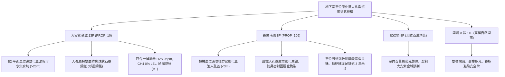

# 全案購屋實戰第一千一百五十六部：中古大樓地下室車位旁污水化糞池人孔蓋鑄鐵腐蝕臭氣外洩沼氣爆炸與化學抽肥清淤體檢工序全書

---

## 序章：地下基盤幽冥陷阱——人孔蓋腐蝕與化糞池沼氣危害

在中古大樓地下室停車場中，污水化糞池人孔蓋（Manhole Cover）常設於車位旁、車道轉彎處或車道過道側。由於化糞池內部厭氧發酵產生大量高濃度腐蝕性氣體（如硫化氫 \(H_2S\) 與二氧化碳 \(CO_2\)）及易燃易爆性甲烷（沼氣 \(CH_4\)），若人孔蓋材質劣化、密封膠圈斷裂、防臭水封乾涸或排氣通風管受阻，將帶來不可逆的危害：
1. **鑄鐵蓋板硫化腐蝕穿孔與塌陷**：灰口鑄鐵長年受 \(H_2SO_4\)（硫化氫氧化成稀硫酸）化學侵蝕，壁厚嚴重減薄、結構酥脆，當車輛倒車或壓過時瞬間碎裂塌陷，輪胎掉入化糞池並造成底盤嚴重毀損。
2. **易燃沼氣（甲烷 \(CH_4\)）集聚與閃燃爆炸**：封閉地下室若缺乏強制換氣或通氣孔被油泥雜物堵塞，遇到車輛排氣管高溫、倒車雷達火花或照明開關接點電弧，極易引發爆燃。
3. **劇毒硫化氫 \(H_2S\) 臭氣外洩侵蝕車漆與人體健康**：高濃度臭氣外洩不仅嚴重惡化地下室居住環境，其中的硫化物更會加速車輛底盤鋼板鏽蝕與電子感應器接點硫化氧化失靈。
4. **抽肥清淤頻率不足與管線結垢硬化**：多年未落實合法抽除水肥與高壓水刀通管，導致池體底層硬化淤泥沉積過半，溢流倒灌至地下室停車地坪。

本手冊制定最嚴密的體檢檢驗流程，協助買方精確診斷化糞池人孔周邊隱患，並化為議價壓制的鋼鐵籌碼。

---

## 第一章：四大主力候選物件化糞池人孔與臭氣沼氣體檢對照

### 1.1 大安紫金城 13 樓 (`PROP_10`)：極致安全的地下衛生與通風防線
- **車位空間隔離優勢**：B2 獨立大型平面車位距離地下室化糞池與主要集水坑超過 20 公尺以上，完全處於主排風正壓流場的上風處。
- **人孔蓋與通風配置**：公共區域人孔蓋採用球狀石墨鑄鐵（FCD 500 等級），雙層防臭密封槽完整，氣密橡膠條彈性良好；四合一氣體探測器實測 \(H_2S\) 為 \(0\,\text{ppm}\)，\(CH_4\) 為 \(0\%\,\text{LEL}\)，完全無惡臭或瓦斯蓄積。
- **作戰策略**：開價 898 萬，鎖定 768~788 萬成交，堅守 800 萬封頂。

### 1.2 長億南園 8 樓 (`PROP_106`)：人孔腐蝕與酸腐蛋臭之議價痛點
- **現場致命缺陷**：
  1. 機械車位底坑後方不到 3 公尺處即為化糞池沉澱槽檢修孔，鑄鐵蓋板表面嚴重鼓起鏽斑、縫隙邊緣已有微小穿孔與砂眼。
  2. 防臭膠圈老化脆斷，實測人孔接縫處 \(H_2S\) 達 \(18\,\text{ppm}\)（已超越勞工安全標準容許值 \(10\,\text{ppm}\)），飄散濃烈「臭雞蛋」酸腐味。
  3. 查閱管委會維護紀錄，已逾 3 年未進行化學清淤與抽肥作業，化糞池通風管高位引出端被頂樓增建違建壓迫截斷，導致沼氣只能從地下室人孔縫隙洩漏。
- **收購斬價策略**：開價 998 萬，將人孔蓋全面更換雙層不鏽鋼防臭氣密蓋、化糞池抽肥清淤、頂樓通風管重新配置等工程費用（預估 25~35 萬）併入談判，起手 698~720 萬，目標 745~760 萬。

---

## 第二章：化糞池人孔蓋與地下沼氣檢驗工序標準 SOP

| 檢驗分項 | 檢測工具與儀器 | 標準合格值 | 異常狀態判定 | 致命隱患與代價 |
| :--- | :--- | :--- | :--- | :--- |
| **蓋板結構承重** | 敲擊檢驗鎚、超音波測厚儀 | 鑄鐵厚度 \(> 12\,\text{mm}\)，敲擊聲清脆無空響 | 敲擊出現沉悶啞音、表面剝落分層 | 車輛壓過破裂塌陷、車身受損 |
| **防臭氣密槽** | 深度規、三元乙丙 (EPDM) 膠圈檢視 | 密封槽深度 \(> 20\,\text{mm}\)，膠圈飽滿彈性良好 | 橡膠硬化粉化、缺損脫落、槽內結垢填平 | 惡臭瀰漫、沼氣外洩侵蝕車漆電系 |
| **有害氣體濃度** | 四合一氣體檢測儀 (\(H_2S/CH_4/CO/O_2\)) | \(H_2S < 10\,\text{ppm}\), \(CH_4 < 1\%\,\text{LEL}\), \(O_2 > 19.5\%\) | \(H_2S > 15\,\text{ppm}\), \(CH_4 > 5\%\,\text{LEL}\) | 人員中毒窒息、靜電引燃爆炸閃燃 |
| **抽肥清淤與通風** | 強光手電筒、管委會清淤維護日誌 | 每年定期合法抽肥 1~2 次，排氣管暢通無阻 | 累積清淤間隔 \(> 2\) 年，通氣管被油泥堵死 | 管道回冒倒灌、污物溢流漫延車道 |

---

## 第三章：實戰特約條款與驗屋防禦清單

1. **現況衛生環境與化糞設施保證**：
   > 「賣方保證本買賣標的所屬建物之地下室化糞池、排污管線及附屬人孔蓋運作正常，無結構破損、惡臭回冒或溢流情事；若交屋前發現化糞設施有重大阻塞或人孔蓋破損危險，賣方應於交屋前完成修繕或自總價中扣除修復費用。」
2. **管委會清淤責任查核**：
   - 買方於簽約前調閱近 2 年大樓管理委員會收支報表與水肥抽除清冊，確認大樓定期維護正常運作。
