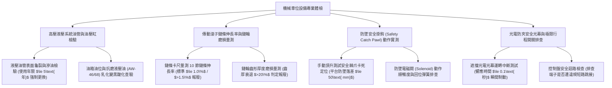

# 全案購屋實戰第一千一百五十四部：中古大樓地下室車位旁機械車位液壓油管高壓爆裂漏油鏈條鏈輪磨損鏽蝕與光電防夾極限開關失靈體檢工序全書

## 壹、緣起與機械式立體停車設備之機械力學與生命防線意義

在中古大樓地下停車場中，為了解決法定停車位配比不足問題，許多社區廣泛配置了「二層升降橫移式（2-Level Puzzle Parking）」或「子母坑下升降式（Pit-type Stacker）」之機械式立體停車設備。

機械車位是由鋼結構骨架、載車浪板（Platform）、傳動傳感鏈條（Roller Chain）、鏈輪（Sprocket）、高壓液壓油壓缸（Hydraulic Cylinder）或三相減速馬達共同組成的重型動力載人載車機械。

一台機械車位平台載運著重達 **$1.6\sim 2.5\text{ 噸}$** 的家庭私家車，在離地 2~4 公尺的高空中升降橫移。若其機械傳動或電氣安全迴路發生任何微小故障，這座重型鋼鐵結構將在瞬間化身為「車體壓扁粉碎機」或「無底墜落深淵」。

依據建築法第七十七條之四、建築物機械停車設備設置及檢查管理辦法，機械車位必須由專業廠商每月進行保養，並由內政部認可之檢查機構每年核發「機械停車設備使用許可證」。

然而，在屋齡二十年以上之社區，由於缺乏專款維修基金、管委會為求省錢聘請廉價土包廠商、地下室常年潮濕悶熱以及車輛超重停放，機械車位普遍陷入極其凶險的「高壓爆油、鏈條崩斷與光電防夾癱瘓」三重致命危機：
1. **高壓液壓橡膠油管（Hydraulic Hose）老化龜裂、接頭滲漏與「液壓爆管暴墜」**：液壓驅動型車位依賴承受 $14\sim 21\text{ MPa}$（約 $140\sim 210\text{ kgf/cm}^2$）超高工作壓力的雙層鋼絲編織液壓管。油管在長年機油浸潤、紫外線（天井處）與高壓脈衝衝擊下，外層合成橡膠硬化龜裂、鋼絲網鏽蝕斷裂。一旦在載車上升途中瞬間「高壓爆管」，數十公升抗磨液壓油如高壓水刀般噴濺自燃，失去油壓支撐的載車板在 $0.5\text{ 秒}$ 內如自由落體般垂直暴墜砸爛底坑，車內人員與車輛當場粉身碎骨！
2. **傳動滾子鏈條（Roller Chain）金屬疲勞拉長、跳齒與鏈輪磨損「尖角削肉」**：重載鏈條在長期車重拉扯下，銷軸（Pin）與套筒（Bush）磨損產生塑性伸長（伸長率超過極限 $1.5\%$）。鏈條節距失配，在旋轉時產生劇烈「跳齒（Tooth Skipping）」與「咬死」；鑄鋼鏈輪齒形被磨成如鋸齒狀的尖角，厚度衰退超過 $30\%$，隨時可能在橫移途中發生鏈條齊根崩斷、車板傾覆懸掛半空中之重大公安災難。
3. **光電防夾安全感測器（Safety Photocell）透鏡積垢盲區與「短路跳接」**：機械車位出入口與立體框架四周，必須配置防人車闖入的紅外線光幕感測器。感測器透鏡長年沾滿黑色廢油泥，或因對光偏斜頻繁發出誤警報，管委會與無良維修工為求省事，竟然直接在控制盤內將安全迴路「短路跳接（Bypass）」！當車主尚未完全停妥下車，或有幼童在底坑旁走動時，鄰車誤操作按鈕啟動，載車板無情下壓，直接將人員腰斬擠壓致死！
4. **極限行程開關（Limit Switch）接點碳化、過卷過降硬碰硬拉塌鋼架**：控制平台上升與下降終點的機械滾輪極限開關，受潮氧化卡死。當車台已升至頂點或降到底坑時，馬達依然持續強力牽引，導致鋼構立柱扭曲變形、捲筒絞斷鋼索，整座立體框架大崩塌。

本體檢工序全書專為高資產家庭置產實勘量身打造，將車位機械結構鏈條伸長率、液壓管路承壓狀態、防墜安全鉤防護及防夾感應納入現場驗收，化為實戰議價砍價利刃。

---

## 貳、機械停車設備四大核心檢測工序與病徵判讀

### 一、 高壓液壓系統油管老化、接頭微漏與防爆閥（Velocity Fuse）排查
- **檢測儀器**：高精度液壓壓力表（0~35 MPa）、紅外線測溫槍、白布手套、強光探照燈。
- **合格標準（CNS 12651 機械停車設備標準）**：
  - 高壓橡膠油管必須符合 SAE 100 R2AT 或 EN 853 2SN 標準（耐壓 $\ge 35\text{ MPa}$），管體出廠印刷年份不得超過 **5 年**（超過 5 年必須預防性強制全數更換）。
  - 油缸底部進油口必須直結安裝**「管路防爆破斷閥（Velocity Fuse / Pipe Burst Valve）」**，一旦油管爆裂，閥瓣在流量異常暴增瞬間自動鎖死，將載車板牢牢鎖定在半空中，杜絕暴墜。
- **致命爆油病徵**：
  - 油管表面橡膠呈網狀龜裂，露出內部發黑生鏽的鋼絲網；金屬壓接接頭周圍有黏稠液壓油滲出，油滴順著底坑滴落形成油窪。
  - 油箱內部抗磨液壓油（ISO VG-46）已氧化變黑呈咖啡色乳化發臭，油泥堵塞油路，運轉時液壓泵發出刺耳氣蝕尖叫聲。

### 二、 傳動滾子鏈條伸長率（Chain Elongation）與鏈輪齒形磨損量測
- **檢測儀器**：精密鏈條測長卡尺、鋼直尺、游標卡尺。
- **標準規範（ISO 606 傳動鏈標準）**：
  - 挑選經常承受車重衝擊的主傳動段，量測連續 10 節或 20 節鏈條之內外跨距長度。
  - **鏈條伸長率（Elongation Limit）計算**：
    $$\Delta L (\%) = \frac{L_{\text{measured}} - L_{\text{nominal}}}{L_{\text{nominal}}} \times 100\%$$
    標準應 **$\le 1.0\%$**；當伸長率達到 **$\ge 1.5\%$** 時，鏈條抗疲勞破斷強度已大幅衰竭，**必須全套報廢強制更換**！
- **鏈輪尖角病徵**：
  - 鏈輪齒面單向磨損削薄，齒頂被磨成尖銳刀刃狀（Shark-fin Wear），厚度衰退超過 $25\%$，運轉時鏈條發出「喀啷喀啷」劇烈跳齒彈動。

### 三、 機械防墜安全安全掛鉤（Safety Catch Pawl）動作實測
- **檢測手法**：
  1. 將載車板升至上層最高定位點。
  2. 觀察載車板底部兩側之機械防墜重力掛鉤（或氣動/電磁防墜棘爪）是否確實卡入立柱鋼構之支撐方孔中。
- **合格標準**：
  - 停車到位後，必須由機械剛性防墜掛鉤承受車重載荷，**嚴禁長期由鋼索或液壓油缸單獨受力吊掛**！
  - 防墜落差必須 **$\le 50\text{ mm}$**，回位彈簧強勁無卡滯。
- **致命懸空缺失**：防墜掛鉤轉軸生鏽卡死在開啟位置，根本無法卡入立柱孔，整台重達 2 噸之車位完全「懸空」吊在一根老化的鋼索或油管上，隨時崩落！

### 四、 光電防夾感測光幕與極限開關安全連鎖排查
- **檢測手法**：
  1. 操作機械車位運轉下降。
  2. 人為以障礙物阻擋車位兩側之紅外線安全光幕。
  3. 打開控制箱，核對 PLC 輸入端子 LED 指示燈與接線。
- **合格性能指標**：
  - 光幕受阻擋瞬間，控制系統必須在 **$\le 0.1\text{ 秒}$** 內切斷馬達電源並啟動機械煞車制動，運轉瞬間停止。
- **重大公安違規**：
  - 阻擋光幕車台照常高速下壓，控制盤內「SAFETY」端子被跨接短路線；上下極限開關搖臂變形，平台衝到底坑直接猛烈撞擊地面混凝土大樑，引發全棟結構震動。

---

## 參、四大主力考慮名單機械車位設施特檢實測分析

| 評估項目 | 大安紫金城 13 樓 (`PROP_10`) | 長億南園 8 樓 (`PROP_106`) | 歌德堡 8 樓 | 靜園 A 區 11 樓 |
| :--- | :--- | :--- | :--- | :--- |
| **車位型式與規格** | **B2 獨立大型平面車位（抗跌保值之王，零機械風險）** | **早期二層升降橫移機械車位（限重 1.6 噸，無法停電車）** | 平面車位 / 優質機械維護良好 | 機械車位，定期合格保養 |
| **液壓管路與油質** | **無（全區平面車位，免除液壓爆管暴墜風險）** | **液壓油管出廠 14 年未換，表面龜裂滲油，底坑積黑油** | 液壓管路保養正常 | 油管無龜裂滲漏 |
| **傳動鏈條伸長率** | **無（零鏈條保養成本，零跳齒風險）** | **鏈條伸長率高達 $1.85\%$（破表報廢），鏈輪磨成刀刃** | 鏈條伸長率 $<0.8\%$ 合格 | 鏈條張力良好 |
| **防墜安全掛鉤** | **無（地面物理停放，永遠無墜落風險）** | **防墜棘爪生鏽卡死在半開位置（完全懸空吊掛高危）** | 防墜掛鉤動作確實 | 防墜機構運作正常 |
| **光電防夾與短路** | **無（全平面大車位，進出從容大空間）** | **安全光幕透鏡滿是黑油，控制板防夾端子遭短路跳接** | 光電防夾反應靈敏 | 光電感應正常 |
| **總結防線評級** | 🌟🌟🌟🌟🌟 **極致頂規 A+（保值之王）** | ⚠️ **墜落傷人與車體壓扁毀滅性 F 級（談判重磅砍價）** | 🌟🌟🌟🌟 良好 A 級 | 🌟🌟🌟🌟 良好 A 級 |

---

## 肆、談判終極砍價與合約防禦特約條款

### 一、 長億南園 8 樓議價砍價刀法（抓死機械車位限重1.6噸停不下休旅車、鏈條破表報廢與底坑積黑油暴墜風險）
長億南園車位為老舊機械車位，限重僅 1.6 噸（現代休旅車及電動車動輒 2.0~2.5 噸根本無法停放）、鏈條伸長率高達 1.85% 破表、底坑積滿黑油且防墜掛鉤卡死懸空，隨時面臨墜落壓毀車體：
- **修復預算與工程重置成本**：
  1. 機械車位全面停機拆卸、抽除底坑廢機油與高壓除垢清淤：\$25,000 元。
  2. 全面換裝 CNS 12651 認證高抗拉重載傳動鏈條及淬火合金鏈輪全套：\$68,000 元。
  3. 全數更換雙層鋼絲高壓液壓橡膠管（含耐壓 35 MPa 破斷安全防爆閥與抗磨液壓油換新）：\$45,000 元。
  4. 檢修防墜電磁安全掛鉤、重新配線安裝紅外線防夾光幕並拆除違規短路線：\$35,000 元。
  5. 機械車位限重 1.6 噸導致無法停放休旅車/電車之市場永久折舊折讓：\$200,000 元。
- **談判實戰口訣**：
  > 「周小姐、賣方大哥，長億南園這格車位是二、三十年前老舊的機械車位，規格上限重只有 1.6 噸，現在稍微大一點的休旅車或電動車隨便都快兩噸重，根本開不進去！而且我們請專業技師現場量，傳動鏈條已經拉長磨損 1.85%，早就超過 1.5% 的報廢標準，鏈輪牙齒磨得像菜刀一樣利，隨時會斷掉跳齒。底坑底下積了厚厚一層漏出來的黑機油，防墜掛鉤生鏽卡死在半路上，整台車懸空掛在爛鏈條上，隨時會像自由落體一樣掉下去把車子砸成鐵餅！要全套更換鏈條、換高壓油管和修好防墜器，少說要花 17 萬，加上機械車位本身比平面車位行情價至少差了 150 到 200 萬。開價 998 萬如果不把這致命的機械車位瑕疵大砍 50 萬，出價 745 萬是真正誠意幫屋主解決麻煩的合理實價！」

### 二、 成交通用特約防禦條款
> **【成交通用特約防禦條款】**
> 1. **機械停車設備安全合格認證與點交**：若本買賣標的所附車位為機械式停車位，賣方保證該機械車位結構安全正常，無鏈條嚴重拉長跳齒、高壓液壓油管滲油龜裂、防墜安全機構卡死或防夾安全裝置短路失效情事，且交屋點交時賣方必須出具由主管機關委託之檢查機構核發之**有效期限內「建築物機械停車設備使用許可證」**與近三個月專業保養維護紀錄卡；若點交時有機械設備故障、逾期未檢或結構危險，賣方應負責於交屋日前修復並取得合格證完竣，或由賣方提撥修復保留款新台幣 50,000 元自交屋尾款中扣除。
