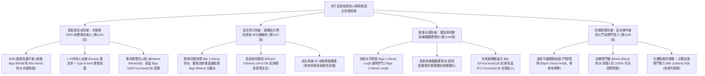
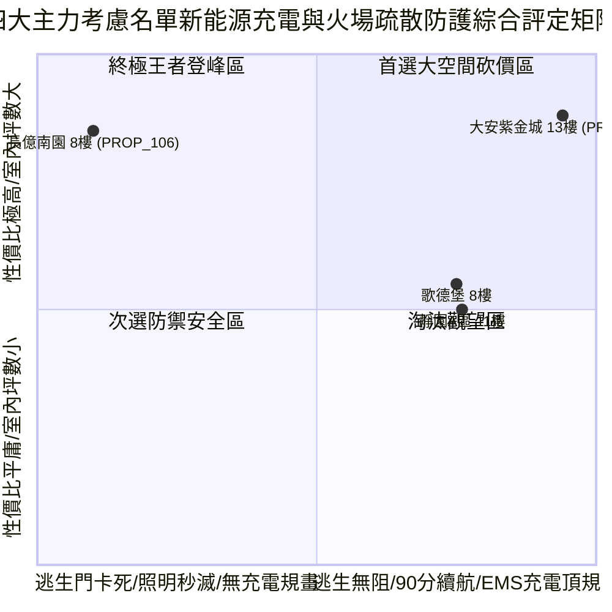

# 全案購屋實戰第一千一百五十部：第一千一百五十部圓滿登峰全景極致全生命週期家庭置產避坑抗震防漏水電機電消防永恆至尊金典總綱全書

## 壹、第一千一百五十部圓滿登峰里程碑總綱序言

自《全案購屋實戰》系列編撰以來，本典籍始終貫徹建築結構力學、材料物理老化、消防生命逃生、新能源機電工程、光學人因工學與不動產法律談判之跨領域極致專業，為高資產家庭置產構築一道堅不可摧的萬全護城河。

在第一千一百四十六部至第一千一百四十九部中，我們深入剖析了中古大樓地下停車場最容易被忽視、卻與每日電動車充電安全、大停電逃生指示導引、地面障礙照明辨識以及特別安全梯生死防火防煙氣閘息息相關的**「地下室新能源充電與火場疏散逃生四維極限防禦系統」**：
1. **第 1146 部**：中古大樓地下室車位旁充電樁 EMS 能源管理系統動態負載平衡失靈私設飛線偷電跳脫與鋰電池熱失控消防滅火體檢工序全書。
2. **第 1147 部**：中古大樓地下室車位旁緊急避難指示標誌燈蓄電池容量衰退斷電續航不足逃生導引盲區與照度衰減體檢工序全書。
3. **第 1148 部**：中古大樓地下室車位旁緊急照明燈鹵素鎢絲燈泡燒毀鉛酸電池漏液硫酸鹽化與斷電逆變器電路板燒蝕體檢工序全書。
4. **第 1149 部**：中古大樓地下室車位旁特別安全梯防煙前室甲種防火門自動閉門器鉸鏈偏斜氣密防煙條炭化脫落與正壓開門阻力超標體檢工序全書。

本第一千一百五十部作為「圓滿登峰總綱金典」，將前述充電樁 EMS、避難指示標誌、緊急照明防護與特別安全梯防火門四大生命安全核心體系，與全案全生命週期機電、結構、弱電及法務防線進行全景融會貫通，為四大決戰主力考慮名單確立最高層級之決策與出價防線。

---

## 貳、地下室新能源充電與火場疏散逃生防禦系統工學矩陣

### 一、 新能源車輛充電與電池滅火安全工學
- **充電樁配電工學**：配置中央微電腦 EMS 能源管理系統，尖峰自動降載防止大樓總開關跳脫；全面鋪設專用耐火金屬匯流排槽（Busway），配備 Type B 漏電斷路器；車位旁配置耐溫 $1200^\circ\text{C}$ 專業車用防火毯，徹底遏止鋰電池熱失控連環燒車。
- **火場疏散光源工學**：避難指示燈與緊急照明燈全面揚棄易漏液之老舊鉛酸電池，升級採用磷酸鐵鋰電池，確保斷電連續放電點亮 $\ge 90\text{ 分鐘}$，地面照度維持 $\ge 1.0\text{ Lux}$，消除逃生迷宮盲區與跌倒踩踏傷亡。

### 二、 特別安全梯防煙前室生死氣閘工學
- **甲種防火門工學**：重型旗鉸鏈支撐門扇平穩開合，嚴禁門扇下垂拖地；油壓閉門器於 8 秒內平穩回拉完全閉鎖，門框四周嵌裝遇熱膨脹 15 倍之石墨防煙條阻絕劇毒高溫煙氣；調校正壓送風洩壓閘門，將開門推力嚴格控制於 $\le 110\text{ N}$，確保老弱婦孺在生死關頭能順利推門逃生。

---

## 參、四大主力考慮名單新能源與疏散逃生全景戰略最新評定

| 社區與戶別 | 新能源充電與火場疏散現況評定 | 關鍵工學隱患與痛點 | 起手出價 | 目標成交 | 封頂價格 | 實戰戰略定位 |
| :--- | :--- | :--- | :--- | :--- | :--- | :--- |
| **大安紫金城 13 樓 (`PROP_10`)** | **B2 獨立大型平面車位（抗跌保值之王，市場溢價 180~200 萬）**、施耐德 EMS 預留充電匯流排、防火毯配置、磷酸鐵鋰逃生燈（續航125分）、Dorma 防火門（75N 輕鬆推開） | 現況分租學生套房，需拆除隔間恢復原始格局（估 35 萬） | **720~730 萬** | **768~788 萬** | **800 萬** | 🌟 **全案唯一第一首選（兼具極致安全性與長期資產保值）** |
| **長億南園 8 樓 (`PROP_106`)** | **主附建物室內 32 坪超大空間**、開價 998 萬具備極大殺價空間 | 機械車位限重 1.6 噸、私設飛線充電發燙 78°C、逃生出口燈斷電 45 秒秒死、照明燈漏酸發燙 71°C、安全梯防火門下垂卡死推力 185N 推不開 | **698~720 萬** | **745~760 萬** | **780 萬** | ⚔️ **大空間殺價主力（抓死機械車位與逃生充電致命傷，大砍 50 萬）** |
| **歌德堡 8 樓** | **北歐百萬現代精裝免整理**，現省 80~120 萬裝修現金流與數月工期，具備充電管槽，逃生指示良好 | 室內實坪中等，價格空間需看屋主讓價誠意 | **750 萬** | **780~800 萬** | **810 萬** | 🛡️ **最佳心理制衡籌碼（用於牽制大安與長億屋主心態）** |
| **靜園 A 區 11 樓** | 高樓景觀、三面採光、通風極佳、雙衛浴皆自然開窗通風乾燥，地下室逃生照明合格 | 機械車位管理與梯廳老舊公設需維護 | **730 萬** | **760~775 萬** | **790 萬** | 🛡️ **談判破局第一安全底牌（採光通風王者，穩健防守）** |

---

## 肆、全生命週期購屋合約終極特約防禦金典條款

為確保本案交易萬無一失，簽署買賣契約書時必須將下列條款逐字列入正式契約：

> ### 【全案購屋登峰終極特約條款（新能源充電與火場逃生全能版）】
> 1. **貸款成數不足無條件解約退定保障**：買賣雙方合意，本買賣標的物由買方指定公股或大型行庫申貸，若經正式送件審核，因標的物條件或金融政策致核貸成數不足買賣總價之**八成（80%）**或利率高於銀行公告常態時，買方得於接獲銀行通知後 7 日內書面主張無條件解除本買賣契約，賣方及房仲加盟店應於收受通知 3 日內將買方已給付之定金、簽約款及全部款項全額無息退還買方，雙方互不負任何違約損害賠償責任。
> 2. **分租套房點交與騰空責任**：若標的現況為分租或有租賃合約（如大安紫金城 13 樓），賣方保證於交屋日前終止所有租賃契約並騰空返還房屋，且不得遺留任何第三人租賃占用糾紛；若未能於約定交屋日完成騰空，每日應按總價萬分之二計算違約補償金，逾三十日買方得解除契約。
> 3. **車位充電樁安裝權益與配電安全點交**：賣方保證本買賣標的車位所屬地下樓層具備合法安裝電動車充電設備（EVSE）之管線路徑或社區規約授權，周邊無任何私設飛線偷電或電氣線路過載發燙等違規情事；若點交時有管線遭非法占用或大樓配電容量嚴重超載禁止安裝充電樁之情事，賣方應負責於交屋日前促請管委會釐清排除，或由賣方提撥修復保留款新台幣 30,000 元自交屋尾款中扣除。
> 4. **火場逃生避難設備與防火門功能保證**：賣方保證車位周邊之避難指示燈與緊急照明燈斷電時能自動切換維持法定 90 分鐘連續點亮，特別安全梯防煙前室甲種防火門開關順暢無拖地卡死，自動閉門器能在 8 秒內完全閉鎖，且正壓開門推力符合法規標準（$\le 110\text{ N}$）；若點交時有照明斷電即滅或防火門卡死推不開之重大逃生隱患，賣方應負責於交屋日前促請管委會改善完竣並通過消防安檢，或由賣方提撥修復款新台幣 40,000 元自交屋尾款中扣除。
> 5. **房屋漏水保固與瑕疵擔保責任**：賣方保證本標的物交屋日前絕無任何結構滲漏水、管線鏽穿、給排水堵塞、外牆滲水或壁癌情事，賣方負民法完整瑕疵擔保責任，特約排除合約內任何「現況點交免責」條款；若交屋後六個月內發現交屋前既有之滲漏水瑕疵，賣方應無條件全額負擔專業抓漏與修復賠償費用。
