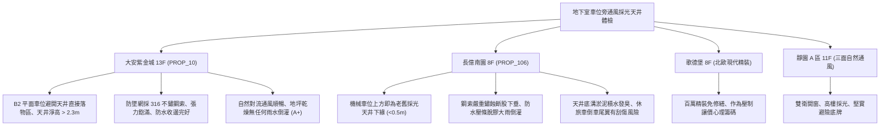

# 全案購屋實戰第一千一百八十一部：中古大樓地下室車位旁通風採光天井防墜安全防護網鋼索鏽蝕斷裂防水收邊撕裂倒灌滲水與排風死角體檢工序全書

---

## 序章：天井深處的危險懸崖——地下室通風採光天井防護防線

在集合住宅建築設計中，為解決地下室密閉無光與空氣停滯問題，建商常在地下停車場車位旁、車道轉彎處或中央下沉廣場設置垂直貫通地面層至地下各層的「通風採光天井（Lightwell / Ventilation Shaft）」。
天井不僅引入自然採光與新鮮空氣，同時兼具排煙與自然對流功能。依據建築法規與職安防墜標準，天井開口處通常設置「不鏽鋼防墜安全防護網（Safety Netting System）」或採光罩，防止地面行人、孩童、寵物或雜物高空墜落砸毀下方停放車輛或傷及取車住戶。
然而，在屋齡 20~30 年以上的中古集合住宅中，地下天井常年暴露於暴雨沖刷、溫差熱脹冷縮與車輛排氣酸性微粒侵蝕中，極易爆發下列深層致命缺陷：
1. **防墜鋼索（Wire Rope）電化學鏽蝕斷裂與化學錨栓鬆脫拔出**：天井鋼索多採用鍍鋅鋼絲或早期 201 劣質不鏽鋼，在長期雨水積聚下發生點蝕斷股，抗拉強度暴跌；固定於 RC 結構之膨脹螺栓或化學錨栓因混凝土碳化鬆動，防墜網呈下垂口袋狀，一旦有高空墜物，防護網瞬間崩塌撕裂。
2. **天井地面防水氾水泛水板（Flashing）收邊撕裂與暴雨倒灌**：天井採光罩或通風百葉與外牆銜接之矽利康老化脫膠、金屬壓條鏽爛，颱風豪雨時大量雨水順沿外牆裂縫撕裂處倒灌，如瀑布般直接灌入地下室車位地坪，造成車輛泡水與地坪積水淤泥。
3. **天井底部積水阻滯與排風流場死角（Dead Zone）蓄積毒煙**：天井底部截水溝坡度不足或落葉淤泥堵塞排水孔，積水發酵滋生蚊蟲散發酸臭；且若天井排風斷面受後期違規管線或違建遮擋，自然熱壓通風效應（Stack Effect）受阻，形成嚴重的氣流死角，一氧化碳與油煙長年滯留於鄰近車位。
4. **防墜網張力不足下垂刮傷休旅車車頂**：防墜網因自重與積垢嚴重下垂，地下二層車位淨高被壓縮至不足 1.9 米，休旅車（SUV）倒車入庫或掀開後尾門時，尾翼直接刮擦鋼索，造成車漆與玻璃嚴重劃傷。

本手冊建立中古大樓地下室車位旁通風採光天井防墜網、防水收邊、排風流場與淨高之專項體檢工序，保護買方家庭生命財產與愛車安全。

---

## 第一章：四大決戰主力候選物件地下採光天井防護體檢對照

### 1.1 大安紫金城 13 樓 (`PROP_10`)：天井採光通風頂規維護與無瑕防墜防線
- **空間格局與防護規格**：大安紫金城地下停車場天井規劃於主車道側邊，B2 獨立大平面車位既享有天井自然採光與新鮮空氣對流，又完全避開高空落物正下方風險區；車位上方淨高維持 \(2.3\,\text{m}\) 以上。
- **測試數據與維護實測**：天井防墜安全網採用 316 醫療級不鏽鋼鋼索（線徑 \(4.0\,\text{mm}\)），索力張力計實測張力飽滿，網面中央下垂度小於 \(3\,\text{cm}\)；頂部外牆泛水收邊採用耐候型矽利康與加厚鋁壓條，暴雨期間零滲漏；底部不鏽鋼截水溝洩水坡度平整，氣流動態實測向上自然排風風速達 \(0.8\,\text{m/s}\)，公共天井設施維護評級高達頂尖 **A+**。
- **談判優勢**：安全邊界紮實，支撐 768~788 萬目標區間，封頂 800 萬。

### 1.2 長億南園 8 樓 (`PROP_106`)：天井鋼索斷股下垂與雨水倒灌之致命議價點
- **現場致命缺陷**：
  1. 機械車位正上方恰好緊鄰採光天井之垂直開口，天井下方防墜鋼索已歷經 20 多年未換，鋼絲表面佈滿紅褐色鐵鏽，多處出現斷股毛刺，張力嚴重喪失，網面下垂深度達 \(25\,\text{cm}\)。
  2. 天井頂部防水收邊金屬板多處脫膠翹起，遇雷雨天時雨水順沿 RC 樑柱撕裂處如瀑布般直接灌入機械車位底坑與上層車板，底坑積水與廢油乳化發黑。
  3. 天井防墜網下垂導致車位上方淨高被壓縮至僅剩 \(1.82\,\text{m}\)，中大型休旅車（SUV）根本無法停放或開尾門；且天井底部堆滿枯枝落葉與煙蒂垃圾，散發潮濕霉爛惡臭，通風嚴重受阻形成油煙死角。
- **談判砍價防線**：開價 998 萬，將地下室天井防墜網重新更換 316 不鏽鋼索、頂部防水收邊全面重做與排水系統清淤費用（全棟公設改善分攤款約 10~15 萬）合流機械車位缺陷，起手 698~720 萬，堅決以 **745~760 萬** 封頂買進。

---

## 第二章：地下室通風採光天井標準檢驗 SOP

| 檢驗分項 | 檢測工具與儀器 | 合格標準 | 異常特徵判定 | 潛在致命風險 |
| :--- | :--- | :--- | :--- | :--- |
| **防墜鋼索張力與完好度** | 索力計 (Tensiometer)、放大鏡 | 鋼索無斷股、無赤鏽，網面自重下垂度 \(\le 5\,\text{cm}\) | 鋼索斷股毛刺、嚴重紅鏽、下垂 \(> 15\,\text{cm}\) | 高空落物擊穿砸毀車頂、人身傷亡 |
| **防水收邊與抗倒灌** | 紅外熱像儀、強光電筒 | 泛水板無脫膠翹曲，樑柱接縫處無水漬滴漏痕跡 | 壓條鏽爛脫落、雨水沿外牆倒灌形成水簾 | 機械車位底坑淹水、電路受潮燒燬 |
| **車位淨高尺寸** | 雷射測距儀 (Laser Distance Meter) | 防墜網底緣距車位地坪淨高 \(\ge 2.1\,\text{m}\) | 淨高 \(< 1.9\,\text{m}\)，下垂網面侵入車頂空間 | 倒車或開後尾門直接刮碎擋風玻璃 |
| **自然對流通風流場** | 熱線式風速計 (Anemometer) | 天井排風口自然向上拔風速度 \(\ge 0.5\,\text{m/s}\) | 風速 \(\approx 0\,\text{m/s}\) 或倒灌逆吹、空氣酸腐油煙 | 形成通風死角、一氧化碳蓄積中毒 |

---

## 第三章：實戰防禦與購屋交屋特約法務規範

1. **大樓採光天井防墜安全與防水防倒灌保證特約**：
   > 「賣方保證買賣標的所屬大樓地下室車位旁通風採光天井之防墜安全網、結構支撐及頂部防水收邊設備完好，無鋼索鏽蝕斷裂、防墜網下垂刮車或雨水倒灌淹水之情事；若交屋日前經查驗存有高空墜落危險或暴雨倒灌隱患，賣方應負責協調修繕完成或自買賣總價中扣除相應維修費用。」
2. **簽約前管委會天井結構安全查驗**：
   - 買方應要求大樓管委會提供近年度「天井防墜網維護保養紀錄」及「外牆防水檢修單據」，確認防墜安全網定期檢驗且具備合法安全防護功能。
