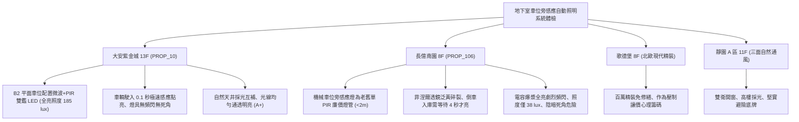

# 全案購屋實戰第一千一百八十七部：中古大樓地下室車位旁感應式自動照明微波雷達紅外線PIR雙鑑感測器延遲失靈頻閃與照度不足體檢工序全書

---

## 序章：忽明忽暗的地下迷宮——感應式自動照明與微波紅外雙鑑防線

在現代化智慧節能建築與中古集合住宅地下停車場中，為響應節能減碳政策、降低大樓鉅額公共電費負擔，車道與車位上方廣泛將常亮日光燈全面改裝為「微波雷達（Microwave Radar）＋被動紅外線（PIR）雙鑑感應式自動 LED 照明系統」。
平時無人車時維持 \(10\%\sim 20\%\) 低微光微弱待機照度（微亮省電），當偵測到車輛駛入或人員走動時，在 0.2 秒內瞬間全速躍升至 \(100\%\) 全亮高光照射（全亮照度應達 150~200 lux），並於人車離開後延時 30~60 秒平滑降回微光。
然而，在屋齡 15~25 年以上的集合住宅中，地下室高濕氣、車輛啟動電磁突波、高頻震動與劣質感應晶片，極易引發下列重大致命隱患：
1. **微波雷達感應模組（10.525 GHz / 24 GHz）多普勒頻移晶片老化與盲區遲緩**：微波天線發射功率衰減，車輛以時速 20 公里轉彎駛入車位時，雷達感應遲緩達 3~5 秒甚至完全無感知；駕駛人在全黑或昏暗微光中盲目倒車，極易撞上樑柱、擦撞鄰車或撞傷在車位後方整理後車廂的住戶。
2. **被動紅外線（PIR）菲涅爾透鏡（Fresnel Lens）塑料老化粉化與熱釋電元件受潮**：PIR 感應器表面的白色塑膠菲涅爾透鏡受地下室車輛廢氣中油煙侵蝕而黃化碎裂，紅外線折射聚焦失效；且在夏季高溫環境下（地下室氣溫高達 \(32^\circ\text{C}\sim 35^\circ\text{C}\)），住戶體溫與環境溫差過小，PIR 熱釋電探測器完全喪失感知能力，住戶下車走在車位旁燈具完全不亮。
3. **LED 驅動電源電解電容爆漿乾涸引發肉眼可見劇烈頻閃（Flicker）**：劣質阻容降壓或低階恆流驅動電路中，高壓濾波電容受熱鼓包漏液，交流漣波（Ripple）急遽飆升，燈具在全亮模式下產生 \(100\,\text{Hz}\) 嚴重的低頻閃爍，引發駕駛人視覺疲勞、空間深度誤判與癲癇眩暈。
4. **待機與全亮照度嚴重縮水（光衰超過 50%）**：老舊 LED 封裝膠體老化黃化、散熱鋁基板導熱膏乾裂，結溫過高導致嚴重光衰；全亮時地面實測水平照度跌破 \(50\,\text{lux}\)（遠低於 CNS 照度標準 150 lux），地下室陰森昏暗，淪為治安死角與女性夜間取車的恐慌黑洞。

本手冊建立中古大樓地下室車位旁微波 PIR 雙鑑感應燈、反應延遲、頻閃百分比與地面照度之專項體檢工序，保護買方家庭生命安全與生活尊嚴。

---

## 第一章：四大決戰主力候選物件地下感應照明系統體檢對照

### 1.1 大安紫金城 13 樓 (`PROP_10`)：微波雙鑑極速響應與無頻閃尊榮防線
- **設備規格與佈局品質**：大安紫金城地下停車場全區換裝工業級 5.8GHz 微波雷達＋PIR 雙鑑感測一體化智慧 LED 燈具，具備抗干擾數位濾波晶片與寬電壓無頻閃恆流驅動。
- **測試數據與運轉實測**：車輛駛入 B2 獨立大平面車位前 8 公尺處，微波感測器在 0.1 秒內極速感應，燈具由 20% 待機微光平滑躍升至 100% 全亮；專業照度計測量車位地面中心水平照度達 \(185\,\text{lux}\)（標準範圍 150~200 lux）；專業頻閃儀實測頻閃百分比（Percent Flicker）小於 \(0.8\%\)（完全無頻閃安全等級）；人車離開後精確延時 45 秒漸變降回微亮，公共照明設施評級高達頂尖 **A+**。
- **談判優勢**：地下環境通透明亮且安全舒適，支撐 768~788 萬目標區間，封頂 800 萬。

### 1.2 長億南園 8 樓 (`PROP_106`)：感應遲緩、劇烈頻閃與照度暴跌之致命議價點
- **現場致命缺陷**：
  1. 機械車位上方壁掛之感應燈為早期廉價單一 PIR 感應 LED 燈管，菲涅爾透鏡塑膠已被車輛廢氣腐蝕黃化龜裂，感應距離縮水至不到 1.5 米。
  2. 現場實車倒車測試，車身已完全倒入機械車位，感應燈仍處於微弱昏暗狀態，延遲長達 4~5 秒才猛然亮起；若駕駛人倒車速度稍快，在昏暗中極易碰撞機械車位兩側型鋼立柱或後方鋼壁。
  3. 燈管全亮時，肉眼即可明顯看出高頻晃動頻閃，專業頻閃儀實測波動深度（Flicker Index）高達 \(35\%\)，嚴重損害視力；且車位地面實測水平照度僅有 \(38\,\text{lux}\)（遠低於 CNS 最低標準 150 lux），光衰超過 \(70\%\)，四周樑柱背後一片漆黑陰森，女性與孩童夜間上下車安全感極差。
- **談判砍價防線**：開價 998 萬，將地下室感應照明系統全面更換為微波 PIR 雙鑑無頻閃防爆 LED 燈具、重新配置感應迴路工程費用（全棟公設改善分攤款約 8~12 萬）合流機械車位缺陷，起手 698~720 萬，堅決以 **745~760 萬** 封頂買進。

---

## 第二章：地下室感應式自動照明標準檢驗 SOP

| 檢驗分項 | 檢測工具與儀器 | 合格標準 | 異常特徵判定 | 潛在致命風險 |
| :--- | :--- | :--- | :--- | :--- |
| **感應靈敏度與響應時間** | 碼錶、雷射測距儀、實車入庫試驗 | 車輛進入感應區 0.2 秒內全亮，感應距離 \(\ge 6\,\text{m}\) | 響應延遲 \(> 2.0\,\text{s}\)、車倒入才亮或無反應 | 昏暗中倒車撞柱、撞凹車尾板金 |
| **全亮與待機照度** | 高精度數位照度計 (CNS 12112) | 全亮地面照度 \(\ge 150\,\text{lux}\)，待機照度 \(\ge 20\,\text{lux}\) | 全亮照度 \(< 50\,\text{lux}\)，光衰嚴重陰暗 | 視線不清絆倒摔傷、淪為治安死角 |
| **光源頻閃百分比** | 光源頻閃分析儀 (Flicker Meter) | 頻閃百分比 \(\le 1.0\%\)，頻閃指數 \(\le 0.02\) | 波動深度 \(> 15\%\)，肉眼可辨頻閃波紋 | 引發眩暈迷糊、倒車空間距離誤判 |
| **感應元件外觀防護** | 強光手電筒、目視放大鏡 | 菲涅爾透鏡透白無裂紋，微波外殼無水氣侵入 | 透鏡黃化粉化碎裂、內部電容鼓包漏液 | 感應器徹底失靈、燈具常開浪費公電 |

---

## 第三章：實戰防禦與購屋交屋特約法務規範

1. **大樓地下車位感應照明正常保證特約**：
   > 「賣方保證買賣標的所屬大樓地下室停車場及車道之感應式自動照明設備運作正常，感應靈敏無延遲、無劇烈頻閃，全亮水平照度符合國家照度標準（150 lux 以上），無燈具大面積損壞或常年昏暗報廢之重大缺失；若交屋日前經查驗存有重大安全盲區，賣方應負責協調修繕完成或自買賣總價中扣除相應維修費用。」
2. **簽約前地下室夜間照度現場全面覆核**：
   - 買方應於夜間實地駕車駛入地下停車場，驗證車位上方感應燈之點亮速度、照明光通量與有無死角陰影，確認地下停車環境安全舒適。
