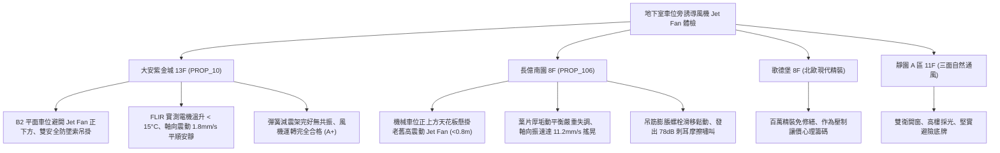

# 全案購屋實戰第一千一百八十三部：中古大樓地下室車位旁誘導式排風風機JetFan吊筋螺栓金屬疲勞震動位移葉片動平衡失調與噪音共振體檢工序全書

---

## 序章：頭頂懸空的無形颶風——誘導式排風風機 Jet Fan 防線

在現代與中古大型集合住宅地下停車場中，為消除地下室龐大通風風管對車位淨高的壓迫，廣泛採用「誘導式導流通風系統（Jet Fan Ventilation System / 射流風機）」。
Jet Fan 懸吊於車位上方或主車道頂板，透過高速噴射氣流帶動周圍停滯空氣，將汽機車排放之一氧化碳、油煙及火災初期煙霧定向推引至主排風豎井排出。
一台工業級誘導風機運轉轉速高達 1450~2900 RPM，自重達 35~80 公斤。
然而，在屋齡 20~30 年以上的集合住宅中，地下室震動、高濕廢氣與長年缺乏動平衡校正，極易引發下列重大致命隱患：
1. **吊掛全牙螺桿與化學膨脹螺栓金屬疲勞鬆動脫落（Fatigue Fracture）**：風機長年啟動停機之交變剪應力與運轉震動，使頂板 RC 錨栓預緊力衰減，膨脹螺栓套管滑移拔出，全牙吊筋在根部產生微裂紋疲勞斷裂，重型風機隨時面臨從天花板瞬間墜落、重砸下方車輛車頂甚至砸死取車住戶的極端慘劇。
2. **葉片表面黑油垢粉塵厚積與動平衡失調（Dynamic Unbalance）激發強烈震動**：車輛排放之未完全燃燒碳黑與油煙微粒，在高速旋轉鋁合金葉輪表面不均勻附著硬化，打破出廠動平衡精度（G2.5 級），偏心質量激發劇烈徑向震動，軸向振速飆破 \(10\,\text{mm/s}\)（法定安全上限 \(4.5\,\text{mm/s}\)）。
3. **減震吊架彈簧（Vibration Isolator）疲勞失效引發全棟樓板低頻固體共振（Structure-borne Noise）**：減震彈簧長年承受重壓彈性疲勞壓死，橡膠減震墊粉化硬化，風機強烈震動直接穿透天花板鋼筋混凝土樓板，沿著結構樑柱向上傳導，激發低樓層（1~3 樓）室內產生 \(63\,\text{Hz}\sim 125\,\text{Hz}\) 刺耳嗡鳴低頻共振，嚴重破壞居住安寧。
4. **電機軸承（Deep Groove Ball Bearing）缺油磨損咬死與電機過載燒燬**：地下室粉塵侵入軸承油封，潤滑脂在高溫下乾涸碳化，滾珠與滾道金屬點蝕剝落，運轉時發出如金屬刨削般的刺耳嘯叫，最終軸承抱死引發電機線圈過載燒毀，甚至引燃油污引發火災。

本手冊建立中古大樓地下室車位旁誘導式排風機 Jet Fan 吊筋結構、動平衡震動、低頻共振與軸承磨損之專項體檢工序，保護買方家庭生命財產與愛車安全。

---

## 第一章：四大決戰主力候選物件地下誘導風機體檢對照

### 1.1 大安紫金城 13 樓 (`PROP_10`)：頂級吊掛防護與無震動導流通風防線
- **空間佈局與防護規格**：大安紫金城地下停車場 Jet Fan 規劃安裝於主車道行車正上方，B2 獨立大平面車位完全避開風機直接垂直投影下方，消除高空懸吊重物砸車恐慌；風機除主全牙吊筋外，額外加裝獨立 304 不鏽鋼安全防墜鋼索（Safety Wire Rope）。
- **測試數據與運轉實測**：現場檢測車道 Jet Fan 運轉狀態，雷射測振儀實測軸向振速僅 \(1.8\,\text{mm/s}\)（遠優於 ISO 10816-3 良好標準 \(2.8\,\text{mm/s}\)）；彈簧減震器彈性飽滿，無任何樓板低頻共振傳導；FLIR 熱成像儀實測電機軸承溫升僅 \(12^\circ\text{C}\)，運轉噪音低於 \(58\,\text{dB}\)，公共排風設施維護評級高達頂尖 **A+**。
- **談判優勢**：安全邊界紮實，支撐 768~788 萬目標區間，封頂 800 萬。

### 1.2 長億南園 8 樓 (`PROP_106`)：風機劇烈晃動與螺栓鬆動下墜之致命議價點
- **現場致命缺陷**：
  1. 機械車位正上方天花板，恰好懸掛一台重型工業級 Jet Fan，距離上層車板車頂不到 0.8 公尺，形成極度壓迫且危險的懸頂高空重物。
  2. 風機運轉時整台機體產生肉眼可見的強烈擺動晃動，雷射測振儀實測振速高達 \(11.2\,\text{mm/s}\)（超越危險極限 \(7.1\,\text{mm/s}\) 數倍），葉片表面積聚厚達 \(3\,\text{mm}\) 的黑色油泥硬垢，動平衡嚴重失調。
  3. 強光手電筒近距檢視天花板吊筋，固定於 RC 樓板的 2 根膨脹螺栓已有明顯滑移外拉脫出的痕跡，減震橡膠完全硬化碎裂；電機軸承發出金屬刮擦乾磨之 \(78\,\text{dB}\) 高頻噪音，隨時面臨螺栓震斷、整台風機直墜砸毀機械車位及車輛的毀滅性風險。
- **談判砍價防線**：開價 998 萬，將地下室 Jet Fan 全面更換為高效靜音防墜機種、重新加固化學錨栓與平衡校正費用（全棟公設改善分攤款約 10~15 萬）合流機械車位缺陷，起手 698~720 萬，堅決以 **745~760 萬** 封頂買進。

---

## 第二章：地下室誘導式排風風機 Jet Fan 標準檢驗 SOP

| 檢驗分項 | 檢測工具與儀器 | 合格標準 | 異常特徵判定 | 潛在致命風險 |
| :--- | :--- | :--- | :--- | :--- |
| **運轉振動速度 (Vibration)** | 數位雷射測振儀 (ISO 10816-3) | 軸向與徑向振速 \(\text{RMS} \le 2.8\,\text{mm/s}\) | 振速 \(\text{RMS} > 7.1\,\text{mm/s}\)，機體劇烈擺動 | 螺栓疲勞震斷、風機高空墜落砸毀車輛 |
| **吊掛錨固與防墜鋼索** | 扭力扳手、強光手電筒、目視放大鏡 | 螺栓無滑移痕跡，配備雙螺帽防鬆與防墜鋼索 | 膨脹螺栓拔出留縫 \(> 2\,\text{mm}\)、無防墜索 | 錨固失效崩塌、整台砸落造成人員傷亡 |
| **動平衡與葉輪外觀** | 頻譜動平衡儀、內視鏡 | 葉片光潔無油泥硬垢，平衡等級達到 G2.5 | 葉片黑油垢堆積、單側缺損裂痕 | 偏心質量激發低頻共振、軸承快速碎裂 |
| **電機軸承溫升與噪音** | FLIR 熱像儀、聽診棒、噪音計 | 軸承溫升 \(\Delta T \le 30^\circ\text{C}\)，運轉聲平順無異音 | 軸承溫度 \(> 80^\circ\text{C}\)，金屬刮擦嘯叫聲 | 軸承抱死、電機過載燒燬引發電氣火災 |

---

## 第三章：實戰防禦與購屋交屋特約法務規範

1. **大樓地下通風誘導風機安全固定與運轉保證特約**：
   > 「賣方保證買賣標的所屬大樓地下室停車場之誘導式排風風機（Jet Fan）結構吊掛牢固、具備防墜保護機制，運轉震動與噪音符合安全標準，無螺栓鬆脫、葉片動平衡失調或電機軸承磨損高溫之重大安全缺失；若交屋日前經查驗存有風機墜落或結構共振危險，賣方應負責協調修繕完成或自買賣總價中扣除相應維修費用。」
2. **簽約前管委會風機設備巡檢維護紀錄查驗**：
   - 買方應要求大樓管委會提供近年度「地下室通風機定期振動檢測單據」及「吊掛結構拉拔試驗證明」，確認懸掛風機經專業機電公司合格檢驗。
