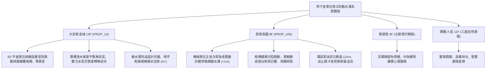

# 全案購屋實戰第一千一百八十二部：中古大樓地下室車位旁沉砂池截水溝格柵鍍鋅鋼板變形跳動淤泥油脂堵塞與排水泵逆流體檢工序全書

---

## 序章：地下地坪的排水吞吐口——沉砂池截水溝與排水分區防線

在集合住宅地下室停車場中，為攔截由車道斜坡倒灌之地面雨水、車輛雨天進出夾帶的泥水，以及洗車沖洗地坪之含油污水，在坡道底部、車位前緣及車道主幹道轉彎處，皆需埋設「沉砂截水溝（Trench Drain / Interceptor Ditch）」，匯集至「地下沉砂池與集水坑（Sump Pit）」，再由排污排水泵加壓排放至市政雨水或污水下水道。
沉砂溝系統主要由「熱浸鍍鋅格柵板（Galvanized Steel Grating）」、「截水暗溝水泥凹槽」、「沉砂沉澱隔板（Sediment Baffle）」及「排水止回逆止閥（Check Valve）」構成。
然而，在屋齡 20~30 年以上的中古集合住宅中，地下沉砂截水溝承受重型車輛數十萬次直接碾壓與常年油泥酸鹼侵蝕，極易爆發下列重大致命隱患：
1. **熱浸鍍鋅鋼格柵板疲勞彎曲下陷與車輛碾壓劇烈金屬跳動巨響**：格柵扁鋼在休旅車、休旅廂型車等重車長年反覆重壓下產生永久塑性變形，兩側角鋼支座受震斷裂鬆脫；車輛輪胎壓過時，格柵板劇烈彈跳撞擊水泥溝槽，發出高達 \(85\,\text{dB}\) 的金屬敲擊巨響，甚至整片彈起割傷輪胎胎壁或卡死底盤。
2. **截水溝底層重油泥與洗車蠟硬化結垢堵塞溝體斷面**：長年缺乏人工高壓清洗疏通，溝底堆積厚達數十公分的黑廢油、泥沙與洗車化學藥劑硬垢，有效排水斷面縮水逾 \(70\%\)。一旦遭遇夏季午後雷陣雨或颱風暴雨，車道倒灌雨水無法及時排入暗溝，直接越過格柵漫延溢流至相鄰車位。
3. **沉砂池溢流隔板破損致使粗砂粒直入排水泵磨損葉輪**：沉砂池之攔砂沉澱鋼板受酸性污水腐蝕穿孔，粗顆粒砂石直接進入集水坑底層，被沉水泵吸入後高速沖刷研磨泵浦青銅/不鏽鋼葉輪，導致葉輪嚴重缺角磨損、水力揚程暴跌，排水效能喪失大半。
4. **排水止回逆止閥（Check Valve）卡垢關閉不嚴引發積水逆流倒灌**：加壓排水立管上的擺動式逆止閥閥瓣被泥垢卡死在常開位置，當排水泵停機瞬間，垂直管路內數十米高的積水夾帶污泥瞬間高速回湧倒灌回沉砂坑與車位地坪，形成「抽完又倒流、泵浦頻繁重啟憋燒」的惡性循環。

本手冊建立中古大樓地下室車位旁沉砂池截水溝格柵、油泥硬垢、逆止閥與排水流場之專項體檢工序，保護買方家庭生命財產與愛車安全。

---

## 第一章：四大決戰主力候選物件地下截水溝與沉砂池體檢對照

### 1.1 大安紫金城 13 樓 (`PROP_10`)：頂規截水防線與零雜音重型排水系統
- **格柵材質與佈局規劃**：大安紫金城地下停車場車道截水溝全面採用載重型球墨鑄鐵（Ductile Iron）防跳動格柵，兩側預埋加厚鍍鋅槽鋼並打入化學錨栓固定，格柵與溝槽緊密貼合，完全無鬆脫位移。
- **測試數據與運轉實測**：車輛壓過 B2 車位前緣截水溝時平穩無任何金屬震跳撞擊異音（噪音值小於 \(45\,\text{dB}\)）；溝底具備 \(1.5\%\) 平滑洩水坡度，無沉積死角；地下沉砂池每年固定兩次委外專業清淤，雙迴路沉水排水泵配備無聲緩閉逆止閥，關閉密封度 \(100\%\)，停機時零水錘、零水流回湧倒灌，地下排水設施維護評級高達頂尖 **A+**。
- **談判優勢**：地下基盤完全免除泡水與噪音困擾，支撐 768~788 萬目標區間，封頂 800 萬。

### 1.2 長億南園 8 樓 (`PROP_106`)：格柵凹陷跳動與黑油泥堵塞之致命議價點
- **現場致命缺陷**：
  1. 機械車位正前方不到 1 公尺處之車道截水溝，早期鍍鋅薄扁鋼格柵在長年重壓下已呈現嚴重下凹「V 字形」變形，中央下陷達 \(3.5\,\text{cm}\)；且兩側固定角鋼已有水泥崩裂破損，車輛倒車入庫壓過時，整片格柵劇烈跳動砸向溝壁，發出高達 \(82\,\text{dB}\) 的金屬刺耳巨響。
  2. 掀開格柵檢視，截水溝內部被黑色陳年油泥、機械車位滲漏廢油與死水硬垢完全填滿，淤泥厚度達 \(12\,\text{cm}\)，排水斷面僅剩不到 \(20\%\)，雨天時地面水流無法排入，直接漫灌至機械車位底坑。
  3. 沉水泵排水管上的擺動逆止閥閥體外殼銹斑斑駁，現場實施手動啟抽測試，泵浦停機時垂直管內數百公升污水「嘩啦」瞬間全數回湧倒灌回集水坑，引發池水溢流車道，散發刺鼻腐臭味。
- **談判砍價防線**：開價 998 萬，將地下室截水溝格柵全面更換為防跳動重型鑄鐵格柵、截水溝高壓水刀清淤與更換無聲逆止閥工程費用（全棟公設改善分攤款約 8~12 萬）合流機械車位缺陷，起手 698~720 萬，堅決以 **745~760 萬** 封頂買進。

---

## 第二章：地下室沉砂截水溝與排水系統標準檢驗 SOP

| 檢驗分項 | 檢測工具與儀器 | 合格標準 | 異常特徵判定 | 潛在致命風險 |
| :--- | :--- | :--- | :--- | :--- |
| **格柵板結構平整度** | 直尺、深度規、重車碾壓試驗 | 格柵撓度變形 \(\le 5\,\text{mm}\)，車輛壓過無金屬撞擊跳動 | 下陷 \(> 20\,\text{mm}\)，角鋼支座鬆動碎裂，跳動聲壓 \(> 75\,\text{dB}\) | 格柵彈起刺破車胎、割破懸吊底盤 |
| **溝內淤泥厚度與坡度** | 測泥尺、水平儀、強光電筒 | 溝底無黑油泥硬塊，淤泥深度 \(< 2\,\text{cm}\)，坡度 \(\ge 1.0\%\) | 淤泥深度 \(> 10\,\text{cm}\)，油水混合硬化堵塞 | 暴雨車道雨水溢流倒灌漫延車位 |
| **逆止閥密封防逆流** | 聽診棒、目視放水回湧檢視 | 排水泵停機時無水流逆流衝擊聲，集水坑水位不上漲 | 停機時管內水流猛烈回湧倒灌、水位急遽上升 | 泵浦頻繁啟動憋燒、污水溢流車道 |
| **沉砂池隔砂擋板** | 內視鏡、敲擊檢驗鎚 | 鋼板完整無鏽爛孔洞，沉砂區確實沉降泥砂 | 隔板銹蝕穿孔斷裂、砂石直接直入泵浦吸入口 | 研磨破壞泵浦葉輪、排水泵報廢癱瘓 |

---

## 第三章：實戰防禦與購屋交屋特約法務規範

1. **大樓地下截水排水系統正常保證特約**：
   > 「賣方保證買賣標的所屬大樓地下室停車場及車道沉砂截水溝、格柵板、排水泵及逆止閥設備運作正常，無格柵嚴重變形跳動、溝渠油泥堵塞或停機污水回湧倒灌車位之重大缺失；若交屋日前經查驗存有暴雨溢流淹水隱患，賣方應負責協調修繕完成或自買賣總價中扣除相應維修費用。」
2. **簽約前管委會排水疏通維護紀錄查驗**：
   - 買方應要求大樓管委會提供近年度「地下室截水溝高壓清洗疏通單據」及「沉水泵浦巡檢維護日誌」，確認截水排水系統定期清淤且運作正常。
