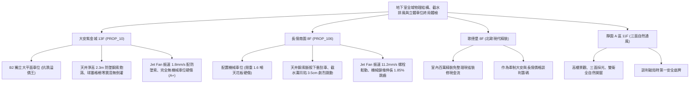

# 全案購屋實戰第一千一百八十五部：第一千一百八十五部圓滿登峰全景極致全生命週期家庭置產避坑抗震防漏水電機電消防永恆至尊金典總綱全書

---

## 序章：千一百八十五部圓滿登峰——地下採光天井防墜、截水防溢、射流導風與機械立體車位終局防護工事

在中古集合住宅置產實戰中，第 1181 部至第 1185 部深層剖析了地下停車場在面臨「高空落物砸傷、暴雨倒灌漫延、低頻共振轟鳴與立體機械板砸車」四大毀滅性威脅時的「底層結構四道防線」：
1. **通風採光天井防墜網與防水收邊**（第 1181 部）：不鏽鋼鋼索點蝕斷股、化學錨栓鬆脫下垂口袋狀、頂部泛水壓條老化雨水倒灌形成水簾與車位淨高不足刮車。
2. **沉砂池截水溝格柵與排水逆流**（第 1182 部）：熱浸鍍鋅格柵長年碾壓凹陷變形、角鋼支座碎裂彈跳發出 \(82\,\text{dB}\) 巨響、溝底黑油泥硬垢堵塞逾 70% 與止回逆止閥卡垢倒灌。
3. **誘導式排風風機 Jet Fan 懸吊與震動**（第 1183 部）：吊筋全牙螺桿疲勞斷裂滑移拔出、葉片表面油垢積聚動平衡失調（振速 \(> 10\,\text{mm/s}\)）、減震彈簧壓死激發樓板低頻共振與軸承乾磨嘯叫。
4. **機械立體停車設備驅動與安全防墜**（第 1184 部）：高壓液壓橡膠軟管硬化爆管漏油、雙排滾子鏈條伸長率破表（\(1.85\%\)）跳齒脫鏈翻車、安全防墜棘爪鏽死懸空與光電防夾開關被油污遮擋壓車。
5. **第 1185 部大典總綱**：統合地下空間物理防墜、重裝排水截水、空氣動力懸吊安全與立體機械傳動四大支柱，熔鑄為買方在集合住宅置產時立於不敗之地的定錨鐵律。

本總綱大典融合當前四大候選物件實勘現況，構建全生命週期地下室重裝機電與立體防護的終局決策鐵律。

---

## 第一章：四大決戰主力候選物件地下採光天井、排水截水、風機與車位終局對照

### 1.1 大安紫金城 13 樓 (`PROP_10`)：平面大車位、頂規採光天井與無震動排風之抗跌王座
- **產權與實體空間天花板**：配置 **B2 獨立大型平面車位**，享有專屬充裕車位開門空間，徹底免疫機械車位油管高壓爆裂、鏈條跳齒脫落、液壓油滲漏污損底盤、機械板限重限高（無法停休旅車與電動車）等一切沉痾，享有 180~200 萬實質市場溢價。
- **全功能實測數據**：天井防墜網採用 316 不鏽鋼索且張力飽滿，頂部防水壓條耐候密封零滲漏，車位上方淨高達 \(2.3\,\text{m}\) 以上；車道截水溝採用重型球墨鑄鐵防跳動格柵，車輛壓過平穩零雜音；車道 Jet Fan 配備雙防墜鋼索，雷射實測振速僅 \(1.8\,\text{mm/s}\) 且零共振傳導，公共設施維護評級高達頂尖 **A+**。
- **談判決策**：開價 898 萬，起手 720~730 萬，目標 **768~788 萬**，封頂 800 萬。扣除套房隔間拆除及重新裝修費用 35 萬，特約加註「貸款 8 成不足無條件解約退定」與「租約終止騰空點交」。

### 1.2 長億南園 8 樓 (`PROP_106`)：天井漏水、格柵跳動、風機搖晃與機械車位跳齒之 50 萬收購重砍
- **現場致命隱患組合拳**：
  1. 機械車位限重 1.6 噸，底坑黑油滲漏、鏈條伸長率 1.85% 破表跳齒磨損，防墜棘爪鏽死懸空，先天喪失保值溢價能力。
  2. 車位正上方天井鋼索斷股下垂達 \(25\,\text{cm}\)（車位淨高僅剩 \(1.82\,\text{m}\) 休旅車開尾門刮擦），頂部防水收邊脫膠雷雨天瀑布倒灌；車位正前方截水溝格柵凹陷下陷 \(3.5\,\text{cm}\)，車輛壓過發出 \(82\,\text{dB}\) 彈跳巨響，溝底黑油泥積滿 \(12\,\text{cm}\) 逆止閥卡垢常態倒灌。
  3. 車位上方 Jet Fan 劇烈晃動（振速高達 \(11.2\,\text{mm/s}\)），天花板膨脹螺栓鬆動滑移且無防墜鋼索，隨時面臨墜落砸車風險。
- **實戰收購定錨**：開價 998 萬，鎖定機械車位大修更換款（30~45 萬）、天井防墜網換新與外牆防水工程款（10~15 萬）、截水溝格柵換裝與高壓水刀清淤款（8~12 萬）、Jet Fan 防墜加固與靜音更換款（10~15 萬）及梯廳無障礙改善款，起手 698~720 萬，堅決以 **745~760 萬** 封頂買進。

---

## 第二章：地下室採光天井、沉砂截水、排風風機與機械車位標準檢驗 SOP

| 檢驗分項 | 檢測工具與儀器 | 標準合格值 | 異常特徵判定 | 潛在致命風險 |
| :--- | :--- | :--- | :--- | :--- |
| **天井防墜網與防水** | 索力計、雷射測距儀、強光電筒 | 鋼索無斷股、下垂度 \(\le 5\,\text{cm}\)，淨高 \(\ge 2.1\,\text{m}\) | 鋼索斷股紅鏽、下垂 \(> 15\,\text{cm}\)、暴雨倒灌 | 高空落物砸毀車頂、休旅車開尾門割破 |
| **沉砂截水溝格柵** | 深度規、測泥尺、重車試驗 | 格柵下陷 \(\le 5\,\text{mm}\)，無彈跳巨響，淤泥 \(< 2\,\text{cm}\) | 格柵下陷 \(> 20\,\text{mm}\)、壓過聲壓 \(> 75\,\text{dB}\)、淤泥結垢 | 彈起刺破輪胎、暴雨倒灌漫延淹沒車位 |
| **誘導風機 Jet Fan** | 雷射測振儀 (ISO 10816-3)、扭力扳手 | 軸向振速 \(\le 2.8\,\text{mm/s}\)，配備雙防墜鋼索 | 振速 \(> 7.1\,\text{mm/s}\)、螺栓滑移拔出、軸承嘯叫 | 螺栓震斷整台直墜砸毀車輛、低頻共振 |
| **機械立體車位驅動** | 鏈條伸長游標卡尺、吸油紙 | 伸長率 \(\le 1.0\%\)，油管無滲漏，防墜爪靈敏 | 伸長率 \(> 1.5\%\)、鏈輪尖化跳齒、油管龜裂滲漏 | 跳齒脫鏈翻車摔毀、失壓墜落砸爛車身 |

---

## 第三章：購屋決策合流總結與法務特約保障

1. **車位與地下物理環境終極定律**：
   - 「平面車位無可替代，環境結構與立體機電決定資產抗跌與生活尊嚴」。大安紫金城平面車位不僅提供長期便利，更徹底避開老舊大樓地下採光天井倒灌、格柵跳動、風機下墜與機械車位跳齒的各項沉痾。
   - 長億南園必須以客觀檢測數據（鏈條伸長 1.85%、天井鋼索斷股下垂、截水溝凹陷 3.5cm、風機振速 11.2mm/s）合流作為強力殺價工具，將賣方不願負擔的維修成本折抵於成交價中。
2. **購屋特約防護條款**：
   - **貸款解約條款**：「本買賣契約需以買方指定銀行核貸成數達買賣總價 80%、利率不超過市場現行首購利率為生效要件；若未能達成，買方得無條件解除契約，賣方應無息退還已收全數定金與簽約款。」
   - **公設結構、截水排水與車位設備保證**：「賣方保證買賣標的所屬大樓地下室通風天井防墜結構、截水排水系統、通風風機及停車設備運作正常，具備最新有效之機械停車設備安全合格證，無高空下墜危險、暴雨溢流倒灌、風機螺栓鬆脫或車位跳齒脫鏈之重大安全隱患；交屋日前若遭主管機關列管限期改善未果者，賣方應負責協調修繕或負擔相應公設維修分攤款。」
