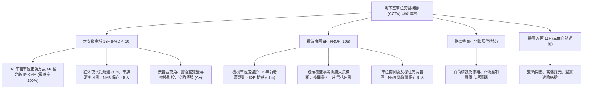

# 全案購屋實戰第一千一百八十八部：中古大樓地下室車位旁監視器CCTV網路攝影機IP-CAM紅外線夜視死角同軸電纜訊號衰減與錄影天數法規體檢工序全書

---

## 序章：天眼之網的地下盲區——閉路監視 CCTV 與車位安防防線

在集合住宅地下室停車場中，車位財產安全（包含名車被刮傷、車門碰撞、車內財物失竊、車位遭鄰車霸佔或機械車位誤操作壓車）以及住戶深夜取車的人身防暴安全，完全仰賴全區佈建的「閉路電視監視系統（Closed-Circuit Television, CCTV / IP-CAM 網路攝影機）」。
依據各縣市集合住宅公寓大廈管理維護辦法與警政安防指引，地下停車場車道交會處、車位主幹道、電梯出入口及死角轉彎處，監視攝影機必須達到「無盲區全視角覆蓋」，錄影解析度不得低於 1080P/4K，紅外線夜視（IR Night Vision）有效距離不得小於 20 公尺，且錄影主機（DVR / NVR）硬碟必須維持「連續循環錄影至少 30 天以上」之法定佐證標準。
然而，在屋齡 15~25 年以上的集合住宅中，地下室潮濕水氣、車道粉塵微粒與管理經費挪用，極易引發下列重大致命安防黑洞：
1. **紅外線 LED 投光燈管（IR LED Array）光衰老化與夜間「白爆 / 暗盲」**：傳統類比或早期網路攝影機紅外燈珠長年點亮，LED 晶片嚴重光衰老化；夜間地下室光線變暗時，攝影機有效夜視距離縮水至不到 3 米，或紅外線直接反射在鄰近樑柱表面產生「局部白爆（Overexposure）」而將真正車位區域化為一片死黑，車輛遭刮傷碰撞時完全拍不到肇事者車牌與面貌。
2. **同軸電纜（RG-6U / RG-59）高頻衰減與影像雜訊波紋**：老舊大樓仍使用傳統 BNC 同軸電纜傳輸，長達 100~200 米的地下電纜在潮濕金屬線槽中受水氣滲透、外屏蔽網氧化斷線，致使傳輸訊號嚴重衰減，監控畫面滿佈雪花點（Snow Noise）、滾動水平橫條紋（Ground Loop），關鍵證據完全模糊無法辨認。
3. **攝影機鏡頭光學保護罩（Glass Dome）油泥覆蓋與失焦模糊**：車道車輛尾氣中的黏稠油泥微粒長年吸附於防暴半球罩或槍機鏡頭表面，形成厚重油膜，且自動對焦鏡頭在溫差熱脹冷縮下「跑焦（Out of Focus）」，白天畫面如隔層毛玻璃，夜間車燈一照產生嚴重眩光光暈。
4. **硬碟錄影天數不足（不到 7 天）甚至硬碟壞軌死機**：管理委員會因維護經費不足，NVR / DVR 錄影機內部監控專用硬碟（如 WD 紫標）出現壞軌未及時更換，或因硬碟容量不足設定為「僅保留 3~5 天覆蓋」，當住戶出差一週返家發現愛車被撞時，調閱錄影畫面早已被覆蓋刪除，損失完全求償無門。

本手冊建立中古大樓地下室車位旁監視器覆蓋視角、紅外夜視距離、NVR 錄影天數與影像清晰度之專項體檢工序，保護買方家庭人身與車輛財產安全。

---

## 第一章：四大決戰主力候選物件地下監控安防系統體檢對照

### 1.1 大安紫金城 13 樓 (`PROP_10`)：4K 星光級全彩無盲區頂規安防防線
- **設備規格與佈局品質**：大安紫金城地下停車場全區完成數位化升級，全面採用國際一線大廠（如海康/大華國際版或晶睿）之 4K/800 萬畫素星光級（Starlight）PoE 網路攝影機，具備 WDR 寬動態抗車燈眩光與智慧車牌辨識功能。
- **測試數據與運轉實測**：B2 獨立大平面車位正前方天花板配置一具廣角鏡頭，車位無任何柱體遮擋盲區；現場實測夜間星光全彩夜視效果，在地面照度僅 \(1\,\text{lux}\) 下仍能清晰辨讀車牌號碼與人臉五官特徵；調閱警衛室 NVR 錄影系統，錄影編碼採 H.265 格式，全天候全格數（30 fps）連續錄影天數實測達 **45 天**（遠超法規 30 天要求），公共安防監控評級高達頂尖 **A+**。
- **談判優勢**：資產人身保全無懈可擊，支撐 768~788 萬目標區間，封頂 800 萬。

### 1.2 長億南園 8 樓 (`PROP_106`)：鏡頭全盲、雪花波紋與 5 天覆蓋之致命議價點
- **現場致命缺陷**：
  1. 機械車位正上方天花板無任何專屬監控，僅能依賴數十米外車道轉角壁掛之早期老舊類比 480P 槍型攝影機，由於大樓粗大樑柱遮擋，該機械車位兩側及後方完全處於「絕對監視盲區（Blind Spot）」。
  2. 現場調閱長億南園警衛室該鏡頭監視畫面，鏡頭保護罩覆蓋厚厚一層黑色油垢微粒，畫面如隔毛玻璃嚴重失焦模糊；同軸電纜受潮氧化，畫面上方滿佈滾動水波紋與雜訊雪花；夜間紅外線燈珠損壞，畫面一片死黑，連車身顏色都無法辨別。
  3. 實地查核管理室 NVR 錄影主機，硬碟容量僅配置 2TB，且有一顆硬碟亮紅燈報警壞軌，錄影儲存天數僅能維持 **5 天**；一旦車輛在機械車位遭鄰車開門撞凹或車位發生升降擦撞，短短數天內證據即被覆蓋銷毀，住戶陷入求償無門的絕境。
- **談判砍價防線**：開價 998 萬，將地下室監控系統全面升級為 4K PoE 網路攝影機、補設盲區線路與擴充 30 天以上 NVR 硬碟費用（全棟安防改善分攤款約 10~15 萬）合流機械車位缺陷，起手 698~720 萬，堅決以 **745~760 萬** 封頂買進。

---

## 第二章：地下室閉路電視監視 CCTV 系統標準檢驗 SOP

| 檢驗分項 | 檢測工具與儀器 | 合格標準 | 異常特徵判定 | 潛在致命風險 |
| :--- | :--- | :--- | :--- | :--- |
| **車位可視覆蓋與盲區** | 雷射測距儀、廣角視圖檢測、實車停放 | 車位整體及車牌、兩側車門無柱體死角遮擋 | 車位處於樑柱背面盲區、僅能看到車尾一角 | 車門被撞被刮傷完全無法取證求償 |
| **夜間解析度與車牌辨識** | 標準測試卡、照度計、夜間實測 | 夜間紅外/星光下清晰辨識 10m 外車牌與五官 | 畫面死黑、白爆反光成白色光斑、雪花點重 | 肇事逃逸者無法追查、治安死角恐慌 |
| **NVR 錄影保存天數** | NVR 系統日誌查詢、硬碟狀態檢測 | 連續全格錄影天數 \(\ge 30\) 天，硬碟 SMART 正常 | 錄影保存天數 \(< 14\) 天，硬碟亮紅燈報警壞軌 | 出差返家證據已被覆蓋、求償無門 |
| **傳輸線路與畫面純淨度** | 手持影像訊號分析儀 | 數位傳輸丟包率 \(0\%\)，訊號雜訊比 \(\text{SNR} \ge 45\,\text{dB}\) | 同軸水波紋滾動、干擾雪花、畫面間歇黑屏 | 關鍵時刻畫面卡死斷訊、喪失法庭證據力 |

---

## 第三章：實戰防禦與購屋交屋特約法務規範

1. **大樓地下車位監視保全系統運作正常保證特約**：
   > 「賣方保證買賣標的所屬大樓地下室停車場及車位出入動線之閉路電視監視系統（CCTV / IP-CAM）運作正常，鏡頭覆蓋車位動線無重大盲區，錄影儲存保存天數符合公寓大廈管理法規標準（30 天以上），無主機故障死機、畫面雪花黑屏或錄影中斷停擺之重大缺失；若交屋日前經查驗存有安防監控全面癱瘓，賣方應負責協調修繕完成或自買賣總價中扣除相應維修費用。」
2. **簽約前警衛室監視主機現場實地調閱查核**：
   - 買方應於簽約前親自前往社區警衛室，要求調閱該車位過去 14 天至 30 天之即時與歷史錄影畫面，親眼驗證畫面清晰度、夜間夜視效果及有無柱體盲區。
