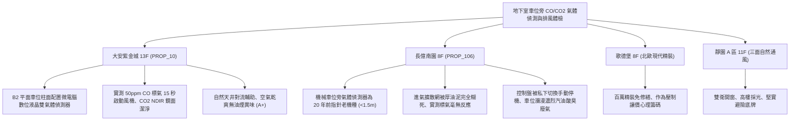

# 全案購屋實戰第一千一百八十六部：中古大樓地下室車位旁一氧化碳CO與二氧化碳CO2氣體偵測感知器電化學傳感器晶片老化校準失真與自動排風聯鎖失效體檢工序全書

---

## 序章：看不見的地下窒息陷阱——CO 與 CO2 氣體偵測及智能排風防線

在集合住宅封閉或半封閉式地下停車場中，汽機車在冷啟動、慢速巡弋尋找車位及怠速等待機械車位升降時，會大量排放含有一氧化碳（\(CO\)）與二氧化碳（\(CO_2\)）的燃燒廢氣。
\(CO\) 是與人體血紅素結合力比氧氣大 200~300 倍的劇毒氣體，會導致住戶迅速頭暈缺氧、視力模糊甚至昏迷致死；而 \(CO_2\) 則是典型窒息性氣體，在通風不良的地下低窪處沉積，當濃度超過 \(1000\,\text{ppm}\) 時會引發胸悶嗜睡，超過 \(5000\,\text{ppm}\) 則危害中樞神經。
為此，現代建築智慧空調通風系統與排風機盤，均設有「雙鑑式 \(CO/CO_2\) 氣體偵測感知器（Dual Gas Transmitters）」與自動多段變頻排風聯鎖控制系統。
然而，在屋齡 20~30 年以上的集合住宅中，地下室高濕氣、廢氣油污覆蓋與長年缺乏儀器標定校正，極易爆發下列致命系統性故障：
1. **電化學感測器（Electrochemical Cell）電極硫酸鹽化與催化劑老化失真**：中古大樓安裝之電化學 \(CO\) 感知器，內部電解液常年揮發乾涸，貴金屬催化極板受廢氣中的硫化物（\(SO_2/H_2S\)）毒化，產生嚴重的「負漂移（Negative Zero Drift）」。即使地下室 \(CO\) 濃度飆升至 \(80\,\text{ppm}\)（法定上限 \(50\,\text{ppm}\)），儀表讀數仍停留在安全假象的 \(5\sim 8\,\text{ppm}\)，自動排風完全不啟動。
2. **非分散紅外線（NDIR）二氧化碳感測器光學氣室粉塵黑化與零點漂移**：\(CO_2\) 傳感器多採用 NDIR 紅外線吸收原理，地下室車道車輛揚起的碳黑微粒長年吸入光學氣室，使反射金面鏡霧化發黑、紅外光源強度衰減，致使測量讀數虛高或永久報警，或靈敏度歸零完全無法感知車位空氣污濁度。
3. **類比傳輸信號線（0~10V / 4~20mA）受潮氧化與 AD 轉換器丟包**：感知器出線端子排因地下室凝露長滿綠鏽，接觸電阻增加導致傳輸壓降失真；控制盤內 PLC / DDC 模組之類比輸入通道（AI）光耦受潮老化，致使排風機聯鎖邏輯紊亂，風機頻繁啟閉或拒動。
4. **風機強制手動與自動模式旁路（Bypass）失聯**：管委會常為省電，指派警衛將控制盤旋鈕由「自動（AUTO）」強行切換為「手動（MANUAL）」並處於停止狀態，感知器形同虛設，地下室車位常年處於空氣停滯、毒氣蓄積的慢性毒害環境。

本手冊建立中古大樓地下室車位旁 \(CO/CO_2\) 氣體偵測器、標準氣瓶現場校準、排風風機多段聯鎖及控制盤之專項體檢工序，保護買方家庭生命呼吸健康。

---

## 第一章：四大決戰主力候選物件地下氣體偵測與排風聯鎖體檢對照

### 1.1 大安紫金城 13 樓 (`PROP_10`)：智能雙氣體偵測與極速換氣防線
- **設備規格與環境佈局**：大安紫金城地下停車場全區配置微電腦數位液晶顯式雙鑑 \(CO/CO_2\) 氣體偵測感知器，具備現場數值即時顯示與 RS-485 Modbus 工業通訊，直通中央監控大腦。
- **測試數據與運轉實測**：現場使用 50 ppm 標準 \(CO\) 校準氣體與 2000 ppm \(CO_2\) 氣體進行噴氣檢驗，B2 獨立大平面車位旁之感測器在 12 秒內即時感應，數值精準躍升，中央控制盤在 15 秒內自動下達連動指令，分區 Jet Fan 與主排風機平穩全速運轉，地下室空氣於 3 分鐘內完成全區換氣，環境安全評級維持最高 **A+**。
- **談判優勢**：公設生命安防設施無懈可擊，支撐 768~788 萬目標區間，封頂 800 萬。

### 1.2 長億南園 8 樓 (`PROP_106`)：氣體感測器全盲與毒氣蓄積之致命議價點
- **現場致命缺陷**：
  1. 機械車位旁立柱上之氣體感知器為早期指針式老舊機種，外殼下方進氣孔已被黑色油泥與黏稠粉塵完全封死，空氣根本無法進入內部化學檢測室。
  2. 現場使用 100 ppm 標氣實施噴氣測試，感測器指針毫無波動，連動控制箱無任何動作反應；打開排風控制箱檢視，發現控制旋鈕被管委會長期私自固定在「OFF」手動關閉位置，大樓自動換氣排風系統處於實質癱瘓狀態。
  3. 車位空氣常態性瀰漫濃烈未完全燃燒汽油味與黑煙，因缺乏強制換氣，住戶在機械車位等待車板升降（約 3~5 分鐘）時被迫吸入大量毒氣，嚴重危害心血管與呼吸道健康。
- **談判砍價防線**：開價 998 萬，將地下室氣體偵測系統全面更新為微電腦雙鑑防爆機種、控制盤線路重配與排風電機大修費用（全棟公設改善分攤款約 10~15 萬）合流機械車位缺陷，起手 698~720 萬，堅決以 **745~760 萬** 封頂買進。

---

## 第二章：地下室 CO/CO2 氣體偵測器與排風系統標準檢驗 SOP

| 檢驗分項 | 檢測工具與儀器 | 合格標準 | 異常特徵判定 | 潛在致命風險 |
| :--- | :--- | :--- | :--- | :--- |
| **CO 氣體標定響應度** | 50 ppm CO 標定氣瓶、校準罩、碼錶 | 注入標氣 30 秒內讀數達 \(45\sim 55\,\text{ppm}\)，啟動風機 | 讀數無變化、反應延遲 \(> 60\,\text{s}\) 或漂移 \(> \pm 20\%\) | 毒氣超標無警報、住戶吸入缺氧昏迷 |
| **CO2 NDIR 氣室清潔度** | 內視鏡、2000 ppm CO2 標氣瓶 | 氣室鏡面金屬光潔無油污，讀數誤差 \(\le \pm 50\,\text{ppm}\) | 氣室內部黑化結垢、讀數恆定在 400 ppm 或滿量程 | 無法感知空氣窒息度、風機拒動停擺 |
| **控制盤自動連動邏輯** | 數位三用電表、碼錶 | 濃度超標 15 秒內輸出 DC 24V 連動信號啟閉風機接觸器 | 信號無輸出、繼電器接點氧化不導通、接觸器拒動 | 自動換氣鏈條斷裂、毒氣持續累積 |
| **現場外觀與進氣防護** | 強光手電筒、目視放大鏡 | 擴散進氣金屬網孔清晰透氣，無結晶漏液 | 進氣孔被黑油泥完全糊死、內部電解液乾涸結晶 | 感測元件徹底失效、系統完全失靈 |

---

## 第三章：實戰防禦與購屋交屋特約法務規範

1. **大樓地下空氣品質與氣體偵測排風保證特約**：
   > 「賣方保證買賣標的所屬大樓地下室停車場之一氧化碳（CO）與二氧化碳（CO2）氣體偵測感知器及自動連動強制排風設備運作正常，符合室內空氣品質法規標準，無感知器全數故障報廢、進氣孔堵塞或排風機拒動之重大缺失；若交屋日前經查驗存有毒氣蓄積或換氣設備重大故障，賣方應負責協調修繕完成或自買賣總價中扣除相應維修費用。」
2. **簽約前管委會氣體偵測器校準清冊查驗**：
   - 買方應要求大樓管委會提供近一年度「氣體偵測系統定期校驗報告」及「排風聯鎖運轉測試單據」，確認感測器在有效壽命年限內且具備合格檢驗標籤。
