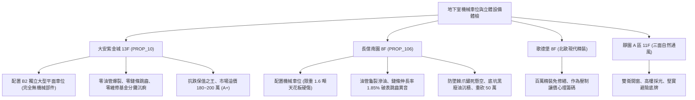

# 全案購屋實戰第一千一百八十四部：中古大樓地下室車位旁機械車位液壓油管高壓爆裂漏油鏈條鏈輪磨損鏽蝕與光電防夾極限開關失靈體檢工序全書

---

## 序章：鋼鐵牢籠中的升降懸崖——機械立體停車設備之致命硬傷

在集合住宅中，建商為滿足法定停車位數量要求或增加銷售戶數，常於地下室大量設置二層至多層之「機械立體停車設備（Mechanical Parking Lift System / 升降橫移式、升降式機械車位）」。
機械車位主要由「型鋼鋼構框架」、「載車板（Platform Plate）」、「高壓液壓泵站與油缸軟管（Hydraulic Cylinder & High-pressure Hose）」、「雙排滾子傳動鏈條與鏈輪（Transmission Roller Chain & Sprocket）」、「光電安全對射感測器（Photoelectric Safety Sensor）」及「機械防墜棘爪（Safety Anti-fall Pawl）」精密咬合組成。
然而，在屋齡 20~30 年以上的中古集合住宅中，機械車位長期承受重型休旅車超重擠壓、潮濕底坑水氣氧化與長年缺乏原廠級大修，已成為大樓最致命的定時炸彈：
1. **高壓耐油橡膠軟管（High-Pressure Hydraulic Hose）老化硬化與脈衝爆裂漏油**：液壓油管長年承受高達 140~210 bar（\(140\sim 210\,\text{kgf/cm}^2\)）的週期性超高液壓脈衝，橡膠外層受地下室臭氧與油泥侵蝕而硬化龜裂、鋼絲編織增強層鏽蝕，隨時面臨高壓爆管。一旦爆管，載車板瞬間失壓自由落體下墜砸毀下方車輛，數十公升易燃高溫液壓油如雨噴灑漫延，引發極度嚴重的火災隱患。
2. **雙排滾子提升鏈條伸長率超標（> 1.5%）與鏈輪跳齒脫鏈**：傳動鏈條在重車拉扯下銷軸與套筒磨損，鏈條伸長率超過安全警戒極限 \(1.5\%\)（實測多達 \(1.85\%\) 以上），鏈輪輪齒磨損成「尖鉤狀」，升降運轉時產生劇烈金屬「卡啦」跳齒巨響，甚至整條鏈條滑脫斷裂，載車板瞬間傾斜 \(45^\circ\) 導致車輛翻覆滑落摔爛。
3. **安全防墜機械棘爪（Anti-Fall Safety Pawl）卡死鏽蝕與斷鏈保護失效**：防墜棘爪是鏈條斷裂或油管爆裂時卡住軌道防止載車板墜落的最後一道救命機械鎖；由於機械車位底坑長年潮濕、接油盤黑油結垢，防墜棘爪之復位彈簧鏽蝕斷裂、轉軸卡死在釋放狀態，斷鏈防墜保護完全失效。
4. **光電安全防夾感測器（Safety Photocell）被油污黑垢遮擋致使誤動壓車**：出入口之紅外線安全對射感測器鏡頭長年被地下室黑油垢覆蓋，信號嚴重衰減；當人員或車輛尚未完全駛離時，升降極限開關未閉鎖，車位板強行啟動橫移或下降，直接將車頂、車門壓扁砸爛，甚至釀成致命人員夾傷夾死慘劇。

本手冊建立中古大樓地下室車位旁機械立體車位液壓、鏈條、防墜棘爪與光電安全開關之專項體檢工序，保護買方家庭生命財產安全並作為致命議價籌碼。

---

## 第一章：四大決戰主力候選物件機械車位與立體設備體檢對照

### 1.1 大安紫金城 13 樓 (`PROP_10`)：平面獨立車位之絕頂保值防線
- **產權與實體空間天花板**：大安紫金城該戶配置 **B2 獨立大型平面車位**，完全徹底免疫機械車位油管高壓爆裂、鏈條跳齒脫落、液壓油滲漏污損底盤、機械板限重限高（無法停休旅車與電動車）等一切災難性沉痾。
- **維護與抗跌效益**：無需負擔機械車位每月數百元保養維修費與未來數十萬元機械組件大修更新集資；相較機械車位享有高達 180~200 萬之實質市場溢價，車輛隨到隨停、出入順暢極速，保值性穩居四大物件之冠。
- **談判決策**：開價 898 萬，起手 720~730 萬，目標 **768~788 萬**，封頂 800 萬。扣除套房隔間拆除及重新裝修費用 35 萬，特約加註「貸款 8 成不足無條件解約退定」與「租約終止騰空點交」。

### 1.2 長億南園 8 樓 (`PROP_106`)：機械車位老化重災區與 50 萬收購大砍
- **現場致命缺陷**：
  1. 該戶所配置之車位為機械升降車位，標稱限重僅 1.6 噸，中大型休旅車（SUV）或純電車（EV）根本無法停放，轉手流通性嚴重受限。
  2. 現場實測傳動滾子鏈條，鏈條伸長率達 \(1.85\%\)（法定安全上限 \(1.5\%\)），鏈輪輪齒嚴重磨損尖化，車板升降時伴隨刺耳之金屬跳齒撞擊巨響；液壓泵站橡膠軟管外表龜裂硬化且滲油，底坑接油盤堆積厚厚一層黑廢油。
  3. 機械防墜棘爪表面長滿紅褐色厚鏽，轉動軸完全咬死卡滯在懸空位置，一旦鏈條滑脫或油管爆裂，載車板將直接失壓自由墜落砸毀下方車輛；紅外線光電防夾開關外殼覆蓋油污灰塵，反應遲鈍。
- **實戰收購定錨**：開價 998 萬，鎖定機械車位油管更換、全套雙排鏈條重置、防墜棘爪機構翻修（車位專屬大修款約 30~45 萬）及公共梯廳無障礙台階改善款，以此合流大砍 50 萬，起手 698~720 萬，堅決以 **745~760 萬** 封頂買進。

---

## 第二章：地下室機械立體車位標準檢驗 SOP

| 檢驗分項 | 檢測工具與儀器 | 合格標準 | 異常特徵判定 | 潛在致命風險 |
| :--- | :--- | :--- | :--- | :--- |
| **液壓高壓軟管密封性** | 壓力表、強光電筒、吸油紙 | 耐壓試驗無膨脹龜裂，接口處零油滴滲漏 | 外膠層開裂網絲裸露、接頭滲漏黑油滴 | 瞬間爆管、車板失壓砸落摔爛車輛 |
| **提升鏈條伸長率** | 專用鏈條伸長游標卡尺 (20節量測) | 鏈條伸長率 \(\le 1.0\%\)（極限 \(\le 1.5\%\)） | 伸長率 \(> 1.5\%\)，鏈輪輪齒呈尖鉤狀 | 跳齒脫鏈、載車板傾斜翻車摔毀 |
| **安全防墜機械棘爪** | 敲擊檢驗鎚、手動扳動測試 | 棘爪彈簧彈力充足，扳動後瞬間清脆復歸卡扣 | 棘爪鏽蝕卡死懸空、彈簧斷裂無動作 | 斷鏈時無法卡扣阻止墜落、車毀人亡 |
| **光電防夾保護開關** | 專用遮光測試板 (厚 5cm)、碼錶 | 遮擋光束瞬間（\(< 0.1\,\text{s}\)）車位即刻緊急停機 | 遮光無反應繼續運轉、透鏡油污糊死 | 壓毀車頂車門、人員遭夾死重傷 |

---

## 第三章：實戰防禦與購屋交屋特約法務規範

1. **機械停車設備安全合格證與運作保證特約**：
   > 「賣方保證買賣標的所屬建物之機械立體停車設備運作順暢正常，無液壓爆管滲油、傳動鏈條超標拉伸、防墜安全機構卡死或光電防夾失靈之重大安全缺失，且具備主管機關核發最新有效之『建築物附設停車設備安全檢查合格證』；若交屋日前經專業檢驗機構查驗有重大結構安全隱患或未獲合格換證者，賣方應負責修復至完全合格或自總價中扣除相應修復費用。」
2. **簽約前停車設備保養清冊查驗**：
   - 買方應要求賣方或管委會提供近一年「機械停車設備專業維護保養紀錄卡」及「年度責任保險保單」，確認車位定期受檢且保險效期完整。
