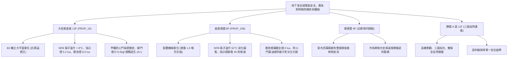

# 全案購屋實戰第一千一百八十部：第一千一百八十部圓滿登峰全景極致全生命週期家庭置產避坑抗震防漏水電機電消防永恆至尊金典總綱全書

---

## 序章：千一百八十部圓滿登峰——地下終端電氣、避難光引、應急投光與氣密防煙之終局防護工事

在中古集合住宅置產實戰中，第 1176 部至第 1180 部深入剖析了地下停車場在面臨「極端電氣過載短路、全域大斷電陷入黑暗與高溫濃煙瘋狂逆灌」三大致命危機時的「最底層生命安防四道閘門」：
1. **低壓配電箱無熔線斷路器（NFB）**（第 1176 部）：熱跳脫雙金屬片熱疲勞、接線端子螺栓鬆弛激發焦耳熱溫升炭化、電氣欠相運轉與外殼漏電。
2. **避難方向指示燈與出口標示燈**（第 1177 部）：鎳鎘蓄電池硫酸鹽化容量衰竭、冷陰極管黑化頻閃、壓克力導光板黃化透光率暴跌與逃生方向盲區。
3. **緊急照明雙頭投光燈**（第 1178 部）：鹵素燈泡鎢絲振動斷裂、閥控鉛酸電池漏液腐蝕電路板析出硫酸鉛結晶、反射罩黑化與地面照度衰減。
4. **特別安全梯防煙前室甲種防火門**（第 1179 部）：閉門器液壓阻尼漏油猛烈重擊反彈、熱膨脹防煙條炭化脫落、雙扇門順序器卡死交叉大開與開門推力超標。
5. **第 1180 部大典總綱**：統合電氣防火、光學逃生導引、大功率應急照明與實體氣密遮煙四大支柱，鑄就買方在集合住宅置產時立於不敗之地的定錨鐵律。

本總綱大典融合當前四大候選物件實勘現況，構建全生命週期地下室重裝機電與立體防護的終局決策鐵律。

---

## 第一章：四大決戰主力候選物件地下電氣、照明與防煙前室終局對照

### 1.1 大安紫金城 13 樓 (`PROP_10`)：電氣頂規、光明逃生與氣密遮煙之抗跌保值之王
- **物理空間與防護優勢**：配置 **B2 獨立大型平面車位**，空間充裕，完全遠離防火門碰撞動線，免除機械車位漏油、爆管、卡死與限重之沉痾。
- **全功能實測數據**：低壓配電箱 NFB 滿載端子溫升低於 \(8^\circ\text{C}\)（接地電阻 \(3.2\,\Omega\)）；LED 避難指示燈斷電續航 120 分鐘（地面照度 \(5.2\,\text{lux}\)）；LED 應急照明燈地面中心照度高達 \(8.5\,\text{lux}\)；防煙前室甲種防火門閉門器平穩鎖定，防煙條飽滿，開門推力僅 \(8.2\,\text{kgf}\)，公共安防評級高達頂尖 **A+**。
- **談判決策**：開價 898 萬，起手 720~730 萬，目標 **768~788 萬**，封頂 800 萬。扣除套房隔間拆除及重新裝修費用 35 萬，特約加註「貸款 8 成不足無條件解約退定」與「租約終止騰空點交」。

### 1.2 長億南園 8 樓 (`PROP_106`)：電氣火災、全黑受困與防煙門大開之 50 萬強勢大砍
- **現場致命隱患組合拳**：
  1. 機械車位限重 1.6 噸，底坑黑油滲漏、鏈條跳齒磨損，先天喪失保值溢價能力。
  2. 車位旁配電箱 NFB 端子高溫達 \(78^\circ\text{C}\)（溫升 \(52^\circ\text{C}\) 超標），PVC 電線皮發泡炭化，箱體帶有 65V 漏電浮電。
  3. 避難指示燈面板黃化黑化頻閃，斷電 45 秒即熄滅；緊急照明燈鉛酸電池漏液腐蝕鎢絲全斷，斷電時地面照度為 \(0\,\text{lux}\) 完全瞎眼；防煙前室防火門閉門器漏黑油失去阻尼、雙開門順序器卡死呈現交叉重疊大開，火災時濃煙直灌安全梯。
- **實戰收購定錨**：開價 998 萬，鎖定機械車位大修更換款（30~45 萬）、大樓配電箱更換與接地整新款（10~15 萬）、指示燈與應急照明全面升級款（8~12 萬）、防火門閉門器重置與防煙條工程款（10~15 萬）及梯廳無障礙改善款，起手 698~720 萬，堅決以 **745~760 萬** 封頂買進。

---

## 第二章：地下室配電安全、避難標示、應急照明與防火門標準檢驗 SOP

| 檢驗分項 | 檢測工具與儀器 | 標準合格值 | 異常特徵判定 | 潛在致命風險 |
| :--- | :--- | :--- | :--- | :--- |
| **低壓配電箱 NFB 端子** | FLIR 熱成像儀、扭力扳手 | 接點溫升 \(\Delta T \le 10^\circ\text{C}\)，接地電阻 \(R \le 10\,\Omega\) | 端子溫升 \(\Delta T > 30^\circ\text{C}\)、電線炭化發泡 | 接觸不良熔融、電氣火災、外殼漏電 |
| **避難方向指示燈** | 數位照度計、碼錶、手動測試閥 | 斷電續航 \(\ge 90\,\text{min}\)，地面照度 \(\ge 1.0\,\text{lux}\) | 斷電 \(< 30\,\text{min}\) 熄滅、面板嚴重泛黃頻閃 | 逃生中途全黑、盲目摸索引發踩踏 |
| **緊急照明雙頭燈** | 照度計、強光電筒、pH 試紙 | 水平照度 \(\ge 1.0\,\text{lux}\)，電池無漏液無結晶 | 鎢絲斷裂不亮、外殼析出白色硫酸鉛粉末 | 照度為 0 lux、黑暗中摔入坑洞摔傷 |
| **防煙前室甲種防火門** | 推拉力計、塞尺、角度規 | 任何角度釋放平順密閉鎖定，推力 \(\le 13.6\,\text{kgf}\) | 閉門器漏黑油砸門反彈、雙開門交叉卡死 | 毒煙長驅直入樓梯間、逃生動線煙囪化 |

---

## 第三章：購屋決策合流總結與法務特約保障

1. **車位與地下機電安防終極定律**：
   - 「平面車位無可替代，環境機電與逃生設施決定人身安全與資產保值」。大安紫金城平面車位不僅提供長期便利，更徹底避開老舊大樓地下電氣、火警照明與防火門的各項沉痾。
   - 長億南園必須以客觀檢測數據（NFB 炭化高溫、指示燈斷電熄滅、應急燈漏酸全毀、防火門交叉大開）合流作為強力殺價工具，將賣方不願負擔的維修成本折抵於成交價中。
2. **購屋特約防護條款**：
   - **貸款解約條款**：「本買賣契約需以買方指定銀行核貸成數達買賣總價 80%、利率不超過市場現行首購利率為生效要件；若未能達成，買方得無條件解除契約，賣方應無息退還已收全數定金與簽約款。」
   - **公設電氣、消防照明與逃生門具保證**：「賣方保證買賣標的所屬大樓地下室低壓配電設備、避難指示燈、緊急照明燈及特別安全梯防煙前室防火門功能正常，符合最新年度公共安全與消防安檢標準；交屋日前若遭主管機關列管限期改善未果者，賣方應負責協調修繕或負擔相應公設維修分攤款。」
