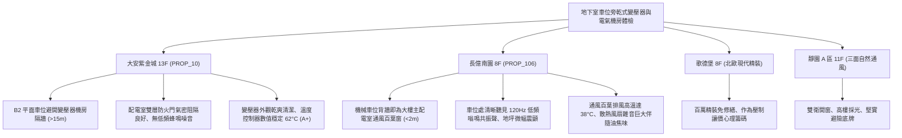

# 全案購屋實戰第一千一百六十一部：中古大樓地下室車位旁低壓乾式變壓器鐵芯共振低頻噪音線圈絕緣受潮局部放電與溫度控制器超溫跳脫體檢工序全書

---

## 序章：靜止的電磁心臟——配電室乾式變壓器之隱蔽風險

在中古集合住宅大樓中，地下室配電場所設之低壓乾式變壓器（Cast Resin / Vacuum Pressure Impregnated Dry-type Transformer），負責將台電輸入之 22.8kV/11.4kV 高壓或大樓內部 380V 動力電降壓為住戶所需之 220V/110V 單相三線或三相四線用電。
由於地下室停車位往往鄰近配電室隔牆或通風百葉，若變壓器運轉超過 20~25 年未落實保養，將引發下列深層致命缺陷：
1. **矽鋼片鐵芯鬆弛夾緊力不足引發低頻共振與噪音外洩**：長年熱循環與磁致伸縮（Magnetostriction）作用，使鐵芯夾件（Clamping Bolts）預緊力衰減，激發 \(100\,\text{Hz}/120\,\text{Hz}\) 嚴重的低頻嗡鳴聲與固體結構傳導震動，直接穿透車位背牆並向上傳遞至低樓層住家。
2. **高低壓線圈環氧樹脂澆鑄體龜裂與局部放電（Partial Discharge）**：地下室潮濕水氣、車輛廢氣中微粒沉積於線圈表面，導致絕緣介電強度下降，引發電暈放電（Corona）與局部放電，加速絕緣老化並散發微弱焦糊臭味。
3. **冷卻散風風扇（Cooling Fans）軸承卡死與超溫控制器（Temperature Controller）失靈**：變壓器強制風冷風扇因灰塵油污附著軸承咬死，Pt100 測溫電阻器受潮漂移，當夏日住戶空調高峰負載飆升時，變壓器溫升超過 \(155^\circ\text{C}\)（F 級絕緣極限）甚至直接超溫跳脫（Trip），造成全區無預警大斷電。
4. **配電室通風防鼠百葉破損致使小動物短路**：防鼠不鏽鋼網破損脫落，老鼠或壁虎鑽入變壓器銅排接頭，引發高壓相間短路電弧爆炸與整棟配電系統全毀。

本手冊制定最嚴密的地下室車位旁乾式變壓器體檢工序，保護買方家庭生命與資產安全。

---

## 第一章：四大決戰主力候選物件地下變壓器機房體檢對照

### 1.1 大安紫金城 13 樓 (`PROP_10`)：電磁設備實體隔離之寧靜防線
- **空間佈局優勢**：大安紫金城地下室主配電室位於地下二層中央獨立機房內，B2 獨立大平面車位距離配電室超過 15 公尺，並有獨立 RC 防火隔牆阻隔。
- **噪音與環境實測**：車位現場環境底噪僅 \(42\,\text{dB(A)}\)，低頻頻段（\(63\,\text{Hz}\sim 125\,\text{Hz}\)）無突出峰值；配電室內乾式變壓器溫控器顯示三相線圈溫度均勻維持於 \(62^\circ\text{C}\sim 65^\circ\text{C}\)，防鼠網及散熱風道乾淨清潔，機電維護評級極高。
- **談判優勢**：安全邊界紮實，支撐 768~788 萬合理成交區間，抗跌性最高。

### 1.2 長億南園 8 樓 (`PROP_106`)：變壓器低頻噪音與散熱不良之致命議價扣款點
- **現場致命缺陷**：
  1. 機械車位背面牆面正對主配電室之通風百葉窗，車位現場量測噪音達 \(58\,\text{dB(A)}\)，且在 \(100\,\text{Hz}\sim 120\,\text{Hz}\) 處存在顯著的低頻共振蜂鳴，長時間停放或上下車產生壓迫不適感。
  2. 變壓器強制冷卻風扇軸承缺油發出「喀喀」高頻摩擦異音，百葉排出的空氣溫度高達 \(38^\circ\text{C}\)，並伴隨微弱絕緣漆受熱焦糊味。
  3. 配電室防鼠百葉網局部破損生鏽，通風百葉下方地坪有滲水積塵痕跡，一旦暴雨潮氣侵入，變壓器極易引發局部放電擊穿或超溫跳脫。
- **談判砍價防線**：開價 998 萬，將變壓器鐵芯重新緊固減震、冷卻風扇更換、配電室通風防護改善（全棟公設改善分攤款約 15~20 萬）合流機械車位缺陷，起手 698~720 萬，目標 745~760 萬。

---

## 第二章：地下室配電室乾式變壓器標準檢驗工序 SOP

| 檢驗分項 | 檢測工具與儀器 | 合格標準 | 異常特徵判定 | 潛在災害與風險 |
| :--- | :--- | :--- | :--- | :--- |
| **低頻噪音與振動** | 精密噪音計 (1/3 倍頻程分析儀)、測振儀 | 車位處低頻聲壓 \(< 45\,\text{dB}\)，結構振速 \(< 0.5\,\text{mm/s}\) | \(100/120\,\text{Hz}\) 突出峰值 \(> 55\,\text{dB}\)，地坪震動明顯 | 長期低頻噪聲干擾、引起頭暈心悸 |
| **線圈運轉溫度** | 溫控箱數位顯示器、FLIR 熱像儀 | 線圈三相溫度 \(\le 90^\circ\text{C}\)，三相溫差 \(\Delta T \le 5^\circ\text{C}\) | 溫度超過 \(115^\circ\text{C}\)（報警門檻）或三相溫差 \(> 15^\circ\text{C}\) | 絕緣加速老化、超溫跳脫致全區斷電 |
| **局部放電與電暈** | 超音波局部放電檢測儀、紫外線成像儀 | 超音波信號 \(< 10\,\text{dB}\mu\text{V}\)，無電暈光暈特徵 | 聽見持續「滋滋」放電聲，放電量 \(> 20\,\text{pC}\) | 絕緣樹脂碳化、引發相間電弧爆炸 |
| **防鼠密封與百葉** | 不鏽鋼厚薄規、強光手電筒 | 防鼠網孔徑 \(\le 6\,\text{mm}\)，無孔洞、門檻高於 \(15\,\text{cm}\) | 網孔破損、門縫 \(> 10\,\text{mm}\)、發現鼠糞 | 小動物竄入引起高壓相間短路爆炸 |

---

## 第三章：實戰防禦與購屋交屋特約法務規範

1. **大樓公設供電變壓設備正常運轉特約**：
   > 「賣方保證買賣標的所屬大樓地下室高低壓變電設備、配電變壓器及溫控保護系統運作正常，無重大過載超溫、異常放電或曾遭台電通知限期改善之重大安全事故；交屋前若大樓主變壓器發生重大損壞或全棟配電停擺，買方得解除契約並請求返還全額價金。」
2. **簽約前管委會變壓器維護紀錄查驗**：
   - 買方應要求查閱最近一期大樓委託專業機電顧問公司進行之「大樓高低壓電氣設備定期檢驗申報報告」，確認乾式變壓器絕緣阻抗、繞組直流電阻及保護電驛測試完全合格。
