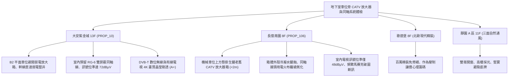

# 全案購屋實戰第一千一百六十七部：中古大樓地下室車位旁社區寬頻共同天線電視CATV放大器受潮氧化突波濾波器失效與4K高畫質訊號衰減體檢工序全書

---

## 序章：視訊影音之地下中繼站——共同天線電視（CATV）與弱電同軸防線

在集合住宅大樓中，社區電視訊號（包含數位無線電視 DVB-T、有線電視 CATV 及衛星共同天線 BS/CS）通常由頂樓天線或有線電視外線引入地下室弱電總機房，經由高頻雙向訊號放大器（Bidirectional Trunk Amplifier）、分配器（Splitter）與分支器（Tap），透過地下停車場之金屬線槽或管束，垂直分配傳輸至各棟各戶電視插座。
然而，在屋齡 20~30 年以上的集合住宅中，地下室車位旁牆面或天花板懸掛之 CATV 弱電箱，常年處於潮濕凝露、汽機車震動與電磁雜訊環境中。若長年缺乏儀器校準與更換，將引發下列深層致命缺陷：
1. **雙向幹線放大器（Trunk Amplifier）高頻衰減與模組受潮氧化**：地下室濕氣滲入放大器鋁合金壓鑄外殼，造成內部射頻（RF）放大晶片與電容接腳綠鏽氧化，\(500\,\text{MHz}\sim 1000\,\text{MHz}\) 超高頻（UHF）頻段訊號衰減超過 \(15\,\text{dB}\)，致使 4K/8K 數位電視或高畫質頻道頻繁出現馬賽克破圖、影音不同步甚至無訊號提示。
2. **同軸電纜（Coaxial Cable）物理發泡 PE 絕緣層水解與編織網氧化**：老舊 RG-6 / RG-11 同軸電纜在潮濕地下室中長年受潮，外被 PVC 龜裂，水氣浸潤鋁箔與鍍錫銅編織網，導致電纜特性阻抗（\(75\,\Omega\)）嚴重失配，引發強烈駐波比（VSWR）升高與訊號反射重影（Ghosting）。
3. **高壓雷擊突波濾波器（Surge Filter）與隔離器老化擊穿**：有線電視同軸外線引入端若未落實接地隔離或避雷突波吸收器老化，夏季高空雷擊或鄰近大功率機電設備啟動突波，將直接沿著同軸銅軸心灌入各戶客廳電視與機上盒，造成家電晶片擊穿燒燬。
4. **F 型連接接頭（F-Connector）鬆脫氧化引發接觸電阻與雜訊侵入**：地下室車道車輛震動常使壓接式或旋擰式 F 接頭鬆脫，外層屏蔽網斷開，外界 4G/5G 行動通信基地台訊號直接竄入同軸線纜（即蜂巢干擾 Cell Interference），造成電視訊號產生嚴重的雪花雜訊干擾。

本手冊建立中古大樓地下室車位旁 CATV 共同天線與同軸傳輸系統之專項體檢工序，保護買方家庭高品質視聽娛樂與公設電氣安全。

---

## 第一章：四大決戰主力候選物件地下視訊與同軸傳輸體檢對照

### 1.1 大安紫金城 13 樓 (`PROP_10`)：高品質視訊傳輸與頂規管線防線
- **幹線配置與設備規格**：大安紫金城地下室主視訊放大機房採獨立密閉配置，幹線同軸電纜全線敷設於金屬鍍鋅蓋板線槽（Cable Tray）內，B2 獨立大平面車位天花板無任何裸露同軸垂掛。
- **實測數據**：使用專業數位電視場強儀實測，13 樓客廳電視出線端數位頻道訊號位準（Signal Level）穩定維持於 \(68\sim 72\,\text{dB}\mu\text{V}\)（標準範圍 \(60\sim 75\,\text{dB}\mu\text{V}\)），調變誤差比（MER）大於 \(32\,\text{dB}\)，誤碼率（BER）小於 \(1\times 10^{-6}\)；公共視訊維護水準達到頂級 **A+**。
- **談判優勢**：居住舒適度無死角，支撐 768~788 萬目標區間，封頂 800 萬。

### 1.2 長億南園 8 樓 (`PROP_106`)：視訊放大器老化與訊號破圖之致命議價點
- **現場致命缺陷**：
  1. 機械車位正上方立柱懸掛早期老舊 CATV 放大器金屬箱，外殼鍍鋅層剝落生鏽，箱門縫隙滲入地下室水氣與油污。
  2. 放大器兩端之 RG-11 同軸電纜接頭未採用標準防水金屬壓接頭，僅以傳統黑色絕緣膠帶（電火布）纏繞，內部銅軸心已嚴重綠鏽氧化。
  3. 實測長億南園 8 樓客廳電視端子，高頻數位頻道訊號位準僅有 \(48\,\text{dB}\mu\text{V}\)（低於最低臨界值 \(55\,\text{dB}\mu\text{V}\)），MER 跌落至 \(20\,\text{dB}\)，電視畫面頻繁出現巨幅馬賽克破圖與音訊斷斷續續。
- **談判砍價防線**：開價 998 萬，將地下室 CATV 主放大器更新、同軸接頭重做、各樓分配器校正及垂直弱電換線費用（全棟公設改善分攤款約 5~10 萬）合流機械車位缺陷，起手 698~720 萬，堅決以 **745~760 萬** 封頂買進。

---

## 第二章：地下室 CATV 共同天線與同軸系統標準檢驗工序 SOP

| 檢驗分項 | 檢測工具與儀器 | 合格標準 | 異常特徵判定 | 潛在致命風險 |
| :--- | :--- | :--- | :--- | :--- |
| **RF 訊號位準 (Signal Level)** | 數位電視場強分析儀 | 各頻道訊號位準在 \(60\sim 75\,\text{dB}\mu\text{V}\) 之間 | 訊號位準 \(< 55\,\text{dB}\mu\text{V}\) 或 \(> 80\,\text{dB}\mu\text{V}\)（過載） | 畫面馬賽克破圖、黑屏無訊號、雪花點 |
| **調變誤差比 (MER) / 誤碼率** | 數位電視場強分析儀 | MER \(\ge 30\,\text{dB}\)，Pre-BER \(< 1\times 10^{-4}\) | MER \(< 24\,\text{dB}\)，BER 飆高出現紅色警告 | 數位串流解碼失敗、畫面卡頓停格 |
| **放大器供電與接地** | 數位電表、接地測試計 | 60V AC 遙供電源電壓穩定，接地電阻 \(R \le 10\,\Omega\) | 供電電壓降至 \(45\,\text{V}\) 以下、無接地保護 | 放大器間歇性重啟斷訊、雷擊損毀設備 |
| **同軸線纜接頭防護** | 強光手電筒、扭力扳手 (7/16 吋) | 全金屬壓縮式防水 F 接頭，無生鏽，緊固力矩標準 | 旋擰式塑膠接頭、纏繞電火布、銅芯綠鏽 | 4G/5G 行動通信雜訊干擾、訊號嚴重反射 |

---

## 第三章：實戰防禦與購屋交屋特約法務規範

1. **大樓共同天線與電視收視訊號保證特約**：
   > 「賣方保證買賣標的所屬大樓地下室電視訊號放大設備及共同天線線路運作正常，客廳與主臥電視出線端具備正常收視數位無線電視（DVB-T）或有線電視之標準訊號強度，無全面斷訊或線路堵塞報廢情事；若經實測訊號強度不足且為公設線路重大故障者，賣方應負責協調修繕或負擔相應公設維修分攤款。」
2. **簽約前室內電視端子現場實測**：
   - 買方應攜帶小型可攜式電視測試儀或請房仲接上電視螢幕，實地測試各頻道畫面是否順暢清晰，確認室內與地下室幹線無斷線老化隱患。
