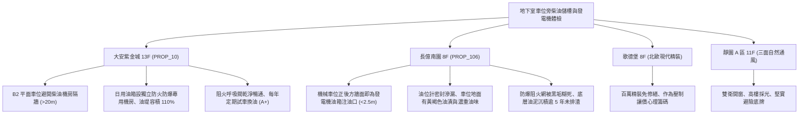

# 全案購屋實戰第一千一百六十三部：中古大樓地下室車位旁消防發電機柴油儲油槽油氣外洩油位表失真防爆阻火呼吸閥堵塞與底層沉油排渣體檢工序全書

---

## 序章：火災黑天鵝之動力心臟——緊急發電機柴油儲槽之安全防線

在集合住宅大樓中，地下室機房配置之柴油緊急發電機組（Emergency Diesel Generator），是當市電中斷、火警發生時支撐消防栓泵、自動撒水泵、排煙風機與緊急昇降機的唯一救命動力心臟。依據消防法規，大樓地下室必須設置「發電機專用柴油儲油槽（日用油箱或主儲油槽）」，儲存 200 公升至數千公升不等之高揮發性柴油燃料。
然而，在屋齡 20~30 年以上的中古大樓中，地下室柴油儲油槽往往鄰近地下車位、通道或排風井。若長期缺乏專案維護與排渣檢驗，將埋下極其可怕的火災爆炸與機電癱瘓地雷：
1. **防爆阻火呼吸閥（Flame Arrester & Breather Valve）油垢堵塞引發油箱內外壓差變形或爆燃**：阻火呼吸閥內部金屬阻火網若遭重油垢與粉塵糊死，通風受阻，燃油在夏季高溫受熱膨脹時無法洩壓，極易造成油槽焊縫撕裂漏油；在發電機抽油時則形成真空負壓，導致油箱癟縮吸癟變形。
2. **柴油長期靜置氧化膠化、微生物滋生與底部油泥沉渣堵塞油路**：柴油靜置超過 6~12 個月未定期循環或添加防腐除藻劑，油中會析出大量瀝青質膠質（Gums）與厭氧菌藻類，沉澱於油槽底坑。若未定期進行底層排渣與沉水排除，火災啟動時發電機高壓油泵與柴油濾清器將在數分鐘內被油泥完全堵死，發電機瞬間熄火，全棟消防系統徹底停擺。
3. **金屬管路接頭與液位計（Level Gauge）密封老化油氣外洩**：玻璃管油位計密封墊硬化脆化，柴油微漏滲入車位地坪，持續揮發高濃度易燃油氣。一旦遇鄰近車輛啟動火星、排氣管高溫或電氣接觸火花，極易釀成毀滅性地下火災。
4. **防溢防漏油堤（Bund Wall / Spill Containment Dike）容積不足或排水截斷閥違規開啟**：油槽周圍防油堤若龜裂破損，或排油水閥常開，油槽一旦破裂，數百公升柴油將漫延流淌至車道與車位，將停放車輛直接化為火海燃料。

本手冊建立中古大樓地下室車位旁緊急發電機柴油儲油槽之標準專項體檢工序，捍衛買方生命財產安全。

---

## 第一章：四大決戰主力候選物件地下柴油儲槽與發電機體檢對照

### 1.1 大安紫金城 13 樓 (`PROP_10`)：消防儲油機電頂規隔離之極致安全
- **空間與機房規範**：大安紫金城 B2 獨立大平面車位距離緊急發電機與儲油間超過 20 公尺以上，發電機房設有甲種防火防爆鋼門與獨立排煙管直通頂樓，完全隔絕油氣與柴油燃燒廢氣。
- **儲油槽維護品質**：柴油日用油箱設置於高出地面之專用防漏油堤內（容積大於油箱容量之 \(110\%\)），油槽阻火呼吸閥無堵塞，外殼接地線電阻實測小於 \(5\,\Omega\)；油位表字跡清晰，柴油澄澈呈淺黃綠色無雜質分層；發電機每月落實帶載試運轉，柴油油路濾清器每年定期更換，公設消防機電評級達到無可挑剔的頂級 **A+**。
- **談判優勢**：極致安全的公共消防設施支撐 768~788 萬目標區間，封頂 800 萬。

### 1.2 長億南園 8 樓 (`PROP_106`)：柴油儲槽滲漏與油泥堵死之致命議價扣款點
- **現場致命缺陷**：
  1. 機械車位正後方牆面即為早期附設之發電機柴油注油管與通氣管，現場空氣中常態性飄散濃烈刺鼻之重柴油揮發油氣，地面接縫處有明顯黃褐色油垢沉積。
  2. 日用油槽防爆阻火呼吸閥的金屬絲網被黑色黏稠油泥完全堵死，通氣孔喪失洩壓功能；玻璃管油位計下端旋塞閥滲油，且刻度已被黑褐色沉澱物糊住無法判讀。
  3. 查閱發電機維修卡，已有超過 5 年未進行油箱底部抽除油泥沉渣作業，儲槽內柴油嚴重膠化變質；一旦大樓遭遇火災停電，發電機高壓噴油嘴恐在數分鐘內因雜質卡死而停機，導致消防栓與排煙完全癱瘓。
- **談判砍價防線**：開價 998 萬，將柴油儲槽全面清洗排渣、更換阻火呼吸閥、修復滲漏管線與發電機油路大修（全棟公設改善費用約 15~22 萬）合流機械車位缺陷，起手 698~720 萬，目標 **745~760 萬** 封頂買進。

---

## 第二章：地下室柴油儲油槽標準檢驗工序 SOP

| 檢驗分項 | 檢測工具與儀器 | 合格標準 | 異常特徵判定 | 潛在致命風險 |
| :--- | :--- | :--- | :--- | :--- |
| **阻火呼吸閥暢通度** | 內視鏡、微壓計、防爆手電筒 | 阻火銅網/不鏽鋼網孔隙清晰，閥片啟閉自如 | 金屬網被黑油垢糊死、閥片卡死閉合 | 油箱受熱超壓爆裂、抽油吸癟變形 |
| **油槽底部沉渣與水分** | 試水膏、底閥沉油取樣器 | 取樣油品透明無沉澱分層，試水膏無變色（水分 \(< 0.02\%\)） | 底部抽出黑色黏稠泥狀物、試水膏變紅（水份超標） | 發電機噴油嘴卡死熄火、消防供電中斷 |
| **油氣外洩與氣體濃度** | 可燃氣體探測器 (LEL)、VOC 探測儀 | 油槽四周與車位處可燃氣體濃度 \(0\%\,\text{LEL}\) | 探測器數值 \(> 5\%\,\text{LEL}\)，油槽周邊強烈刺鼻油味 | 遇車輛啟動火星引發爆燃大火 |
| **防溢防漏油堤完好度** | 鋼捲尺、裂縫檢測儀 | 油堤無裂紋穿孔，有效容積 \(\ge\) 油槽容量 \(110\%\) | 油堤貫通性裂縫、排油排水閥處於常開漏油狀態 | 柴油外洩漫延車道、愛車瞬間陷入火海 |
| **靜電消除接地電阻** | 接地電阻測試儀 (Earth Tester) | 油槽本體接地電阻 \(R \le 10\,\Omega\)（優質 \(\le 4\,\Omega\)） | 未設接地線、銅導線鏽蝕斷裂、阻值 \(> 100\,\Omega\) | 燃油流動摩擦靜電積聚引發自燃閃燃 |

---

## 第三章：實戰防禦與購屋交屋特約法務規範

1. **大樓緊急發電機柴油儲槽與供電安全保證特約**：
   > 「賣方保證買賣標的所屬大樓地下室緊急發電機系統及其附屬柴油儲油槽設備符合消防法規標準，油路無滲漏、無油氣蓄積、阻火呼吸裝置運作正常，發電機具備斷電自動啟動供電能力；若交屋前大樓發電機或柴油槽遭消防主管機關安檢列為嚴重違規待修者，賣方應負責協調修繕或負擔相應公設改善分攤款。」
2. **簽約前發電機試車與定期維護清單查驗**：
   - 買方應要求大樓管委會提供「緊急發電機每月定期試車紀錄表」及「年度柴油更換/濾清器耗材保養單據」，確認發電機在 15 秒內能順利自動切換投入供電。
