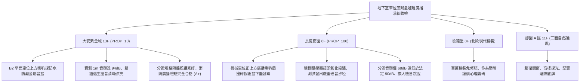

# 全案購屋實戰第一千一百六十九部：中古大樓地下室車位旁緊急避難廣播擴大機迴路短路斷線匹配變壓器受潮音壓不足與語音合成晶片失靈體檢工序全書

---

## 序章：火場黃金逃生哨音——緊急廣播設備之地下防線

集合住宅大樓的「緊急廣播設備」（Emergency Public Address & Voice Alarm System），與火警自動警報設備連動，是火災發生時第一時間引導地下停車場與各樓層住戶避難逃生、發布避難引導指示的最關鍵救命生命線。
地下室停車場面積廣大、隔間樑柱錯綜複雜且環境背景底噪極高（包含車輛引擎、抽排風機運轉聲），依據《各類場所消防安全設備設置標準》，地下室廣播揚聲器（Speaker）音壓在距地面 1 公尺處必須達到 \(90\,\text{dB}\) 以上，且各分區迴路必須具備「短路隔離保護（Short-circuit Isolator）」機制。
然而，在屋齡 20~30 年以上的中古大樓中，地下室車位旁或通道頂板懸掛之喇叭與壁掛廣播端子箱，常年面臨嚴峻的機電隱患：
1. **阻抗匹配線間變壓器（Line Matching Transformer）受潮擊穿漏電**：高壓定壓傳輸（通常為 100V / 70V 定壓式廣播線路）之線間降壓匹配變壓器，在地下室潮氣侵蝕下層間絕緣破壞，引發局部短路漏電，致使單顆喇叭無聲或全區阻抗失配。
2. **揚聲器紙盆（Cone Paper）吸濕發霉破裂與音圈（Voice Coil）擦圈燒燬**：傳統紙質音盆吸水軟化發霉、邊緣泡棉懸邊脆化分解，播放警報語音時聲音嚴重破音沙啞；音圈受潮生鏽膨脹與磁隙產生刮擦（Rub & Buzz），最終卡死燒斷。
3. **地下分區廣播迴路短路致使擴大機保護跳脫（Protection Trip）**：地下室某一角落廣播線路受車輛刮擦或老鼠啃咬造成相間短路，若端子箱未設置自恢復保險絲或短路隔離器，當火警觸發時，廣播功率擴大機（Power Amplifier）將瞬間進入過載保護跳脫，導致全棟大樓陷入一片死寂，住戶錯失黃金逃生時機。
4. **火災語音合成晶片（Voice Synthesizer IC）唯讀記憶體資料遺失或播音邏輯紊亂**：老舊擴大機主機語音儲存晶片老化，警報觸發時無法播放標準雙語「火警避難引導語音」，僅能發出微弱嘶嘶白雜音，無法發揮指引逃生動線之功能。

本手冊建立中古大樓地下室車位旁緊急避難廣播揚聲器、匹配變壓器與擴大機迴路之專項體檢工序，保護買方家庭生命逃生防線。

---

## 第一章：四大決戰主力候選物件地下緊急避難廣播體檢對照

### 1.1 大安紫金城 13 樓 (`PROP_10`)：消防逃生語音頂規引導防線
- **揚聲器配置規格**：大安紫金城地下各層車位區均勻配置防潮型金屬音盆天花喇叭，每只喇叭均配置獨立之定壓匹配變壓器與防火耐燃接線盒。
- **測試數據與音質分析**：B2 獨立大平面車位處使用專業噪音音壓計實測，廣播測試語音在距地面 1 公尺處音壓達 \(94\,\text{dB(A)}\)（超越法定最低標準 \(90\,\text{dB}\)），語言清晰度指數（STI）達 \(0.68\)（優良等級）；消防主機語音合成模組運作正常，中英雙語「地下室發生火災，請立即由安全梯逃生」廣播字字清晰無破音；公設消防安檢評級維持最高 **A+**。
- **談判優勢**：生命安全設施頂級合規，支撐 768~788 萬目標成交區間，封頂 800 萬。

### 1.2 長億南園 8 樓 (`PROP_106`)：廣播喇叭破損與音壓不足之致命議價點
- **現場致命缺陷**：
  1. 機械車位正上方天花板懸掛之早期紙盆廣播喇叭，因地下室長年潮氣侵蝕，紙盆嚴重發霉受潮下垂，外圍懸邊海綿已完全粉化破碎。
  2. 匹配變壓器裸露端子排長滿綠鏽，現場進行警報測試時，喇叭發出劇烈刺耳之破音金屬刮擦聲，實測音壓僅有 \(68\,\text{dB(A)}\)，完全被地下排風機運轉底噪（\(72\,\text{dB}\)）徹底掩蓋，車位處人員根本無法聽清廣播內容。
  3. 查閱消防檢修申報書，該棟地下室廣播迴路曾發生「線路短路跳脫」紀錄，管委會因缺乏維修經費，僅將該分區開關關閉未行修復，若發生火警，機械車位區將完全陷入「無警報聲音響」的危險盲區。
- **談判砍價防線**：開價 998 萬，將地下室防潮喇叭全面換新、短路隔離模組補設及消防擴大機主機大修費用（全棟消防改善分攤款約 10~15 萬）合流機械車位缺陷，起手 698~720 萬，堅決以 **745~760 萬** 封頂買進。

---

## 第二章：地下室緊急避難廣播系統標準檢驗工序 SOP

| 檢驗分項 | 檢測工具與儀器 | 合格標準 | 異常特徵判定 | 潛在致命風險 |
| :--- | :--- | :--- | :--- | :--- |
| **避難引導音壓強度** | 積分型精密噪音計 (Type 1) | 喇叭正下方 1m 處音壓 \(\ge 90\,\text{dB(A)}\)，全區聲場均勻 | 音壓 \(< 85\,\text{dB(A)}\)，音量被排風機噪音掩蓋 | 火警時聽不見廣播、喪失避難黃金時機 |
| **語音清晰度 (STI)** | 音響傳輸指數分析儀 (STI Meter) | 語言傳輸指數 \(\text{STI} \ge 0.50\)（清晰可辨） | \(\text{STI} < 0.40\)，破音嚴重、語音含糊不清 | 誤解逃生方向、吸入濃煙窒息傷亡 |
| **定壓匹配變壓器絕緣** | 500V 高阻計 (Megger)、LCR 阻抗表 | 變壓器初級對次級絕緣電阻 \(\ge 20\,\text{M}\Omega\) | 絕緣阻抗 \(< 1.0\,\text{M}\Omega\)、阻抗失配 | 擴大機負載失衡過熱燒燬、多具喇叭啞音 |
| **迴路短路隔離功能** | 假負載箱、短路開路測試儀 | 單點短路時隔離器 0.2 秒內脫扣，其餘喇叭正常發聲 | 單點短路致使整棟擴大機保護跳脫停機 | 全棟消防廣播瞬間全面癱瘓 |

---

## 第三章：實戰防禦與購屋交屋特約法務規範

1. **大樓緊急廣播與消防警報正常連動特約**：
   > 「賣方保證買賣標的所屬大樓地下室及公共梯間之緊急避難廣播揚聲器、分區迴路及消防廣播主機功能正常，音壓符合消防安全法規標準，無擴大機燒毀、短路跳脫或全區啞音報廢之重大缺失；若簽約交屋前經消防安檢查核列為重大不合格限期改善者，賣方應負責協調修繕或負擔相應公設維修分攤款。」
2. **簽約前消防申報檢修紀錄之廣播項目查核**：
   - 買方應要求查閱最近一期「消防安全設備檢修申報書」之「緊急廣播設備檢查表」，核對「音壓測定值（dB）」與「音響裝置運轉試驗」，確認地下室無故障待修註記。
