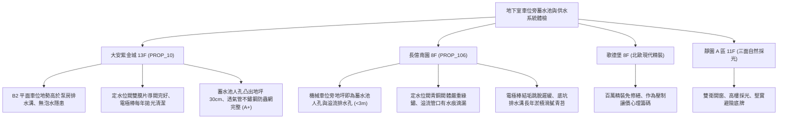

# 全案購屋實戰第一千一百六十二部：中古大樓地下室車位旁蓄水池自來水進水浮球閥卡死溢流淹水防倒流逆止閥故障與抽水泵空轉體檢工序全書

---

## 序章：大樓供水咽喉與地下淹水防線——蓄水池進水控制與泵浦安全

集合住宅大樓的民生用水系統，通常採用「地下室蓄水池（下水池）＋頂樓水塔（上水池）」兩段式重力供水架構。自來水事業處的自來水管線直接引入地下室蓄水池，再由多段式渦卷泵或沉水式抽水泵（揚水泵浦）加壓輸送至頂樓。
在地下室停車場中，蓄水池多為 RC 混凝土結構澆置於地樑層或停車位地坪下方，其進水控制閥組、透氣防蟲管、人孔蓋與溢流管路往往緊鄰車位或車道。一旦這套進水與加壓系統在經歷 20~30 年後老化失修，將釀成極具毀滅性的地下室災難：
1. **進水機械浮球閥（Float Valve）或定水位閥（Altitude Valve）導閥卡死導致池水溢流淹水**：自來水進水閥若因水中鐵鏽雜質、水垢卡死導閥活塞，或浮球連桿變形卡扣，自來水將以每小時數十噸的流量持續強灌。當溢流管（Overflow Pipe）口徑不足或排水格柵堵塞時，冰冷自來水將迅速漫延至整個地下室停車地坪，淹沒車位、泡損車輛底盤與電機設備。
2. **防倒流污染防止器（Backflow Preventer / RPZ）閥片破損導致飲用水倒流污染**：自來水進水管若未設置或逆止閥橡膠膜片龜裂硬化，當外界自來水管網因爆管負壓抽吸時，大樓蓄水池內的死水或雜質可能逆流回主幹管，造成全區水質重度污染並面臨自來水公司鉅額罰款。
3. **電極棒液位控制器（Liquid Level Controller / Floatless Relay）表面附著生物膜失靈引發泵浦無水空轉燒毀**：高低水位不鏽鋼電極棒若結垢嚴重或短路，揚水泵在池水抽乾時仍持續全速空轉，機械軸封（Mechanical Seal）在無水冷卻潤滑下瞬間高溫碳化熔融，電機線圈過熱燒燬，甚至引燃泵房周邊雜物。
4. **蓄水池透氣管（Air Vent Pipe）防蟲銅網破損導致污水與病媒蚊蟲侵入**：地下室廢氣、蚊蠅、蟑螂甚至老鼠經由破孔鑽入水池中腐爛，導致全棟住戶飲用水大腸桿菌嚴重超標，引發群體急性腸胃炎。

本手冊建立中古大樓地下室車位旁蓄水池進水閥、液位控制與揚水泵浦之專項體檢工序，保護買方家庭飲水安全與愛車遠離泡水威脅。

---

## 第一章：四大決戰主力候選物件地下蓄水池與供水泵浦體檢對照

### 1.1 大安紫金城 13 樓 (`PROP_10`)：供水機電頂級維護與零泡水風險
- **車位地形與高程優勢**：大安紫金城 B2 獨立大平面車位位於車道主排水分區的高點，地坪具備 \(1.5\%\) 的洩水坡度，完全遠離蓄水池檢修人孔與泵浦機房超過 25 公尺，即使機房發生偶發性溢流，水流亦順沿截水溝直接排入沉砂坑，車位絕無積水泡車隱患。
- **蓄水池與閥件現況**：進水主控閥採用雙膜片水力定水位閥（Altitude Control Valve），反應靈敏；蓄水池人孔蓋凸出地基面達 \(30\,\text{cm}\) 以上，周圍設有防水凸緣與防溢橡膠密封墊，透氣管末端配備 316 不鏽鋼 100 目防蟲網；揚水泵浦配備微電腦缺水保護器，定期保養運轉震動值低於 \(1.8\,\text{mm/s}\)，維護等級評定為頂級 **A+**。
- **談判決策**：安全與居住生活底氣堅若磐石，支撐 768~788 萬目標區間，封頂 800 萬。

### 1.2 長億南園 8 樓 (`PROP_106`)：蓄水池溢流滴漏與泵房潮濕之致命議價扣款點
- **現場致命缺陷**：
  1. 機械車位側方地坪不到 3 公尺處，即為地下蓄水池之溢流管排水口與檢修人孔。現場勘查發現，自來水定水位閥關閉不嚴，溢流管內部持續發出「滴答」涓流漏水聲，顯示自來水常態性溢流浪費，水費由全棟住戶分攤。
  2. 蓄水池人孔蓋為早期平面鑄鐵蓋板，邊緣未做高起防污圍堰（Curb），洗車污水與地面灰塵極易經由蓋板縫隙滲入自來水池內，水質衛生存有高度疑慮。
  3. 電極棒感應棒表面包裹厚重黃褐色生物水垢，液位感知失真；揚水泵浦機械軸封已有水滴飛濺甩出痕跡，電機軸承運轉聲刺耳嘶鳴，隨時面臨泵浦軸封燒融與全棟缺水大修。
- **談判折讓策略**：開價 998 萬，將定水位閥更換、蓄水池人孔高起防護改造、揚水泵浦軸封及軸承重修（全棟公設分攤費用約 10~18 萬）合流機械車位限重 1.6 噸之不可逆抗跌硬傷，起手 698~720 萬，目標 **745~760 萬** 封頂買進。

---

## 第二章：地下室蓄水池與進水控制系統標準體檢工序 SOP

| 檢驗分項 | 檢測工具與儀器 | 合格標準 | 異常特徵判定 | 潛在致命風險 |
| :--- | :--- | :--- | :--- | :--- |
| **定水位進水閥** | 壓力表、水力導閥手動截斷測試 | 關閉時完全密封、溢流管零滴漏，開啟平順無水錘 | 溢流管持續流水、閥體劇烈震顫敲擊聲 | 自來水日夜溢流浪費、淹水漫延停車場 |
| **液位控制電極棒** | 數位三用電表、高阻計 | 電極棒清潔光亮、高低水位繼電器響應延遲 \(< 1\,\text{s}\) | 電極棒覆蓋厚垢硬化、抽乾水泵仍不停機 | 揚水泵空轉乾燒毀損、電機線圈起火 |
| **蓄水池人孔密封** | 游標卡尺、防臭氣密橡膠檢視 | 人孔高出地坪 \(\ge 20\,\text{cm}\)，雙層密封無水漬侵入 | 人孔與地坪齊平、蓋板四周有泥沙水痕滲入 | 洗車廢水與地面油污滲入、大腸桿菌超標 |
| **揚水泵浦機械軸封** | 紅外熱像儀、聽診棒、測振儀 | 軸封處零洩漏或每分鐘 \(< 3\) 滴，軸承震速 \(< 2.5\,\text{mm/s}\) | 水滴呈水霧狀噴濺、軸承部位溫度 \(> 75^\circ\text{C}\) | 軸承抱死燒燬、地下室全區無預警斷水 |
| **透氣管防蟲不鏽鋼網** | 強光手電筒、目視放大鏡 | 100 目 304/316 不鏽鋼網牢固無破損、朝下彎曲 | 防蟲網破洞脫落、管口無防護朝天 | 蟑螂老鼠病媒鑽入溺死、全棟住戶集體中毒 |

---

## 第三章：實戰防禦與購屋交屋特約法務規範

1. **公設供水蓄水池與泵浦運轉保證特約**：
   > 「賣方保證買賣標的所屬大樓地下室蓄水池、定水位進水閥組及揚水泵浦設備運作正常，無溢流滲漏、人孔污水倒灌或供水馬達燒毀待修之重大故障；交屋日前若發生蓄水池溢流淹水致車輛財物受損，或發生全棟自來水重大污染事故，賣方應負責協調修繕賠償或買方得無條件解除契約。」
2. **大樓自來水清洗與水質檢驗核驗**：
   - 買方應要求賣方或管委會出示最近一期合法清潔公司之「大樓蓄水池水塔清洗維護紀錄表」及「環保局/SGS 飲用水水質檢驗報告」，確認大腸桿菌群、總菌落數及重金屬完全合格。
