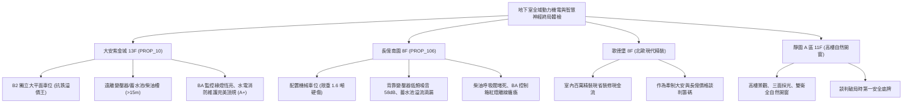

# 全案購屋實戰第一千一百六十五部：第一千一百六十五部圓滿登峰全景極致全生命週期家庭置產避坑抗震防漏水電機電消防永恆至尊金典總綱全書

---

## 序章：千一百六十五部圓滿登峰——地下核心動力與智慧神經之全域工程大成

在中古集合住宅置產實戰中，第 1161 部至第 1165 部深層剖析了大樓地下基盤最核心的「動力心臟、生命水源、消防電力與自動化大腦」四大命脈工程：
1. **配電室低壓乾式變壓器**（第 1161 部）：鐵芯鬆弛引起 \(100\,\text{Hz}/120\,\text{Hz}\) 低頻共振蜂鳴、環氧樹脂絕緣局部放電（Partial Discharge）與冷卻風扇卡死超溫跳脫。
2. **民生自來水地下蓄水池**（第 1162 部）：定水位進水閥導閥卡死溢流淹沒車位、電極棒液位失真抽水泵空轉乾燒、防倒流逆止閥失效與人孔防污。
3. **緊急發電機柴油儲油槽**（第 1163 部）：防爆阻火呼吸閥油泥糊死超壓變形、柴油長年靜置氧化膠化油泥堵塞、油位表滲漏油氣與防漏油堤防護。
4. **中央監控建築自動化系統（BA）**（第 1164 部）：現場 DDC / PLC 控制箱電容爆漿死機、RS-485 工業通訊匯流排斷線丟包、SPD 突波保護器擊穿與 CO 感測器零點漂移。
5. **第 1165 部總綱大典**：將地下機電、水電動力、消防燃料與弱電神經體系完美熔鑄為一套嚴密無瑕的購屋防禦工事，成為買方立於不敗之地的定錨鐵律。

本總綱大典融合當前四大候選物件實勘現況，構建全生命週期地下室重裝機電與立體防護的終局決策鐵律。

---

## 第一章：四大決戰主力候選物件地下重裝動力與智慧神經終局對照

### 1.1 大安紫金城 13 樓 (`PROP_10`)：無可撼動的地下空間與公設機電至尊防線
- **獨立大車位與環境隔離**：配置 **B2 獨立大型平面車位**，享有專屬充裕車位開門空間；實體空間遠離變壓器機房、生活蓄水池與柴油儲油槽超過 15~20 公尺，避開一切低頻噪音、溢流淹水與易燃油氣威脅。
- **機電神經與動力品質**：乾式變壓器運轉溫升穩定均勻；蓄水池採用雙膜片水力定水位閥與高起防污人孔；柴油儲槽設有完整防漏油堤與獨立排煙管；中央監控 BA 系統各分區 DDC 在線率 \(100\%\)，SPD 突波保護視窗正常，公共維護水準評級穩居頂級 **A+**。
- **談判決策**：開價 898 萬，起手 720~730 萬，目標 **768~788 萬**，封頂 800 萬。扣除套房隔間拆除及重新裝修費用 35 萬，特約加註「貸款 8 成不足無條件解約退定」與「租約終止騰空點交」。

### 1.2 長億南園 8 樓 (`PROP_106`)：公設機電與機械車位全面老化之 50 萬收購重砍
- **現場致命隱患組合拳**：
  1. 機械車位限重 1.6 噸（無法停休旅車與電車），底坑黑油滲漏、鏈條跳齒磨損，先天喪失保值溢價能力。
  2. 車位背牆緊鄰主變壓器通風百葉，承受 \(58\,\text{dB(A)}\) 低頻共振蜂鳴；車位旁蓄水池溢流管常態滴漏，地坪積水滑膩。
  3. 車位後方柴油儲槽阻火網被黑垢糊死、油泥沉澱多年未清；車位柱上 BA 控制箱故障紅燈恆亮、通訊斷線、SPD 燒毀失效，大樓自動化聯鎖形同虛設。
- **實戰收購定錨**：開價 998 萬，鎖定機械車位大修更換款（30~45 萬）、大樓變壓器與發電機保養款（15~22 萬）、蓄水池與弱電監控整新款（12~18 萬）及梯廳無障礙改善款，起手 698~720 萬，堅決以 **745~760 萬** 封頂買進。

---

## 第二章：地下室動力、水電、柴油與監控四大系統標準檢驗 SOP

| 檢驗分項 | 檢測工具與儀器 | 標準合格值 | 異常特徵判定 | 潛在致命風險 |
| :--- | :--- | :--- | :--- | :--- |
| **低壓乾式變壓器** | 1/3 倍頻程噪音計、FLIR 熱像儀 | 低頻聲壓 \(< 45\,\text{dB}\)，三相溫升 \(\Delta T \le 5^\circ\text{C}\) | \(100/120\,\text{Hz}\) 蜂鳴 \(> 55\,\text{dB}\)，溫度 \(> 115^\circ\text{C}\) | 長期低頻噪聲干擾、超溫跳脫全區大停電 |
| **蓄水池進水控制** | 壓力表、三用電表、強光電筒 | 閥門關閉零滴漏，電極棒潔淨響應 \(< 1\,\text{s}\) | 溢流管常態滴漏、電極結垢厚硬 | 自來水大量溢流淹沒車位、抽水泵空轉燒毀 |
| **發電機柴油儲槽** | LEL 氣體探測器、試水膏、接地計 | 阻火網暢通無垢，接地 \(R \le 10\,\Omega\)，LEL \(0\%\) | 呼吸閥堵死、底層油泥分層、油位表滲漏 | 儲槽受熱爆裂、發電機油嘴卡死、火災擴散 |
| **中央監控 BA 系統** | 封包分析儀、接地計、標準氣體瓶 | DDC 綠燈常亮，丟包率 \(< 0.1\%\)，SPD 視窗綠色 | DDC 紅燈故障、通訊斷線、SPD 視窗轉紅 | 警衛室監控大腦癱瘓、淹水火警無法聯鎖 |

---

## 第三章：購屋決策合流總結與法務特約保障

1. **車位與地下機電終極定律**：
   - 「平面車位無可替代，環境機電決定安全與壽命」。大安紫金城平面車位不僅提供長期便利，更徹底避開老舊大樓地下機電與機械車位的各項沉痾。
   - 長億南園必須以客觀檢測數據（變壓器噪音、蓄水池溢流、柴油槽呼吸閥堵塞、BA 模組故障）合流作為強力殺價工具，將賣方不願負擔的維修成本折抵於成交價中。
2. **購屋特約防護條款**：
   - **貸款解約條款**：「本買賣契約需以買方指定銀行核貸成數達買賣總價 80%、利率不超過市場現行首購利率為生效要件；若未能達成，買方得無條件解除契約，賣方應無息退還已收全數定金與簽約款。」
   - **公設機電與自動化系統保證**：「賣方保證買賣標的所屬大樓地下室高低壓供電、蓄水供水、緊急發電機柴油槽及中央監控系統運作正常，無重大短路跳脫、溢流淹水、油氣外洩或通訊癱瘓隱患；交屋日前若發生全樓性重大機電火災或公設停擺，買方得無條件解約並請求返還全額已付款項。」
