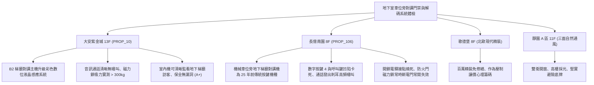

# 全案購屋實戰第一千一百六十八部：中古大樓地下室車位旁大樓對講機主機解碼器受潮按鍵彈簧疲勞音訊嘯叫與門禁開鎖電驛接點氧化體檢工序全書

---

## 序章：社區安防第一道關卡——對講機系統與地下門禁防線

在集合住宅大樓中，對講機與門禁保全系統（Intercom & Access Control System）連接了警衛管理室、各棟地下梯廳門禁門、一樓大門與各住戶室內對講分機。地下室停車場梯廳往往設有地下門禁對講讀卡主機，而其解碼分配器（Decoder / Floor Distributor）、後備電源箱（DC 12V/24V Power Supply）與音訊/影像傳輸線路，常集中安裝於地下室梯廳旁或車位側牆之弱電配線箱內。
然而，在屋齡 20~30 年以上的集合住宅中，地下室潮濕水氣、車道震動、柴油廢氣與長年未維護，極易引發下列重大隱患：
1. **梯廳門禁對講主機金屬按鍵彈簧疲勞與導電橡膠炭化失效**：住戶每日停車後頻繁按壓地下門禁對講機呼叫鍵或密碼按鍵，內部不鏽鋼彈簧金屬疲勞卡滯，導電橡膠按鍵表面導電炭層磨損脫落，致使按鍵失靈或連續短路報警。
2. **對講機音訊類比電路受潮引發回授嘯叫（Acoustic Feedback）與雜音干擾**：地下室空氣濕度長期高於 \(80\%\,\text{RH}\)，音訊放大電路之運算放大器（Op-Amp）與可調電位器（Potentiometer）受潮氧化，造成通話時產生刺耳的高頻嘯叫（Howling）、交流嗡鳴聲（Humming），甚至完全聽不清警衛室呼叫。
3. **門禁開鎖繼電器（Relay）接點電弧燒蝕與陽極鎖（Drop Bolt）/ 磁力鎖（EM Lock）失靈**：開鎖繼電器長年承受直流感性負載反向電動勢（Flyback EMF）衝擊，接點嚴重炭化氧化，導致按壓室內開鎖鍵後，地下梯廳防火門磁力鎖無法正常釋放，或鎖栓卡死致使門禁長開形同虛設，外部可疑人士自由進出。
4. **影像傳輸類比同軸線或差分雙絞線老舊致使視訊雪花條紋**：對講機門禁攝影機視訊信號衰減嚴重，室內對講機螢幕僅能看見模糊晃動之雪花橫條紋，無法辨識訪客面貌，徹底喪失安防辨識機能。

本手冊建立中古大樓地下室車位旁對講機主機、解碼器與門禁鎖具之標準專項體檢工序，保護買方家庭生命安防與資產隱私。

---

## 第一章：四大決戰主力候選物件地下對講與門禁系統體檢對照

### 1.1 大安紫金城 13 樓 (`PROP_10`)：現代數位對講與零死角門禁安防
- **系統現代化優勢**：大安紫金城地下各層梯廳門禁對講系統於近年完成整修更換，採用金屬防水防暴型彩色數位液晶對講主機，結合悠遊卡/RFID 感應門禁。
- **測試數據與運行實測**：B2 平面車位進入梯廳之磁力鎖吸力實測達 \(320\,\text{kgf}\)，斷電釋放符合消防逃生連動法規；實測 13 樓室內對講分機與地下梯廳主機雙向對講，音質清澈無底噪、無嘯叫，彩色視訊解析度高達 1080P，且能穩定遙控開鎖；公共安防維護評級高達頂尖 **A+**。
- **談判優勢**：保全完備且無更新集資壓力，支撐 768~788 萬目標區間，封頂 800 萬。

### 1.2 長億南園 8 樓 (`PROP_106`)：對講門禁全面癱瘓之致命議價扣款點
- **現場致命缺陷**：
  1. 機械車位旁地下梯廳對講機為 25 年前之傳統黑白CRT/按鍵式機種，按鍵面板「呼叫（CALL）」與「數字 4」凹陷卡滯，多次按壓無反應。
  2. 實測通話功能，揚聲器發出刺耳的高頻反饋嘯叫與連續交流嗡鳴聲，地下梯廳人員完全無法聽清 8 樓住戶對話；黑白視訊螢幕滿佈滾動斜紋，夜間一片漆黑無法辨識人臉。
  3. 門禁陽極鎖電驛接點碳化燒蝕，地下梯廳防火門鎖栓無法正常彈出上鎖，住戶多用木楔或磚塊擋住門縫，導致外人隨時可由地下車道直接進入長億南園各棟電梯間，形成重大安防漏洞。
- **談判砍價防線**：開價 998 萬，將地下室門禁主機換新、數位解碼器重新配線、梯廳磁力鎖更換與室內對講機整新費用（全棟安防改善分攤款約 8~12 萬）合流機械車位缺陷，起手 698~720 萬，堅決以 **745~760 萬** 封頂買進。

---

## 第二章：地下室對講機主機與門禁系統標準檢驗工序 SOP

| 檢驗分項 | 檢測工具與儀器 | 合格標準 | 異常特徵判定 | 潛在致命風險 |
| :--- | :--- | :--- | :--- | :--- |
| **通話品質與聲學回授** | 聲級計、實時頻譜分析儀 | 語音清晰度 \(> 90\%\)，無交流聲，無 \(\ge 2\,\text{kHz}\) 嘯叫 | 揚聲器嘯叫聲壓 \(> 75\,\text{dB}\)，交流嗡鳴嚴重 | 無法與訪客通話、警衛緊急廣播失靈 |
| **按鍵機械與導通性能** | 按鍵手感力度計、數位三用電表 | 按鍵行程平順回彈迅速，閉合電阻 \(< 10\,\Omega\) | 按鍵卡死陷落、按壓接觸電阻 \(> 1\,\text{k}\Omega\) | 無法呼叫住戶、密碼開鎖功能失效 |
| **門禁鎖具與電驛動作** | 數位電表、拉力計、磁力測試器 | 磁力鎖吸力 \(\ge 280\,\text{kgf}\)，開鎖信號響應 \(< 0.5\,\text{s}\) | 接點炭化無動作、鎖栓卡死、門常開未鎖 | 外人自由出入梯廳、遭小偷竊盜入侵 |
| **視訊信號與夜間補光** | 照度計、手持視訊監視測試儀 | 視訊信號幅度 \(1.0\,\text{Vp-p}\pm 10\%\)，夜間紅外補光清晰 | 畫面滾動斜條紋、黑屏無訊號、夜間全黑 | 無法識別訪客身分、引狼入室遭搶奪 |

---

## 第三章：實戰防禦與購屋交屋特約法務規範

1. **大樓門禁對講系統功能正常保證特約**：
   > 「賣方保證買賣標的所屬大樓地下室梯廳門禁對講主機、室內對講分機及大門開鎖連動系統功能正常，無按鍵卡死、通話嘯叫、視訊失真或門禁鎖具長期故障報廢情事；交屋前若對講門禁系統存有重大故障，賣方應負責修復至可正常通話及遙控開鎖之狀態，或自買賣總價中扣除相應修復費用。」
2. **簽約前室內外對講功能現場全面覆核**：
   - 買方應於簽約前實地在地下室梯廳主機與室內機進行雙向呼叫、語音對講、視訊影像檢視與開鎖動作測試，確認管線與解碼器完全正常。
