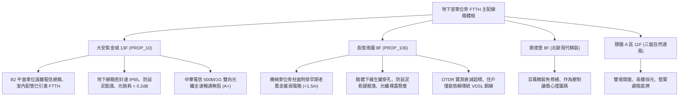

# 全案購屋實戰第一千一百六十六部：中古大樓地下室車位旁光纖到府FTTH主配線箱光纜接續盒脆化粉塵污染熔接損耗超標與防潮抗鼠體檢工序全書

---

## 序章：數位動脈之地下端點——光纖到府（FTTH）主配線箱防線

在現代數位生活與居家遠距辦公日益普及的時代，集合住宅的網際網路傳輸品質直接決定了資產價值與生活便利性。依據國家通訊傳播委員會（NCC）相關規範，近年大樓多建置「光纖到府」（Fiber to the Home, FTTH）架構，而 20~30 年以上的中古大樓則多透過社區管委會與電信業者合作，於地下室電信主機房或地下車位旁牆面增設「大樓主配光箱（Optical Distribution Cabinet, ODC / 光端箱）」，集中收容台電管道或中華電信外引光纜，並透過垂直弱電豎井將光纖分配至各棟住戶。
然而，地下停車場環境常年高濕、粉塵瀰漫、汽機車震動且不時伴隨鼠害威脅，地下室主配光箱若未落實專業維護，將引發下列深層致命缺陷：
1. **光纖接續匣（Splice Tray）橡膠塑膠老化脆裂與光纖微彎損耗（Micro-bending Loss）**：地下室溫度變化與未恆溫環境加速接續匣脆化，收容盤內之 \(250\,\mu\text{m}\) 裸光纖受應力擠壓，彎曲半徑小於 \(15\,\text{mm}\)，導致特定波長（\(1310\,\text{nm}/1490\,\text{nm}/1550\,\text{nm}\)）衰減激增，引發住戶網路頻繁掉封包甚至斷線。
2. **LC/SC 光纖適配器陶瓷套筒（Ceramic Sleeve）粉塵污染與端面磨損**：車道車輛往來揚起之碳黑與油污微粒經由未密封箱門滲入，附著於光纖適配器插芯端面，造成插損（Insertion Loss）飆高至 \(1.5\,\text{dB}\) 以上（標準應 \(< 0.3\,\text{dB}\)），反射損耗（Return Loss）劣化引發光回波干擾。
3. **電信箱體金屬鍍鋅板電化鏽蝕穿孔與防鼠泥（Firestop Putty）脫落**：外引管線穿越孔若未以防火防鼠膨脹膠泥緊密填塞，老鼠極易沿著管槽鑽入箱體內部啃咬芳綸纖維與緊套光纖，引發全棟大樓網路癱瘓。
4. **接地銅排氧化與突波衝擊**：光纜外層金屬加強芯（Steel Strength Member）若未落實接地或接地電阻過高，當夏季雷擊感應電流傳導至地下室時，將直接擊毀相連之光電轉換器（ONU / OLT）設備。

本手冊建立中古大樓地下室車位旁 FTTH 光纖主配線箱之標準專項體檢工序，保護買方家庭高速數位生活與資產價值。

---

## 第一章：四大決戰主力候選物件地下光纖通訊設施體檢對照

### 1.1 大安紫金城 13 樓 (`PROP_10`)：頂規光纖到府與超高速網路優勢
- **通訊基礎設施優勢**：大安紫金城社區於近年完成全區 FTTH 光纖到府升級改造工程，主配光箱設於獨立之電信專用弱電機房內，遠離地下車位震動與水氣。
- **測試數據與維護狀態**：B2 獨立大平面車位旁之分線箱採用優質粉體烤漆密封箱，進出線孔以防火防鼠膨脹泥嚴密填塞；實測各芯光纖衰減率低於 \(0.25\,\text{dB/km}\)，連接器插損均在 \(0.2\,\text{dB}\) 以內；13 樓室內已預留光纖暗管入戶，中華電信 HiNet 500M/1G 雙向極速寬頻即插即通，通訊評級高達頂尖 **A+**。
- **談判優勢**：現代數位居住品質頂尖，支撐 768~788 萬目標區間，封頂 800 萬。

### 1.2 長億南園 8 樓 (`PROP_106`)：弱電箱老化與光纖無法入戶之致命扣款點
- **現場致命缺陷**：
  1. 機械車位旁立柱上懸掛早期老舊金屬電信箱，箱底因地下室潮氣侵蝕已嚴重鏽蝕穿孔，箱門無法緊閉。
  2. 防鼠填縫泥早已乾裂脫落，箱內傳統銅纜與後期加裝之單模光纖混雜凌亂，部分光纖彎曲半徑小於 \(10\,\text{mm}\)，且表面積滿黑油污灰塵。
  3. 實測長億南園目前多數住戶因垂直管線堵塞無法直接拉設 FTTH 光纖入戶，僅能使用傳統電話雙絞線行 VDSL 供裝（最高速率僅 60M~100M，且下雨天頻繁斷線）。若欲重新穿引光纖暗管，需面臨公設管線疏通甚至外走明管之管委會協調困難。
- **談判砍價防線**：開價 998 萬，將弱電箱體換新、垂直管道疏通拉設專用光纖暗管費用（預估每戶改善支出約 5~8 萬）合流機械車位限重 1.6 噸與水電老化硬傷，起手 698~720 萬，堅決以 **745~760 萬** 封頂買進。

---

## 第二章：地下室車位旁 FTTH 主配線箱標準檢驗工序 SOP

| 檢驗分項 | 檢測工具與儀器 | 合格標準 | 異常特徵判定 | 潛在致命風險 |
| :--- | :--- | :--- | :--- | :--- |
| **光纖鏈路損耗** | 光時域反射儀 (OTDR)、光功率計 | 接頭插損 \(< 0.3\,\text{dB}\)，全鏈路總損耗 \(< 20\,\text{dB}\) | 接續點損耗 \(> 0.8\,\text{dB}\)，曲線出現明顯反射階躍 | 寬頻頻繁斷線掉包、無法申裝高速光纖 |
| **端面清潔度** | 光纖端面檢測顯微鏡 (400x) | 插芯纖芯區（Core）與包層無油污、凹坑、刮痕 | 端面覆蓋碳黑灰塵、陶瓷插芯碎裂 | 永久性磨損光電模組、傳輸誤碼率飆高 |
| **箱體防鼠與密封** | 厚薄規、內視鏡、防火泥檢視 | 防火防鼠膠泥飽滿無縫隙，箱門橡膠密封條彈性良好 | 防火泥脫落孔洞直徑 \(> 6\,\text{mm}\)，箱內發現鼠糞咬痕 | 老鼠啃斷主幹線光纖、全棟數位癱瘓 |
| **接地防雷保護** | 接地電阻計 (Earth Tester) | 光纜金屬加強芯接地電阻 \(R \le 10\,\Omega\) | 加強芯懸空未接地、接地銅排嚴重綠鏽斷開 | 雷擊突波沿外線灌入、擊毀住家數據機 |

---

## 第三章：實戰防禦與購屋交屋特約法務規範

1. **大樓寬頻通訊與光纖到府保證特約**：
   > 「賣方保證買賣標的所屬大樓地下室電信主配線箱及垂直弱電管道通暢，具備光纖到府（FTTH）或高速寬頻接入條件，管線無遭管委會封閉或嚴重塌陷卡死情事；若經電信主管機構勘查確認無法拉設寬頻或管線損壞需由買方自費大修者，賣方應負責協調修繕或負擔相應工程費用。」
2. **簽約前電信寬頻可裝速率查詢**：
   - 買方應於簽約前透過中華電信官網或客服專線，輸入該物件地址進行「光世代供裝速率查詢」，確認是否支援 300M/500M/1G 之極速雙向光纖服務。
