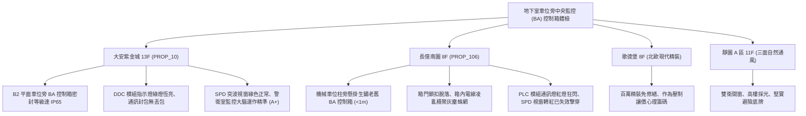

# 全案購屋實戰第一千一百六十四部：中古大樓地下室車位旁中央監控系統BA控制箱PLC模組老化通訊線路斷線突波防護器失效與感知器飄移體檢工序全書

---

## 序章：大樓神經大腦之地下中樞——中央監控系統（BA）與機電聯鎖防線

在現代化與優質中古集合住宅大樓中，地下室機電設備（包含排風機、排煙閘門、揚水泵、污水泵、一氧化碳偵測、消防發電機與照明回路）已全面接入「建築自動化中央監控系統」（Building Automation System, BAS / BA）。BA 系統透過分散式控制器（DDC / PLC 模組）、RS-485 / Modbus / BACnet 工業通訊匯流排，將全棟機電運轉狀態即時回傳至警衛監控室。
然而，在屋齡 15~25 年以上的集合住宅中，地下室車位旁或通道側壁掛之 BA 現場控制箱（DDC Panel），往往處於高濕、油污、震動與浪湧突波等惡劣環境，若長年未更新維護，將引發全樓機電的「神經癱瘓」：
1. **可程式控制器（PLC / DDC）主板電容爆漿與 CPU 當機**：長年地下室高溫高濕與連續通電運轉，使得主板鋁電解電容鼓包漏液，造成控制器頻繁死機，導致排風扇停止運轉或抽水泵無法接收啟動信號。
2. **RS-485 / BACnet 通訊線路接點氧化與遮蔽層破損斷線**：通訊雙絞線（Shielded Twisted Pair）長年受濕氣侵蝕接點綠化氧化，終端電阻（Terminating Resistor）脫落，引起通訊封包反射衝突與「節點離線（Node Offline）」，監控主機無法察覺地下室淹水或一氧化碳濃度超標。
3. **突波防護器（Surge Protection Device, SPD）老化擊穿短路或失效脫扣**：地下室常受大功率發電機啟動、電梯頻繁煞車或夏季雷擊突波衝擊，SPD 模組氧化劣化喪失吸波能力，致使強大突波擊穿弱電傳感器與 PLC 晶片。
4. **一氧化碳（CO）與溫濕度感測器類比量（4~20mA / 0~10V）零點飄移**：傳感器電化學晶片老化未定期校準，實測值嚴重失真，當地下室廢氣濃度達致死濃度時仍未觸發排風風機強制排氣。

本手冊建立中古大樓地下室車位旁 BA 中央監控控制箱、PLC 模組與通訊線路之標準體檢工序，保護買方掌握公設大腦健康度的定錨依據。

---

## 第一章：四大決戰主力候選物件地下中央監控系統體檢對照

### 1.1 大安紫金城 13 樓 (`PROP_10`)：監控中樞精密維護之極致智慧防線
- **監控箱體規格與環境**：大安紫金城 B2 車位區之 BA 控制箱採用厚度 \(1.5\,\text{mm}\) 粉體烤漆防水防塵箱（IP65 等級），內部排線規整、標籤清晰，完全無受潮水痕。
- **運行狀態實測**：DDC 模組電源與運行（RUN）燈呈穩定綠色，Modbus 通訊指示燈（TX/RX）規律閃爍無丟包；SPD 突波保護模組檢驗視窗顯示為正常綠色；警衛室主機螢幕可即時顯示地下各區 CO 濃度及各集水坑液位，公設智慧化維護評級高達頂尖 **A+**。
- **談判優勢**：公設無隱形癱瘓大修負擔，支撐 768~788 萬目標成交價，封頂 800 萬。

### 1.2 長億南園 8 樓 (`PROP_106`)：BA 控制箱癱瘓失聯之致命議價扣款點
- **現場致命缺陷**：
  1. 機械車位立柱旁懸掛之早期 BA 監控控制箱，箱門密封膠條粉化斷裂，箱門半掩無法鎖閉，內部 PLC 模組與端子排覆蓋厚厚一層黑油垢與蜘蛛網。
  2. 模組故障燈（FAULT / ERR）呈紅色恆亮，RS-485 通訊指示燈完全不閃爍，顯示該分區控制箱已實質離線；突波防護器（SPD）指示視窗已呈現紅色，內部壓敏電阻早已劣化燒毀，喪失雷擊突波防護力。
  3. 車位旁之一氧化碳偵測器實測已斷電無輸出，地下室排風全靠警衛室人員定時手動手切，導致排風延遲與油煙蓄積，大樓監控系統處於「半盲癱瘓」狀態。
- **談判砍價防線**：開價 998 萬，將地下室 BA 控制模組更換、通訊線路重新校正與感測器重置（全棟弱電監控公設整新分攤款約 12~18 萬）合流機械車位缺陷，起手 698~720 萬，目標 **745~760 萬** 封頂買進。

---

## 第二章：地下室中央監控 BA 系統標準檢驗工序 SOP

| 檢驗分項 | 檢測工具與儀器 | 合格標準 | 異常特徵判定 | 潛在致命風險 |
| :--- | :--- | :--- | :--- | :--- |
| **PLC/DDC 模組運轉狀態** | 示波器、邏輯分析筆、目視檢驗 | RUN 燈綠色常亮、ERR/ALARM 燈熄滅，電容頂部平整 | ERR 燈紅亮、電容頂部鼓包漏液、頻繁重啟 | 聯鎖控制失效、排水排風設備拒動 |
| **通訊匯流排品質** | 網路纜線測試儀、Modbus 封包分析軟體 | 通訊丟包率 \(< 0.1\%\)，終端匹配電阻 \(120\,\Omega\pm 5\%\) | 通訊燈長滅或長亮、封包錯誤率 \(> 20\%\) | 警衛室無法監控地下室火警淹水 |
| **SPD 突波保護器視窗** | 目視檢視、接地電阻計 | 狀態視窗為正常綠色，SPD 接地線牢固（\(< 5\,\Omega\)） | 狀態視窗轉為紅色/黃色、模組表面焦黑碳化 | 雷擊突波直接擊毀全區精密弱電設備 |
| **類比感知器校準精度** | 標準標定氣體瓶、4~20mA 信號產生器 | 4~20mA 信號線性誤差 \(< \pm 1\%\,\text{FS}\) | 輸出信號跳動飄移、在乾淨環境輸出超標 | CO 超標無法啟動風機、住戶中毒 |

---

## 第三章：實戰防禦與購屋交屋特約法務規範

1. **大樓中央監控與機電自動化保證特約**：
   > 「賣方保證買賣標的所屬大樓公共中央監控系統（BA）、地下室通風排煙及排水聯鎖控制設備運作正常，無主機當機斷線或重大通訊故障；若交屋前發現大樓監控大腦長期癱瘓且經管委會決議需由住戶大額集資更換者，賣方應負責協調修繕或負擔相應公設分攤費用。」
2. **簽約前管委會弱電監控保養清冊查驗**：
   - 買方應要求查閱最近一期大樓委託之「中央監控弱電系統定期維護紀錄表」，確認全棟各分區 DDC 模組在線率與感測器校正合格證明。
