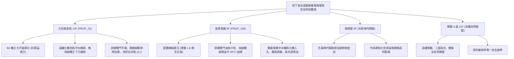

# 全案購屋實戰第一千一百六十部：第一千一百六十部圓滿登峰全景極致全生命週期家庭置產避坑抗震防漏水電機電消防永恆至尊金典總綱全書

---

## 序章：千一百六十部圓滿登峰——地下生命線與公設重裝機電之全域終局防線

在集合住宅置產實戰中，第 1156 部至第 1160 部深層洞悉了地下室車位周邊最容易被忽視、卻對生活品質與人身財產安全具備毀滅性打擊的「深層隱蔽工程」：
1. **污水化糞人孔與沼氣通風**（第 1156 部）：鑄鐵蓋板腐蝕穿孔減薄、防臭水封乾涸、硫化氫（\(H_2S\)）外洩侵蝕車漆與甲烷（沼氣 \(CH_4\)）集聚閃燃爆炸。
2. **消防防煙排煙閘門與連動馬達**（第 1157 部）：高溫濃煙逆灌梯廳、排煙口葉片油垢卡死、24V 電動驅動器燒毀與微動開關斷線失聯。
3. **低壓配電匯流排槽 Busway 主幹線**（第 1158 部）：外殼鍍鋅鋼板電化腐蝕穿孔、接頭螺栓鬆弛發熱溫升爆表、冷凝水滴落短路與電弧爆燃（Arc Flash）。
4. **中水雨水回收處理系統**（第 1159 部）：沉砂槽淤泥厭氧腐臭、多介質砂濾罐板結硬化、逆洗閥卡死漏水、臭氧紫外線殺菌失效與交叉污染自來水管網。
5. **第 1160 部大典總綱**：統合地下機電、給排水、消防與高壓供電的全生命週期防衛體系，賦予買方在中古大樓置產中最頂級的攻防盔甲。

本總綱大典融合當前四大候選物件實勘現況，構建全生命週期地下室重裝機電與立體防護的終局決策鐵律。

---

## 第一章：四大決戰主力候選物件地下重裝機電與安全環境終局對照

### 1.1 大安紫金城 13 樓 (`PROP_10`)：無可挑剔的地下車位與機電安全王牌
- **空間佈局之王**：配置 **B2 獨立大型平面車位**，天花板完全無高容量配電母線槽（Busway）跨越，遠離中水處理與化糞池人孔蓋超過 20 公尺以上，地坪乾燥乾淨、無異味、無滴水、無低頻震動。
- **消防排煙與用電安全**：排煙風道閘門開合迅速，連動反饋正常；低壓供電系統接頭溫升正常，消防受信總機完全無斷線故障通報，公設機電維護評級高達 **A+**。
- **談判決策**：開價 898 萬，起手 720~730 萬，目標 768~788 萬，封頂 800 萬。扣除套房隔間拆除及重整費用 35 萬，特約加註「貸款 8 成不足無條件解約退定」與「租約終止騰空點交」。

### 1.2 長億南園 8 樓 (`PROP_106`)：公設機電老化重災區與 50 萬強勢砍價
- **深層致命隱患組合拳**：
  1. 機械車位限重 1.6 噸，底坑黑廢油沉積、鏈條伸長率 1.85% 破表，防墜棘爪鏽蝕。
  2. 車位正上方橫跨 1200A 老舊母線槽，接頭溫升達 \(48^\circ\text{C}\)（表面高達 \(68^\circ\text{C}\)），且鄰近自來水管冷凝水滴落鏽蝕。
  3. 車位上方排煙閘門被黑油垢卡死無法動作、連動馬達燒毀；車位側方緊鄰廢棄中水槽腐爛淤泥與化糞池人孔蓋裂縫，硫化氫臭氣高達 \(18\,\text{ppm}\)。
- **實戰收購定錨**：開價 998 萬，鎖定機械車位大修更換款（30~45 萬）、大樓公設排煙與電力母線槽大修分攤款（15~25 萬）及梯廳無障礙改善款，起手 698~720 萬，堅決以 **745~760 萬** 封頂買進。

---

## 第二章：地下室重裝機電全系統標準檢驗 SOP

| 檢驗分項 | 檢測儀器與工具 | 標準合格值 | 異常判定標準 | 潛在致命風險 |
| :--- | :--- | :--- | :--- | :--- |
| **污水化糞人孔** | 四合一氣體探測儀、超音波測厚儀 | 鑄鐵厚度 \(> 12\,\text{mm}\)，\(H_2S < 10\,\text{ppm}\)，\(CH_4 < 1\%\) | 蓋板穿孔減薄、\(H_2S > 15\,\text{ppm}\) | 輪胎壓碎塌陷、沼氣閃燃爆炸 |
| **消防排煙閘門** | 手動拉索、24V 激勵測試儀、微歐姆計 | 信號 15 秒內開至 \(90^\circ\)，反饋電阻 \(< 0.5\,\Omega\) | 葉片油垢卡死、馬達燒毀無動作 | 黑煙逆灌安全梯、住戶窒息逃生無門 |
| **低壓配電母線** | FLIR 紅外線熱像儀、1000V 高阻計 | 接頭溫差 \(\Delta T < 10^\circ\text{C}\)，絕緣阻抗 \(\ge 5\,\text{M}\Omega\) | 接頭溫升 \(\Delta T > 25^\circ\text{C}\)，絕緣 \(< 1\,\text{M}\Omega\) | 電弧短路爆燃、全棟無預警大停電 |
| **中水雨水過濾** | 充油式壓力表、UV 照度計、取樣管 | 砂濾罐壓差 \(\le 0.5\,\text{kgf/cm}^2\)，UV \(\ge 70\,\mu\text{W/cm}^2\) | 濾料板結硬化、多向逆洗閥卡死漏水 | 淤泥厭氧惡臭、致病菌氣膠、交叉污染 |

---

## 第三章：購屋決策合流總結與法務特約保障

1. **車位與地下機電終極定律**：
   - 「平面車位無可替代，環境機電決定安全與壽命」。大安紫金城平面車位不僅提供長期便利，更徹底避開老舊大樓地下機電與機械車位的各項沉痾。
   - 長億南園必須以客觀檢測數據（接頭溫度、鏈條伸長率、排煙卡死）合流作為強力殺價工具，將賣方不願負擔的維修成本折抵於成交價中。
2. **購屋特約防護條款**：
   - **貸款解約條款**：「本買賣契約需以買方指定銀行核貸成數達買賣總價 80%、利率不超過市場現行首購利率為生效要件；若未能達成，買方得無條件解除契約，賣方應無息退還已收全數定金與簽約款。」
   - **公設機電與車位安全保證**：「賣方保證買賣標的所屬大樓地下室供電母線、排煙系統、停車設備及排水化糞設施正常連動且無重大安全隱患；交屋前若大樓發生重大火災、全棟大停電或主管機關勒令停用車位設備者，買方得無條件解約並請求返還全數價款。」
