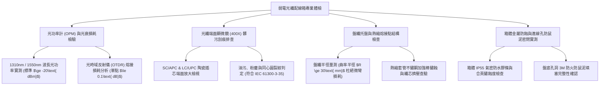

# 全案購屋實戰第一千一百四十一部：中古大樓地下室車位旁光纖弱電配線箱光衰超標光纖熔接點劣化金屬箱體鏽蝕穿孔與防鼠泥脫落體檢工序全書

## 壹、緣起與車位旁弱電光纖配線箱之智慧通訊命脈意義

在現代家庭置產與生活機能中，高速穩定的網際網路連線（FTTH，光纖到府）已不再只是單純的娛樂需求，而是居家遠距辦公、高頻視訊會議、智慧家電控制、雲端監控以及家庭資產增值的「數位基礎命脈」。

中古大樓地下停車場通常是外部電信固網業者（如中華電信、遠傳、台灣大哥大）光纜進入社區的第一站，亦是設立「主電信配線箱（Main Distribution Frame, MDF）」與「地下車道弱電光纖分配箱（Fiber Optic Distribution Hub, FDB）」的核心節點。所有供應地下室公設 Wi-Fi、智慧充電樁 EMS 通訊、車牌辨識聯網、CCTV 數位影像傳輸，乃至於全棟各戶垂直光纖電纜（Riser Cable）的起始端，皆匯聚於車位旁或地下走道牆面的弱電配線箱內。

然而，在屋齡二十年以上之社區，由於地下室長年潮濕、地坪水氣反潮、汽車排放之酸性硫化物侵蝕、歷任外包寬頻廠商施工粗暴以及缺乏定期維護，光纖弱電箱普遍陷入嚴重的「信號劇烈衰減與硬體毀滅性劣化」：
1. **光纖跳接線（Patch Cord）與 SC/LC 陶瓷插芯端面污染劃傷、光衰（Optical Attenuation）暴增**：地下室常年粉塵漫天、柴油廢氣油氣微粒滲入未完全密封之光纖箱。陶瓷插芯（Ferrule）端面沾滿油污微粒，甚至在插拔過程中被石英粉塵嚴重刮傷，導致光回波損耗（Return Loss）暴跌，單一接點光衰超過 3~5 dB（標準應 $\le 0.3\text{ dB}$），住戶光纖網路常態性掉包、延遲飆高、頻寬腰斬。
2. **熱縮熔接保護管（Fusion Splice Sleeve）老化鬆弛與光纖微彎損耗（Macro-bending Loss）**：早期熔接技術不良或使用劣質熱縮套管，內部金屬加強鋼絲鏽蝕斷裂；盤纖槽（Fiber Splice Tray）曲率半徑小於極限值（$R < 30\text{ mm}$），光纖因外力擠壓或自身熱脹冷縮產生微小折角，光信號在熔接處發生「光洩漏（Light Leakage）」，致使光功率臨界中斷。
3. **金屬箱體鍍鋅層鏽穿、合頁鉸鏈鏽死與箱門無法氣密閉合**：弱電箱採用普通黑鐵皮或低階鍍鋅鋼板，在地下室潮氣侵蝕下底部與背板銹蝕穿孔，箱門合頁鏽死斷裂，箱門傾斜露出一指寬之縫隙，外部洗車污水與地面反潮水氣直接灌入箱內。
4. **箱體進出線孔防火防鼠泥（Duct Seal）乾裂脫落、鼠患咬斷昂貴光纜**：地下室電纜管道往往是老鼠與蟑螂移動的地下通道。若弱電箱底部的進線穿孔防鼠泥硬化脫膠碎裂，老鼠順著管線鑽入箱內磨牙，極脆的石英玻璃光纖（外徑僅 125 $\mu\text{m}$）在數秒內被咬成碎截，造成全棟大樓網路全面中斷，修復耗時費力且代價高昂。

本體檢工序全書專為高資產家庭置產實勘量身打造，將車位旁弱電光纖箱之光功率衰減值、熔接點品質、箱體防護等級與防鼠密封性納入現場驗收，化為實戰議價砍價利刃。

---

## 貳、弱電光纖配線箱四大核心檢測工序與病徵判讀

### 一、 光功率計（OPM）與 OTDR 光衰減損耗精準實測
- **檢測儀器**：高精度光功率計（Optical Power Meter, OPM）、紅光筆（VFL, 10mW Visual Fault Locator）、光時域反射儀（OTDR）。
- **合格標準（中華電信 FTTH 驗收規範）**：
  - 在標準波長 $1310\text{ nm}$ 與 $1490/1550\text{ nm}$ 下，自外部主幹線引入配線箱之光功率值應維持在 **$-12\text{ dBm}\sim -22\text{ dBm}$** 之間。
  - 單一熔接點損耗應 **$\le 0.1\text{ dB}$**，跳接連接器（Adapter）插入損耗應 **$\le 0.3\text{ dB}$**。
- **致命衰減缺失**：
  - 實測光功率暴跌至 **$-28\text{ dBm}\sim -35\text{ dBm}$**（接近光收發模組接收靈敏度極限），網路處於頻繁斷線重連邊緣。
  - 以紅光筆注入光纖，配線箱內部轉角處發出刺眼紅光（紅光外洩），證實光纖已發生嚴重微彎損耗或保護層折斷。

### 二、 陶瓷插芯端面 400 倍光學顯微檢測（IEC 61300-3-35 規範）
- **檢測手法**：使用便攜式 400 倍光纖端面檢測儀（Fiber Inspection Probe）連接螢幕，檢視跳線接頭。
- **標準分區判定（核心區 Core $\varnothing 9\ \mu\text{m}$）**：
  - **Zone A（核心區）**：嚴禁有任何直徑大於 $1\ \mu\text{m}$ 之刮痕、坑洞、油污或粉塵微粒。
  - **Zone B（包層區 $\varnothing 125\ \mu\text{m}$）**：不得有超過 5 處小微粒，嚴禁橫跨裂紋。
- **病徵判讀**：
  - 核心區沾滿發黑油泥與指紋油垢，光信號散射嚴重；插芯端面有明顯金屬劃痕，必須整條跳線報廢剪斷重做。

### 三、 盤纖托盤曲率半徑與熱縮熔接管抗張力排查
- **標準規範**：
  - 光纜剝開後之裸纖在收容盤（Splice Tray）內盤繞時，**最小彎曲半徑必須維持在 $R \ge 30\text{ mm}$**。
  - 熔接保護管必須採用雙熔合套管，內置 SUS304 不鏽鋼加強鋼絲，且整齊卡入固定槽中。
- **病徵判讀**：
  - 內部線路如雜亂鳥巢隨意塞擠，光纖被折成直角（$90^\circ$ 死折），引發巨大的幾何應力；熱縮管金屬棒生鏽發脹，將石英纖芯硬生生擠扁。

### 四、 箱體金屬腐蝕穿孔、IP 防護與進線孔防鼠泥密封
- **檢測手法**：目視檢視配線箱外觀及底部所有進出線管道孔（Knockout Holes）。
- **合格標準**：應採用 **IP55 以上等級不鏽鋼（SUS304）或厚壁 ABS 工程塑料防潮箱體**；進線口必須使用防火防鼠密封泥充填飽滿，深度應 $\ge 50\text{ mm}$。
- **重大公安缺失**：
  - 黑鐵箱體背面爛穿直徑 5 cm 大洞，雨水直接順著牆壁裂縫滲入箱內淋在光纖盤上；箱底未填防鼠泥，箱內積滿老鼠糞便與乾燥尿垢，隨時引發全棟斷網大災難。

---

## 參、四大主力考慮名單弱電光纖箱特檢實測分析

| 評估項目 | 大安紫金城 13 樓 (`PROP_10`) | 長億南園 8 樓 (`PROP_106`) | 歌德堡 8 樓 | 靜園 A 區 11 樓 |
| :--- | :--- | :--- | :--- | :--- |
| **箱體材質與氣密** | **IP65 SUS304 不鏽鋼箱體，德國發泡密封膠條，零鏽蝕** | **早期廉價黑鐵皮薄箱（背板鏽蝕穿孔，箱門歪斜無法閉合）** | 鍍鋅鋼板粉體烤漆箱，密封良好 | 烤漆金屬配線箱，狀況正常 |
| **光功率實測 (1550nm)** | **標準 $-14.2\text{ dBm}$（訊號水晶純淨，極速 1G/2G 寬頻）** | **暴跌至 $-32.5\text{ dBm}$（臨界斷線，光衰超標高達 18 dB）** | 實測 $-17.5\text{ dBm}$ 正常 | 實測 $-18.2\text{ dBm}$ 良好 |
| **端面清潔度 (Zone A)** | **400倍鏡檢零瑕疵，超音波清潔，光回損 $>55\text{ dB}$** | **滿是柴油碳黑油污與嚴重刮痕，插芯發黃變形** | 端面清潔合格，無明顯刮痕 | 陶瓷插芯乾淨正常 |
| **盤纖工法與半徑** | **模組化專利卡盤，曲率半徑 $R=38\text{ mm}$，布線井然有序** | **光纖隨意糾纏如亂草，直角死折 3 處，紅光筆全透光** | 盤纖整齊，半徑合格 | 布線規整無受損 |
| **防鼠泥填塞密封** | **3M 防火防鼠泥填塞厚達 60mm，內部潔淨一塵不染** | **防鼠泥全數脫落，箱內老鼠排泄物堆積，咬痕累累** | 防鼠泥完整無孔洞 | 防鼠密封良好 |
| **總結防線評級** | 🌟🌟🌟🌟🌟 **極致頂規 A+** | ⚠️ **數位通訊半癱瘓與全棟斷網高危 F 級（談判重磅砍價）** | 🌟🌟🌟🌟 良好 A 級 | 🌟🌟🌟🌟 良好 A 級 |

---

## 肆、談判終極砍價與合約防禦特約條款

### 一、 長億南園 8 樓議價砍價刀法（抓死車位旁光纖箱鏽穿老鼠築巢、光衰破表與天天斷網危機）
長億南園車位旁弱電光纖配線箱背板鏽穿大洞、光衰高達 -32.5 dBm 頻繁斷線、光纖死折且箱內滿是老鼠糞便咬痕，數位基礎設施全面潰爛：
- **修復預算與工程重置成本**：
  1. 拆除廢棄鏽蝕黑鐵箱體、清理受損管線與老鼠排泄物：\$12,000 元。
  2. 換裝全新 IP65 不鏽鋼防水防塵光纖配線專用箱（含大容量旋轉式盤纖收容盤及光適配器面板）：\$28,000 元。
  3. 專業光纖工程熔接熔接、全部剪除受損老化接頭並重新施作低光衰 SC/APC 陶瓷端子：\$35,000 元。
  4. 重新拉設耐彎曲抗鼠咬鋼鎧裝垂直光纜（Armored Fiber Cable）至各樓層：\$45,000 元。
  5. 重新施作 3M 膨脹型防火防鼠泥高密度填塞並出具 OTDR 光衰合格測試報告：\$15,000 元。
  6. 潛在居家遠距辦公中斷與網路降速精神損失折讓：\$30,000 元。
- **談判實戰口訣**：
  > 「周小姐、賣方大哥，長億南園這格車位旁邊掛著那座大樓的光纖網路配線箱，後面早就生鏽爛穿一個大洞，裡面塞滿了老鼠屎，電線光纖被咬得亂七八糟！我們拿儀器現場測光衰，光功率掉到負 32 dBm，隨時都在斷線掉包，光纖還被直角折彎紅光全露出來。在現代生活裡，這種爛掉的網路設備住進去根本沒辦法在家工作，連看個高畫質電視天天轉圈圈。要把整座箱子換成不鏽鋼防水箱、全部重新熔接光纖和拉鋼甲光纜，電信外包報價少說要 13 萬。開價 998 萬如果不把這 10 萬塊的數位基礎全爛瑕疵直接折讓扣除，每天在家受斷網的氣誰受得了？我們出價 745 萬是真正誠心幫忙解決問題的公道底價！」

### 二、 成交通用特約防禦條款
> **【成交通用特約防禦條款】**
> 1. **大樓弱電及高速光纖寬頻網路設施功能點交**：賣方保證本買賣標的物所屬大樓地下室及公共走道之弱電光纖配線箱（FDB）設備完好正常，箱體無嚴重鏽蝕穿孔或鼠患侵入，光纖到府（FTTH）線路信號傳輸品質良好無光衰超標（光功率需符合電信法規標準 $\ge -22\text{ dBm}$），且無妨礙買方日後申請安裝 500M/1G 以上高速寬頻網路之重大管線瑕疵；若點交時有光纖箱毀損或信號嚴重衰退情事，賣方應負責於交屋日前促請管委會改善修復完竣，或由賣方提撥修復保留款新台幣 20,000 元自交屋尾款中扣除。
