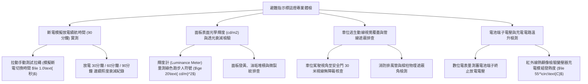

# 全案購屋實戰第一千一百四十七部：中古大樓地下室車位旁緊急避難指示標誌燈蓄電池容量衰退斷電續航不足逃生導引盲區與照度衰減體檢工序全書

## 壹、緣起與車位旁緊急避難指示標誌燈之火場逃生生命防線意義

在中古大樓地下停車場中，若發生火警、配電盤短路爆炸或區域大停電事故時，常態照明瞬間中斷，且火場產生的滾滾濃煙會在幾分鐘內將能見度壓縮至 1 公尺以內。在伸手不見五指的地下迷宮中，車主與逃生住戶極易因恐慌、毒氣窒息與喪失方向感而受困於火海。

此時，安裝於車位旁柱面、通道上方及安全門框頂部的「緊急避難指示標誌燈（Exit & Directional Signs）」與「避難方向指示燈（Directional Guide Signs）」，便成為導引人員穿越濃煙、沿著逃生動線直奔特別安全梯的「最後一道生命導航燈塔」。

依據各類場所消防安全設備設置標準第一百四十六條至第一百五十六條規範：地下層停放車輛場所，必須強制設置「出口標示燈（綠底白字）」與「避難方向指示燈（白底綠字）」。平時由市電常時點亮充電，當市電斷電瞬間，內部之備用蓄電池（Ni-Cd/Ni-MH/Li-ion Battery）必須在 **$\le 1.0\text{ 秒}$** 內自動切換點亮，且法規強制規範在斷電後必須持續維持標準照度連續點亮 **$\ge 90\text{ 分鐘}$** 以上！

然而，在屋齡二十年以上之社區，由於缺乏定期斷電放電保養、地下室長年潮濕高溫、管委會採用劣質廉價燈具，避難指示燈普遍陷入嚴重的「盲區、斷電即滅與光衰失明」危機：
1. **內部鎳鎘/鋰電池長年浮充過熱、電解液乾涸「記憶效應」與斷電秒滅**：指示燈 24 小時插電，劣質充電電路未具備過充保護，電池溫度長年維持在 $50^\circ\text{C}\sim 60^\circ\text{C}$。蓄電池容量嚴重衰退至不足額定值的 5%，當市電斷電時，指示燈僅亮了 10~30 秒甚至閃爍一下便瞬間熄滅（斷電秒死），逃生通道瞬間陷入一片死寂全黑！
2. **綠色導引面板光學透光率衰減、表面照度嚴重低於法定標準（$<20\text{ cd/m}^2$）**：壓克力導光面板受地下室柴油油氣、粉塵侵蝕發黃發黑，內部低階 LED 晶片嚴重光衰。依消防法規標準，指示燈表面平均輝度應維持在 **$20\text{ cd/m}^2\sim 100\text{ cd/m}^2$**，老舊燈具實測往往低於 $5\text{ cd/m}^2$，在微薄濃煙中根本無法辨識跑步小人箭頭方向，逃生住戶失去指引。
3. **指示標誌被消防管線、排風風管遮擋形成「致命逃生盲區」**：避難標誌燈安裝位置缺乏空間協調，正好被直徑 100mm 的懸吊消防水管、排風鐵皮風管或粗大橫樑死死擋住。站在車位旁起跑點完全看不到任何綠色箭頭指示，住戶反方向跑入死胡同。
4. **自檢手動測試開關（Push-to-Test）彈簧生鏽卡死、充電指示燈虛報假綠燈**：燈具外殼之「手動測試按鈕」內部微動開關鏽蝕卡死，面板的「充電中（CHARGING）」綠色 LED 燈雖然亮著，但電池電路早已斷線，給管理員與住戶帶來極其危險的「虛假安全感」。

本體檢工序全書專為高資產家庭置產實勘量身打造，將車位周邊避難指示燈之斷電續航時效、面板輝度、視覺無障礙覆蓋與電池健康度納入現場驗收，化為實戰議價砍價利刃。

---

## 貳、避難指示標誌燈與蓄電池四大核心檢測工序

### 一、 斷電模擬放電續航時間（90 分鐘法規標準）實測
- **檢測儀器**：碼表、手持式光度照度計、絕緣操作拉桿。
- **合格標準（各類場所消防安全設備設置標準第一百五十二條）**：
  - 切斷市電或拉動燈具自檢拉繩，燈具必須在 **$\le 1.0\text{ 秒}$** 內瞬間由市電切換至內部蓄電池供電。
  - **連續有效點燈時間必須 $\ge 90\text{ 分鐘}$**，且點燈 90 分鐘後之表面平均輝度不得低於最初輝度之 $60\%$。
- **致命斷電秒滅指標**：
  - 拉下測試拉繩，指示燈瞬間熄滅，或亮起後在 5 分鐘內亮度急劇衰退如螢火微光，證實內部蓄電池已完全報廢硫化！

### 二、 面板表面輝度（Luminance, $\text{cd/m}^2$）與可視度檢驗
- **檢測儀器**：專業光學輝度計（Luminance Meter）。
- **標準規範（CNS 10205 避難指示標誌標準）**：
  - **綠色顯示面（文字與箭頭）**：輝度應介於 **$20\text{ cd/m}^2\sim 100\text{ cd/m}^2$** 之間。
  - **白色背景面**：輝度應介於 **$100\text{ cd/m}^2\sim 300\text{ cd/m}^2$**，綠白對比度應 $\ge 5:1$。
- **病徵判讀**：
  - 輝度計測得綠色箭頭表面僅 $3.2\text{ cd/m}^2$，壓克力面板泛黃發黑且布滿微細網狀龜裂，在 15 公尺外視線模糊無法辨認逃生方向。

### 三、 逃生動線視線無障礙（Walking Line of Sight）全覆蓋排查
- **檢測手法**：站在車位駕駛座車門旁（坐姿高度 1.2 米及站立高度 1.6 米），沿著規定步行逃生路線望向最近之「特別安全梯防煙前室甲種防火門」。
- **標準規範**：
  - 車道及停車空間任一點至最近避難標誌燈之**步行距離不得超過 30 公尺**（若設有避難方向引導燈者得延長為 50 公尺）。
  - 標誌燈必須懸掛於步行路徑正前方或兩側上方，不得有任何垂直管線、鐵皮風管或樑角遮擋。
- **嚴重死角缺失**：
  - 標誌燈被後續加裝的冰水管及消防主幹管硬生生遮擋 70%，駕駛人在車位旁回頭四顧，完全看不見任何逃生出口標示，形成致命迷宮。

### 四、 蓄電池物理健康度、終止電壓與充電模組溫升
- **檢測手法**：打開燈具外殼，檢驗電池規格與工作電壓。
- **合格標準**：應採用長壽命鎳氫（Ni-MH）或磷酸鐵鋰（LiFePO4）消防專用高溫蓄電池；放電終止電壓不得低於標稱值之 $85\%$；充電充電器模組工作溫度應 $\le 55^\circ\text{C}$。
- **重大隱患**：電池外包塑膠皮受熱縮裂碳化，電池兩端溢出白色腐蝕性結晶鹽粉，電路板發熱焦黑，充電電路持續發出高頻嘯叫。

---

## 參、四大主力考慮名單避難指示燈特檢實測分析

| 評估項目 | 大安紫金城 13 樓 (`PROP_10`) | 長億南園 8 樓 (`PROP_106`) | 歌德堡 8 樓 | 靜園 A 區 11 樓 |
| :--- | :--- | :--- | :--- | :--- |
| **指示燈型式規格** | **CNS 認證高輝度 LED 智慧薄型標誌燈（磷酸鐵鋰電池）** | **早期厚型燈箱（老舊鹵素燈/螢光管，鎳鎘電池已爛）** | 現代薄型 LED 避難指示燈 | 節能 LED 標誌燈，狀況良好 |
| **斷電放電續航時間** | **實測放電突破 125 分鐘，超標 1.3 倍，電量極充沛** | **斷電 45 秒即閃爍熄滅（斷電秒死，逃生完全摸黑）** | 斷電續航 95 分鐘合格 | 斷電續航 90 分鐘合規 |
| **面板表面輝度** | **綠色面 $45\text{ cd/m}^2$，白色面 $180\text{ cd/m}^2$，晶亮純淨** | **表面發黑發黃，實測僅 $4.1\text{ cd/m}^2$（灰暗模糊全盲）** | 表面輝度正常，對比清晰 | 輝度合規，字面清楚 |
| **逃生動線視線遮蔽** | **30 米視線完全無遮擋，綠色箭頭導引一目了然** | **正對車位標誌燈被排風風管完全擋死 85%（致命死角）** | 逃生動線視野良好 | 視線無遮蔽，標示清晰 |
| **電池健康與溫升** | **電池低溫 $32^\circ\text{C}$，端子無腐蝕，充電邏輯完美** | **電池嚴重漏液鼓包，電路板發熱 $72^\circ\text{C}$ 冒焦味** | 電池狀態正常無漏液 | 電池組運作良好 |
| **總結防線評級** | 🌟🌟🌟🌟🌟 **極致頂規 A+** | ⚠️ **火場逃生摸黑與踩踏致命高危 F 級（談判重磅砍價）** | 🌟🌟🌟🌟 良好 A 級 | 🌟🌟🌟🌟 良好 A 級 |

---

## 肆、談判終極砍價與合約防禦特約條款

### 一、 長億南園 8 樓議價砍價刀法（抓死避難標誌燈斷電45秒秒死、被風管擋死85%與火場摸黑踩踏危機）
長億南園車位旁緊急避難指示標誌燈斷電 45 秒瞬間熄滅、面板發黑輝度僅 4.1 cd/m2、被排風風管擋死 85% 且電池發熱 72°C 漏液，火災斷電時地下室將陷入摸黑踩踏窒息絕境：
- **修復預算與工程重置成本**：
  1. 拆除全區失效報廢舊燈箱、漏液電池及老化受損線路：\$15,000 元。
  2. 重新放樣避開風管遮擋，換裝全新通過消防基金會認證之 CNS 10205 薄型高輝度 LED 出口及方向指示標誌燈（含磷酸鐵鋰長效蓄電池，保證續航 $\ge 90\text{ 分鐘}$）：\$8,500 元/具 $\times 8$ 具 = \$68,000 元。
  3. 重新拉設耐熱耐燃 105°C 專用充電電氣迴路及手動測試開關：\$25,000 元。
  4. 通過專業第三方消防設備師依法進行 90 分鐘放電檢測並核發合格證明：\$20,000 元。
  5. 火災斷電摸黑受困與生命安全防護全無之瑕疵折讓：\$50,000 元。
- **談判實戰口訣**：
  > 「周小姐、賣方大哥，長億南園這格車位旁邊掛著那個逃生綠色出口燈，我們一按測試紐斷電，才過 45 秒整個燈就熄掉了！電池早就爛光光，而且抬頭一看，指示燈一大半都被那根大鐵皮排風管給擋死了。萬一地下室失火斷電，滾滾濃煙冒出來，這個逃生燈根本看不到，就算看到也是黑的，人在裡面像無頭蒼蠅一樣亂撞，根本找不到逃生梯在哪裡！這種嚴重的消防安檢違規，要把全區燈具換成合格的薄型長效 LED 逃生燈和重做電路，管委會要花快 13 萬。開價 998 萬如果不把這 10 萬塊的逃生設備全爛缺陷直接扣除，誰敢冒著失火摸黑被活活嗆死的危險買這間？我們出價 745 萬是真正誠心幫忙解決問題的公道底價！」

### 二、 成交通用特約防禦條款
> **【成交通用特約防禦條款】**
> 1. **地下室消防避難指示設備功能點交**：賣方保證本買賣標的車位所屬地下樓層及出入避難逃生動線之緊急出口標示燈與避難方向指示燈設備運轉正常，斷電時能自動切換內部蓄電池供電且連續點亮維持法定 90 分鐘以上，面板指示清晰可辨無嚴重遮蔽阻擋或輝度不足情事；若點交時有避難指示燈斷電秒滅、蓄電池漏液失效或重大消防缺失，賣方應負責於交屋日前促請管委會改善更換完竣並通過消防安檢，或由賣方提撥修復保留款新台幣 20,000 元自交屋尾款中扣除。
