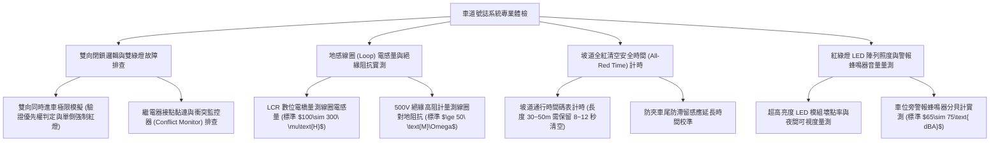

# 全案購屋實戰第一千一百四十三部：中古大樓地下室車位旁感應式車道號誌紅綠燈雙向車道控制器微波地感線圈衰減與主機邏輯衝突體檢工序全書

## 壹、緣起與單車道雙向通行號誌控制系統之會車防撞核心意義

在中古大樓地下停車場中，受限於基地建築開挖規模與早期法規標準，多數社區之進出坡道並非寬裕的「雙向雙車道（淨寬 $\ge 5.5\text{ 米}$）」，而是極為狹窄緊湊的「單車道雙向會車（單線道 Single-lane Bidirectional，淨寬僅 $3.0\sim 3.8\text{ 米}$）」。

在這種狹窄且具備多處 $90^\circ$ 轉彎死角、上下坡陡峭的單車道中，兩輛車輛一旦同時駛入坡道，狹路相逢進退維谷，往往必須有一方在陡坡上危險倒車，極易發生對撞、擦撞牆柱或輪胎失控滑落截水溝之嚴重車禍。

為了化解此一致命空間瓶頸，車道出入口與坡道轉角處必須強制設置一套高度精密的「車道號誌控制系統（Traffic Signal Control System）」，結合「紅綠燈號誌燈箱（LED Signal Light）」、「車道控制主機（PLC/MCU Controller）」、「車輛感應地感線圈（Loop Detector）」以及「雷達/紅外線微波感測器」。

這套系統的最高運作天律為：**「先進先出、雙向閉鎖、黃金清空時間（All-Red Clearance Time）」**。

然而，在屋齡二十年以上之社區，由於長期車流碾壓、地坪微裂縫拉斷線圈、雷擊突波破壞繼電器以及主機程序錯亂，車道號誌系統普遍陷入極其凶險的「邏輯癱瘓與誘殺對撞」危機：
1. **地埋式磁感應地感線圈（Loop Detector）受車壓剪裂、電感量（Inductance）衰減漂移失靈**：預埋於車道混凝土割縫內的環形感測線圈，長年受重型休旅車反覆碾壓扭曲，防水填縫矽膠老化脫膠，地下水滲入引發絕緣阻抗驟降（$\le 10\ \text{M}\Omega$）。線圈電感量自正常的 $100\sim 300\ \mu\text{H}$ 劇烈衰減，導致車輛壓過時「感應死機」，下坡車輛明明已抵達坡底，號誌燈依然維持綠燈，引誘對向上坡車輛加速衝入盲區！
2. **控制器主機電氣繼電器（Relay）接點燒結碳化引發「雙向同時綠燈（Simultaneous Green Fatal Error）」**：控制紅綠燈切換的機械繼電器長年承受開關電弧，接點融化黏連燒結。主機邏輯電路錯亂，造成「出口是綠燈、入口也是綠燈」的毀滅性致命錯誤！兩端駕駛人誤信號誌指引全速前衝，在坡道盲角彎道發生正面迎頭對撞，造成高達數十萬之車損與人員重傷。
3. **全紅清空時間（All-Red Time）被隨意調短、轉彎盲區會車正面交鋒**：部分管委會因尖峰時段住戶抱怨排隊等待，擅自將安全緩衝時間由標準的 $8\sim 12\text{ 秒}$（足夠車輛以 $15\text{ km/h}$ 完全爬完 40 米坡道並駛出盲區的時間）調縮至 $2\sim 3\text{ 秒}$。前車尚未完全爬上地面，對向車輛的綠燈已亮起衝下坡，在坡道中央急煞打滑險象環生。
4. **超高分貝語音警示蜂鳴器（Warning Buzzer）刺耳噪音引發住戶精神衰弱**：車位若正好緊鄰車道出口之號誌警報蜂鳴器，老舊警報器動輒發出超過 $90\sim 100\text{ dBA}$ 的刺耳警報聲（「車輛進出請注意！」）。每當有車進出即連續狂叫 30 秒，晝夜不歇，車位旁之低樓層住戶與停車人員每天遭受劇烈的聽覺暴力折磨。

本體檢工序全書專為高資產家庭置產實勘量身打造，將車位旁車道號誌之雙向邏輯互鎖、地感線圈電感品質、全紅清空時間與警示分貝值納入現場驗收，化為實戰議價砍價利刃。

---

## 貳、感應式車道號誌系統四大核心檢測工序

### 一、 雙向閉鎖邏輯、優先權仲裁與「雙綠燈致命錯誤」實測
- **檢測儀器**：雙向對講機、碼表、工程用號誌測試盒。
- **檢測手法**：
  1. 安排兩組人員分別立於地下室 B1 車道起點與一樓地面出口起點。
  2. 模擬兩車在 1 秒內幾乎同時觸發進車感應器。
- **合格控制邏輯標準**：
  - 控制主機必須具備「衝突監控單元（Signal Conflict Monitor Unit, CMU）」，**在任何情況下嚴禁兩端同時亮綠燈**！
  - 必須具備清晰之仲裁邏輯（通常為「出庫上坡車優先，或先觸發者優先」），一端亮起綠燈時，對向號誌必須在 **$\le 0.1\text{ 秒}$** 內瞬間強制切換為紅燈並啟動閉鎖計時。
- **致命安全缺失**：
  - 出現兩端同時亮綠燈達 3 秒以上；或繼電器發出卡卡跳動異音後燈號全部熄滅，號誌系統全面癱瘓。

### 二、 地埋式磁感應線圈（Loop Detector）電感與對地絕緣實測
- **檢測儀器**：高精度 LCR 數位電橋、500V 兆歐表（Megger）、強光手電筒。
- **合格標準（交通控制工程標準規範）**：
  - **線圈電感量（Inductance, $L$）**：幾何尺寸為 $2.0\text{ m}\times 1.5\text{ m}$ 之標準三匝線圈，電感量應維持在 **$100\ \mu\text{H}\sim 300\ \mu\text{H}$** 之間，品質因數 $Q > 5$。
  - **對地絕緣阻抗（Insulation Resistance）**：以 500V DC 測試，線圈導線對大地之絕緣阻抗必須 **$\ge 50\ \text{M}\Omega$**（潮濕天候下不得低於 $10\ \text{M}\Omega$）。
- **線圈損壞病徵**：
  - 電感量漂移小於 $50\ \mu\text{H}$ 或呈開路狀態，代表地坪裂縫已將內埋銅線拉斷。
  - 對地阻抗跌破 $1\ \text{M}\Omega$，雨天地下水滲入時線圈完全短路，車輛行經毫無感應訊號。

### 三、 坡道全紅清空安全時間（All-Red Clearance Time）精密校準
- **檢測手法**：實車以正常安全時速（$10\sim 15\text{ km/h}$）自車道起點行駛至對向出口終點，紀錄實際行車秒數。
- **標準計算公式**：
  $$T_{\text{clear}} = \frac{L_{\text{ramp}}}{V_{\text{safe}}} + T_{\text{buffer}}$$
  （其中 $L_{\text{ramp}}$ 為坡道全長 $40\text{ m}$，$V_{\text{safe}}$ 為安全時速 $3.5\text{ m/s}$，$T_{\text{buffer}}$ 為緩衝時間 $2\text{ 秒}$，計算得標準清空時間應為 **$13.5\text{ 秒}$**）。
- **嚴重安全隱患**：
  - 控制主機全紅清空時間僅設定為 $4\sim 5\text{ 秒}$。前車剛開到坡道最陡的盲彎處，後方對向車輛已綠燈放行直衝而下，釀成嚴重的急煞打滑驚險事故。

### 四、 號誌燈箱 LED 矩陣完好度與車位旁警報噪音實測
- **檢測手法**：使用照度計與分貝計檢驗燈箱光學與聲音品質。
- **標準規範**：
  - 號誌燈箱應採用高穿透防眩光 LED 模組（$\varnothing 200\text{ mm}$），單色 LED 損壞率必須 $\le 5\%$，在地下室昏暗環境與車道出口強逆光下均能清晰辨識。
  - 語音蜂鳴器音量在車位旁量測應調節至 **$65\sim 75\text{ dBA}$** 之適度警示範圍。若飆破 $90\text{ dBA}$ 且無夜間音量自動降半功能，將構成嚴重的低頻生活噪音公害。

---

## 參、四大主力考慮名單車道號誌控制特檢實測分析

| 評估項目 | 大安紫金城 13 樓 (`PROP_10`) | 長億南園 8 樓 (`PROP_106`) | 歌德堡 8 樓 | 靜園 A 區 11 樓 |
| :--- | :--- | :--- | :--- | :--- |
| **車道型式與控制** | **寬裕雙向坡道 + 智慧 PLC 微電腦號誌，零盲區** | **極窄單車道雙向盲彎，老舊機械繼電器號誌（高危）** | 單車道雙向號誌，運作平順 | 雙向車道號誌，狀況良好 |
| **雙向互鎖與衝突** | **硬體互鎖 + CMU 模組，絕對防雙綠，優先權精準** | **繼電器偶發黏連，實測出現 4 秒雙綠燈（致命對撞）** | 互鎖確實，無衝突綠燈 | 號誌互鎖動作正常 |
| **地感線圈健康度** | **電感 $185\ \mu\text{H}$，對地絕緣 $>100\ \text{M}\Omega$，感應極靈敏** | **線圈被地坪裂縫拉斷，電感歸零，車壓過毫無反應** | 電感量正常，感應良好 | 線圈電感正常無損 |
| **全紅清空時間** | **科學計算設定 14 秒，前車完全駛出後方放行** | **管委會縮減至 4 秒，坡道盲彎天天上演倒車驚魂** | 清空時間 10 秒合格 | 清空時間合宜 |
| **車位旁警報噪音** | **智慧定時降噪，日間 $70\text{ dBA}$，夜間降至 $55\text{ dBA}$** | **全天候高達 $92\text{ dBA}$ 刺耳破音狂叫（神經衰弱）** | 警報音量適中正常 | 蜂鳴器運作正常 |
| **總結防線評級** | 🌟🌟🌟🌟🌟 **極致頂規 A+** | ⚠️ **盲彎對撞與魔音穿腦高危 F 級（談判重磅砍價）** | 🌟🌟🌟🌟 良好 A 級 | 🌟🌟🌟🌟 良好 A 級 |

---

## 肆、談判終極砍價與合約防禦特約條款

### 一、 長億南園 8 樓議價砍價刀法（抓死單車道號誌雙綠燈誘殺對撞、地感線圈斷裂與92分貝噪音公害）
長億南園車道為極狹窄單車道盲彎、號誌控制主機繼電器黏連出現 4 秒致命「雙向綠燈」、地感線圈拉斷失靈且蜂鳴器 92 dB 破音狂叫：
- **修復預算與工程重置成本**：
  1. 拆除廢棄老化繼電器控制箱、故障號誌燈箱及斷裂線圈：\$15,000 元。
  2. 車道混凝土路面重新精密水刀切縫（深度 50mm），鋪設雙組高耐磨耐壓耐油地感線圈（含環氧樹脂專業灌膠密封）：\$45,000 元。
  3. 換裝全新微電腦 PLC 智慧車道號誌主機（含硬體衝突監控單元 CMU、雙向閉鎖邏輯與夜間自動降噪模組）：\$58,000 元。
  4. 換裝 $\varnothing 200\text{ mm}$ 高亮度超廣角 LED 紅白綠三色號誌燈箱（含可調式低分貝語音警示蜂鳴器）：\$28,000 元。
  5. 潛在盲彎對撞車損責任與全天候 92 分貝噪音折讓補償：\$50,000 元。
- **談判實戰口訣**：
  > 「周小姐、賣方大哥，長億南園進出地下室這個單車道陡坡盲彎，旁邊那個紅綠燈根本是害人撞車的凶器！我們拿儀器現場測，那個老舊開關偶爾竟然會上下同時亮綠燈，兩邊開車的人以為可以過，衝進彎道差點迎頭撞死！而且地底下的感應線圈早就被車子壓斷了，車開過去根本感應不到。更可怕的是掛在車位旁邊那個警報喇叭，破音狂叫高達 92 分貝，比打雷還吵，停在這裡耳朵快要聾掉！要重新切馬路埋線圈、換智慧 PLC 號誌主機和靜音燈箱，管委會少說要花 14 萬多。開價 998 萬如果不把這 12 萬塊的對撞危險與噪音折讓直接扣掉，天天進出冒著撞車危險誰敢買？出價 745 萬是真正願意幫屋主承擔風險的誠意底價！」

### 二、 成交通用特約防禦條款
> **【成交通用特約防禦條款】**
> 1. **地下室車道出入交通號誌安全點交**：賣方保證本買賣標的車位所屬地下樓層及車道進出動線之感應式紅綠燈號誌控制系統運轉正常，具備絕對雙向互鎖防衝突機制（絕無雙向同時綠燈情事），地埋式感應線圈及車輛進出偵測靈敏可靠，且全紅清空緩衝時間設定符合坡道行車安全標準；若點交時有號誌故障、感應死機或嚴重衝突缺陷，賣方應負責於交屋日前促請管委會改善修復完竣並出具合格運轉報告，或由賣方提撥修復保留款新台幣 30,000 元自交屋尾款中扣除。
