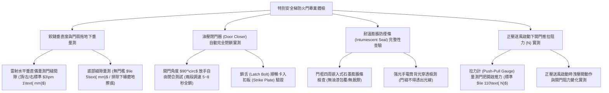

# 全案購屋實戰第一千一百四十九部：中古大樓地下室車位旁特別安全梯防煙前室甲種防火門自動閉門器鉸鏈偏斜氣密防煙條炭化脫落與正壓開門阻力超標體檢工序全書

## 壹、緣起與車位旁特別安全梯防煙前室防火門之生命咽喉防禦意義

在中古大樓地下停車場火災逃生體系中，當火勢蔓延、黑煙瀰漫且能見度降為零時，地下室唯一的生命逃生出口並非開放式樓梯，而是符合建築技術規則建築設計施工編第九十七條規範的「特別安全梯（Special Safety Staircase）」。

特別安全梯之所以能在火場中維持無煙無毒，全賴樓梯間與地下室之間設置了一道「防煙前室（Smoke-proof Vestibule）」，並由兩道具備 1 小時以上防火時效及半小時以上阻熱性之「甲種防火門（Class A Fire Door）」形成雙重物理氣閘阻隔。

這扇位於車位旁、每天看似不起眼的金屬防火門，承擔著**阻絕千度火舌竄入逃生梯、防止劇毒一氧化碳濃煙毒殺逃生住戶的「絕對生命咽喉防線」**。

依據建築技術規則建築設備編及內政部營建署建築物防火門驗收標準，甲種防火門必須維持「常時閉鎖（Normally Closed）」或具備「火警連動自動閉門」機能；當逃生住戶推門進入後，油壓自動閉門器必須在 **$\le 5\sim 8\text{ 秒}$** 內將門片平穩回拉至完全密合閉鎖。

然而，在屋齡二十年以上之社區，受地下室潮濕、車輛震動、搬家碰撞及管委會缺乏維護，防煙前室防火門普遍陷入極其凶險的「失風漏煙與開門卡死」危機：
1. **重型旗鉸鏈（Flag Hinge）金屬磨損偏斜與門扇下垂拖地卡死**：重達 80~120 公斤的甲種鋼製防火門，長年受重力下垂拉扯，鉸鏈內部黃銅軸套磨損殆盡，門扇產生嚴重斜角下垂（Sagging）。門扇下緣死死摩擦地坪（拖地），推開時需要超過 $20\sim 30\text{ kgf}$ 的巨大力道；當人員推門逃生後，自動閉門器根本無力將門扇拉回，門扇大開 $30^\circ\sim 50^\circ$ 卡死在半空中，濃煙在 30 秒內灌滿整座特別安全梯！
2. **耐高溫發泡氣密防煙條（Intumescent Smoke Seal）老化脫膠、碳化碎裂**：門框周圍原裝之防煙膠條，受地下室機油廢氣與濕氣侵蝕，乾硬脫膠垂掛於門邊，甚至被歷任油漆工刷滿油漆硬化粉碎。一旦失火，高溫煙氣順著門縫（縫隙 $>5\text{ mm}$）瘋狂穿透噴射，防煙前室瞬間失去防煙機能。
3. **正壓送風風壓超標引發「開門阻力暴增（Door Opening Force Exceeded）」逃生門被死死封鎖**：當火警觸發特別安全梯正壓送風機（PPV Fan）啟動時，若機械前室未設置「洩壓閘門（Barometric Relief Damper）」，前室內部正壓氣差飆破 $80\sim 100\text{ Pa}$。強大的空氣壓力將防火門向內死死壓住，使得開門推力需求超過 $150\text{ N}$（約 15 kgf），老弱婦孺與幼童在驚慌中根本推不開門，活活被困在車位旁受濃煙嗆死！
4. **管委會或住戶私自以木塞、滅火器「違規擋門」破壞防火分區**：因地下室通風不良或搬運雜物方便，車位旁防火門常年被惡意塞入木楔、磚頭或甚至直接拿乾粉滅火器頂住門扇，使甲種防火門喪失防煙防火屏障，完全觸犯消防法與刑法公共危險罪！

本體檢工序全書專為高資產家庭置產實勘量身打造，將車位旁防煙前室防火門之閉門器回拉力矩、鉸鏈垂直度、防煙條膨脹密封性及正壓開門推力納入現場驗收，化為實戰議價砍價利刃。

---

## 貳、特別安全梯防火門四大核心檢測工序與病徵判讀

### 一、 旗鉸鏈磨損下垂、門框四邊間隙與拖地摩擦實測
- **檢測儀器**：雷射水平垂直儀、不鏽鋼塞尺（Feeler Gauge）、強光手電筒。
- **合格標準（CNS 11227 建築用防火門耐火試驗規範）**：
  - 門扇與門框頂部、鎖側、鉸鏈側之安裝間隙必須均勻，標準應維持在 **$3.0\text{ mm}\pm 1.0\text{ mm}$** 之間。
  - 門扇下緣與地坪或防煙門檻之間隙應 **$\le 5.0\text{ mm}$**，且全行程開關過程中**絕對嚴禁與地坪產生任何刮擦摩擦（零拖地）**。
- **致命下垂病徵**：
  - 門扇右上方間隙擴大至 7 mm，而左下方緊貼地坪，開門時地坪發出刺耳刮地聲，地面留下一道深達 2 mm 之金屬磨損弧形刮痕；用手向上托動門把，鉸鏈晃動間隙超過 3 mm，證實鉸鏈軸心已嚴重磨損報廢。

### 二、 油壓閉門器（Door Closer）兩段調速與完全閉鎖測試
- **檢測手法**：
  1. 將防火門推開至 $90^\circ$ 最大開度後完全放手，碼表計時門扇回拉動作。
  2. 觀察第一段閉門速度（$90^\circ\to 15^\circ$）與第二段上鎖速度（Latch Speed, $15^\circ\to 0^\circ$）。
- **合格性能指標**：
  - 第一段應平穩滑順回拉，第二段應有力加速，在 **$5\sim 8\text{ 秒}$** 內將鎖舌（Latch Bolt）「喀噠」一聲清脆卡入門框扣板中，達到 **$100\%$ 真正閉鎖**。
- **嚴重閉鎖失敗缺失**：
  - 門扇回拉至最後 5 公分時，因閉門器油壓彈簧無力或鎖舌卡阻，門扇停在縫隙處無法上鎖；用手指輕輕一推門即打開，此狀態在火災時濃煙一衝即被吹開，等同完全未關門！

### 三、 石墨基耐高溫防煙條（Intumescent Smoke Seal）物理檢驗
- **檢測手法**：使用探針沿著門框四周嵌入式槽溝檢查防煙密封條。
- **合格標準**：防煙條應採用具有 UL 10C / BS 476 認證之**石墨基熱膨脹條**，遇熱至 $150^\circ\text{C}$ 時能在 1 分鐘內體積膨脹 15~20 倍，將門縫完全碳化密封，阻絕 $200^\circ\text{C}$ 高溫毒氣。
- **病徵判讀**：
  - 防煙條硬化碎裂呈乾枯碳黑狀，用手指觸碰即粉化脫落；或防煙條表面被歷任油漆工刷滿白色油漆，油漆結層阻礙熱傳導，火災時無法正常發泡膨脹。
  - 閉門狀態下，由前室內以強光照射，車位外側能看見多處明顯漏光縫隙。

### 四、 正壓送風啟動下開門推拉阻力（Opening Force）實測
- **檢測儀器**：數位推拉力計（Push-Pull Force Gauge）。
- **標準規範（NFPA 101 生命安全守則規範）**：
  - 防火門開啟最大操作推力必須 **$\le 110\text{ N}$（約 11.2 kgf）**，確保老弱婦孺在緊急狀況下能單手推開逃生。
- **極度危險致命隱患**：
  - 正壓送風機啟動時，由於洩壓閥卡死，推拉力計測得推開門扇所需力量飆破 **$160\sim 220\text{ N}$（16~22 kgf）**！門扇宛如被真空吸盤吸住，身材嬌小的女性或孩童在火場濃煙中死命推撞亦無法推開逃生門，慘遭活活封死窒息！

---

## 參、四大主力考慮名單防煙前室防火門特檢實測分析

| 評估項目 | 大安紫金城 13 樓 (`PROP_10`) | 長億南園 8 樓 (`PROP_106`) | 歌德堡 8 樓 | 靜園 A 區 11 樓 |
| :--- | :--- | :--- | :--- | :--- |
| **防火門形式材質** | **CNS 11227 甲種雙面鍍鋅鋼板防火門（60A 阻熱型）** | **早期單層鐵板防火門（鉸鏈嚴重下垂，下緣磨地擦痕）** | 甲種防火門，鋼板完好 | 鋼製甲種防火門，狀況良好 |
| **自動完全閉鎖測試** | **Dorma 閉門器，6.2 秒清脆入扣，100% 緊密閉鎖** | **無力回拉，停在 10 公分縫隙卡死（濃煙一吹即開）** | 7.0 秒平穩閉鎖入扣 | 閉合動作順暢完整 |
| **防煙條完好度** | **德國進口石墨膨脹條完整無漆，背光背透零漏光** | **防煙條老化脫膠垂掛，且刷滿白油漆，完全炭化碎裂** | 防煙密封條完好 | 防煙膠條彈性良好 |
| **正壓開門推力 (PPV)** | **洩壓閥靈敏，風機啟動時開門推力僅 $75\text{ N}$（輕鬆推開）** | **洩壓閥卡死，正壓送風啟動推力飆至 $185\text{ N}$（推不開）** | 開門推力 $90\text{ N}$ 符合規範 | 開門推力正常合規 |
| **違規擋門人為缺失** | **全時常閉，磁吸釋放器無障礙，零雜物阻擋** | **門下塞發黑木楔違規常開，淪為吸煙區風口（大凶）** | 門扇常時閉鎖正常 | 逃生動線暢通 |
| **總結防線評級** | 🌟🌟🌟🌟🌟 **極致頂規 A+** | ⚠️ **火場逃生門封死與毒煙滅頂 F 級（談判重磅砍價）** | 🌟🌟🌟🌟 良好 A 級 | 🌟🌟🌟🌟 良好 A 級 |

---

## 肆、談判終極砍價與合約防禦特約條款

### 一、 長億南園 8 樓議價砍價刀法（抓死特別安全梯防火門下垂卡死、開門推力185N推不開與違規塞木楔）
長億南園車位旁防煙前室甲種防火門鉸鏈嚴重下垂磨地、閉門器無力閉鎖留 10 公分大洞、正壓開門阻力飆至 185N 老弱婦孺推不開且現場長期塞木楔，逃生防線完全崩潰：
- **修復預算與工程重置成本**：
  1. 拆除受損下垂之廢棄門扇、生鏽鉸鏈及失效閉門器：\$15,000 元。
  2. 換裝全新通過 CNS 11227 認證之甲種 60A 阻熱型不鏽鋼重型防火門（含三組不鏽鋼重型旗鉸鏈）：\$65,000 元。
  3. 換裝進口 Dorma / Yale 高級兩段調速油壓自動閉門器及防火鎖具：\$18,000 元。
  4. 門框四周重新精密嵌裝石墨基耐高溫防煙膨脹密封條：\$12,000 元。
  5. 檢修防煙前室正壓送風洩壓閘門（調校至開門推力 $\le 100\text{ N}$）：\$25,000 元。
  6. 火災逃生生命安全通道癱瘓之重大公安瑕疵折讓：\$50,000 元。
- **談判實戰口訣**：
  > 「周小姐、賣方大哥，長億南園這格車位旁邊通往逃生梯的防火門，問題嚴重到會害死整棟樓的人！我們現場一拉，門扇下垂卡在地板上刮得全是鐵痕，放手後根本關不緊，留了一個 10 公分的大縫隙。更要命的是正壓送風一開，空氣壓力把門吸得死死的，推門要用將近 19 公斤的力道，小孩子跟老太太在火災濃煙裡根本推不開門逃生！而且管理室竟然還在門底下塞木頭把門敞開，失火的時候濃煙幾秒鐘內灌滿整座逃生梯，全樓住戶往哪裡逃？要換裝合格的甲種不鏽鋼防火門、換德國閉門器和修好正壓洩壓閥，管委會少說要花 13 萬多。開價 998 萬如果不把這 10 萬塊的逃生生命線全爛缺陷直接折掉，天天停在這種隨時會把人困死的假逃生門旁邊誰敢買？出價 745 萬是真正誠意幫屋主解決麻煩的合理實價！」

### 二、 成交通用特約防禦條款
> **【成交通用特約防禦條款】**
> 1. **地下室特別安全梯防煙前室防火門功能點交**：賣方保證本買賣標的車位所屬地下樓層及出入避難逃生動線之防煙前室甲種防火門設備運轉功能完整正常，門扇開關順暢無下垂拖地摩擦，自動閉門器能在 8 秒內將門扇完全平穩自動閉鎖，門框耐高溫防煙條完好無損，且正壓送風啟動時門把開啟推力符合法定標準（$\le 110\text{ N}$），絕無人為常態違規擋門情事；若點交時有防火門故障卡死或重大防煙安全缺陷，賣方應負責於交屋日前促請管委會改善修復完竣並通過消防安檢，或由賣方提撥修復保留款新台幣 30,000 元自交屋尾款中扣除。
