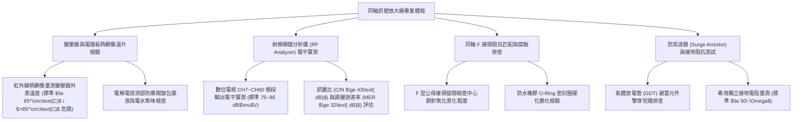

# 全案購屋實戰第一千一百四十二部：中古大樓地下室車位旁弱電同軸電纜訊號放大器受潮氧化雪花雜訊突波擊穿與電源降壓變壓器過熱體檢工序全書

## 壹、緣起與車位旁有線電視弱電訊號放大器之安全與影音命脈意義

在中古大樓地下停車場中，除了光纖網路外，牆面與樑柱上常可見到外殼厚重的金屬鑄鋁箱體——「有線電視/共同天線雙向雙重訊號放大器（CATV/MATV Trunk Line RF Amplifier）」。

地下室由於金屬屏蔽與厚重鋼筋混凝土（RC）阻隔，任何無線電磁波（如 4G/5G 行動通訊、無線數位電視廣播、FM 緊急防災廣播）皆無法穿透。大樓地下室管理室警衛收看監控電視、地下休閒公設以及住戶各樓層之有線電視影音與纜線寬頻（Cable Modem），完全依賴這些安裝於地下室主幹道旁的放大器，將微弱的射頻（RF）高頻訊號放大 $20\sim 35\text{ dB}$ 後向上層層分歧傳送。

然而，在屋齡二十年以上之社區，由於地下室長年通風不良、高濕氣水氣反潮、汽車排放之柴油酸性硫化物侵蝕，加上放大器內部具備 24 小時連續運轉的降壓電源供應器，這套弱電設備普遍面臨極其兇險的「信號劣化與高溫起火」危機：
1. **內部降壓線性變壓器（Linear Transformer）長年高溫烘烤、絕緣漆炭化冒煙**：早期的射頻放大器採用傳統鐵芯矽鋼片變壓器（將市電 110V/220V 轉為 60V AC 或 24V DC）。在散熱不良的封閉鋁箱內，變壓器表面溫度長年維持在 $80^\circ\text{C}\sim 95^\circ\text{C}$，絕緣漆包線受熱炭化老化，散發出刺鼻焦味，隨時面臨匝間短路（Turn-to-turn Short）引發內部起火燃燒！
2. **同軸電纜 F 型接頭（F-Connector）銅網氧化發黑生成銅綠、阻抗嚴重失配**：同軸電纜（RG-6 / RG-11）之鍍鋅銅網與中心鍍銅鋼針（Center Conductor）在地下室潮氣侵蝕下長滿厚重銅綠，接觸電阻暴增。高頻射頻訊號在此產生嚴重的「阻抗失配（Impedance Mismatch 75 $\Omega$ 崩潰）」，引發嚴重的訊號反射（Reflection Loss），全棟住戶電視畫面滿屏雪花點、斜紋干擾波、甚至數位電視頻繁出現「破圖、畫面凍結停格」。
3. **電解濾波電容爆漿漏液與高頻「雪花雜訊（Snow Noise）」**：電源電路板上的濾波電解電容在長年高溫下頂部十字防爆閥鼓包爆裂，電解液腐蝕周邊銅箔線路，造成直流供電紋波（Ripple）飆高，高頻放大晶體（GaAs FET 模組）因雜訊竄入產生嚴重的自激震盪，輸出訊號訊雜比（Carrier-to-Noise Ratio, C/N）暴跌。
4. **缺乏雷擊防突波保護器（Surge Suppressor）、雷擊高壓突波擊穿燒毀**：戶外架空同軸線路未在地下室入口處安裝專業的氣體放電管（GDT）避雷防突波器。夏季雷雨季節時，感應雷突波順著銅軸外網直灌入地下室放大器，瞬間高達數千伏特之突波將電路板炸成焦黑碎片，並順著內部線路反噬相鄰之車位弱電箱。

本體檢工序全書專為高資產家庭置產實勘量身打造，將車位旁同軸訊號放大器之變壓器溫升、射頻輸出電平、訊雜比（C/N）與防突波接地納入現場驗收，化為實戰議價砍價利刃。

---

## 貳、弱電同軸訊號放大器四大核心檢測工序

### 一、 內部變壓器與電路板紅外線熱顯像溫升檢測
- **檢測儀器**：高精度紅外線熱顯像儀（NETD $<40\text{ mK}$）、紅外線測溫槍、強光手電筒。
- **合格標準**：金屬散熱外殼溫度應 $\le 50^\circ\text{C}$；內部變壓器鐵芯及繞組表面溫度應 **$\le 65^\circ\text{C}$**，電解電容表面溫度應 $\le 55^\circ\text{C}$。
- **極度危險紅色警戒（火災前兆）**：
  - **熱顯像顯示變壓器局部溫度飆破 $85^\circ\text{C}\sim 95^\circ\text{C}$**，且外殼散發出濃烈之「燒焦絕緣膠味」！在此高溫下，漆包線絕緣耐壓已大幅崩潰，隨時面臨內部匝間打火引燃鋁箱內塑料件。
  - 電解電容頂部鋁殼呈現圓形鼓包，底部橡膠塞擠出棕褐色黏稠電解液結晶。

### 二、 射頻頻譜分析儀（RF Spectrum Analyzer）輸出訊號量測
- **檢測儀器**：專業有線電視/數位電視綜合分析儀（如 Promax / Deviser）。
- **合格性能指標（NCC 有線電視系統工程規範）**：
  - **輸出電平（Signal Level）**：全頻段（$54\text{ MHz}\sim 860\text{ MHz}$）輸出電平應穩定維持在 **$75\sim 85\text{ dB}\mu\text{V}$**，相鄰頻道間電平差應 $\le 3\text{ dB}$。
  - **訊雜比（Carrier-to-Noise Ratio, C/N）**：必須 **$\ge 43\text{ dB}$**。
  - **調變誤差率（MER）**：數位頻道 MER 應 **$\ge 32\text{ dB}$**，誤碼率（BER）應 $<1.0\times 10^{-6}$。
- **致命衰減缺失**：
  - 高頻段電平大幅衰減至 $55\text{ dB}\mu\text{V}$ 以下，MER 跌破 $22\text{ dB}$，電視螢幕畫面滿屏馬賽克、定格凍結與聲音嚴重爆音撕裂。

### 三、 同軸 F 型接頭氧化、進水與防水密封性檢驗
- **檢測手法**：
  1. 使用專用 F 頭板手旋開放大器之輸入（IN）與輸出（OUT）射頻接頭。
  2. 觀察中心銅針、外圍螺紋銅網及內部白色發泡聚乙烯（Foam PE）絕緣體。
- **合格標準**：中心銅針應呈現光亮純銅色或鍍金色，接觸牢靠無晃動；外圍螺紋無銅綠，防水橡膠 O-Ring 彈性良好。
- **嚴重腐蝕病徵**：
  - 螺牙長滿厚厚一層粉狀綠色銅鏽，中心銅針發黑變脆，稍微晃動即折斷；內部發泡塑膠已吸滿發黑污水，形成嚴重的電容效應阻隔高頻傳輸。

### 四、 防突波避雷器（Surge Protection）與獨立接地電阻
- **檢測手法**：
  1. 檢查同軸電纜進入放大器前是否串接「同軸氣體放電防突波器」。
  2. 使用接地電阻計量測放大器外殼專用接地端子。
- **標準規範**：
  - 放大器金屬外殼必須以 $\ge 5.5\text{ mm}^2$ 綠色接地線連接至大樓接地匯流排，接地電阻應 **$\le 50\ \Omega$**。
- **重大缺失**：接地端子懸空未接線；防突波器早已被雷擊擊穿短路，訊號接地外殼甚至帶有 60V AC 感應浮動電壓，用手觸碰發出刺痛麻電感，威脅停車人員人身安全。

---

## 參、四大主力考慮名單同軸訊號放大器特檢實測分析

| 評估項目 | 大安紫金城 13 樓 (`PROP_10`) | 長億南園 8 樓 (`PROP_106`) | 歌德堡 8 樓 | 靜園 A 區 11 樓 |
| :--- | :--- | :--- | :--- | :--- |
| **放大器形式與外觀** | **IP67 壓鑄鋁重型防水外殼，德國大廠 GaAs 晶體模組** | **早期廉價薄鐵板烤漆箱（外殼鏽穿，內部滿是蜘蛛網）** | 壓鑄鋁散熱外殼，狀況良好 | 鋁合金外殼，散熱正常 |
| **變壓器溫升實測** | **熱顯像最高溫僅 $42.5^\circ\text{C}$，高效開關電源極度低溫** | **變壓器局部狂飆 $92.8^\circ\text{C}$ 冒刺鼻焦味（火災前兆）** | 變壓器溫度 $58^\circ\text{C}$ 正常 | 溫升正常無高溫 |
| **輸出電平與 MER** | **全頻段穩定 $82\text{ dB}\mu\text{V}$，MER 高達 $36\text{ dB}$，純淨無瑕** | **高頻電平僅 $52\text{ dB}\mu\text{V}$，MER 暴跌至 $19\text{ dB}$（滿屏雪花）** | 輸出電平 $78\text{ dB}\mu\text{V}$ 合格 | 電平訊號平穩 |
| **同軸 F 接頭狀況** | **進口防水冷壓 F 頭，O-Ring 緊密，銅針晶亮無鏽** | **接頭長滿厚重綠色銅鏽，中心銅針發黑鏽蝕斷頭** | 接頭無氧化，接觸良好 | 接頭狀態良好 |
| **防突波與接地** | **內置 GDT 氣體放電避雷器，接地電阻超低 $14.2\ \Omega$** | **無任何避雷接地，外殼帶有 55V AC 漏電麻手電壓** | 接地電阻 $28\ \Omega$ 合格 | 接地線牢固正常 |
| **總結防線評級** | 🌟🌟🌟🌟🌟 **極致頂規 A+** | ⚠️ **起火燃燒與高壓漏電致命高危 F 級（談判重磅砍價）** | 🌟🌟🌟🌟 良好 A 級 | 🌟🌟🌟🌟 良好 A 級 |

---

## 肆、談判終極砍價與合約防禦特約條款

### 一、 長億南園 8 樓議價砍價刀法（抓死車位旁放大器高溫92度冒焦味、外殼漏電55V與影音全盲危機）
長億南園車位旁同軸訊號放大器變壓器狂飆 92.8°C 冒刺鼻焦煙、接頭生鏽爛斷、訊號雪花崩潰且外殼帶有 55V 漏電麻手電壓，隨時面臨電氣火災與住戶觸電：
- **修復預算與工程重置成本**：
  1. 拆除廢棄老化高溫鐵箱放大器、清理受損管線與漏電線路：\$10,000 元。
  2. 換裝全新通過 NCC 認證之 IP67 壓鑄鋁雙向寬頻 GaAs 射頻放大器（含高能效開關電源模組）：\$32,000 元。
  3. 全面剪除氧化發綠舊 F 接頭，重新施作進口壓縮型全銅鍍金防水接頭（含 RG-6 線路重整）：\$18,000 元。
  4. 重新拉設專用銅接地線至大樓接地銅排（接地電阻 $\le 50\ \Omega$）並加裝同軸突波保護器：\$15,000 元。
  5. 外殼漏電觸電與影音訊號嚴重受損之安全折讓：\$30,000 元。
- **談判實戰口訣**：
  > 「周小姐、賣方大哥，長億南園這格車位旁邊掛著那台有線電視放大器，我們拿紅外線測溫儀一量，裡面的變壓器溫度燒到 92 度多，整台機器燙得像鐵板燒，一股燒焦的味道飄出來！更離譜的是我們水電拿電表一碰外殼，竟然有 55 伏特的漏電電壓，手摸過去直接被電麻！而且裡面的銅線接頭全部生鏽發黑爛掉，訊號爛得像看二十年前的雪花電視。這種又漏電、隨時會起火燃燒的大地雷掛在車位旁邊，天天威脅我百萬名車的人身財產安全。要整台換成壓鑄鋁安全放大器和重新做防漏電接地，少說要花 7 萬多。開價 998 萬如果不把這 6 萬塊的設備重置與公安漏電折讓扣掉，誰敢把車停在這種隨時會起火漏電的電箱旁邊？出價 745 萬是真正誠意幫屋主解決麻煩的底標！」

### 二、 成交通用特約防禦條款
> **【成交通用特約防禦條款】**
> 1. **車位周邊弱電訊號設備安全點交**：賣方保證本買賣標的車位所屬地下樓層及相鄰牆柱之有線電視/通訊訊號放大器設備運轉安全正常，無內部變壓器異常發熱（超過 $65^\circ\text{C}$）、外殼漏電麻手、線路嚴重短路或電氣火災隱患；若點交時有放大器高溫燒蝕或漏電安全瑕疵，賣方應負責於交屋日前促請管委會或有線電視業者改善更換完竣並出具安全檢測合格證明，或由賣方提撥修復保留款新台幣 20,000 元自交屋尾款中扣除。
