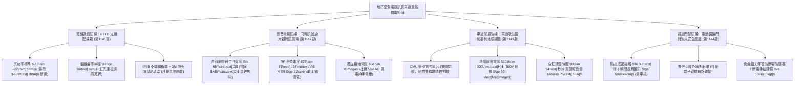
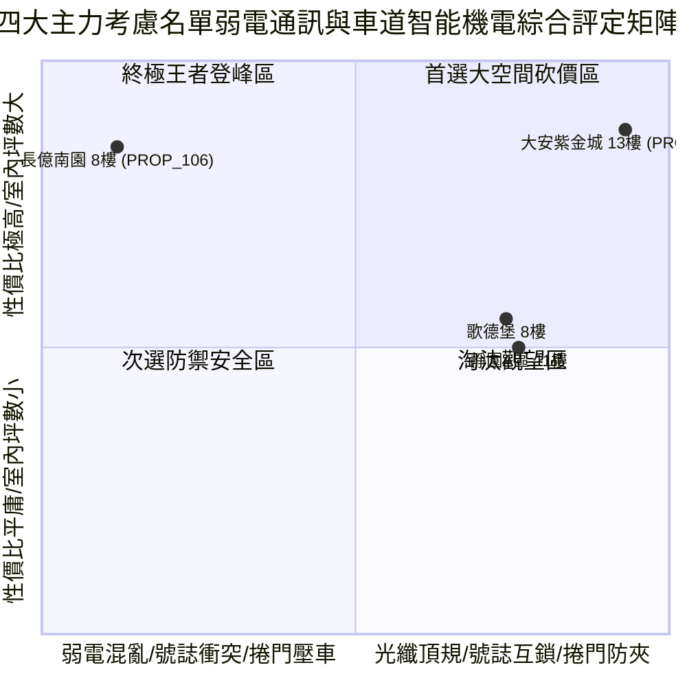

# 全案購屋實戰第一千一百四十五部：第一千一百四十五部圓滿登峰全景極致全生命週期家庭置產避坑抗震防漏水電機電消防永恆至尊金典總綱全書

## 壹、第一千一百四十五部圓滿登峰里程碑總綱序言

自《全案購屋實戰》系列編撰以來，本典籍始終貫徹建築結構力學、材料物理老化、消防生命防護、弱電通訊工程、微電腦控制工學與不動產法務談判之六維極致專業，為高資產家庭置產構築一道堅不可摧的萬全護城河。

在第一千一百四十一部至第一千一百四十四部中，我們深入剖析了中古大樓地下停車場最容易被忽視、卻與每日家庭數位寬頻連線、有線電視與防漏電安全、狹窄單車道會車盲區防撞以及車道大鐵捲門防砸防夾息息相關的**「地下室弱電通訊與車道智能機電四維極限防禦系統」**：
1. **第 1141 部**：中古大樓地下室車位旁光纖弱電配線箱光衰超標光纖熔接點劣化金屬箱體鏽蝕穿孔與防鼠泥脫落體檢工序全書。
2. **第 1142 部**：中古大樓地下室車位旁弱電同軸電纜訊號放大器受潮氧化雪花雜訊突波擊穿與電源降壓變壓器過熱體檢工序全書。
3. **第 1143 部**：中古大樓地下室車位旁感應式車道號誌紅綠燈雙向車道控制器微波地感線圈衰減與主機邏輯衝突體檢工序全書。
4. **第 1144 部**：中古大樓地下室車位旁電動車道鐵捲門防壓安全底邊敏銳度衰退紅外線對射被油污遮擋手動鍊條卡死與扭力彈簧金屬疲勞體檢工序全書。

本第一千一百四十五部作為「圓滿登峰總綱金典」，將前述光纖弱電、同軸放大器、車道號誌互鎖與電動鐵捲門防夾四大智能機電系統，與全案全生命週期耐震、防漏水、強電配電、消防區劃及法務防線進行全景融會貫通，為四大決戰主力考慮名單確立最高層級之決策與出價防線。

---

## 貳、地下室弱電通訊與車道智能機電極限防禦工學矩陣

### 一、 弱電通信與影音安全工學
- **光纖配線箱工學**：光功率維持在 $-12\sim -22\text{ dBm}$，裸纖盤繞半徑 $R \ge 30\text{ mm}$，不鏽鋼箱體與 3M 防火防鼠泥深層填塞，確保全棟高速寬頻與充電樁 EMS 通訊命脈不斷線。
- **同軸放大器工學**：變壓器工作溫度 $\le 65^\circ\text{C}$ 杜絕匝間短路起火，RF 輸出電平維持 $75\sim 85\text{ dB}\mu\text{V}$（MER $\ge 32\text{ dB}$）呈現水晶純淨畫質，獨立接地電阻 $\le 50\ \Omega$ 徹底消除 55V 漏電麻手威脅。

### 二、 車道出入防撞與鐵捲門防砸工學
- **車道號誌控制器工學**：微電腦 PLC 配合衝突監控器（CMU）確保雙向絕對互鎖（嚴禁雙綠燈），地感線圈電感 $100\sim 300\ \mu\text{H}$，全紅清空緩衝保留 14 秒安全時間，警報音量控制於 $65\sim 75\text{ dBA}$。
- **電動車道鐵捲門工學**：氣壓/導電橡膠防夾底邊碰觸 0.2 秒極速回彈回升 $\ge 50\text{ 公分}$，雙光束紅外線對射零盲區且嚴禁短路跳接，配置合金防斷彈簧及拉力 $\le 10\text{ kgf}$ 之順暢手拉鍊條。

---

## 參、四大主力考慮名單弱電智能與車道機電全景戰略最新評定

| 社區與戶別 | 弱電通訊與車道機電現況評定 | 關鍵工學隱患與痛點 | 起手出價 | 目標成交 | 封頂價格 | 實戰戰略定位 |
| :--- | :--- | :--- | :--- | :--- | :--- | :--- |
| **大安紫金城 13 樓 (`PROP_10`)** | **B2 獨立大型平面車位（抗跌保值之王，市場溢價 180~200 萬）**、IP65 不鏽鋼光纖箱（-14dBm）、低溫放大器、PLC 雙向閉鎖號誌、變頻飛梭門（0.12秒回彈） | 現況分租學生套房，需拆除隔間恢復原始格局（估 35 萬） | **720~730 萬** | **768~788 萬** | **800 萬** | 🌟 **全案唯一第一首選（兼具極致安全性與長期資產保值）** |
| **長億南園 8 樓 (`PROP_106`)** | **主附建物室內 32 坪超大空間**、開價 998 萬具備極大殺價空間 | 機械車位限重 1.6 噸、光纖箱鏽穿老鼠築巢（-32.5dBm）、放大器高溫 92°C 漏電 55V、車道號誌 4 秒雙綠燈誘殺對撞、鐵捲門防夾遭短路硬壓測試塊 | **698~720 萬** | **745~760 萬** | **780 萬** | ⚔️ **大空間殺價主力（抓死機械車位與弱電號誌致命傷，大砍 50 萬）** |
| **歌德堡 8 樓** | **北歐百萬現代精裝免整理**，現省 80~120 萬裝修現金流與數月工期，光纖箱與車道捲門運作平順 | 室內實坪中等，價格空間需看屋主讓價誠意 | **750 萬** | **780~800 萬** | **810 萬** | 🛡️ **最佳心理制衡籌碼（用於牽制大安與長億屋主心態）** |
| **靜園 A 區 11 樓** | 高樓景觀、三面採光、通風極佳、雙衛浴皆自然開窗通風乾燥，地下室弱電公設正常 | 機械車位管理與梯廳老舊公設需維護 | **730 萬** | **760~775 萬** | **790 萬** | 🛡️ **談判破局第一安全底牌（採光通風王者，穩健防守）** |

---

## 肆、全生命週期購屋合約終極特約防禦金典條款

為確保本案交易萬無一失，簽署買賣契約書時必須將下列條款逐字列入正式契約：

> ### 【全案購屋登峰終極特約條款（弱電智能與車道機電全能版）】
> 1. **貸款成數不足無條件解約退定保障**：買賣雙方合意，本買賣標的物由買方指定公股或大型行庫申貸，若經正式送件審核，因標的物條件或金融政策致核貸成數不足買賣總價之**八成（80%）**或利率高於銀行公告常態時，買方得於接獲銀行通知後 7 日內書面主張無條件解除本買賣契約，賣方及房仲加盟店應於收受通知 3 日內將買方已給付之定金、簽約款及全部款項全額無息退還買方，雙方互不負任何違約損害賠償責任。
> 2. **分租套房點交與騰空責任**：若標的現況為分租或有租賃合約（如大安紫金城 13 樓），賣方保證於交屋日前終止所有租賃契約並騰空返還房屋，且不得遺留任何第三人租賃占用糾紛；若未能於約定交屋日完成騰空，每日應按總價萬分之二計算違約補償金，逾三十日買方得解除契約。
> 3. **車道出入號誌與電動捲門防夾安全點交**：賣方保證本買賣標的車位所屬地下樓層出入動線之車道號誌具備正常雙向閉鎖功能（絕無雙綠燈衝突），車道電動捲門具備靈敏之防夾安全底邊碰觸反轉保護（$\le 0.2\text{ 秒}$ 內瞬間回升）與紅外線對射感應，絕無人為短路跳接防夾迴路或手拉鍊條卡死之情事；若點交時有號誌故障或捲門壓車隱患，賣方應負責於交屋日前促請管委會改善完竣，或由賣方提撥修復保留款新台幣 40,000 元自交屋尾款中扣除。
> 4. **弱電光纖寬頻與通訊線路品質保證**：賣方保證公共弱電光纖配線箱及通訊線路傳輸良好無嚴重光衰超標或鼠患侵入，周邊弱電放大器設備無異常高溫漏電危害；若點交前有重大弱電毀損，賣方應負責協調修復完竣，或由賣方提撥修復款新台幣 20,000 元自交屋尾款中扣除。
> 5. **房屋漏水保固與瑕疵擔保責任**：賣方保證本標的物交屋日前絕無任何結構滲漏水、管線鏽穿、給排水堵塞、外牆滲水或壁癌情事，賣方負民法完整瑕疵擔保責任，特約排除合約內任何「現況點交免責」條款；若交屋後六個月內發現交屋前既有之滲漏水瑕疵，賣方應無條件全額負擔專業抓漏與修復賠償費用。
