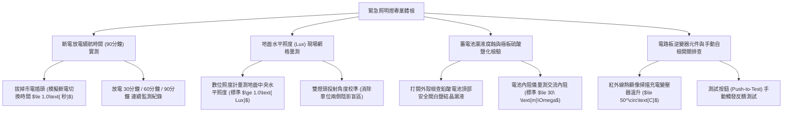

# 全案購屋實戰第一千一百四十八部：中古大樓地下室車位旁緊急照明燈鹵素鎢絲燈泡燒毀鉛酸電池漏液硫酸鹽化與斷電逆變器電路板燒蝕體檢工序全書

## 壹、緣起與車位旁緊急照明燈之大停電人身安全防線意義

在中古大樓地下停車場中，若遭遇強烈地震、區域性大跳電、台電線路跳脫或地下室配電盤爆炸事故時，天花板常態感應式日光燈或 LED 燈會在瞬間全數熄滅。地下二層或地下三層等缺乏任何自然採光的深層空間，將在 $0.1\text{ 秒}$ 內陷入絕對的漆黑（Absolute Darkness）。

此時，壁掛於車位旁柱面、車道交會口及特別安全梯轉角的「雙頭緊急照明燈（Emergency Lighting Fixture）」，肩負著在斷電瞬間瞬間點亮、劃破黑暗、照亮腳下障礙物與車位動線的「第一道光源防線」。

依據建築技術規則建築設備編第一百一十六條及各類場所消防安全設備設置標準第一百五十七條至第一百六十五條規範：地下停車場必須強制配置緊急照明設備。當常用電源中斷時，緊急照明燈必須在 **$\le 1.0\text{ 秒}$** 內自動切換點亮，且地面水平面照度（Horizontal Illuminance）在全區必須維持 **$\ge 1.0\text{ Lux}$（走道交會處 $\ge 2.0\text{ Lux}$）**，且法定有效放電連續點燈時間必須 **$\ge 90\text{ 分鐘}$**！

然而，在屋齡二十年以上之社區，由於缺乏定期放電點檢、地下室常年潮濕悶熱、歷任管委會為求省錢購買廉價雜牌燈具，車位旁之緊急照明燈普遍陷入極其嚴重的「全面癱瘓與火災自燃」雙重危機：
1. **內部小型閥控式密封鉛酸蓄電池（VRLA Lead-Acid Battery）漏液、乾涸與極板硫酸鹽化（Sulfation）**：傳統緊急照明燈內置 6V/4.5Ah 鉛酸電池。長年插在 110V 插座上進行劣質浮充（Float Charge），缺乏充飽自動切斷電路，電池溫度長年處於 $45^\circ\text{C}\sim 55^\circ\text{C}$ 高溫。電池內部稀硫酸電解液蒸發乾涸，極板生成不可逆的白色粗晶粒硫酸鉛（硫酸鹽化），內阻飆升數十倍；電池頂部安全閥破裂噴出強酸性液體，將內部鐵件、變壓器與電路板腐蝕爛穿，斷電時連 1 秒鐘都亮不起來（斷電即滅）！
2. **早期鹵素鎢絲燈泡（Halogen Bulb）燈絲氧化震斷、高發熱燒熔燈罩**：早期照明燈採用兩顆 6V 8W~12W 鹵素燈泡。鹵素燈泡發熱量極高（表面溫度可達 $200^\circ\text{C}$ 以上），老舊塑膠燈杯受熱發黑黃化脆化；且車道車流每日震動，高溫白熾鎢絲極易震斷脆裂，當真正斷電時，燈泡發出刺鼻焦味卻毫無光線。
3. **斷電切換逆變器電路板（Inverter PCB）繼電器燒結與電解電容鼓包**：控制市電斷電瞬間切換至電池供電的直流繼電器（DC Relay），接點受潮發黑氧化，切換時產生拉弧燒結卡死；電源板上的濾波電解電容因常年高溫頂部鼓包爆漿，甚至產生短路起火，照明燈本體反而演變成引發地下室火災的起火源！
4. **照度嚴重衰退低於 $0.1\text{ Lux}$、地面高低差與截水溝暗藏跌倒骨折殺機**：在老舊微弱的燈光下，地面照度跌破 $0.1\text{ Lux}$（僅如月光千萬分之一），住戶在驚慌中摸黑撤離，極易被車位旁的車輪擋絆倒、跌入未蓋好之截水溝中造成粉碎性骨折，甚至撞擊立柱外露之生鏽角鋼。

本體檢工序全書專為高資產家庭置產實勘量身打造，將車位旁緊急照明燈之連續放電時效、地面水平照度、鉛酸電池漏液度及電路板溫升納入現場驗收，化為實戰議價砍價利刃。

---

## 貳、緊急照明燈與鉛酸蓄電池四大核心檢測工序

### 一、 斷電模擬放電續航時間（90 分鐘法規標準）實測
- **檢測儀器**：碼表、絕緣手套、強光手電筒。
- **合格標準（各類場所消防安全設備設置標準第一百六十三條）**：
  - 拔下照明燈之市電插頭或關閉照明專用無熔線斷路器，燈具必須在 **$\le 1.0\text{ 秒}$** 內瞬間點亮。
  - **連續有效點燈時間必須 $\ge 90\text{ 分鐘}$**，且點燈 90 分鐘結束時，照度不得低於最初照度之 $50\%$。
- **致命報廢指標**：
  - 插頭拔掉後，燈泡閃爍 2~3 下即完全熄滅，或在 10 分鐘內迅速黯淡發黃，電壓跌破終止電壓（6V 電池跌破 5.25V），證實蓄電池已完全壽終正寢。

### 二、 地面水平照度（Horizontal Lux）現場網格量測
- **檢測儀器**：高精度低照度專用照度計（解析度 $0.01\text{ Lux}$）。
- **標準規範（CNS 10206 緊急照明燈標準）**：
  - 在距車位地面上方垂直高度不超過 10 公分處水平量測：
    - **走道與車道地面**：水平照度應 **$\ge 1.0\text{ Lux}$**。
    - **轉彎處、樓梯門口及坡道起點**：水平照度應 **$\ge 2.0\text{ Lux}$**。
- **病徵判讀**：
  - 照度計測得僅 $0.05\sim 0.15\text{ Lux}$，地面漆黑一片看不清車輪擋與地坪界限；燈頭被住戶私自調轉朝向天花板，失去向下照明功能。

### 三、 鉛酸電池內部阻抗、漏液結晶與極板硫酸鹽化檢驗
- **檢測儀器**：專業蓄電池內阻分析儀（Battery Conductance Tester）、數位電表。
- **合格標準**：
  - 6V/4.5Ah 全新密封鉛酸電池之內部交流電阻應 **$\le 25\sim 35\ \text{m}\Omega$**，浮充電壓應維持在 $6.75\text{V}\sim 6.90\text{V}$。
- **重大公安腐蝕病徵**：
  - 電池內阻飆破 **$500\ \text{m}\Omega\sim 2000\ \text{m}\Omega$**，外觀兩側側壁嚴重鼓脹變形（鼓包）。
  - 電池正負極端子覆蓋著厚厚一層藍白色強酸腐蝕結晶粉末，底座金屬板已被酸液蝕穿，散發刺鼻酸氣。

### 四、 充電變壓器溫升、逆變電路板與自檢按鈕實測
- **檢測手法**：使用紅外線熱顯像儀檢測插電待機狀態下之照明燈外殼。
- **合格標準**：內部小型降壓充電變壓器表面溫度應 $\le 50^\circ\text{C}$，電路板無燒蝕發黑痕跡。
- **病徵判讀**：
  - 熱顯像顯示外殼局部溫度高達 **$68^\circ\text{C}\sim 75^\circ\text{C}$**，變壓器線圈長年過熱發燙，隨時引燃塑膠外殼起火。
  - 按下「PUSH TEST」手動測試開關，開關卡死彈不回來，燈泡無任何亮起反應。

---

## 參、四大主力考慮名單緊急照明燈特檢實測分析

| 評估項目 | 大安紫金城 13 樓 (`PROP_10`) | 長億南園 8 樓 (`PROP_106`) | 歌德堡 8 樓 | 靜園 A 區 11 樓 |
| :--- | :--- | :--- | :--- | :--- |
| **照明燈形式規格** | **CNS 認證高光效 LED 廣角雙燈頭（磷酸鐵鋰電池）** | **早期廉價鹵素燈泡老燈（內裝 6V 鉛酸電池，已爛）** | 現代 LED 緊急照明燈 | LED 雙頭緊急照明燈 |
| **斷電放電續航時間** | **實測放電長達 140 分鐘，光度穩定，電量超強充沛** | **斷電 1 分 15 秒燈絲轉紅熄滅（斷電即滅全盲）** | 斷電續航 95 分鐘合格 | 斷電續航 90 分鐘合規 |
| **地面水平照度** | **車位地面高達 $3.8\text{ Lux}$（均勻明亮，清晰辨識障礙物）** | **微弱僅 $0.08\text{ Lux}$（黑洞級昏暗，如瞎子摸象）** | 地面照度 $1.5\text{ Lux}$ 合格 | 地面照度 $1.2\text{ Lux}$ 良好 |
| **電池漏液與硫酸鹽** | **磷酸鐵鋰無漏液隱患，內阻僅 $18\ \text{m}\Omega$，低溫安全** | **鉛酸電池爆開，流出強酸白鹽蝕穿底板，內阻暴增** | 電池端子乾淨無結晶 | 電池狀態正常無漏液 |
| **變壓器溫升與安全** | **熱顯像最高溫僅 $31^\circ\text{C}$，高效冷光驅動，零火災隱患** | **變壓器高溫 $71.5^\circ\text{C}$ 冒塑膠焦味，外殼發燙變形** | 變壓器溫升正常 $45^\circ\text{C}$ | 運轉溫度正常無發熱 |
| **總結防線評級** | 🌟🌟🌟🌟🌟 **極致頂規 A+** | ⚠️ **火場全黑踩踏與自燃高危 F 級（談判重磅砍價）** | 🌟🌟🌟🌟 良好 A 級 | 🌟🌟🌟🌟 良好 A 級 |

---

## 肆、談判終極砍價與合約防禦特約條款

### 一、 長億南園 8 樓議價砍價刀法（抓死緊急照明燈斷電1分鐘即滅、電池漏酸發燙71度自燃危機）
長億南園車位旁緊急照明燈斷電 1 分鐘即死、鹵素燈泡燒黑、鉛酸電池漏強酸蝕穿外殼且變壓器高溫 71.5°C 冒焦味，斷電時整座地下室將陷入全黑踩踏地獄：
- **修復預算與工程重置成本**：
  1. 拆除全區失效報廢之老舊鉛酸鹵素照明燈、清理強酸腐蝕痕跡：\$12,000 元。
  2. 換裝全新通過 CNS 10206 消防認證之一體成型雙頭高亮度 LED 防災照明燈（採用磷酸鐵鋰 LiFePO4 長壽命蓄電池，保證續航 $\ge 90\text{ 分鐘}$，照度 $\ge 2.0\text{ Lux}$）：\$6,500 元/具 $\times 8$ 具 = \$52,000 元。
  3. 重新配置專用充電電源插座（含耐熱線路與漏電斷路器）：\$20,000 元。
  4. 委託專業消防設備師實施全負載斷電照度檢驗並出具合格證明文件：\$18,000 元。
  5. 大停電摸黑撤離跌倒骨折風險與火災自燃隱患折讓補償：\$50,000 元。
- **談判實戰口訣**：
  > 「周小姐、賣方大哥，長億南園這格車位旁邊掛著那盞緊急照明燈，我們把插頭拔掉測試，才過一分多鐘燈泡就暗掉熄滅了！裡面的老舊鉛酸電池早就破裂流出強酸，把鐵殼都腐蝕爛穿一個大洞。更恐怖的是我們拿紅外線一測，充電電路板燙到 71 度多，塑膠殼都被烤到變形發臭，隨時會自己起火燃燒！一旦地下室大停電或失火斷電，全地下室黑得像棺材一樣，地上照度連 0.1 Lux 都不到，人走兩步就被車輪擋絆倒摔斷腿。要把全區照明燈換成合格的磷酸鐵鋰 LED 防災燈和重做電路，管委會少說要花 10 萬。開價 998 萬如果不把這 8 萬塊的緊急照明全爛缺陷扣除，誰敢把全家人帶到這種斷電全盲的危險車位？我們出價 745 萬是真正誠心幫忙解決問題的公道底價！」

### 二、 成交通用特約防禦條款
> **【成交通用特約防禦條款】**
> 1. **地下室緊急照明設備功能點交**：賣方保證本買賣標的車位所屬地下樓層及出入動線之緊急照明燈設備運轉正常，市電斷電時能自動切換點亮且連續有效照明維持法定 90 分鐘以上，地面水平照度符合法規標準（$\ge 1.0\text{ Lux}$），蓄電池無漏液鼓包或變壓器異常發熱起火隱患；若點交時有照明燈斷電即滅、電池損毀或重大消防安檢缺陷，賣方應負責於交屋日前促請管委會改善更換完竣並出具檢驗合格證明，或由賣方提撥修復保留款新台幣 20,000 元自交屋尾款中扣除。
