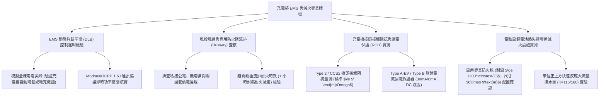

# 全案購屋實戰第一千一百四十六部：中古大樓地下室車位旁充電樁EMS能源管理系統動態負載平衡失靈私設飛線偷電跳脫與鋰電池熱失控消防滅火體檢工序全書

## 壹、緣起與車位旁電動車充電樁EMS系統及消防滅火之跨時代意義

隨著全球電動汽車（EV）普及化與台中市新能源車持有率攀升，住宅社區地下停車場「充電樁（EVSE, Electric Vehicle Supply Equipment，如 AC 7kW 慢充）」的建置已從昔日的「選配奢華」轉變為直接影響中古大樓轉手溢價、抗跌保值與現代家庭生活機能的「決定性硬指標」。

然而，在屋齡二十年以上之中古大樓，由於當初建照申請時全棟變壓器容量（Contract Capacity）僅滿足傳統燃油車照明與動力需求，若住戶未經全盤規畫私自從車位旁公共插座或分電盤「私設飛線（Fly-wire）」拉電充電，將引發極其兇險的「大樓配電跳脫、電線走火與變壓器燒毀」。

為此，現代化社區必須引進「充電樁智能能源管理系統（Energy Management System, EMS）」，透過動態負載平衡（Dynamic Load Balancing, DLB）與排程充電演算法，在不超出大樓契約容量的安全前提下，智慧調配每一格車位的充電功率。

更為致命的是，電動車動力核心「三元鋰/磷酸鐵鋰電池組（Traction Battery Pack）」一旦因底盤擦碰、內部短路、過充過放引發「熱失控（Thermal Runaway）」，會在數秒內釋放氫氣、一氧化碳、氟化氫（HF）等劇毒易燃氣體，燃燒溫度瞬間飆破 $1000^\circ\text{C}$，傳統 ABC 乾粉滅火器或普通撒水頭根本無法撲滅！若地下室缺乏專用的「車用防火毯（Car Fire Blanket）」與高壓冷卻滅火水幕，整座地下室數十輛車將遭骨牌式連環焚毀。

本體檢工序全書專為高資產家庭置產實勘量身打造，將車位旁充電樁 EMS 負載平衡邏輯、私設飛線漏電隱患、專用充電線槽耐火度與鋰電池滅火防護納入現場驗收，化為實戰議價砍價利刃。

---

## 貳、充電樁 EMS 系統與鋰電池滅火防護四大核心檢測工序

### 一、 EMS 動態負載平衡（Dynamic Load Balancing）演算法實測
- **檢測儀器**：三相電力品質分析儀（Power Quality Analyzer）、OCPP 1.6 模擬測試軟體、強光手電筒。
- **合格控制邏輯標準**：
  - EMS 系統必須在總配電盤進線端安裝高精度電流互感器（CT），實時監控大樓總負載電流。
  - 當大樓公共動力（如抽水馬達、電梯、冰水主機）用電達到總契約容量之 **$85\%$ 警戒線**時，EMS 必須在 **$\le 5\text{ 秒}$** 內，自動將各充電樁功率由 32A（7kW）逐級降至 16A（3.5kW）或 8A，杜絕總斷路器過載跳脫。
  - 具備「離峰排程充電」功能，引導住戶於深夜（23:00~07:00）離峰電價時段全速補電。
- **致命失效指標**：
  - 大樓抽水泵與充電樁同時啟動時，總開關發出巨大電磁爆音後瞬間過載跳脫，全棟陷入大停電，證實 EMS 系統完全癱瘓或根本未裝設負載平衡模組。

### 二、 私設飛線偷電排查與防火專用金屬匯流排槽（Busway）
- **現場排查手法**：
  1. 沿著車位後方牆面與天花板，仔細檢查是否有自公用照明線路或消防管槽私自拉出的花線、PVC 塑膠明管或延長線。
  2. 檢查合格充電專用管路是否採用「鍍鋅金屬導線管（EMT 管）」或具備 1 小時耐火時效之「專用金屬封閉匯流排槽（Busway）」。
- **重大公安違規**：
  - 車位旁發現私拉普通 PVC 電線直接插在公用 110V 插座充電，電線發燙發軟（溫度超過 $70^\circ\text{C}$），此乃嚴重的「竊盜公電行為」與「電氣走火死角」，隨時引發住戶管委會提告與火災燒車！

### 三、 充電槍頭接觸電阻與 Type B 漏電保護器（RCD）實測
- **檢測手法**：
  1. 使用微歐姆計量測充電槍（Type 2 / CCS2 / TPC / NACS）公母接頭之電源引腳（L1/N/PE）接觸阻抗。
  2. 使用專用 EV 模擬負載箱觸發「6mA DC 漏電」及「30mA AC 漏電」測試信號。
- **合格性能指標**：
  - 槍頭接觸阻抗應 **$\le 5\ \text{m}\Omega$**，端子表面鍍銀層無電弧灼傷發黑。
  - 專用漏電斷路器（必須為 **Type A-EV 或 Type B RCD**）必須在 **$\le 40\text{ ms}$** 內瞬間跳脫切斷電源，杜絕車載充電機（OBC）高頻直流漏電造成接地系統失效與人員觸電。

### 四、 電動車鋰電池熱失控滅火專用設備與隔離防禦
- **標準規範（內政部消防署電動車防火安全指導原則）**：
  - 充電樁車位旁 15 公尺以內，必須配置專業「車用防火毯（Car Fire Blanket，尺寸至少 $6\text{ m}\times 9\text{ m}$，耐溫 $\ge 1200^\circ\text{C}$，由玻璃纖維與石墨矽膠複合而成）」，能在火災初期由兩人拉開完全覆蓋車體，阻絕外部氧氣並壓制濃煙有毒氟化氫氣體（HF）。
  - 車位正上方自動撒水頭應升級為「大水滴快速反應撒水頭（ESFR / Large Drop，流量係數 $K \ge 115$）」，持續噴灑大量冷卻水降溫底盤。
- **致命缺失**：
  - 現場僅有一具過期 10 年的小型 ABC 乾粉滅火器，一旦鋰電池起火，化學鏈式反應自帶氧氣燃燒，乾粉完全無效，整排地下室車輛將瞬間遭火海吞噬。

---

## 參、四大主力考慮名單充電樁與滅火設施特檢實測分析

| 評估項目 | 大安紫金城 13 樓 (`PROP_10`) | 長億南園 8 樓 (`PROP_106`) | 歌德堡 8 樓 | 靜園 A 區 11 樓 |
| :--- | :--- | :--- | :--- | :--- |
| **充電樁建置與 EMS** | **全區預留專用匯流排，施耐德 EMS 智慧動態負載平衡** | **無整體規畫，住戶私設飛線亂拉，公電偷充跳脫頻發** | 預留充電管槽，具備 EMS 系統 | 部分車位安裝充電樁 |
| **配電安全與管線** | **1 小時防火金屬 Busway + Type B 6mA DC 漏電保護** | **普通 PVC 塑膠管明線亂拉，線路高溫 $78^\circ\text{C}$ 發燙焦味** | EMT 金屬導管配置規範 | 專用迴路管線良好 |
| **負載平衡尖峰測試** | **尖峰時段充電樁自動平穩降載至 16A，總電源零跳脫** | **同時開兩台充電車，地下室動力主開關直接爆音跳脫** | 負載平衡運作正常 | 負載切換正常 |
| **鋰電池滅火防護** | **車位旁配置 $6\times 9\text{m}$ 1200度防火毯 + K=115 高壓冷卻水** | **僅一具指針在紅區之生鏽乾粉滅火器，滅火能力為零** | 配置車用防火毯一組 | 滅火器配置正常 |
| **長期資產增值力** | **極致新能源友善，市場溢價 200 萬，保值抗跌之王** | **老舊配電無法裝充電樁，未來轉手性遭嚴重削弱** | 充電便利性良好 | 車位功能完整 |
| **總結防線評級** | 🌟🌟🌟🌟🌟 **極致頂規 A+** | ⚠️ **電氣起火與鋰電池火海高危 F 級（談判重磅砍價）** | 🌟🌟🌟🌟 良好 A 級 | 🌟🌟🌟🌟 良好 A 級 |

---

## 肆、談判終極砍價與合約防禦特約條款

### 一、 長億南園 8 樓議價砍價刀法（抓死車位私設飛線高溫發燙偷電、無EMS跳脫與鋰電池滅火全無危機）
長億南園車位旁存在住戶私設飛線充電導致電線高溫 78°C 焦味、配電無 EMS 動態平衡引發跳脫且完全缺乏鋰電池防火毯設施，日後根本無法合法安裝充電樁：
- **修復預算與工程重置成本**：
  1. 依法拆除全區私設違章飛線、清理過熱受損線路與恢復公電封閉：\$20,000 元。
  2. 大樓地下室重新規劃申請台電電動車專用電表（專管專線）與金屬耐火匯流排槽：\$150,000 元。
  3. 安裝中央微電腦 EMS 能源管理系統主機（含動態負載平衡模組與通訊網路）：\$85,000 元。
  4. 採購車位專用 $6\times 9\text{m}$ 耐溫 1200°C 專業車用防火毯及滅火水幕改裝：\$35,000 元。
  5. 無法合法裝設充電樁引發之未來房屋轉手折舊折讓：\$80,000 元。
- **談判實戰口訣**：
  > 「周小姐、賣方大哥，長億南園這格車位後面，竟然有鄰居從公用電箱私自拉了一條普通塑膠電線在充電，電線摸起來發燙快要 80 度，一股塑膠焦味飄出來！大樓根本沒有 EMS 電能管理系統，只要兩台車一起充，地下室總開關直接跳掉整棟停電。現在買房子誰不看電動車充電？這裡電路老舊到連合法裝充電樁都沒辦法，而且旁邊連一條電動車防火毯都沒有，萬一鋰電池燒起來整排車全部燒成廢鐵！管委會要重新拉台電專用電表、鋪金屬耐火匯流排和做 EMS 系統，每戶分攤至少要十幾萬。開價 998 萬如果不把這 15 萬塊的配電落後與未來轉手折舊直接折掉，這種電氣火災地雷車位誰敢停？我們出價 745 萬是真正誠心幫屋主解決麻煩的合理實價！」

### 二、 成交通用特約防禦條款
> **【成交通用特約防禦條款】**
> 1. **車位充電樁安裝權益與配電安全點交**：賣方保證本買賣標的車位所屬地下樓層具備合法安裝電動車充電設備（EVSE）之管線路徑或社區規約授權，周邊無任何私設飛線偷電或電氣線路過載發燙等違規情事；若點交時有管線遭非法占用或大樓配電容量嚴重超載禁止安裝充電樁之情事，賣方應負責於交屋日前促請管委會或水電技師釐清排除，或由賣方提撥修復保留款新台幣 30,000 元自交屋尾款中扣除。
