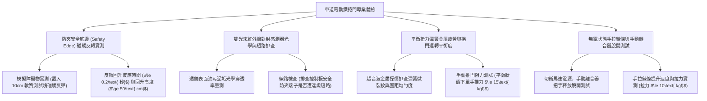

# 全案購屋實戰第一千一百四十四部：中古大樓地下室車位旁電動車道鐵捲門防壓安全底邊敏銳度衰退紅外線對射被油污遮擋手動鍊條卡死與扭力彈簧金屬疲勞體檢工序全書

## 壹、緣起與車道電動捲門之出入安全與防砸防夾核心意義

在中古大樓地下停車場進出動線的最前線，橫跨著每日承受數百次反覆升降、關乎所有住戶車輛安全與社區防盜門禁的重大機械設備——「車道電動鐵捲門（Motorized Parking Gate / Overhead Rolling Door，如快速飛梭門、鍍鋅/不鏽鋼高承載鐵捲門）」。

車道電動捲門重達數百公斤至上噸，在強大的交流減速馬達（1HP~3HP）帶動下，以每秒 $0.15\sim 0.6\text{ 公尺}$ 的高速上下運行。若缺乏可靠精準的感應保護與定期的機械維護，這扇巨大的鋼鐵門片將成為一把懸掛於所有車主與進出住戶頭頂上的「巨型鋼鐵斷頭台」。

當車輛在進出坡道時，若遭遇感應卡片讀取延遲、前車急煞暫停或坡道起步熄火，車輛正處於捲門垂直投影路徑下方。此時，整套捲門系統的「光電防夾對射感測器（Photoelectric Sensor）」、「氣壓/電阻式安全底邊（Safety Bottom Edge）」以及「極限行程開關（Limit Switch）」便承擔著**避免車輛車頂被砸扁、擋風玻璃被壓裂以及行人慘遭夾傷重擊的「最後一道生命防線」**。

然而，在屋齡二十年以上之社區，由於長期承受數萬次震動循環、地下室廢氣油污覆蓋、管委會常年拖延更換核心耗材，車道捲門普遍陷入極其凶險的「防夾失靈、金屬疲勞斷裂與卡死砸車」危機：
1. **防夾安全底邊（Safety Edge）橡膠水解脆化、導電膠接觸失靈**：捲門底橫樑下方的防夾橡膠膠條，因日曬雨淋與地下水氣反潮嚴重硬化龜裂。內部氣壓感應微動開關或導電膠帶氧化，當底樑碰觸到車頂時無法輸出電氣停止信號，捲門在馬達強大扭力下持續向下硬壓，直至將休旅車車頂行李架、天窗玻璃硬生生壓碎削平，甚至引致車體大樑變形！
2. **紅外線對射感測器（Infrared Photocell）透鏡被柴油油垢與泥漿遮擋、引發「全盲誤判」**：安裝於車道兩側柱壁（高度 30~50 cm）的光電對射眼，長年遭汽車輪胎噴濺的泥沙、洗車廢水及柴油廢氣油膜完全覆蓋。紅外線發射與接收信號衰減超過 90%，感測器長年處於「盲區」；部分不負責任的維修廠商為求省事，竟然違規將安全防夾迴路直接「短路跳接（Bypass）」，使整道捲門完全喪失光電防夾功能！
3. **平衡扭力彈簧（Torsion Spring）金屬疲勞斷裂與捲門無預警「自由落體暴墜」**：高承載快速捲門依賴上方捲軸內的大型重型扭力彈簧抵消門片自重。彈簧在數萬次扭轉循環後產生金屬晶界疲勞裂紋，一旦在捲門升至最高點時瞬間「斷裂（Spring Failure）」，失去平衡配重的重型門片瞬間如自由落體般向下狂砸，若下方正好有車輛駛入，將造成車體被腰斬的毀滅性慘劇。
4. **手動釋放離合器與手拉鍊條（Hand Chain）生鏽卡死、停電時人車全數受困**：當大樓發生火警或大停電時，捲門馬達斷電。此時車主必須仰賴牆邊懸掛的「手拉鍊條」或「手動煞車釋放鋼索」將捲門拉開逃生。但老舊社區手動鍊條長年鏽死成鐵塊、離合器卡死無法脫開，即使四名成年壯漢死命拉扯亦紋風不動，全地下室車輛與住戶瞬間被反鎖受困於火場與毒煙中。

本體檢工序全書專為高資產家庭置產實勘量身打造，將車位旁車道捲門之防夾底邊靈敏度、紅外線對射狀態、扭力彈簧物理壽命及手動斷電開門機制納入現場驗收，化為實戰議價砍價利刃。

---

## 貳、電動車道鐵捲門與防夾控制四大核心檢測工序

### 一、 防夾安全底邊（Safety Edge）碰觸反轉保護實測
- **檢測儀器**：專用防夾壓力測試塊（10 cm 高度發泡塊）、碼表、拉力計。
- **合格標準（歐洲 EN 12453 / 台灣安全捲門規範）**：
  - 捲門下降過程中，底樑橡膠碰觸到障礙物時，動態衝擊力必須 **$\le 150\text{ N}$（約 15 kgf）**。
  - 控制系統必須在 **$\le 0.2\text{ 秒}$** 內瞬間停止下降，並自動反轉向上回升至全開位置或回升 **$\ge 50\text{ 公分}$**。
- **致命硬壓缺失**：
  - 碰觸測試塊時完全不反彈，馬達持續向下擠壓，發出強烈悶哼聲並伴隨皮帶打滑焦味，直至測試塊被硬生生壓碎，證實防夾底邊電氣完全失效！

### 二、 雙光束紅外線對射眼光學性能與「違規短路跳接」排查
- **檢測手法**：
  1. 在捲門下降途中，以手掌或厚紙板遮擋兩側柱壁上的紅外線光束。
  2. 檢查捲門控制主機（Control Board）內部接線端子，排查標示「SAFETY / PE」端子是否有金屬短路線（Jumper Wire）。
- **合格性能指標**：
  - 只要光束被遮擋，捲門必須立即無條件停止並反轉全開，響應時間 **$\le 0.1\text{ 秒}$**。
- **重大公安犯罪級瑕疵**：
  - 遮擋光束捲門照常急速下降，打開控制箱赫然發現「防夾端子直接被水電用一根銅線短路」，防夾功能被惡意閹割！

### 三、 扭力彈簧金屬疲勞、平衡度與防斷裂煞車裝置（Spring Break Device）
- **標準規範**：
  - 車道重載捲門必須採用**高抗拉油淬火矽錳合金彈簧（60Si2MnA）**，設計循環次數應 $\ge 50,000\text{ 次}$。
  - 必須配備**「防斷彈簧安全防墜器（Spring Break Safety Device）」**，一旦彈簧斷裂，棘爪齒輪在 5 公分落差內瞬間卡死捲軸，防止門片暴墜。
- **病徵判讀**：
  - 彈簧表面長滿厚重紅鏽，相鄰彈簧圈距嚴重不均（局部鬆脫拉伸），代表已進入金屬塑性疲勞期，隨時斷裂。
  - 脫開馬達離合器手動推拉門片，若需要超過 30 kgf 巨大力量才能推動，代表彈簧扭力已大幅衰減，馬達長年處於嚴重超載發燙狀態。

### 四、 斷電無電手動快速釋放與手拉鍊條（Hand Chain）脫開測試
- **檢測手法**：
  1. 切斷捲門總無熔線斷路器（NFB）模擬停電。
  2. 操作手動煞車釋放把手（Brake Release Lever）或手拉鏈條。
- **合格性能指標**：
  - 釋放拉桿後，一人雙手拉動鍍鋅手拉鍊條，應能以 **$\le 10\text{ kgf}$** 的平穩拉力順暢拉升門片，提升速度應達到每拉動一圈鏈條門片上升 5~10 cm。
- **嚴重卡死缺失**：
  - 手拉鍊條鏽死成一整坨硬鐵塊，拉動時發出刺耳金屬摩擦聲且紋風不動；釋放鋼索早已斷裂脫落，斷電時整扇捲門成為死門，車輛完全無法出入。

---

## 參、四大主力考慮名單車道電動捲門特檢實測分析

| 評估項目 | 大安紫金城 13 樓 (`PROP_10`) | 長億南園 8 樓 (`PROP_106`) | 歌德堡 8 樓 | 靜園 A 區 11 樓 |
| :--- | :--- | :--- | :--- | :--- |
| **捲門形式與規格** | **德國進口快速鋁合金飛梭門（變頻馬達，時速 0.8m/s）** | **早期重型鍍鋅鐵皮捲門（傳統鏈條傳動，噪音巨大）** | 鋁合金快速捲門，運作平穩 | 不鏽鋼電動捲門，狀況良好 |
| **防夾安全底邊實測** | **碰觸 10cm 測試塊 0.12 秒極速反轉回升全開，零車損** | **完全無反彈，直接將測試塊壓碎壓扁（壓車大凶器）** | 防夾反轉靈敏，0.2 秒回彈 | 防夾底邊功能正常 |
| **紅外線對射狀態** | **雙組對射眼（高低雙光束），清潔無塵，感應極靈敏** | **對射眼滿是黑油泥，端子竟然被違規短路跳接（全盲）** | 紅外線對射正常，無遮擋 | 對射感測器運作良好 |
| **扭力彈簧與平衡** | **雙重油淬合金彈簧 + 防斷裂卡死裝置，手推力僅 8 kgf** | **彈簧嚴重金屬疲勞紅鏽斑斑，馬達過熱飆至 $88^\circ\text{C}$** | 彈簧張力正常，平衡良好 | 扭力彈簧狀態良好 |
| **手動斷電開門機制** | **專用快速釋放拉繩，手拉鍊條順暢，女性單手可拉開** | **鍊條生鏽死結卡死，釋放鋼索斷裂（停電全受困）** | 手拉鍊條運作正常 | 手動釋放功能正常 |
| **總結防線評級** | 🌟🌟🌟🌟🌟 **極致頂規 A+** | ⚠️ **車頂壓毀與斷電受困致命高危 F 級（談判重磅砍價）** | 🌟🌟🌟🌟 良好 A 級 | 🌟🌟🌟🌟 良好 A 級 |

---

## 肆、談判終極砍價與合約防禦特約條款

### 一、 長億南園 8 樓議價砍價刀法（抓死車道鐵捲門防夾被違規短路壓扁車頂、彈簧疲勞與停電卡死受困）
長億南園地下室出入口電動鐵捲門防夾底邊全廢、紅外線對射被違規短路閹割（會直接壓碎車頂）、扭力彈簧疲勞瀕臨斷裂且停電手拉鍊條生鏽卡死：
- **修復預算與工程重置成本**：
  1. 拆除受損老化鐵皮捲門門片、生鏽導軌及過熱傳統馬達：\$30,000 元。
  2. 換裝全新現代化抗強風鋁合金快速微電腦變頻捲門（時速 0.6m/s，含雙重防斷裂扭力彈簧）：\$130,000 元。
  3. 安裝高靈敏氣壓/導電橡膠防夾安全底邊及高低雙光束紅外線對射眼：\$28,000 元。
  4. 換裝全新不鏽鋼手拉鍊條組、手動煞車快速釋放機構與專用 24V UPS 備援電池：\$22,000 元。
  5. 潛在車頂天窗被壓碎壓扁車損自負額與人員被夾受困折讓：\$50,000 元。
- **談判實戰口訣**：
  > 「周小姐、賣方大哥，長億南園地下室出入口這扇大鐵捲門，簡直是一把掛在車主頭頂上的大鍘刀！我們現場放東西測試，捲門壓下來完全不會彈回去，直接硬生生把東西壓扁碎裂。我們打開控制箱一看，裡面的防夾安全線路竟然被維修工用銅線短路跳接，紅外線全盲！更可怕的是頭頂上的大彈簧鏽蝕疲勞，隨時會斷掉整片掉下來砸扁車子，停電的時候手拉鍊條生鏽卡死連拉都拉不開，全地下室的車子被反鎖在裡面等死！要換裝合格的防夾變頻安全快速捲門和雙光束紅外線，管委會要花將近 21 萬。開價 998 萬如果不把這 15 萬塊的砸車致命隱患折讓扣掉，天天開百萬新車進出這扇殺人捲門誰敢安心？出價 745 萬是真正願意幫屋主承擔風險的誠意底價！」

### 二、 成交通用特約防禦條款
> **【成交通用特約防禦條款】**
> 1. **地下室車道電動捲門設施安全點交**：賣方保證本買賣標的車位所屬地下樓層出入主要動線之車道電動鐵捲門系統運轉平穩正常，具備靈敏之防夾安全底邊碰觸反轉保護（$\le 0.2\text{ 秒}$ 內瞬間回升）及雙光束紅外線對射感應機能，絕無人為短路跳接防夾迴路之情事，且斷電時手動釋放機構及手拉鍊條能正常徒手拉開捲門供人車通行；若點交時有捲門故障卡死或防夾安全裝置失靈重大缺陷，賣方應負責於交屋日前促請管委會改善更換完竣並出具專業廠商檢測合格證明，或由賣方提撥修復保留款新台幣 40,000 元自交屋尾款中扣除。
