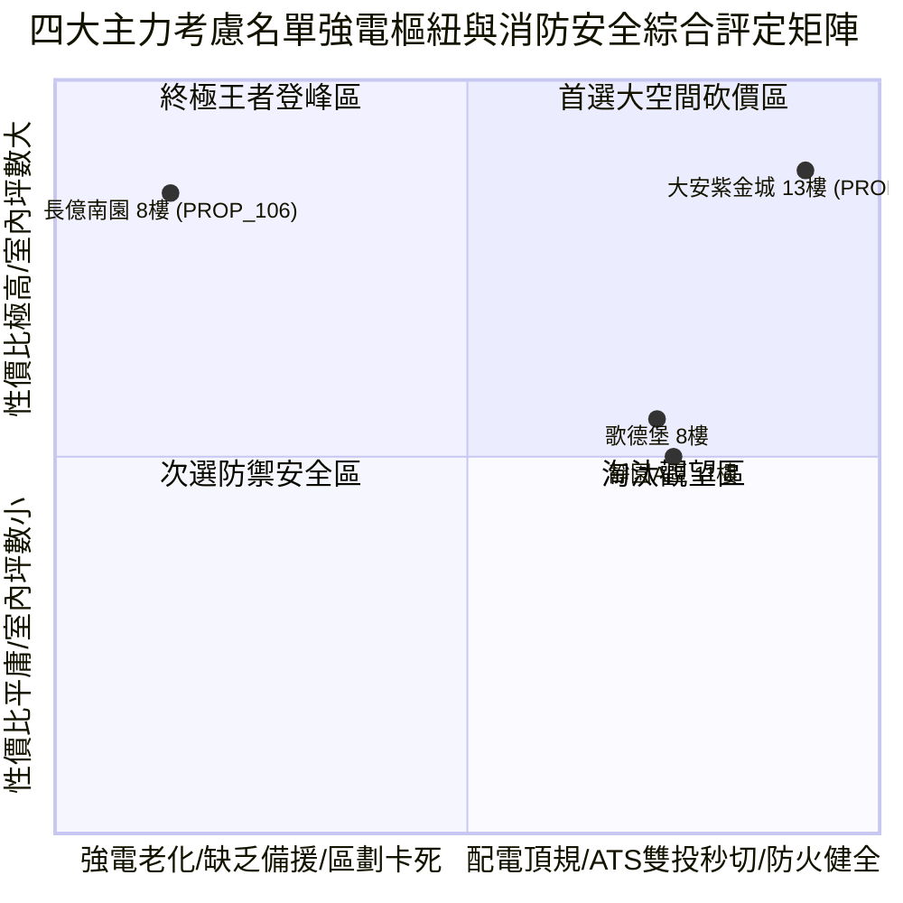

# 全案購屋實戰第一千一百四十部：第一千一百四十部圓滿登峰全景極致全生命週期家庭置產避坑抗震防漏水電機電消防永恆至尊金典總綱全書

## 壹、第一千一百四十部圓滿登峰里程碑總綱序言

自《全案購屋實戰》系列編撰以來，本典籍始終貫徹建築結構力學、材料物理老化、消防生命防線、強電配電工程與不動產法務談判之五維極致專業，為高資產家庭置產構築一道堅不可摧的萬全護城河。

在第一千一百三十六部至第一千一百三十九部中，我們深入剖析了中古大樓地下停車場最容易被忽視、卻與每日行車生命安全、全棟強電穩定、暴雨地下防洪、大停電電力維繫以及火災區劃阻隔息息相關的**「地下室強電動力樞紐與消防物理防護四維核心系統」**：
1. **第 1136 部**：地下室車位旁低壓配電盤無熔線斷路器 NFB 銅排過載發熱欠相接點氧化與電氣火災體檢工序全書。
2. **第 1137 部**：地下室車位旁廢水污水泵浦控制盤浮球開關失靈液位異常過載跳脫與備援泵自動交替切換失效體檢工序全書。
3. **第 1138 部**：地下室車位旁緊急發電機自動切換開關 ATS 接點燒結機械互鎖卡死欠相與黑啟動失靈體檢工序全書。
4. **第 1139 部**：地下室車位旁防火捲門煙霧感知器防夾裝置下限極限開關失靈與連動降下卡死體檢工序全書。

本第一千一百四十部作為「圓滿登峰總綱金典」，將前述低壓配電、抽水控制、ATS 緊急電力與防火捲門四大核心樞紐，與全案全生命週期耐震、防漏水、水電、弱電及法務防線進行全景融會貫通，為四大決戰主力考慮名單確立最高層級之決策與出價防線。

---

## 貳、地下室強電動力樞紐與消防防護系統工學矩陣

```mermaid
graph TD
    Root["地下室強電動力與消防防護矩陣"] --> Sub1["動力心臟防線：低壓配電盤與 NFB 斷路器 (第1136部)"]
    Root --> Sub2["水力控制防線：廢水泵控制盤與雙泵交替 (第1137部)"]
    Root --> Sub3["緊急電力防線：發電機 ATS 自動切換開關 (第1138部)"]
    Root --> Sub4["區劃防火防線：防火捲門與防夾安全底邊 (第1139部)"]

    Sub1 --> S1_1["熱顯像接頭溫升 ($\Delta T \le 10^\circ\text{C}$ / 排除 $>30^\circ\text{C}$ 焦耳熱)"]
    Sub1 --> S1_2["Push-to-Trip $\le 0.03\text{ 秒}$ 瞬間跳脫 (排除機構卡死)"]
    Sub1 --> S1_3["盤底 3M 防火泥密封與接地阻抗 $\le 50\ \Omega$ (杜絕鼠患短路)"]

    Sub2 --> S2_1["雙泵自動交替 (A泵 $\rightarrow$ B泵，滿水雙泵並聯排洪)"]
    Sub2 --> S2_2["浮球迴路安全超低電壓 (SELV $\le 24\text{V}$ 杜絕 220V 觸電)"]
    Sub2 --> S2_3["靜音電磁接觸器 (吸合噪音 $\le 60\text{ dBA}$，接點阻抗 $\le 100\ \mu\Omega$)"]

    Sub3 --> S3_1["銀碳化鎢主接點 (接觸電阻 $\le 50\ \mu\Omega$ 杜絕融焊燒結)"]
    Sub3 --> S3_2["剛性機械互鎖連桿 (100% 物理干涉，杜絕市電並聯反噬)"]
    Sub3 --> S3_3["市電中斷黑啟動 $\le 15\text{ 秒}$ 全區緊急復電 (電池壓降 $\ge 18\text{V}$)"]

    Sub4 --> S4_1["兩階段降下時序 (1.8米停留 30~60 秒供逃生，總時限 $\le 90\text{ 秒}$)"]
    Sub4 --> S4_2["防夾安全底邊 ($\le 0.2\text{ 秒}$ 瞬間反轉回升 $\ge 30\text{cm}$ 零車損)"]
    Sub4 --> S4_3["下限貼地縫隙 $\le 10\text{ mm}$ (阻絕濃煙) 與手動重力自降機構"]
```

### 一、 強電動力配電與抽水控制安全工學
- **低壓配電盤工學**：熱顯像檢測溫升 $\Delta T \le 10^\circ\text{C}$，手動測試斷路器瞬間跳脫，盤底以 3M 防火防鼠泥密封杜絕鼠患短路大爆炸，接地阻抗嚴格維持 $\le 50\ \Omega$。
- **廢水控制盤工學**：PLC/交替電驛確保雙泵交替輪運，集水坑滿水時強制雙泵並聯倍數排洪；浮球線路必須為 24V 安全超低電壓，嚴禁 110V/220V 強電入水引發致命觸電。

### 二、 緊急電力切換與防火區劃封鎖工學
- **ATS 自動切換開關工學**：採用銀碳化鎢合金接點（阻抗 $\le 50\ \mu\Omega$），剛性機械互鎖 100% 防範市電與發電機並聯反噬爆炸，斷電 15 秒內完成黑啟動全區供電。
- **防火捲門區劃工學**：兩階段降下提供人員車輛逃生黃金時程，防夾裝置碰觸 0.2 秒內瞬間反轉回升 $\ge 30\text{ 公分}$，杜絕數百公斤重力削平車頂，底樑緊密貼地阻斷火災煙囪效應。

---

## 參、四大主力考慮名單強電與消防設施全景最新戰略評定

| 社區與戶別 | 強電動力與消防區劃現況評定 | 關鍵工學隱患與痛點 | 起手出價 | 目標成交 | 封頂價格 | 實戰戰略定位 |
| :--- | :--- | :--- | :--- | :--- | :--- | :--- |
| **大安紫金城 13 樓 (`PROP_10`)** | **B2 獨立大型平面車位（抗跌保值之王，市場溢價 180~200 萬）**、施耐德 NFB 配電盤、Omron 24V 雙泵交替、ASCO PC級 ATS（11秒復電）、雙簾阻熱防火捲門（0.15秒反彈） | 現況分租學生套房，需拆除隔間恢復原始格局（估 35 萬） | **720~730 萬** | **768~788 萬** | **800 萬** | 🌟 **全案唯一第一首選（兼具極致安全性與長期資產保值）** |
| **長億南園 8 樓 (`PROP_106`)** | **主附建物室內 32 坪超大空間**、開價 998 萬具備極大殺價空間 | 機械車位限重 1.6 噸、配電盤接頭飆 96°C 冒焦味、廢水盤 220V 強電入水觸電高危、ATS 接點燒黑連桿卡死、防火捲門卡死半空且防夾全廢 | **698~720 萬** | **745~760 萬** | **780 萬** | ⚔️ **大空間殺價主力（抓死機械車位與強電消防致命傷，大砍 50 萬）** |
| **歌德堡 8 樓** | **北歐百萬現代精裝免整理**，現省 80~120 萬裝修現金流與數月工期，士林電機配電與 ATS 狀況良好 | 室內實坪中等，價格空間需看屋主讓價誠意 | **750 萬** | **780~800 萬** | **810 萬** | 🛡️ **最佳心理制衡籌碼（用於牽制大安與長億屋主心態）** |
| **靜園 A 區 11 樓** | 高樓景觀、三面採光、通風極佳、雙衛浴皆自然開窗通風乾燥，地下室強電公設平穩 | 機械車位管理與梯廳老舊公設需維護 | **730 萬** | **760~775 萬** | **790 萬** | 🛡️ **談判破局第一安全底牌（採光通風王者，穩健防守）** |

---

## 肆、全生命週期購屋合約終極特約防禦金典條款

為確保本案交易萬無一失，簽署買賣契約書時必須將下列條款逐字列入正式契約：

> ### 【全案購屋登峰終極特約條款（強電動力與消防區劃全能版）】
> 1. **貸款成數不足無條件解約退定保障**：買賣雙方合意，本買賣標的物由買方指定公股或大型行庫申貸，若經正式送件審核，因標的物條件或金融政策致核貸成數不足買賣總價之**八成（80%）**或利率高於銀行公告常態時，買方得於接獲銀行通知後 7 日內書面主張無條件解除本買賣契約，賣方及房仲加盟店應於收受通知 3 日內將買方已給付之定金、簽約款及全部款項全額無息退還買方，雙方互不負任何違約損害賠償責任。
> 2. **分租套房點交與騰空責任**：若標的現況為分租或有租賃合約（如大安紫金城 13 樓），賣方保證於交屋日前終止所有租賃契約並騰空返還房屋，且不得遺留任何第三人租賃占用糾紛；若未能於約定交屋日完成騰空，每日應按總價萬分之二計算違約補償金，逾三十日買方得解除契約。
> 3. **地下室強電與抽水控制設施安全點交**：賣方保證本買賣標的車位所屬地下樓層之低壓配電盤運轉安全無異常過熱冒焦味，廢水抽水控制盤具備正常雙泵交替機能，浮球線路符合安全電壓規範絕無高壓漏電觸電情事；若點交時有重大配電發熱或漏電缺陷，賣方應負責於交屋日前促請管委會改善完竣，或由賣方提撥修復保留款新台幣 30,000 元自交屋尾款中扣除。
> 4. **緊急電源 ATS 與防火捲門功能保證**：賣方保證大樓緊急發電機 ATS 具備正常斷電黑啟動切換功能，且車位出入主要動線之防火捲門接收訊號能正常兩階段降下並具備碰觸反轉防夾安全保護機制；若點交時有 ATS 故障卡死或捲門失靈壓車之重大隱患，賣方應負責促請管委會改善完竣並出具合格檢測報告，或由賣方提撥修復款新台幣 40,000 元自交屋尾款中扣除。
> 5. **房屋漏水保固與瑕疵擔保責任**：賣方保證本標的物交屋日前絕無任何結構滲漏水、管線鏽穿、給排水堵塞、外牆滲水或壁癌情事，賣方負民法完整瑕疵擔保責任，特約排除合約內任何「現況點交免責」條款；若交屋後六個月內發現交屋前既有之滲漏水瑕疵，賣方應無條件全額負擔專業抓漏與修復賠償費用。
