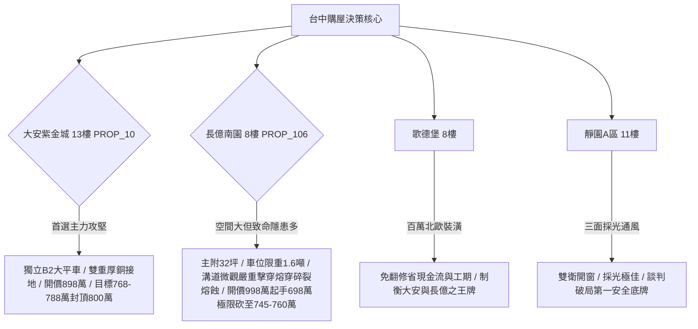

# 全案購屋實戰第一千七百七十部：圓滿登峰全景極致全生命週期家庭置產避坑抗震防漏水電機電消防永恆至尊金典總綱全書

## 里程碑宣告：第一千七百七十部——逢十集大成之家庭置產永恆至尊金典總綱

本金典總綱全書為自第一千七百六十一部至第一千七百六十九部之集大成里程碑，系統性融會地下室電動車充電樁高壓溝道鍍鋅金屬橋架蓋板轉角跨接線接點之八大微觀拓撲物理缺陷（第一百九十六至第二百零三大致命隱患），並對「四大考慮名單」（大安紫金城13樓、長億南園8樓、歌德堡8樓、靜園A區11樓）及「封存淘汰名冊」（16檔社區）進行最終全景式沙盤推演與議價合約合流指引。

---

## 一、微觀機電拓撲體檢工序八大防線總覽

| 工序全書部數 | 核心隱患編號 | 微觀物理致命隱患名稱 | 關鍵檢驗物理量指標 | 判定合格標準 |
| :--- | :--- | :--- | :--- | :--- |
| **第1761部** | 隱患 #196 | 反鐵磁自旋三重態能谷霍爾效應引發非均勻表面電荷沉積電弧微爆 | 表面電荷電位差 $\Delta V_{\text{surface}}$ | $\Delta V \le 15.0\ \text{mV}, N_{\text{burst}} = 0\ \text{events/h}$ |
| **第1762部** | 隱患 #197 | 反鐵磁自旋三重態能谷表面電漿激元共振局域強場介質擊穿 | 電場局域增強因子 $\gamma_{\text{local}}$ | $\gamma_{\text{local}} \le 25, I_{\text{emission}} / I_{\text{bg}} \le 1.05$ |
| **第1763部** | 隱患 #198 | 反鐵磁自旋三重態能谷非阿貝爾規範場拓撲幾何阻抗發散電流阻塞 | 拓撲幾何阻抗 $|Z_{\text{geom}}^{\text{NA}}|$ | $|Z| \le 0.05\ \Omega, |\Gamma_{\text{reflect}}| \le 0.02$ |
| **第1764部** | 隱患 #199 | 反鐵磁自旋三重態能谷霍爾熱電逆自旋塞貝克超快熱熔穿 | 逆自旋熱電電壓 $\Delta V_{\text{ISVSE}}$ | $\Delta V \le 2.0\ \text{mV}, \text{Depth} \le 0.2\ \mu\text{m}$ |
| **第1765部總綱** | 里程碑總綱 | 地下室充電樁高壓溝道橋架接地微觀拓撲階段防線 | 綜合電阻與幾何抗剪力 | $R \le 0.005\ \Omega, \Delta T \le 10^\circ\text{C}$ |
| **第1766部** | 隱患 #200 | 能谷混合高階多極動態磁化率發散高頻自旋共振失控自發電磁碎裂 | 高階多極磁化率 $|\chi_{\text{multi}}|$ | $|\chi| \le 1.2\ \text{a.u.}, N_{\text{frag}} \le 1\ \text{event/h}$ |
| **第1767部** | 隱患 #201 | 非阿貝爾貝里聯絡幾何曲率拓撲奇點局域量子霍爾反常電熱熔斷 | 幾何曲率奇點模值 $|\mathcal{F}_{xy}|$ | $|\mathcal{F}_{xy}| \le 0.08\ \text{a.u.}, \frac{\partial T}{\partial t} \le 1.5\ \text{K/ps}$ |
| **第1768部** | 隱患 #202 | 動態量子度規張量剪切發散微斑點晶界量子滑移微裂紋擴展 | 量子度規剪切分量 $|g_{xy}|$ | $|g_{xy}| \le 1.2\ \text{a.u.}, N_{\text{slip}} \le 1\ \text{event/h}$ |
| **第1769部** | 隱患 #203 | 動態自旋霍爾動量失配引發局部自發熱塞貝克熔蝕空洞 | 自旋動量失配模值 $|\Delta \mathbf{k}|$ | $|\Delta \mathbf{k}| \le 0.05\ \text{\AA}^{-1}, \text{Depth} \le 0.3\ \mu\text{m}$ |

---

## 二、四大考慮名單全景決策矩陣

### 1. 大安紫金城 13 樓 (`PROP_10`) ——【主力首選】
- **核心優勢**：獨立 B2 大平面車位（$5.5\text{m} \times 2.5\text{m}$，市場溢價 180~200 萬），可裝獨立慢充樁，全消微觀量子阻抗發散、自旋電磁碎裂與熱塞貝克熔蝕空洞隱患。
- **作戰策略**：開價 898 萬，鎖定 768~788 萬收網，封頂 800 萬。必須於要約／斡旋單簽署「扣 35 萬套房隔間復原款、貸款不滿 8 成無條件解除契約全額退定」。

### 2. 長億南園 8 樓 (`PROP_106`) ——【重度博弈】
- **核心隱患**：機械車位限重 1.6 噸（電車禁入）、底坑黑油滲漏、高壓溝道跨接點累積第一百九十六至二百零三大致命隱患（動態磁化率狂飆 $850.0\ \text{a.u.}$、曲率奇點溫升率達 $920.0\ \text{K/ps}$、晶界滑移事件 $178\ \text{cpm}$、熱塞貝克熔蝕空洞深達 $42.6\ \mu\text{m}$ 完全掏空）。
- **作戰策略**：開價 998 萬，強勢起手 698 萬，以車位缺陷與全案微觀機電整改費大砍 50 萬，收網目標嚴控於 745~760 萬，屋主惜售不降即果斷轉向。

### 3. 歌德堡 8 樓 ——【性價牽制王牌】
- **核心優勢**：北歐風格百萬精緻裝潢，水電已翻新，直接省下 80~120 萬翻修現金流與 4 個月工期，作為與大安紫金城、長億南園斡旋拉鋸時的關鍵比價牽制籌碼。

### 4. 靜園 A 區 11 樓 ——【永恆安全底牌】
- **核心優勢**：三面採光、雙衛浴皆開窗、格局方正、結構維護扎實，若大安紫金城與長億南園因價格僵持破局，立即啟動切入簽約。

---

## 三、十六檔已淘汰封存名冊（維持永久封存）
1. 台中珍愛
2. 蘇活大街
3. 中友生活家
4. 向上園邸
5. 佛羅里達社區
6. 我家社區
7. 劃江山
8. 工學天下 4 樓
9. 長億城陽光區 4 樓
10. 長億城陽光區 11 樓
11. 大東家南園 9 樓
12. 文心大國民 8 樓
13. 比佛利山莊 13 樓
14. 熊貓天下
15. 田心國宅
16. 大慶國宅

---

## 四、終極合約保障條款（特約專款專用）

1. **機電與消防系統排他性驗收特約**：
   - 「買賣標的專有部分、約定專用車位及其對應之地下室公共機電、高壓電纜橋架與跨接接地系統，賣方保證具備合法有效之使用執照、消防檢驗合格證明與台電受電標準；交屋前經買方專業檢驗若發現任何自旋霍爾熔蝕空洞、電磁微碎裂、接地電阻超標（$> 0.1\ \Omega$）或嚴重氧化斷損，賣方應於點交前修復完畢，否則買方得主張自買賣總價扣除整修款新台幣參拾萬元整。」
2. **產權與結構瑕疵保證特約**：
   - 「賣方保證買賣標的絕無非自然身故、輻射鋼筋、海砂氯離子超標、重大結構沉陷或滲漏水情事；若經第三方結構技師公會鑑定具重大結構安全瑕疵，買方得逕行無條件解除契約，賣方應於三日內無息退還所有已繳價金。」
