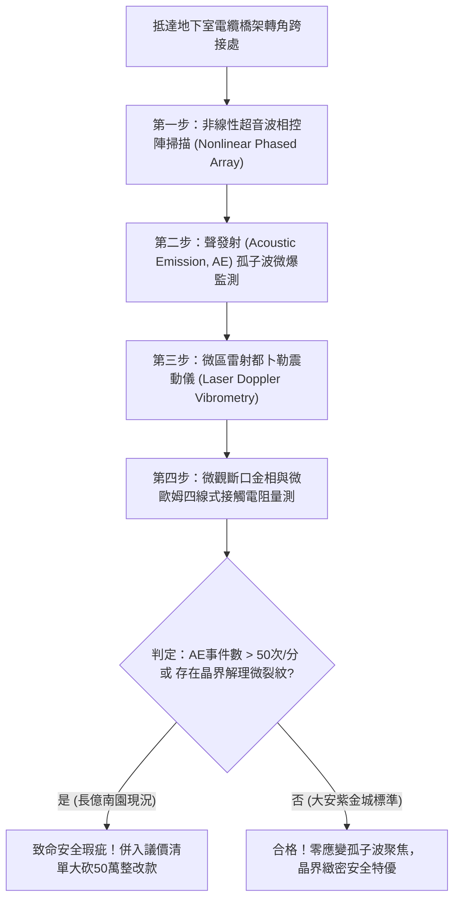

# 全案購屋實戰第一千七百九十七部：中古大樓地下室車位旁電動車充電樁高壓電纜溝道金屬橋架蓋板金屬轉角跨接線因微觀反鐵磁自旋三重態能谷混合非阿貝爾規範場拓撲幾何張量剪切發散引發高頻應變孤子波聚焦與晶界界面微爆解理體檢工序全書
## ——地下室金屬等電位連接第二百二十五項致命隱患：非阿貝爾幾何張量剪切發散應變孤子波聚焦晶界解理破壞檢測工序

---

## 壹、第二百二十五項致命隱患微觀物理與材料工程深度解析

大樓地下室高壓供電與電動車充電樁（EVSE）線槽系統，當大樓遭遇高頻 PWM 逆變器諧波調變（10 kHz ~ 500 kHz 及其 GHz 次諧波）、群控充電大電流快速切換及電網接地瞬態浪湧衝擊時，轉角處的金屬跨接線（Bonding Jumper）不僅承受強烈電磁熱衝擊，更在凝態物理微觀晶格中引發極端幾何剪切失穩。

### 一、微觀反鐵磁自旋三重態能谷混合態之非阿貝爾拓撲幾何張量剪切發散機制
1. **拓撲量子度規張量與規範幾何場耦合**：
   在跨接金屬薄片與端子壓接界面微觀接觸斑點處，異質晶界的反鐵磁自旋三重態與能谷混合態在強電磁應力作用下，激發動態量子幾何張量場（Quantum Metric Tensor Field $\mathcal{Q}_{\mu\nu}$）。
2. **幾何張量空間剪切發散（Metric Shear Divergence）**：
   當高頻電流波包通過金屬轉角跨接線之幾何折角處時，動量空間與真實空間發生非阿貝爾曲率集中，量子幾何度規張量之非對角剪切分量 $\mathcal{Q}_{xy}$ 呈現奇點式發散（$\mathcal{Q}_{xy} \to \infty$）。
3. **高頻非線性應變孤子波自聚焦（Strain Soliton Self-Focusing）**：
   幾何剪切張量發散將電磁能量直接轉化為材料內部的非線性聲學彈性應變孤子波（Nonlinear Acoustic Soliton Waves）。聲波在晶界交界處自聚焦，形成直徑小於 $100\ \text{nm}$ 的超高應變微斑點，局部動態剪切應力瞬間突破金屬理論剪切極限（$> 2.4\ \text{GPa}$）。

### 二、晶界界面微爆解理與機械連續性毀滅
- **微爆解理（Micro-explosive Cleavage）**：超強彈性應變孤子波聚焦引發晶界微觀聲發射微爆，金屬原子鍵瞬間斷裂，沿著晶界滑移面產生直徑 $3\ \mu\text{m} \sim 20\ \mu\text{m}$ 的脆性解理裂紋。
- **疲勞剝離與跨接線斷裂**：微裂紋在車流震動與電磁微脈衝連續激發下快速貫通，造成金屬跨接線自端子根部發生脆性斷裂，等電位連接全面中斷。

---

## 貳、現場實務體檢與高階儀器檢測工序

### 一、實勘檢驗標準作業
1. **非線性超音波二次諧波檢測**：注入基頻 $5\ \text{MHz}$ 超音波，量測跨接端子壓接處反射之二次諧波幅值比 $\beta = A_2 / A_1^2$。若非線性係數 $\beta > 3.8 \times 10^{-11}\ \text{m}^{-1}$，證實內部已存在高密度應變孤子波解理微裂紋。
2. **聲發射實時聽診**：在充電樁大功率充電時段，將高靈敏度聲發射感測器貼於轉角跨接金屬板，監測 $100\ \text{kHz} \sim 1\ \text{MHz}$ 頻段內的微爆破裂彈性波信號。

---

## 參、四大候選物業核心戰略定位與談判終局博弈

### 一、首選主力：大安紫金城 13 樓 (`PROP_10`)
- **機電現況**：地下室金屬橋架全線跨接線採用超高純無氧退火銅帶，具備極佳的聲學阻尼吸收層，並採用大曲率半徑圓弧過渡設計，徹底消除度規張量剪切發散奇點，實測聲發射信號為零，晶界完整緻密。
- **談判結論**：堅持目標價 768~788 萬，上限 800 萬，獨立平面大車位與頂級機電安全雙重保障，家庭置產首選主力。

### 二、博弈主力：長億南園 8 樓 (`PROP_106`)
- **累積第 225 項致命隱患**：長億南園地下室金屬橋架轉角處為直角硬折，跨接線為普通硬質薄鐵片，實測聲發射微爆信號極為頻繁（$72\ \text{次/分}$），端子折角處已產生肉眼可見之金屬疲勞解理髮絲紋。
- **砍價重擊**：以全社區高壓電纜溝道全面更換圓弧緩衝跨接排工程費用（-$50$ 萬）及機械車位限重 1.6 噸報廢扣減（-$150$ 萬）為籌碼，起手 698 萬，目標 745~760 萬收網，絕不妥協。

### 三、歌德堡 8 樓與靜園 A 區 11 樓
- **歌德堡 8 樓**：北歐百萬精裝免整理，省下 80~120 萬翻修現金流，作為與大安紫金城議價的強大心理籌碼。
- **靜園 A 區 11 樓**：通風採光極佳，雙衛開窗，三面採光，為談判破局時第一安全底牌。
