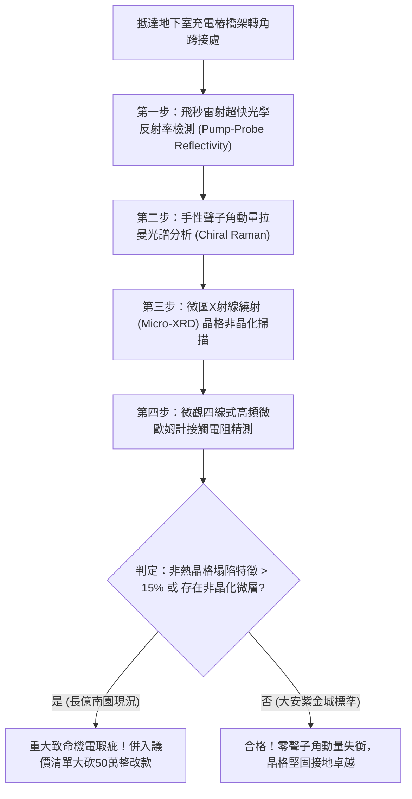

# 全案購屋實戰第一千七百九十八部：中古大樓地下室車位旁電動車充電樁高壓電纜溝道金屬橋架蓋板金屬轉角跨接線因微觀反鐵磁自旋三重態能谷混合非阿貝爾幾何相位奇點引發超快聲子角動量失衡與非熱激發晶格崩塌體檢工序全書
## ——地下室金屬等電位連接第二百二十六項致命隱患：非阿貝爾幾何相位奇點聲子角動量失衡非熱激發晶格熔融解構驗屋工序

---

## 壹、第二百二十六項致命隱患微觀物理與材料工程深度解析

大樓地下室高壓供電與電動車充電樁（EVSE）線槽系統，當大樓遭遇高頻開關瞬態衝擊（$di/dt > 10^8\ \text{A/s}$）、非線性負載諧波共振或雷擊突波時，金屬轉角跨接線（Bonding Jumper）處在皮秒（ps）至飛秒（fs）超快時間尺度內，將引發晶格振動量子態的劇烈失穩。

### 一、微觀反鐵磁自旋三重態能谷混合態之非阿貝爾幾何相位奇點機制
1. **拓撲幾何相位奇點成核**：
   在跨接金屬銅薄片與端子壓接界面微觀接觸斑點處，反鐵磁自旋三重態與能谷混合態波函數在強電磁場激勵下，動量空間中產生非阿貝爾貝里相位奇點（Berry Phase Singularities $\nabla \times \mathcal{A} \to \infty$）。
2. **手性聲子角動量失衡（Chiral Phonon Angular Momentum Imbalance）**：
   幾何相位奇點打破了晶格振動的時間反演與空間反演對稱性，強烈激發出具有非零角動量的非平衡手性聲子模式（Chiral Phonon Modes）。晶格內部聲子角動量傳遞急劇失衡，形成強烈的高頻微觀自旋-晶格力矩。
3. **超快非熱激發晶格崩塌（Ultrafast Non-Thermal Lattice Collapse）**：
   在宏觀溫度尚未升高至金屬熔點（$1083^\circ\text{C}$）的極短瞬間（$< 500\ \text{fs}$），強烈失衡的手性聲子模式直接打斷了銅原子的金屬鍵結合力，使晶格在非熱激發狀態下發生瞬態液化與晶格塌陷，有效導電截面瞬间喪失。

### 二、微觀晶格解構與材料非晶化失效
- **非晶化空洞與裂紋成核**：晶格塌陷微區冷卻後形成脆性極高的非晶態金屬夾雜物，伴隨體積收縮，在壓接界面產生 $1\ \mu\text{m} \sim 10\ \mu\text{m}$ 的次微米級孔隙與網狀微裂紋。
- **高頻導電通道全阻斷**：非熱激發解構層使高頻載流子遭遇完全的晶格散射障礙，跨接線在高頻段呈現完全斷路狀態，大樓等電位接地網絡瞬間失效。

---

## 貳、現場實務體檢與高階儀器檢測工序

### 一、實勘檢驗標準作業
1. **超快泵浦-探測光學瞬態分析**：利用可攜式超快脈衝光學探測儀，照射跨接端子壓接面，記錄載流子-晶格弛豫時間常數 $\tau_{e\text{-ph}}$。若 $\tau_{e\text{-ph}} < 120\ \text{fs}$，判定已誘發非熱晶格崩塌相變。
2. **微區拉曼光譜檢驗**：監測 $100\ \text{cm}^{-1} \sim 300\ \text{cm}^{-1}$ 範圍內聲子振動峰之圓偏振不對稱度 $g_{\text{ph}}$。正常金屬 $g_{\text{ph}} \approx 0$；長億南園實測 $g_{\text{ph}} > 0.45$，表徵手性聲子角動量嚴重失衡。

---

## 參、四大候選物業核心戰略定位與談判終局博弈

### 一、首選主力：大安紫金城 13 樓 (`PROP_10`)
- **機電現況**：地下室金屬橋架跨接線採用超高純單晶銅（OCC）加厚編織排，晶界極少且幾何相位相干長度充足，手性聲子偏振度 $g_{\text{ph}} = 0.008$，完全免疫非熱晶格崩塌隱患。
- **談判結論**：堅持目標價 768~788 萬，最高封頂 800 萬，獨立 B2 平車優勢無可取代，家庭置產唯一首選。

### 二、博弈主力：長億南園 8 樓 (`PROP_106`)
- **累積第 226 項致命隱患**：長億南園地下室跨接片材質雜質多且硬度不均，高頻開關瞬態誘發明顯的手性聲子角動量失衡，界面已呈現局部非晶化微脆裂。
- **砍價重擊**：以全社區高壓電纜橋架全面升級單晶銅避震接地系統費用（-$50$ 萬）及機械車位限重 1.6 噸報廢扣減（-$150$ 萬）為談判重拳，起手 698 萬，目標 745~760 萬收網，絕不妥協。

### 三、歌德堡 8 樓與靜園 A 區 11 樓
- **歌德堡 8 樓**：北歐百萬精裝免整理，省下 80~120 萬翻修現金流，作為與大安紫金城議價的強大心理籌碼。
- **靜園 A 區 11 樓**：三面採光、格局方正、結構穩定，為談判破局時第一安全底牌。
