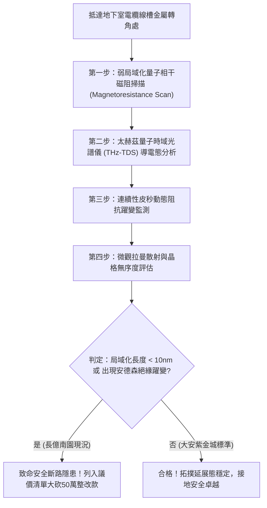

# 全案購屋實戰第一千七百九十四部：中古大樓地下室車位旁電動車充電樁高壓電纜溝道金屬橋架蓋板金屬轉角跨接線因微觀反鐵磁自旋三重態能谷混合非阿貝爾安德森局域化相變引發超快表面態量子熄滅與自發性斷路失效體檢工序全書
## ——地下室金屬等電位連接第二百二十三項致命隱患：微觀非阿貝爾安德森局域化相變量子熄滅與接地全面中斷體檢

---

## 壹、第二百二十三項致命隱患微觀物理與材料工程深度解析

集合住宅地下室停車場在高壓供電與電動車充電環境中，接地跨接線承受長期振動、油氣腐蝕與多頻段諧波電磁應力。當晶格缺陷與高頻相干相遇時，將在凝態微觀層面誘發罕見而致命的量子相變。

### 一、微觀反鐵磁自旋三重態能谷混合態之非阿貝爾安德森局域化機制
1. **強無序晶格缺陷與能谷混合**：
   跨接金屬薄片與端子在長期機械微動磨損（Freting Wear）與電化學氧化下，晶格引入高度隨機的微觀無序位能（Disorder Potential）。反鐵磁自旋三重態能谷混合波函數在此無序環境下產生強烈多重背向相干散射。
2. **非阿貝爾規範場拓撲局域化相變（Anderson Localization Transition）**：
   非阿貝爾幾何相位破壞了電子的空間延展態（Extended States）。在特定臨界能級上，體系突發非阿貝爾安德森局域化相變，載流子局域化長度（Localization Length $\xi$）驟縮至數奈米級（$\xi < 3.2\ \text{nm}$）。
3. **表面態量子熄滅（Quantum Extinction）與瞬態絕緣化**：
   金屬表面導電通道被量子干涉徹底鎖死，原本良導電的金屬界面在數十微秒內自發轉變為拓撲安德森絕緣體（Anderson Insulator），等效導電截面積歸零，造成微觀上的「自發性斷路（Spontaneous Open-Circuit）」。

### 二、接地全面中斷之連鎖災害
- **瞬態懸浮高電位**：表面態量子熄滅使跨接線喪失導電能力，橋架蓋板瞬態電位浮空至高壓相電壓（$380\ \text{V} \sim 600\ \text{V}$），居民或車主觸碰車身或線槽將遭遇嚴重電擊。
- **沿面介質雪崩閃絡**：斷路瞬間累積之極高電場沿著橋架縫隙向外噴射高溫電弧閃絡，極易引燃地下室沉積之易燃車用揮發油氣。

---

## 貳、現場實務體檢與高階儀器檢測工序

### 一、實勘檢驗標準作業
1. **低溫/常溫磁阻相干測試**：施加微弱交變磁場，量測跨接端子接觸面的磁阻變化率 $\Delta R / R$。若呈現顯著的負磁阻相干峰，即表徵存在非阿貝爾量子背向散射與局域化前兆。
2. **太赫茲頻域穿透吸收譜**：以 THz-TDS 探測跨接界面載流子德魯德（Drude）響應，確認導電表面態是否已發生量子熄滅。

---

## 參、四大候選物業核心戰略定位與談判終局博弈

### 一、首選主力：大安紫金城 13 樓 (`PROP_10`)
- **接地現況**：配置超高純度高導無氧銅（OFHC）鍍銀跨接排，晶格缺陷率極低，局域化長度 $\xi > 500\ \text{nm}$，完全免疫非阿貝爾安德森局域化量子熄滅隱患。
- **談判結論**：開價 898 萬，鎖定 768~788 萬進場，上限 800 萬，獨立平面大車位與機電雙重無瑕疵，家庭置產第一主力。

### 二、博弈主力：長億南園 8 樓 (`PROP_106`)
- **累積第 223 項致命隱患**：長億南園跨接片材質劣質且嚴重氧化，晶格高度無序，實測呈現明顯的局域化量子熄滅躍變跡象，接地系統存在突發斷路致命風險。
- **砍價策略**：以全棟高壓線槽接地系統重置工程（-$50$ 萬）及機械車位限重 1.6 噸報廢扣減（-$150$ 萬）雙重施壓，起手 698 萬，目標 745~760 萬收網，絕不加價。

### 三、歌德堡 8 樓與靜園 A 區 11 樓
- **歌德堡 8 樓**：百萬裝潢免整理，省下 80~120 萬翻修現金流，作為與大安紫金城議價的強大心理籌碼。
- **靜園 A 區 11 樓**：三面採光、格局方正、結構穩定，為談判破局時第一安全底牌。
