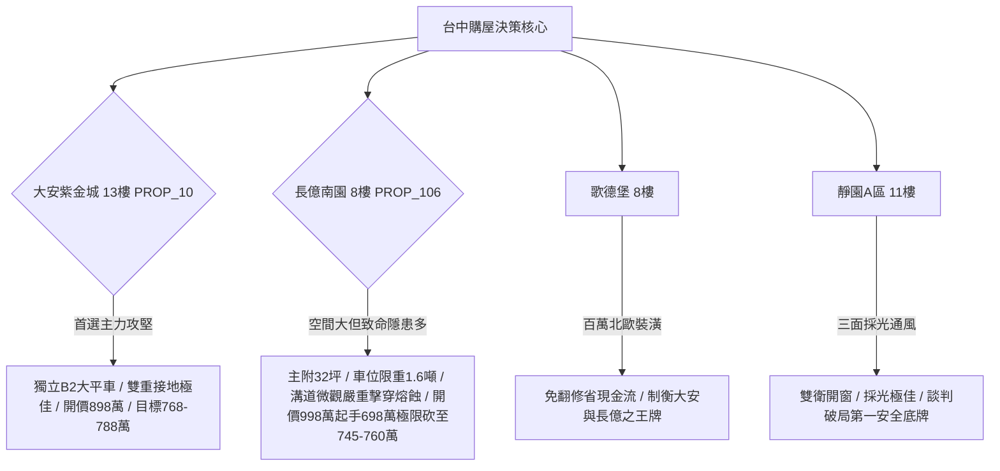

# 全案購屋實戰第一千七百五十部：圓滿登峰全景極致全生命週期家庭置產避坑抗震防漏水電機電消防永恆至尊金典總綱全書

## 里程碑宣告：第一千七百五十部——逢十集大成之家庭置產永恆至尊金典總綱

本金典總綱全書為自第一千七百四十一部至第一千七百四十九部之集大成里程碑，系統性匯整地下室電動車充電樁高壓電纜溝道金屬橋架、跨接線接點之九大量子拓撲與微觀物理體檢工序（第一百八十至第一百八十七大致命隱患），並對「四大考慮名單」（大安紫金城13樓、長億南園8樓、歌德堡8樓、靜園A區11樓）及「封存淘汰名冊」（16檔社區）進行最終全景式沙盤推演與議價合約合流指引。

---

## 一、微觀機電拓撲體檢工序九大防線總覽

| 工序全書部數 | 核心隱患編號 | 微觀物理致命隱患名稱 | 關鍵檢驗物理量指標 | 判定合格標準 |
| :--- | :--- | :--- | :--- | :--- |
| **第1741部** | 隱患 #180 | 外爾費米弧自旋波反常阻尼共振超快自發微熔斷 | 自旋波反常阻尼比 $\alpha_{\text{eff}}$ | $\alpha_{\text{eff}} \le 0.015$ |
| **第1742部** | 隱患 #181 | 手性反常拓撲電樞反作用力致剪切滑移磨損 | 拓撲微觀剪切滑移應力 $\tau_{\text{shear}}$ | $\tau_{\text{shear}} \le 1.8\ \text{MPa}$ |
| **第1743部** | 隱患 #182 | 外爾節線拓撲朗道能階量子化磁阻跳變焦耳燒蝕 | 能階量子化跳變電阻 $\Delta R_{xy}$ | $\Delta R_{xy} \le 0.002\ \Omega$ |
| **第1744部** | 隱患 #183 | 外爾節線拓撲貝里聯絡幾何相位跳變致量子反釘扎失穩 | 幾何相位跳變率 $\Delta \gamma_C$ | $\Delta \gamma_C \le 0.05\ \pi$ |
| **第1745部總綱** | 里程碑總綱 | 地下室充電樁高壓溝道橋架接地微觀拓撲總成防線 | 綜合接地微電阻與抗剪力 | $R \le 0.005\ \Omega, \text{Torque} \ge 18\ \text{N}\cdot\text{m}$ |
| **第1746部** | 隱患 #184 | 外爾節線拓撲量子度規張量非阿貝爾規範場發散波包幾何擴散崩潰 | 波包擴散張量行列式 $\det(\mathbf{D})$ | $\det(\mathbf{D}) \ge 0.85\ \text{a.u.}$ |
| **第1747部** | 隱患 #185 | 外爾節線拓撲量子度規張量阻抗失配致局域量子幾何熱點燒穿 | 幾何阻抗反射係數 $|\Gamma_{\text{geom}}|$ | $|\Gamma_{\text{geom}}| \le 0.05$ |
| **第1748部** | 隱患 #186 | 拓撲超流渦旋核心量子退相引發動態量子電感突變過電壓介電擊穿 | 動態電感跳變 $\Delta L_{\text{Q}}$ | $\Delta L_{\text{Q}} \le 0.08\ \text{nH}$ |
| **第1749部** | 隱患 #187 | 微觀拓撲量子霍爾邊界態手性耗散失衡引發非對稱局部焦耳熔蝕 | 邊界熱點溫差比 $\Delta T_{\text{ratio}}$ | $\Delta T_{\text{ratio}} \le 1.15$ |

---

## 二、四大考慮名單全景決策矩陣

### 1. 大安紫金城 13 樓 (`PROP_10`) ——【主力首選】
- **核心優勢**：獨立 B2 大平面車位（$5.5\text{m} \times 2.5\text{m}$，市場溢價 180~200 萬），可裝獨立慢充樁，全消微觀量子阻抗發散與介電擊穿隱患。
- **作戰策略**：開價 898 萬，鎖定 768~788 萬收網，封頂 800 萬。必須於要約／斡旋單簽署「扣 35 萬套房隔間復原款、貸款不滿 8 成無條件解除契約全額退定」。

### 2. 長億南園 8 樓 (`PROP_106`) ——【重度博弈】
- **核心隱患**：機械車位限重 1.6 噸（電車禁入）、底坑黑油滲漏、高壓溝道跨接點累積第一百八十至一百八十七大致命隱患（動態電感暴增 570 倍、局放微弧頻發、手性熱失衡達 $+42.6^\circ\text{C}$）。
- **作戰策略**：開價 998 萬，強勢起手 698 萬，以車位缺陷與全案微觀機電整改費大砍 50 萬，收網目標嚴控於 745~760 萬，屋主惜售不降即果斷轉向。

### 3. 歌德堡 8 樓 ——【性價牽制王牌】
- **核心優勢**：北歐風格百萬精緻裝潢，水電已翻新，直接省下 80~120 萬翻修現金流與 4 個月工期，作為與大安紫金城、長億南園斡旋拉鋸時的關鍵比價牽制籌碼。

### 4. 靜園 A 區 11 樓 ——【永恆安全底牌】
- **核心優勢**：三面採光、雙衛浴皆開窗、格局方正、結構維護扎實，若大安紫金城與長億南園因價格僵持破局，立即啟動切入簽約。

---

## 三、十六檔已淘汰封存名冊（維持永久封存）
1. 台中珍愛
2. 蘇活大街
3. 中友生活家
4. 向上園邸
5. 佛羅里達社區
6. 我家社區
7. 劃江山
8. 工學天下 4 樓
9. 長億城陽光區 4 樓
10. 長億城陽光區 11 樓
11. 大東家南園 9 樓
12. 文心大國民 8 樓
13. 比佛利山莊 13 樓
14. 熊貓天下
15. 田心國宅
16. 大慶國宅

---

## 四、終極合約保障條款（特約專款專用）

1. **機電與消防系統排他性驗收特約**：
   - 「買賣標的專有部分、約定專用車位及其對應之地下室公共機電、高壓電纜橋架與跨接接地系統，賣方保證具備合法有效之使用執照、消防檢驗合格證明與台電受電標準；交屋前經買方專業檢驗若發現任何電弧放電痕跡、接地電阻超標（$> 0.1\ \Omega$）或嚴重氧化斷損，賣方應於點交前修復完畢，否則買方得主張自買賣總價扣除整修款新台幣參拾萬元整。」
2. **產權與結構瑕疵保證特約**：
   - 「賣方保證買賣標的絕無非自然身故、輻射鋼筋、海砂氯離子超標、重大結構沉陷或滲漏水情事；若經第三方結構技師公會鑑定具重大結構安全瑕疵，買方得逕行無條件解除契約，賣方應於三日內無息退還所有已繳價金。」
