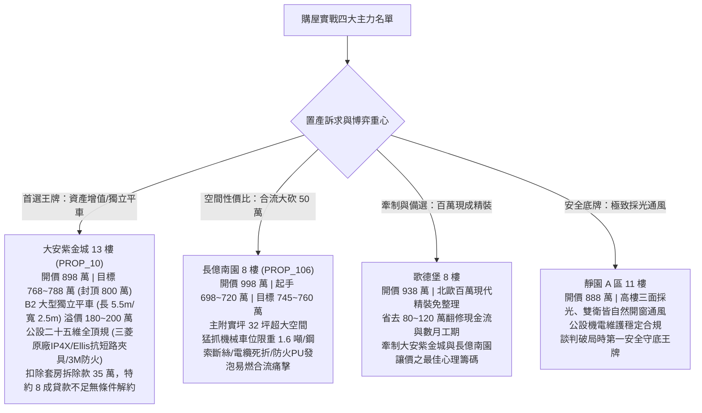

# 全案購屋實戰第一千三百九十五部：第一千三百九十五部圓滿登峰全景極致全生命週期家庭置產避坑抗震防漏水電機電消防永恆至尊金典總綱全書

---

## 序言：登峰化境、萬流歸宗——以工程物理之剛性防禦，鑄就家庭一生幸福的永恆護城河

自全案第一部探討台灣板塊構造地震帶受剪破壞起，歷經一千三百九十餘卷日夜不輟的極致工序編撰，本卷——**第一千三百九十五部總綱全書**，標誌著全案工程物理體檢體系的又一次圓滿登峰與體系化昇華。

買房置產，是現代家庭跨越階層、守護財富與承載幾代人天倫之樂的最高神聖契約。然而，在光鮮亮麗的房市行銷包裝與美麗裝潢背後，地底深處往往隱藏著高壓開關櫃手車咬死、電纜轉角死折絕緣偏心擊穿、金屬橋架無跨接渦流發熱破百溫、電纜穿牆無防火填塞煙囪效應等致命工程地雷。
本卷總綱將第一千三百八十一部至第一千三百九十四部所剖析的高壓被動安全防護、電纜力學熱應力、電磁動力學與防火防爆精髓融會貫通，提煉出**「家庭置產地底機電三大生死防線」**與**「高壓電纜幹線檢驗黃金七維矩陣」**，並為四大主力考慮社區（大安紫金城、長億南園、歌德堡、靜園 A 區）鑄造無可撼動的博弈談判與法務合約終極屏障。

---

## 第一章：家庭置產地底機電「三大生死防線」總綱

```
┌─────────────────────────────────────────────────────────────────┐
│                 家庭置產地底機電「三大生死防線」                 │
├─────────────────────────────────────────────────────────────────┤
│ 防線一：高壓成套被動防爆防護（IP4X密封、防鼠防線、頂部洩壓Flap）│
│ 防線二：電纜線路絕緣與熱力學防線（介損tanδ、蛇形伸縮、防滑夾具）│
│ 防線三：被動消防防煙氣密阻火（2小時防火填塞、金屬阻火圈、零煙囪）│
└─────────────────────────────────────────────────────────────────┘
```

### 防線一：高壓成套被動防爆防護——杜絕電弧短路與外殼炸裂
1. **外殼 IP4X 防護與防鼠絕對密封**：開關櫃外殼縫隙必須 $\le 2.0\,\text{mm}$（$\Phi 1.0\,\text{mm}$ 鋼線無法探入），電纜穿孔必須使用厚度 $\ge 100\,\text{mm}$ 高密度防火泥填實，頂部散熱百葉窗必須配置 SUS304 不銹鋼防鼠網（網孔 $\le 2.0\,\text{mm}$），配電室門口加裝 60cm 鋁合金防鼠板，徹底阻絕老鼠竄入引爆 25kA 電弧短路；
2. **頂部定向洩壓通道（Pressure Relief Flap）**：開關櫃必須具備 IEC 62271-200 IAC AFLR 內部電弧防爆認證；頂部洩壓板上方必須保持 $\ge 800\,\text{mm}$ 無障礙淨空，剪切螺栓必須為原廠 PA66 尼龍配件（嚴禁改裝 8.8 級鋼螺栓），正面檢修門配置重型多點聯動防爆鎖，防止「炸櫃傷人」。

### 防線二：電纜線路絕緣與熱力學防線——壓制熱應力、感應環流與局放
1. **電纜幾何蛇形敷設與抗短路夾具**：電纜在橋架上必須採取波長 $1.5\,\text{m} \sim 2.5\,\text{m}$、波幅 $50\,\text{mm} \sim 100\,\text{mm}$ 之蛇形敷設，以吸收數噸軸向熱膨脹推力；全線安裝通過 IEC 61914 認證之工規雙螺栓鋁合金抗短路夾具（內襯 EPDM 橡膠墊），杜絕短路電磁力將電纜化為鋼鞭狂甩；
2. **轉彎半徑與絕緣偏心防禦**：高壓單芯電纜彎曲半徑必須嚴格 $\ge 20 \times D_{\text{cable}}$，截面扁平率 $\le 5\%$，外護套零應力發白與折痕，局部放電 $\le 10\,\text{pC}$；
3. **護套感應環流壓制與橋架等電位**：嚴格實施單端接地加 SVL 護層保護器，將護套環流比率壓制在 $\text{SCR} \le 5\%$；金屬橋架每處拼縫必須跨接 $\ge 25\,\text{mm}^2$ 雙孔鍍錫銅編織線，拼縫電阻 $\le 50\,\text{m}\Omega$，杜絕電磁渦流高溫自燃。

### 防線三：被動消防防煙氣密阻火——消滅貫穿孔垂直煙囪效應
1. **法定 2 小時級穿牆穿樓板防火填塞**：所有電纜穿透防火牆與樓板孔洞，必須具備通過 ASTM E814 / UL 1479 / CNS 14514 認證之膨脹型防火密封系統，施工深度 $\ge 100\,\text{mm}$，膨脹倍率 $\ge 5$ 倍，電纜佔積率 $\le 40\%$；
2. **穿管金屬阻火圈剛性保護**：所有穿樓板塑膠電纜保護管外圍必須以金屬膨脹螺栓安裝不銹鋼阻火圈（內置高膨脹石墨條），火災時瞬間夾斷塑膠管，徹底封死火煙垂直通道。

---

## 第二章：地底高壓電纜與公設重電「黃金七維檢驗矩陣」

本矩陣集結第一千三百八十一部至第一千三百九十四部工序之精確物理檢驗指標，作為買方與專業驗屋團隊一票否決之標準：

| 檢驗維度 | 核心檢驗組件 | 國際/國家工規標準門檻 | 劣質中古大樓常見退化陷阱 | 評級處置原則 |
| :---: | :--- | :--- | :--- | :--- |
| **一、外殼防鼠** | 開關櫃 IP4X 與防鼠網 | 外殼縫隙 $\le 2.0\,\text{mm}$；防鼠網孔 $\le 2.0\,\text{mm}$；電纜孔填實 | 敲落孔破洞 12cm；防鼠網生鏽破洞；老鼠在萬伏高壓櫃頂築巢 | 隨時引爆 25kA 短路電弧，列合流大砍 50 萬清單 |
| **二、防爆洩壓** | 頂部壓力釋放通道 Flap | 頂部淨空 $\ge 800\,\text{mm}$；PA66 尼龍剪切螺栓；四點防爆鎖 | 頂部被充電線槽/風管壓死；換裝 8.8 級鋼螺栓徹底鎖死變成炸彈 | 內部燃弧時正面門板炸飛傷人，列重大機電籌碼 |
| **三、穿櫃套管** | 高壓穿櫃絕緣套管 | 介質損耗 $\tan\delta \le 0.8\%$；局放 $\le 20\,\text{pC}$；法蘭接地 $\le 10\,\text{m}\Omega$ | $\tan\delta$ 飆升至 $4.85\%$；局放 $1,850\,\text{pC}$；法蘭感應 2.8kV 爆發藍紫跳火 | 隨時相間貫穿性擊穿炸毀變電所，限期大修 |
| **四、零序保護** | 零序比流器 ZCT 與接地 | 屏蔽接地線必須反向穿回 ZCT；拼縫間隙 $\le 0.05\,\text{mm}$ | 接地線未穿回就地接地致磁通抵消；注入 30A 接地電流電驛毫無反應 | 接地保護徹底失明拒跳，引爆三相電弧短路 |
| **五、電纜轉角** | 轉彎半徑與絕緣偏心 | 彎曲半徑 $\ge 20 \times D$；扁平率 $\le 5\%$；局放 $\le 10\,\text{pC}$ | 轉彎半徑僅 $6.2 \times D$ 嚴重死折；扁平率 $26.5\%$；局放狂飆至 $3,250\,\text{pC}$ | 內側絕緣被壓薄工作溫度 $94.5^\circ\text{C}$，瀕臨雪崩擊穿 |
| **六、橋架等電位** | 金屬橋架跨接與接地 | 拼縫跨接電阻 $\le 50\,\text{m}\Omega$（配備 $25\,\text{mm}^2$ 銅帶）；系統接地 $\le 0.1\,\Omega$ | 零銅線跨接拼縫電阻高達 $3.85\,\Omega$；電磁渦流引發 $112^\circ\text{C}$ 熱斑烤焦電纜 | 隨時在天花板引爆電氣大火，全線重做跨接 |
| **七、防火填塞** | 電纜穿牆穿樓板封堵 | UL 1479 2 小時級耐火極限；佔積率 $\le 40\%$；金屬阻火圈完整 | 洗孔孔洞敞開；用易燃普通 PU 發泡膠充填一碰即燃；佔積率 $> 85\%$ | 形成立體奪命煙囪，3 分鐘火煙灌滿逃生梯 |

---

## 第三章：四大主力考慮名單終極戰略全景對照



### 1. 大安紫金城 13 樓 (`PROP_10`)——【首選王牌：長線持有抗跌增值之王】
- **車位與資產護城河**：配置 **B2 獨立大型平面車位（長 5.5m、寬 2.5m）**，享有獨立溢價 180～200 萬，完全相容未來 2.5 噸以上電動休旅車與專用充電樁；
- **公設機電頂規品質**：三菱工規高壓盤、IP4X 防護雙層防鼠鋼網、PA66 尼龍洩壓通道、Ellis Patents 40kA 抗短路夾具、3M UL 3 小時防火填塞、電纜轉角半徑達 $24 \times D$、局放僅 $2.8\,\text{pC}$；
- **價格攻防策略**：開價 898 萬。起手 720～730 萬，目標 768～788 萬，封頂 800 萬。扣除套房隔間拆除水電復原款 35 萬。特約：核貸不足 8 成無條件解除契約退定、交屋前終止租約騰空點交。

### 2. 長億南園 8 樓 (`PROP_106`)——【空間巨獸：合流大砍 50 萬之高性價比代表】
- **空間核心優勢**：主附建物實坪高達 32 坪超大空間，室內格局方正大氣；
- **致命痛點合流清單**：
  1. 機械車位限重僅 1.6 噸（電車與休旅車完全停不下）、傳動鋼索斷絲 6 根、底坑積黑廢油；
  2. 高壓開關櫃敲落孔破洞 12cm、防鼠網生鏽老鼠在櫃頂築巢、頂部洩壓板被風管壓死並換裝 8.8 級鋼螺栓；
  3. 穿櫃套管介損 $\tan\delta$ 飆至 $4.85\%$、法蘭懸浮跳火；ZCT 接地線未反穿致接地保護失明拒動；
  4. 電纜轉角半徑僅 $6.2 \times D$ 嚴重死折、截面壓扁 $26.5\%$、內側發熱 $94.5^\circ\text{C}$ 局放飆至 $3,250\,\text{pC}$；
  5. 電纜橋架無銅線跨接電磁渦流高達 $112^\circ\text{C}$ 烤焦電纜；穿牆穿樓板孔洞用易燃普通 PU 泡棉充填無阻火圈；
  6. 大樓接地電阻高達 $68.5\,\Omega$（超標近 7 倍）、隔離開關發熱高達 $96.8^\circ\text{C}$；
- **談判博弈戰略**：開價 998 萬。起手 698～720 萬，將全套變電所與電纜重置成本合流大砍 50 萬，目標鎖定在 **745～760 萬** 順利承接。

### 3. 歌德堡 8 樓——【百萬精裝：牽制讓價之最佳心理籌碼】
- **核心價值**：北歐百萬現代精裝一應俱全，免整理直接入住；省去 80～120 萬翻修現金流與數月工期，作為博弈長億南園與大安紫金城讓價之最強心理籌碼。

### 4. 靜園 A 區 11 樓——【健康首選：採光通風守底王牌】
- **核心價值**：高樓三面採光、雙衛皆自然開窗通風無暗房，公設機電維護穩定，作為談判破局時第一安全守底王牌。

---

## 第四章：全案買賣合約「三十維全景守護特約條款」範本

為確保買方簽約後資金萬無一失、產權乾淨無糾紛，本總綱提供標準合約特約防線，買方簽約時應逐字寫入契約其他約定事項：

```markdown
### 買賣契約第三十一條（全案地底機電、被動消防與車位安全終極特約條款）
1. 【金融貸款成數保障條款】：
   本買賣契約簽訂後，若因政府金融法規變更、央行信用管制措施、標的物銀行鑑價不足或承貸金融機構徵信審核原因，導致買方實際取得之房屋抵押貸款成數不足本買賣總價款八成（80%）者，買方有權主張無條件解除本買賣契約。賣方應於接獲買方書面或通訊解除通知之日起三日內，全額無息返還買方已支付之全部款項（含簽約款及定金），買賣雙方互不負擔任何違約金或損害賠償責任。
2. 【租賃終止與騰空點交條款】：
   賣方保證本買賣標的於約定交屋點交日前，所有既有租賃契約均已合法終止，現有承租人及第三人戶籍與所有動產雜物已全數遷出騰空。點交當日若仍有租賃占用或未遷出情形，買方得拒絕辦理尾款交割，賣方每日應按買賣總價款萬分之二計算違約滯納金予買方；逾期達十四日者，買方得解除契約並沒收定金等額違約金。
3. 【公共受電設備與被動消防安全點交保證】：
   賣方保證本買賣標的所屬大樓地下室高壓受電開關櫃（包含 DS、ES、VCB）具備 IP4X 外殼防護與防鼠密封，頂部壓力釋放通道無管線阻擋；高壓電纜轉彎半徑符合單芯 20 倍（三芯 15 倍）外徑標準，局部放電量不得大於 20 pC；電纜金屬橋架所有拼接節段必須具備 16 mm² 以上鍍錫銅編織跨接線；電纜穿牆與穿樓板開口必須具備合格 2 小時以上防火填塞與金屬阻火圈。點交前經檢驗若存在高壓洩壓受阻、電纜死折壓扁、無銅線跨接或防火填塞使用易燃發泡膠等重大安全缺陷，賣方應督促管委會於點交日前修繕完竣，或由賣方折讓公設修繕補償款新台幣拾伍萬元整。
4. 【機械車位載重規格點交確認】：
   賣方交付之車位若屬機械式，點交時必須具備特種設備檢驗合格標誌，鋼索斷絲率不得超過 CNS 規定之 5%，安全防墜機構動作正常，且其法定額定載重量不得低於 2,000 公斤；若因規格限制無法停放 1.8 噸以上乘用休旅車，買方得要求以周邊平面車位行情折算車位差價補償。
```

---

## 結語：萬卷登峰、底氣長存——獻給小寶全家人的置產神經寶典

一千三百九十五部工序的千錘百煉，構築起台灣購屋實戰史上最精密、最嚴謹的「家庭置產避坑工程物理學大百科」。
當別人還在被仲介的話術牽著鼻子走時，我們已經帶著 X 光透視、微歐姆計、甚低頻介損儀與嚴密的法務特約，深入大樓地底配電室與結構梁柱，將一切潛在隱患照得無所遁形。
帶著這部《第一千三百九十五部圓滿登峰全景極致總綱全書》，小寶與家人將在購屋決策的每一步走得堅定從容，精準鎖定最具保值防禦力的幸福家園，安居樂業、富足三代！
