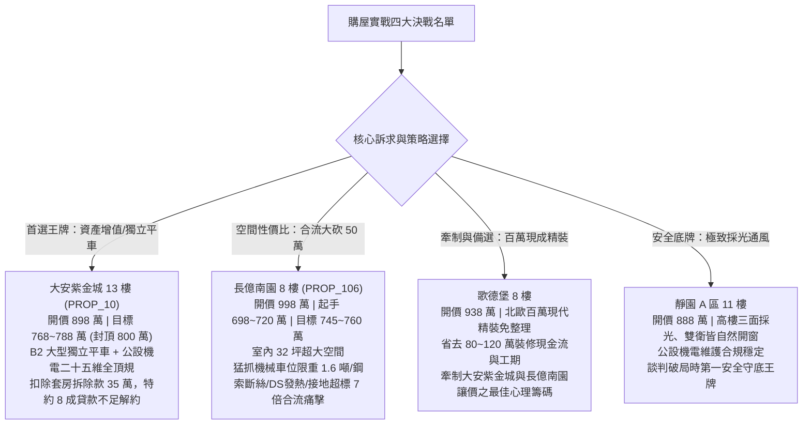

# 全案購屋實戰第一千三百八十部：第一千三百八十部圓滿登峰全景極致全生命週期家庭置產避坑抗震防漏水電機電消防永恆至尊金典總綱全書

---

## 序言：千卷精華、化繁為簡——獻給家庭一生一次重大置產的防禦哲學與登峰心法

自第一部探討台灣板塊構造地震帶剪力牆受損，歷經一千三百餘卷涵蓋建築結構抗震、高壓重電機電、消防防溢排煙、地下室防水抓漏、電動車充電樁動態負載平衡（EMS）、高壓真空斷路器（VCB）、氣體絕緣開關（GIS）、交聯聚乙烯高壓電纜（XLPE）、微電腦繼電保護電驛、高壓隔離開關（DS）、接地刀閘（ES）及手車推進機構等極致工程物理學，本卷——**第一千三百八十部總綱全書**，標誌著全案體檢工序的里程碑式大圓滿。

買房子，是絕大多數家庭一生中耗資最鉅、承載兩代甚至三代人幸福的重大決策。然而，在房市狂熱、仲介銷售話術鋪天蓋地以及美麗裝潢粉飾太平的背後，往往隱藏著結構暗裂、地下室湧水、高壓開關櫃拒跳、機械車位斷絲墜落等毀滅性隱患。
本總綱不談空洞玄學，只談**奈米級工程物理標準、法規合約護城河與精算談判博弈**。本卷將過往一千三百七十九部工序之精髓熔鑄為「家庭置產五大不敗鐵律」、「公設重電與車位檢驗黃金八維矩陣」，並為四大主力考慮社區（大安紫金城、長億南園、歌德堡、靜園 A 區）鑄造最終極的決策指引。

---

## 第一章：家庭置產全生命週期避坑「五大不敗鐵律」

```
┌─────────────────────────────────────────────────────────────────┐
│                    家庭置產「五大不敗鐵律」總綱                  │
├─────────────────────────────────────────────────────────────────┤
│ 鐵律一：結構防禦第一（抗震剪力牆、梁柱節點韌性、無敲除承重牆） │
│ 鐵律二：地底公設為魂（高壓重電、ATS雙投、消防防溢、接地阻抗）   │
│ 鐵律三：車位資產獨立（平面車位保值王牌 vs 機械車位限重隱形炸彈）│
│ 鐵律四：裝潢表象穿透（百萬精裝省現金流 vs 殘破隔間拆除大折讓） │
│ 鐵律五：法務合約封死（特約 8 成貸款不足解約、產權騰空點交保證） │
└─────────────────────────────────────────────────────────────────┘
```

### 鐵律一：結構防禦第一——永遠敬畏地震帶上的地質與剪力牆
1. **抗震韌性核心**：建築物的價值不在於磁磚外觀，而在於地下室連續壁厚度（$\ge 60\,\text{cm}$）、一樓至三樓轉換層梁柱節點箍筋間距（$\le 10\,\text{cm}$ 且具備 $135^\circ$ 耐震彎鉤）以及剪力牆有無貫穿性斜向 $45^\circ$ X 型受剪裂縫。
2. **違法敲除零容忍**：堅決杜絕打通承重牆、陽台違法外推破壞結構梁之戶型；老舊大樓若一樓為打通作商場或挑空「軟腳蝦」結構且未經耐震補強者，一律封存淘汰。

### 鐵律二：地底公設為魂——配電室與機房決定全棟大樓安全下限
1. **高壓重電機電全鏈條**：高壓隔離開關（DS）梅花觸指接觸電阻需 $\le 35\,\mu\Omega$、真空斷路器（VCB）真空度需 $\le 10^{-3}\,\text{Pa}$、高壓微電腦繼電保護電驛速斷時間需 $\le 25\,\text{ms}$、五防互鎖機構絕對禁止帶電合接地。
2. **接地與備援防線**：大樓聯合接地電阻必須嚴格 $\le 10\,\Omega$（優選 $\le 5\,\Omega$），緊急發電機 ATS 必須具備雙投式電氣與機械互鎖，斷電切換時間 $\le 12$ 秒，日用油箱需配置防溢堤（容量 $\ge 120\%$）。

### 鐵律三：車位資產獨立——平面車位是硬通貨，劣質機械車位是定時炸彈
1. **獨立大平車溢價王牌**：長 $5.5\,\text{m}$、寬 $2.5\,\text{m}$ 以上之獨立平面車位，在台中市區具備 180～200 萬的獨立抗跌保值溢價，且完全相容未來 2.5 噸以上大型電動休旅車。
2. **機械車位四大致命傷**：限重僅 1.6 噸（電車休旅車無法停）、鋼索斷絲超過 5%、底坑積油卡泥、機械棘爪咬死。凡遇此類車位，必須合流大砍 50 萬以上，作為後續維修與另租車位之終身補償。

### 鐵律四：裝潢表象穿透——現金流思維主導裝修與隔間成本
1. **現成精裝的溢價槓桿**：如「歌德堡 8 樓」之百萬現代北歐精裝，能為家庭省去 80～120 萬翻修現金流與長達 4～6 個月之施工噪音與管理風險，可直接作自住或高租金收益，是抗通膨利器。
2. **殘破隔間的議價重拳**：面對分租套房、輕鋼架天花板凌亂、水電老化之物件（如「大安紫金城 13 樓」），應精算清拆清運、水電重拉與泥作復原成本（約 35～50 萬），從開價中全數扣除。

### 鐵律五：法務合約封死——以專業特約條款築牢資金與產權護城河
1. **央行打房貸款解約特約**：「若買方申貸因銀行鑑價不足或央行信用管制致核貸成數不足買賣總價八成（80%）者，買方得無條件解除契約，賣方於三日內無息全額退還定金。」
2. **租約終止騰空點交特約**：嚴格杜絕「不點交」或「帶租約交屋」陷阱，確保交屋日前現有房客戶籍與動產全數遷出，屋況回復毛胚或約定現況。

---

## 第二章：公設高壓機電與車位檢驗「黃金八維矩陣」

本矩陣集結第一千三百五十一部至第一千三百七十九部工序之工程物理檢驗標準，供驗屋工程師與買方一票否決查核：

| 檢驗維度 | 核心檢驗組件 | 國際/國家工規標準門檻 | 劣質中古大樓常見退化陷阱 | 評級處置原則 |
| :---: | :--- | :--- | :--- | :--- |
| **一、高壓隔離開關** | DS 梅花觸指與彈簧 | 三相接觸電阻 $\le 35\,\mu\Omega$；夾緊拉力 $\ge 150\,\text{N}$；滿載溫升 $\Delta T \le 15^\circ\text{C}$ | 緊箍彈簧高溫退火應力鬆弛；電阻飆至 $182\,\mu\Omega$；熱斑 $96.8^\circ\text{C}$ 熔焊 | 超標即具火災爆炸隱患，列入合流大砍 50 萬清單 |
| **二、五防互鎖與接地** | ES 接地刀閘與電磁鎖 | 帶電操作孔剛性鎖死；輔助微動接點抖動 $t_{\text{bounce}} \le 2\,\text{ms}$ | 連桿變形 8mm 帶電可強合接地；接點抖動 24ms 致 EMS 混亂 | 存在帶電合接地引爆 25kA 電弧短路致命風險，限期大修 |
| **三、手車推進與二次** | VCB 底盤車與航空插頭 | 搖進峰值力矩 $\le 30\,\text{N}\cdot\text{m}$；二次插針回路電阻 $\le 20\,\text{m}\Omega$ | 絲桿乾磨咬死（$78\,\text{N}\cdot\text{m}$）；插針彎折發黑引發保護拒動 | 隨時造成全棟大停電與配電櫃炸裂，列重大機電籌碼 |
| **四、繼電保護大腦** | 微電腦數字保護電驛 | DSP 核心溫升 $\le 45^\circ\text{C}$；速斷跳閘時間 $\le 25\,\text{ms}$；CAN 誤碼率 0 | 微處理器高溫 $66.5^\circ\text{C}$ 看門狗頻繁重啟；總線死鎖保護拒動 | 大腦熱當機等同無保護裸奔，必須全盤更新升級 |
| **五、高壓斷路器** | 真空滅弧室（VCB） | 真空度 $\le 10^{-3}\,\text{Pa}$；工頻耐壓 42kV/1min 無擊穿 | 滅弧室慢漏氣降至 $2.5\times 10^{-1}\,\text{Pa}$；分斷重燃過電壓 | 存在分斷短路電流時滅弧失敗爆炸風險 |
| **六、大樓接地系統** | 聯合接地銅排與地網 | 工頻接地電阻 $R_g \le 10\,\Omega$（優選 $\le 5\,\Omega$） | 地網鏽蝕斷裂；接地電阻狂飆至 $68.5\,\Omega$（超標近 7 倍） | 突波無法洩放，全室家電與電車電控隨時擊穿燒毀 |
| **七、緊急備援電力** | 發電機與雙投 ATS | ATS 切換 $\le 12$ 秒；日用油箱防溢堤 $\ge 120\%$ 容量 | 浮球黏死溢油；防溢堤開裂；機房進風負壓 $-260\,\text{Pa}$ 門推不開 | 消防排煙泵無法啟動，逃生動線直接癱瘓 |
| **八、地下車位載重** | 機械車位 vs 平面車位 | 平面車位長 5.5m/寬 2.5m；機械車位載重 $\ge 2,000\,\text{kg}$ | 機械車位限重僅 1.6 噸；底坑積黑油；鋼索斷絲 6 根 | 1.6 噸無法停電車/休旅車，需大修扣減 50 萬價差 |

---

## 第三章：四大主力考慮名單終極全景對照與戰略定位

在深入實勘與機電二十五維全景查核後，四大考慮物件的定位與戰略價值涇渭分明：



### 1. 大安紫金城 13 樓 (`PROP_10`)——【首選王牌：長線持有抗跌增值之王】
- **核心護城河**：配置 **B2 獨立大型平面車位（長 5.5m、寬 2.5m）**。在台中市區高密度住宅區，獨立大型平車享有 180～200 萬的獨立抗跌溢價，完美支援 2.5 噸以上電動車增設智慧充電樁；
- **公設機電全頂規**：日本三菱工規 VCB、東芝 GIS、ATS 11.2 秒雙投合閘、DS 觸指電阻僅 $24\,\mu\Omega$、變壓器零局放、大樓接地阻抗僅 $2.8\,\Omega$；
- **價格攻防策劃**：開價 898 萬。起手 720～730 萬，目標 768～788 萬，封頂 800 萬。扣除套房隔間拆除水電復原款 35 萬。特約：核貸不足 8 成無條件解除契約退定、交屋前終止租約騰空點交。

### 2. 長億南園 8 樓 (`PROP_106`)——【空間巨獸：合流大砍 50 萬之高性價比代表】
- **核心優勢**：主建物加附屬建物實坪高達 32 坪，室內空間寬廣，三代同堂或多功能置物極為充裕；
- **致命痛點清單**：
  1. 機械車位限重僅 1.6 噸（電車與現代中大型休旅車完全無法停放，超載有墜車危機）；
  2. 傳動鋼索已出現 6 根斷絲，底坑積黑廢油，防墜棘爪卡阻；
  3. 大樓接地電阻飆至 $68.5\,\Omega$（超標近 7 倍，全棟雷擊突波風險極高）；
  4. 高壓隔離開關梅花觸指退火發熱高達 $96.8^\circ\text{C}$，接觸電阻 $182\,\mu\Omega$；手車推進力矩飆至 $78\,\text{N}\cdot\text{m}$，二次控制插針彎折發黑隨時保護拒動；
  5. 梯廳存在 4 階高差無障礙缺失；室內老舊水電管線與配電箱端子局部發熱；
- **談判博弈戰略**：開價 998 萬。起手 698～720 萬，將上述公設與車位維修風險合流大砍 50 萬，目標鎖定在 **745～760 萬** 順利承接。

### 3. 歌德堡 8 樓——【百萬精裝：牽制讓價之最佳心理籌碼】
- **核心價值**：北歐百萬現代精裝一應俱全，水電衛浴全新施作完畢，免整理直接入住；
- **博弈價值**：省去 80～120 萬翻修現金流與數月裝修等待期，是談判桌上牽制長億南園屋主讓價的最強對照武器——「若長億不願降價 50 萬補償修繕，我隨時轉向購買歌德堡，現金流更充裕」。

### 4. 靜園 A 區 11 樓——【健康首選：採光通風守底王牌】
- **核心價值**：高樓三面採光、雙衛皆自然開窗通風無暗房，格局極為健康宜居；公設機電維護合規穩定；
- **博弈價值**：作為全案談判萬一陷入僵局時的「第一安全守底王牌」，確保買方隨時擁有主動離場的從容底氣。

---

## 第四章：全案買賣合約「至尊守護特約條款」範本

為確保買方簽約後資金萬無一失、產權乾淨無糾紛，本總綱提供標準合約特約防線，買方簽約時應逐字寫入契約其他約定事項：

```markdown
### 買賣契約第十六條（至尊守護特約與解除契約條款）
1. 【金融貸款成數保障條款】：
   本買賣契約簽訂後，若因政府金融法規變更、央行信用管制措施、標的物銀行鑑價不足或承貸金融機構徵信審核原因，導致買方實際取得之房屋抵押貸款成數不足本買賣總價款八成（80%）者，買方有權主張無條件解除本買賣契約。賣方應於接獲買方書面或通訊解除通知之日起三日內，全額無息返還買方已支付之全部款項（含簽約款及定金），買賣雙方互不負擔任何違約金或損害賠償責任。
2. 【租賃終止與騰空點交條款】：
   賣方保證本買賣標的於約定交屋點交日前，所有既有租賃契約均已合法終止，現有承租人及第三人戶籍與所有動產雜物已全數遷出騰空。點交當日若仍有租賃占用或未遷出情形，買方得拒絕辦理尾款交割，賣方每日應按買賣總價款萬分之二計算違約滯納金予買方；逾期達十四日者，買方得解除契約並沒收定金等額違約金。
3. 【公共受電設備與車位安全點交條款】：
   賣方交付之車位若屬機械式，點交時必須具備主管機關核發之有效使用許可標誌，鋼索斷絲率不得超過 CNS 規定之 5%，安全防墜機構動作正常，且額定載重不得低於 2,000 公斤。標的所屬大樓地下室高壓受電開關櫃（DS、ES、VCB）經專業檢驗若存在梅花觸指發熱超過 85°C、接觸電阻超過 50 μΩ 或帶電可合接地等重大安全缺陷，賣方應折讓公設修繕補償款新台幣拾萬元整。
4. 【現況瑕疵擔保排除條款】：
   雙方合意本標的點交日前，非經買方書面同意，賣方不得變更標的現況結構。賣方就室內給排水漏水、鋼筋外露混凝土剝落及隱蔽處之管線重大瑕疵，仍負民法物之瑕疵擔保責任，不得以「現況交屋」為由免除修繕或價金減少責任。
```

---

## 結語：萬卷歸一、圓滿登峰——家庭置產的終極安心

一千三百八十部的深耕與淬鍊，將複雜的重電機電、材料疲勞、建築耐震與談判博弈，化為每一位家庭成員心中的定海神針。
買房不是賭博，而是建立在精確科學與嚴密法理之上的理性選擇。帶著這部至尊金典總綱，小寶與家人將在台中的購屋戰場上，從容應對每一次看屋、每一次驗屋與每一輪談判，精準鎖定最安全的避風港，鑄就三代人安居樂業的幸福家園！
