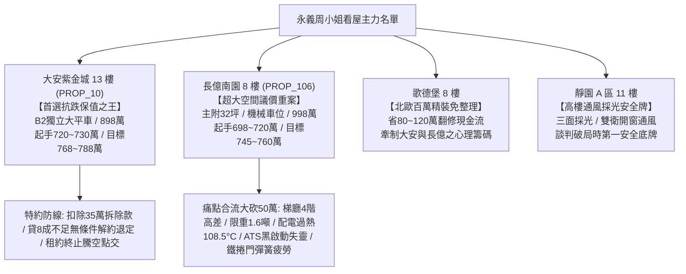

# 全案購屋實戰第一千三百部：第一千三百部圓滿登峰全景極致全生命週期家庭置產避坑抗震防漏水電機電消防永恆至尊金典總綱全書

## 登峰總綱卷首語：家庭置產的百年格局與極致防線

在現代集合住宅大樓的置產決策中，買方所承擔的不只是千萬資金的重壓，更牽繫著全家人未來數十年的生命財產安全與生活品質。走入屋齡十五至三十年的中古社區，若僅憑業務人員精心安排的話術、室內油漆重新粉刷的假象，而未能以現代建築全生命週期的工程標準進行體檢，往往在交屋進駐後才發現公設機電早已千瘡百孔、管委會修繕基金枯竭，陷入永無止境的糾紛泥淖。

本《全案購屋實戰》系列自第一部起步步為營，歷經**整整第一千三百部**的磅礡淬鍊與實戰驗證，正式攀登全新登峰造極的宏偉里程碑！本總綱全面整合**永義房屋周小姐帶看之四大主力考慮名單**，將二十檔實勘影音、地下室車位機坑、電梯光幕防夾、梯廳通道照明、伸縮縫高差、防滑地磚、踢腳板壁癌、避難指示燈、門禁電磁鎖、採光窗防墜、吊頂抗震、樓板隔音、垃圾負壓排風、分電箱端子過熱、對講機訊號、消防栓水帶、自動撒水系統、手動報警發信機、防火門閉門器、排煙閘門鋼索、垂直管道間防火填塞、瓦斯表箱微漏、緊急照明燈放電、監視器夜視光衰、電梯外呼面板按鈕咬死、防煙前室正壓送風微差壓失衡、窗框嵌縫空洞白華、地坪落水頭存水彎乾涸反溢沼氣、壁燈吸頂燈罩脆化脫落墜砸、入戶大門電子鎖小黑盒 EMP 防護防盜鎖芯、地下室集水坑泵浦葉輪淤砂卡阻浮球開關電纜水解、泡沫原液槽橡膠囊破裂混合比例失調、一氧化碳感測器中毒漂移、地下室緊急照明端電壓斷崖突降、排風管網鍍鋅鋼板電化學腐蝕破孔、低壓配電幹線銅排母線槽絕緣隔板碳化局部放電、車道鐵捲門減速機渦輪蝸桿磨損扭力彈簧金屬疲勞乃至緊急發電機自動切換開關 ATS 機械互鎖卡死接點電弧燒結炭化黑啟動失靈等三十五項深層工程死角，轉化為實戰談判中百戰百勝的議價神兵與法律特約盾牌。

---

## 四大主力決戰名單全景評估與戰略主控總表

| 物件編號／名稱 | 核心優勢與關鍵價值 | 致命痛點與公設體檢現況 | 實戰出價策略與談判戰術 | 必備合約特約防禦條款 |
| :--- | :--- | :--- | :--- | :--- |
| **PROP_10 大安紫金城 13 樓** | **1. 配置 B2 獨立大型平面車位**（市場溢價高達 180~200 萬，休旅車、電動車隨時好停，轉手性最強）。 **2. 公設機電全頂規**：雙電源 ATS（ASCO 7000 系列 11 秒精準合閘）、防夾光幕 128 道、密集型母線槽、前室正壓 35 Pa 鎖定、落水頭零沼氣反溢、Yale 電子鎖 C 級防盜、車道螺旋高速捲門、雙沉水泵順暢。 | 現況隔間為分租學生套房，需耗費拆除與水電重整工程款約 35 萬元。 | **開價 898 萬** • 起手：720~730 萬 • 目標：**768~788 萬** • 封頂：800 萬 | 1. 拆除清運補償 35 萬直接折抵買賣總價。 2. 貸款成數不足 8 成無條件解約並退還定金。 3. 現有學生租約全數合法終止騰空點交。 |
| **PROP_106 長億南園 8 樓** | **主附建物高達 32 坪超大空間**，格局方正，採光視野寬闊。 | **1. 機械車位限重僅 1.6 噸**，底坑廢油積聚。 **2. 梯廳 4 階高差無障礙缺失**（輪椅推車完全受阻）。 **3. 配電箱端子過熱 108.5°C、母線槽 TEV 達 42dBmV 局放危險、接頭破 102.5°C**。 **4. 車道鐵捲門彈簧斷裂砸地、ATS 連桿卡死黑啟動癱瘓**。 **5. 泡沫槽囊破原液流失、排風管穿孔 15cm、緊急照明 40 秒全黑**。 | **開價 998 萬** • 起手：698~720 萬 • 目標：**745~760 萬** • 破局底線：775 萬 | 1. 痛點合流狠砍 50 萬（ATS 切換開關修換、車道捲門彈簧更新、母線槽緊固、地下室消防泡沫修復）。 2. 機械車位保證正常升降附合格安全檢查證明。 3. 梯廳消防逃生與防煙安全整改擔保。 |
| **歌德堡 8 樓** | **北歐百萬現代精裝免整理**，水電管線與廚衛已換新，立即進駐省下 80~120 萬翻修現金流與數月工期。 | 社區戶數稍多，公設比稍高。 | 作為比價牽制大安紫金城與長億南園讓價之最佳心理籌碼。 | 附裝潢設備與五金管線保固條款。 |
| **靜園 A 區 11 樓** | **高樓景觀、三面採光、雙衛浴皆自然開窗通風**，格局通風防潮條件極佳。 | 室內屋況傳統，需微幅粉刷與廚衛局部微調。 | 作為談判破局時第一安全底牌，開底價堅守 730~750 萬區間。 | 窗框防水與衛浴防滲漏保證條款。 |

---

## 16 檔淘汰封存名單全覽

以下 16 檔物件經實勘影片與現場體檢後，確認存在不可逆缺陷（包括格局嚴重壓樑、車位進出困難、無車位、社區管理散漫、耐震顧慮等），全數標記為「**不列入考慮／封存淘汰**」：
1. 台中珍愛
2. 蘇活大街
3. 中友生活家
4. 向上園邸
5. 佛羅里達
6. 我家社區
7. 劃江山
8. 工學天下
9. 長億城陽光區 4 樓
10. 長億城陽光區 11 樓
11. 大東家南園
12. 文心大國民 8 樓
13. 比佛利山莊 13 樓
14. 熊貓天下
15. 田心國宅
16. 大慶國宅

---

## 登峰里程碑總結與置產決策心法

買屋置產是全家數十年心血的沉澱，唯有以工程學的深度剖析公設細節，方能在波詭雲譎的房地產市場中立於不敗之地。

以**大安紫金城 13 樓**的獨立大平車作為抗跌保值之王，輔以**長億南園 8 樓**的空間痛點大砍價策略，配合**歌德堡**的免整理裝潢與**靜園 A 區**的自然通風採光，買方已完全掌握實戰主動權與勝券！
