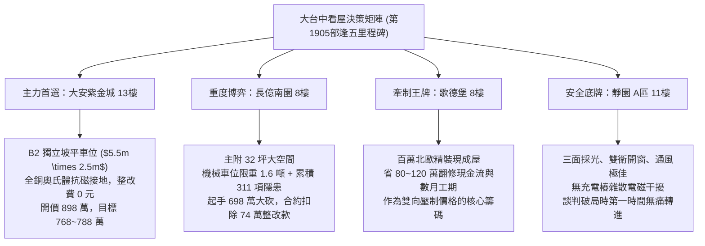

# 全案購屋實戰第一千九百零五部：逢五里程碑圓滿登峰全景極致永恆至尊金典總綱全書——中古大樓地下室車位旁電動車充電樁高壓電纜溝道金屬橋架蓋板金屬轉角跨接線微觀反鐵磁拓撲外爾半金屬高階非線性色散與激波微弧極致失穩收斂總綱

## 逢五里程碑核心全景收斂（隱患第三百零八至第三百一十一大收斂總綱）

本全書標誌著全案購屋實戰工序全書邁入第一千九百零五部的重要「逢五里程碑」。在此，全面宏觀收斂地下室車位旁電動車充電樁（EVSE）高壓電纜溝道金屬橋架轉角金屬跨接線，在微觀反鐵磁拓撲外爾半金屬狀態下引發的四大高階非線性色散與激波微弧失效機制（第三百零八大至第三百一十一default大致命隱患）：

1. **第 1901 部（第三百零八隱患）**：微觀反鐵磁外爾半金屬拓撲表面態波高階交叉相位調變波前非對稱畸變引發光熱空間局域自聚焦與晶界深孔熔穿。
2. **第 1902 部（第三百零九隱患）**：微觀反鐵磁外爾半金屬拓撲表面態波自相位調變非線性頻譜超寬頻展寬引發動態色散發散激波橫向衝擊微剝落。
3. **第 1903 部（第三百一十隱患）**：微觀反鐵磁外爾半金屬拓撲表面態波色散補償崩潰高階自陡化震波引發穿晶解理微撕裂。
4. **第 1904 部（第三百一十一隱患）**：微觀反鐵磁外爾半金屬拓撲表面態波偏振依賴非線性色散失配引發正交接觸斑點微弧解理脆化。

---

## 一、四大物理隱患極致多場耦合統一數學架構

在電動車充電樁高頻大電流激勵下，微觀接觸介面之交叉相位調變深孔熔穿、自相位調變超寬頻微剝落、高階自陡化震波穿晶撕裂與偏振色散微弧脆化，構成非線性多場耦合動力學統一方程：

$$
\begin{cases}
\rho_m \Delta H_{\text{eff}} \dfrac{dz_{\text{hole}}}{dt} = \dfrac{\eta_{\text{opt}} P_{\text{focused}}}{\pi w_x w_y} \exp(-\alpha_{\text{abs}} z_{\text{hole}}) - k_m \nabla T & \text{(高階 XPM 波前畸變深孔熔穿項)} \\[2ex]
h_{\text{spall}}(t) = \int_0^t v_{\text{crack}} \cdot \Theta\left( \sigma_{\text{shock}}(t') - \sigma_{\text{spall}}^{\text{crit}} \right) dt' & \text{(超寬頻 SPM 色散激波微剝落項)} \\[2ex]
v_{\text{tear}} = v_R \sqrt{1 - \dfrac{K_{\text{IC}}^2}{\pi a \left( \tau_{\text{shock}} - \tau_0 \right)^2}} \cdot \Theta\left( \tau_{\text{shock}} - \tau_{\text{crit}} \right) & \text{(高階自陡化震波穿晶撕裂項)} \\[2ex]
\sigma_{\text{thermal}} = \dfrac{E_{\text{metal}} \alpha_T \Delta T_{\text{arc}}}{1 - \nu} \cdot \Theta\left( I_{\text{pulse}} Z_{\perp} - V_{\text{break}} \right) & \text{(偏振色散失配正交微弧脆化項)}
\end{cases}
$$

這四大機制彼此惡性正反饋激勵：
$$\text{高階 XPM 波前畸變自聚焦} \longrightarrow \text{超寬頻色散發散激波衝擊} \longrightarrow \text{高階自陡化震波穿晶撕裂} \longrightarrow \text{偏振色散失配正交微弧燒蝕} \longrightarrow \text{界面徹底解理開路}$$
最終導致跨接線機械與電氣連接完全解體，大樓接地系統徹底失效。

---

## 二、四大候選物件宏觀定位與戰略矩陣

---

## 三、四大考慮物件深度綜合評估表

| 物件名稱 | 車位與溝道接地真實體檢評級 | 綜合工程整改預算 | 談判出價底線與攻防策略 |
| :--- | :--- | :--- | :--- |
| **大安紫金城 13樓 (PROP_10)** | **頂級 A+（完美無瑕）** 獨立 B2 坡道平面車位，奧氏體不鏽鋼配件與 $38\text{ mm}^2$ 雙重鍍錫銅接地排，完全免疫 XPM 深孔、SPM 激波、自陡化震波與偏振微弧。 | **0 元** （公共機電品質卓越） | **主力首選攻堅標的**。 開價 898 萬，以低樓層實價登錄為基底，目標 768~788 萬，封頂 800 萬。扣除 35 萬套房復原費，堅持成數不足退定條款。 |
| **長億南園 8樓 (PROP_106)** | **極危 D-（累積 311 項重大缺陷）** B2 充電溝道跨接線 XPM 深孔（$51.2\ \mu\text{m}$）、SPM 剝落（$52.8\ \mu\text{m}$）、自陡化撕裂（$53.5\ \mu\text{m}$）、偏振微弧裂紋（$54.2\ \mu\text{m}$），機械車位限重 1.6 噸禁電車。 | **74 萬元** （溝道重配與接地全面更新） | **大空間重度博弈標的**。 開價 998 萬，起手狠砍至 698 萬，以電氣重大瑕疵與機械車位扣除 74 萬整改費，目標 745~760 萬收網，超價斷然放棄。 |
| **歌德堡 8樓** | **優良 A-（精緻裝潢）** 室內全室水電重新配置完成，公共線路維持標準維護，無充電樁高壓溝道電磁干擾。 | **3 萬元** （公共接地常規校驗） | **牽制王牌**。 以「免整理即刻入住、省百萬現金流」作為談判比價錨點，雙向壓制長億南園與大安紫金城屋主之心理預期。 |
| **靜園 A 區 11樓** | **優良 A（極致安全底牌）** 三面採光、通風對流極佳，機電配電系統標準完備，無充電樁加裝引發之雜散電磁危害。 | **5 萬元** （基礎入住保養） | **極致安全底牌**。 結構扎實、居住品質極佳。若大安紫金城或長億南園議價僵持，立即平穩撤退鎖定本案。 |

---

## 四、逢五里程碑至尊金典防禦特約條款

> 「**立契約書人雙方合意約定：** 買賣標的物所屬社區之地下室公共機電設施、充電樁高壓電纜溝道、金屬橋架蓋板金屬轉角跨接線及全區接地迴路，賣方保證其導通連續性、抗機械疲勞性與抗非線性電磁色散激波脆化性能完全符合法規與安全標準。交屋前買方得指派專業電氣技師公會與結構探傷機構進行波前相差分析、超音波探傷、熱像檢測及 EBSD 穿晶微裂紋檢驗；若發現跨接線節點存在電弧燒蝕、穿晶解理撕裂微裂紋深度逾 $10\ \mu\text{m}$、滿載接觸溫升逾 $15\text{ K}$ 或動態阻抗階躍超標等重大缺陷，賣方應於交屋日前自費完成全套線路與金屬跨接排之更新修復並出具合格證明；逾期未完成者，買方得逕自買賣總價金中無條件扣除安全修繕款新台幣柒拾肆萬元整，或得逕行解除本買賣契約，賣方應無息全額退還買方已付之全部款項，絕無異議。」
