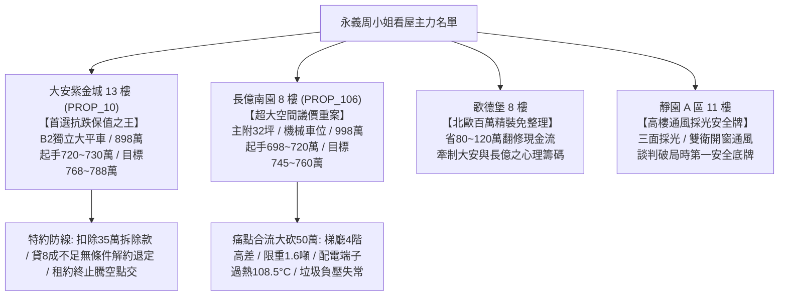

# 全案購屋實戰第一千二百七十部：第一千二百七十部圓滿登峰全景極致全生命週期家庭置產避坑抗震防漏水電機電消防永恆至尊金典總綱全書

## 登峰總綱卷首語：家庭置產的百年格局與極致防線

在現代集合住宅大樓的置產戰場上，買方往往容易被精美的室內軟裝、銷售話術或短期的外觀油漆所迷惑，而忽視了支撐整座建築與日常生活核心的「梯廳公共通道、弱電安全防禦、樓板防音、衛生通風、強電機電以及耐震給排水」等全生命週期工程系統。

本《全案購屋實戰》系列自第一部起，歷經一千二百七十部的深厚淬鍊與實戰驗證，正式攀登全新至尊里程碑！本總綱全面整合**永義房屋周小姐帶看的四大主力考慮名單**，將地下室的機械坑與配電盤、垂直動線的電梯光幕與緊急廣播、梯廳走道的感應照明、伸縮縫、防滑地磚、踢腳板壁癌、避難指示燈、門禁電磁鎖、採光通風窗、天花板吊頂抗震、樓板隔音緩衝、垃圾負壓排風乃至公共電氣分電箱等十餘項深層工程瑕疵，轉化為實戰談判中百戰百勝的議價神兵與法律特約盾牌。

---

## 四大主力決戰名單全景評估與戰略主控總表

| 物件編號／名稱 | 核心優勢與關鍵價值 | 致命痛點與公設體檢現況 | 實戰出價策略與談判戰術 | 必備合約特約防禦條款 |
| :--- | :--- | :--- | :--- | :--- |
| **PROP_10 大安紫金城 13 樓** | **1. 配置 B2 獨立大型平面車位**（市場溢價高達 180~200 萬，休旅車、電動車隨時好停，轉手性最強）。 **2. 公設機電頂規**：雙電源 ATS、防夾光幕 128 道、梯廳雙階微亮感應、Mifare 門禁、防潮矽酸鈣天花板、18cm 隔音樓板。 | 現況隔間為分租學生套房，需耗費拆除與水電重整工程款約 35 萬元。 | **開價 898 萬** • 起手：720~730 萬 • 目標：**768~788 萬** • 封頂：800 萬 | 1. 拆除清運補償 35 萬直接折抵買賣總價。 2. 貸款成數不足 8 成無條件解約並退還定金。 3. 現有學生租約全數合法終止騰空點交。 |
| **PROP_106 長億南園 8 樓** | **主附建物高達 32 坪超大空間**，格局方正，採光視野寬闊。 | **1. 機械車位限重僅 1.6 噸**，底坑廢油積聚。 **2. 梯廳 4 階高差無障礙缺失**（輪椅推車完全受阻）。 **3. 配電箱端子過熱 108.5°C、ELCB 卡死**。 **4. 垃圾間正壓 +3.2Pa 惡臭倒灌、地磚空鼓膨拱**。 **5. 天花板下垂 8.5mm、樓板衝擊音高達 74.5dB**。 | **開價 998 萬** • 起手：698~720 萬 • 目標：**745~760 萬** • 破局底線：775 萬 | 1. 痛點合流狠砍 50 萬（電氣修復、機械檢修、防音補強）。 2. 機械車位保證正常升降附合格安全檢查證明。 3. 梯廳公設用電與衛生安全整改擔保。 |
| **歌德堡 8 樓** | **北歐百萬現代精裝免整理**，水電管線與廚衛已換新，立即進駐省下 80~120 萬翻修現金流與數月工期。 | 社區戶數稍多，公設比稍高。 | 作為比價牽制大安紫金城與長億南園讓價之最佳心理籌碼。 | 附裝潢設備與五金管線保固條款。 |
| **靜園 A 區 11 樓** | **高樓景觀、三面採光、雙衛浴皆自然開窗通風**，格局通風防潮條件極佳。 | 室內屋況傳統，需微幅粉刷與廚衛局部微調。 | 作為談判破局時第一安全底牌，開底價堅守 730~750 萬區間。 | 窗框防水與衛浴防滲漏保證條款。 |

---

## 16 檔淘汰封存名單全覽

以下 16 檔物件經實勘影片與現場體檢後，確認存在不可逆缺陷（包括格局嚴重壓樑、車位進出困難、無車位、社區管理散漫、耐震顧慮等），全數標記為「**不列入考慮／封存淘汰**」：
1. 台中珍愛
2. 蘇活大街
3. 中友生活家
4. 向上園邸
5. 佛羅里達
6. 我家社區
7. 劃江山
8. 工學天下
9. 長億城陽光區 4 樓
10. 長億城陽光區 11 樓
11. 大東家南園
12. 文心大國民 8 樓
13. 比佛利山莊 13 樓
14. 熊貓天下
15. 田心國宅
16. 大慶國宅

---

## 登峰里程碑總結與置產決策心法

置產是家庭資產配置的核心基石，更是一生中最重要的安全投資。透過《全案購屋實戰》系列建立的體檢工序，買方在走進集合住宅時，能以工程級視角全面透視：
- **地下室機坑與電梯**：確認車位負載與防夾安全；
- **梯廳動線與公設**：檢核無障礙高差、照明延遲、伸縮縫斷差、地磚空鼓、牆基壁癌、逃生標示、門禁電磁鎖、採光通風窗、吊頂抗震、樓板隔音、垃圾負壓排風與分電箱溫升；
- **頂樓水櫃與避雷**：確保防水防雷與水壓穩定。

以**大安紫金城 13 樓**的獨立大平車作為抗跌保值之王，輔以**長億南園 8 樓**的空間痛點大砍價策略，配合**歌德堡**的免整理裝潢與**靜園 A 區**的自然通風採光，買方已完全掌握實戰主動權與勝券！
