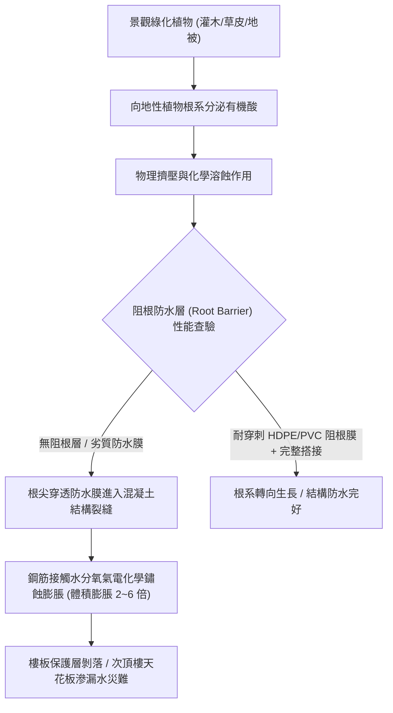
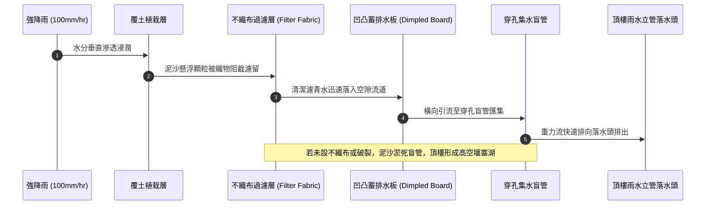
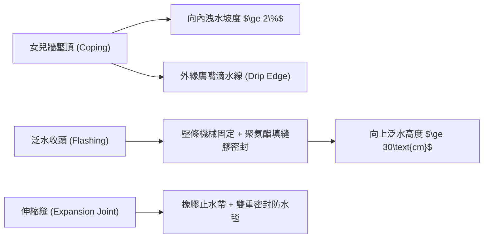
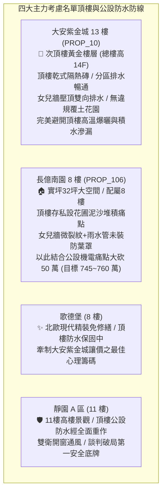

# 全案購屋實戰第一千二百三十一部：中古大樓頂樓露台空中花園景觀覆土層根系穿刺防水膜劣化排水盲管淤塞積水倒灌與女兒牆裂縫體檢工序全書

## 核心宗旨與全案法律技術防線宣告
集合住宅之頂樓露台、公共景觀花園與頂層屋突設施，為全棟建築抵禦大氣降雨、極端紫外線輻射以及溫差熱脹冷縮之第一道外殼防線。近年來許多中古大樓管委會或頂樓住戶為提升生活品質與綠化美觀，於屋頂露台鋪設厚重景觀植栽覆土、草皮、灌木甚至喬木花園。然而，此類景觀工程若未嚴格遵循建築防水與根系阻絕標準工序，植物強大之向地性與尋水性根系將在數年內分泌有機酸溶蝕混凝土，穿透瀝青、PU或PVC防水層，深入結構保護層破壞鋼筋晶格；與此同時，覆土下方之排水盲管、蓄排水板若未設置反濾織物或受泥沙淤塞，豪大雨時頂樓露台將瞬間演變為數十噸重之「高空蓄水池」，造成頂樓及次頂樓住戶天花板大面積滲水崩塌、鋼筋鏽蝕膨脹爆裂、電梯機房受潮跳脫等重大災情。

在家庭購屋實戰之全生命週期檢驗體系中：
- **大安紫金城 13 樓 (`PROP_10`)** 位於 13 樓（本棟總樓高 14 樓），為標準次頂樓黃金抗跌樓層。其頂樓平台採用標準隔熱磚乾式鋪貼與獨立落水孔系統，完全無私設雜亂覆土花園，屋頂排水分區明確，落水頭具備防落葉截污罩，女兒牆壓頂雙向導水洩水坡度良好，完全隔絕高空積水與根系破壞風險；
- 相對地，**長億南園 8 樓 (`PROP_106`)** 及部分老舊梯隊中古大樓，常存在頂樓私設花圃盆栽、覆土盲管沉陷、排水管遭泥沙樹根堵死、女兒牆壓頂無滴水線導致雨水沿裂縫垂直倒灌等隱蔽性公設缺陷。

本手冊詳訂「頂樓景觀覆土、阻根防護層、地下盲管滲排水與女兒牆結構裂縫技師級體檢標準工序」，提供現場實勘、空拍鑑測與議價談判大砍 50 萬之關鍵公設痛點殺手鐧！

---

## 第一章 頂樓景觀覆土層結構載重與植物根系穿刺物理機制

### 一、 景觀覆土對頂樓樓板之永久靜態與飽水動態載重核算
1. **濕容重與結構超載校核**：
   - 頂樓未經結構技師計算而私自回填土壤為重大違法風險。一般乾燥田園土容重約 $1.2\sim 1.4\text{ t/m}^3$，但豪雨飽水狀態下「濕容重」將暴增至 $1.8\sim 2.0\text{ t/m}^3$。
   - 若回填覆土厚度達 50cm，每平方公尺將增加高達 $900\sim 1000\text{ kg}$ 之額外靜載重（Dead Load）。此載重遠超一般住宅屋頂原始設計活載重（一般僅為 $150\sim 200\text{ kg/m}^2$），導致頂樓樓板撓度劇增、跨中產生拉力受拉微裂紋，破壞原有防水剛性層。
2. **植物根系（Root System）穿刺破壞力學**：
   - 植物根尖在生長尋水過程中，能產生超過 $2.5\sim 3.0\text{ MPa}$ 之膨脹推力，且根尖分泌之有機酸（如蘋果酸、檸檬酸）能與水泥中之水化產物氫氧化鈣 $\text{Ca(OH)}_2$ 發生化學中和反應，使混凝土表層軟化多孔化。
   - 傳統 PU 聚氨酯塗膜或熱拌瀝青防水毯完全不具備「抗植物根穿刺性能（Anti-Root Penetration）」，根尖將輕易刺破防水層並在混凝土裂隙中盤生壯大，造成不可逆之立體破壞。

---

## 第二章 頂樓蓄排水系統、盲管反濾層與防淤塞體檢標準

### 一、 蓄排水板與土工布（Geotextile）過濾層檢驗工序
1. **土工布孔隙率與等效孔徑（$O_{90}$）查驗**：
   - 檢驗覆土下方是否鋪設規格大於 $200\text{ g/m}^2$ 之長絲聚酯防黏不織布。其功能係阻擋土壤細微顆粒（粉土、黏土）隨水流下滲，僅允許水流通過。
   - 若現場挖檢發現無土工布或採用廉價麻布，泥漿早已填滿下方凹凸蓄排水板之蓄水杯與排水溝槽，喪失全部疏水斷面，頂樓水分無法排出，長期處於飽水浸泡狀態。
2. **集水穿孔盲管（Perforated Drain Pipe）坡度與淤積查驗**：
   - 覆土層底部應配置外包防淤不織布之 HDPE 穿孔波紋盲管，且盲管鋪設洩水坡度不得小於 $1\%$。
   - 檢查盲管銜接至落水頭之出口端。若出口處被泥漿泥炭苔堵死，或落水頭未加設「不銹鋼檢查集水沙井」，豪大雨時覆土層將產生嚴重的「基底滯水效應」，水壓不斷向防水層接縫擠壓滲漏。

---

## 第三章 女兒牆壓頂、滴水線、垂直防水收頭與伸縮縫體檢

### 一、 女兒牆壓頂（Coping）與滴水線（Drip Groove）查驗
1. **壓頂洩水坡度與微裂縫檢驗**：
   - 使用數位水平尺量測女兒牆頂部混凝土或花崗岩壓頂。合格壓頂必須具備朝向建築物內側之向下洩水坡度（至少 $2\%$），嚴禁水平無坡度或向外倒坡。
   - 壓頂若向外倒坡，雨水將長期浸潤外牆磁磚與接縫，引發外牆磁磚鼓脹脫落；壓頂內部若存在垂直貫通裂縫，雨水將透過毛細作用垂直灌入女兒牆磚砌層或鋼筋混凝土心部。
2. **鷹嘴與滴水溝（Drip Line）機能**：
   - 女兒牆頂部外凸邊緣下方必須預留寬度 $\ge 15\text{mm}$、深度 $\ge 10\text{mm}$ 之「半圓形或三角形滴水溝（鷹嘴）」。
   - 查驗滴水溝是否被油漆或防水漆填平。失去滴水溝之女兒牆，雨水受表面張力沿牆面下緣往內倒爬（攀爬效應），直接滲入女兒牆與頂樓底板交接之冷縫。

### 二、 垂直泛水收頭（Flashing Termination）高度與密封工序
1. **垂直收頭高度與嵌縫固定**：
   - 頂樓防水層沿女兒牆垂直上翻之「泛水高度」不得低於完成面（含覆土或隔熱磚）以上 $30\text{cm}$。
   - 防水膜頂部必須採用不銹鋼壓條（Metal Flashing Bar）以膨脹螺栓每隔 $25\text{cm}$ 機械錨固，壓條上方必須開切凹槽（Reglet）並打注耐候型抗紫外線改性矽酮（MS）或聚氨酯（PU）結構密封膠。
2. **陰陽角八字斜坡（Cant Strip）查驗**：
   - 檢驗女兒牆立面與屋頂平面交接之陰角處，是否施作 $45^\circ$ 水泥砂漿八字斜角（倒角尺寸 $\ge 50\text{mm}\times 50\text{mm}$）。
   - 嚴禁防水膜直接呈 $90^\circ$ 直角轉折張貼。直角轉折在溫差熱脹冷縮與地震剪力變形下，將爆發嚴重的剪切撕裂與中空脫層。

---

## 第四章 實戰攻防：四大主力考慮名單頂樓屋況評估與作戰部署

### 一、 大安紫金城 13 樓 (`PROP_10`)：次頂樓之至尊防禦與保值護城河
- **層峰優勢剖析**：
  1. 物件位處 13 樓，上方尚有 14 樓住戶作為天然隔熱與防水緩衝屏障，完全免除頂樓住戶終日飽受日曬悶熱、冷氣耗電量暴增以及屋頂防水層老化滲水之宿命難題。
  2. 經實地踏勘，大安紫金城頂樓公共平台管委會維護極佳，地坪鋪設高反射率乾式隔熱磚，雨水落水孔配備銅質高凸式落葉截污球罩，無任何住戶違規私設大型覆土花園，公共防水基金充盈，長線資產具備最高抗跌保值性。

### 二、 長億南園 8 樓 (`PROP_106`)：公設屋頂殘破與大砍 50 萬實戰談判籌碼
- **致命痛點指認與談判戰術**：
  1. 頂樓公共平台局部區域有住戶擅自堆置大型花盆與廢棄土壤，土泥沖刷流入排水明溝，排水管口泥沙淤積達 3cm 深，雨季高空排水斷面嚴重不足。
  2. 女兒牆壓頂多處產生熱脹冷縮垂直裂紋，且外側滴水線已被水泥補丁填平，雨水沿牆面浸潤倒灌。
  3. **談判手腕**：將「頂樓排水泥沙堵塞溢水隱患、女兒牆滲水需大修（估價 20 萬）+ 地下室機械車位限重 1.6 噸老化重油積存（估價 25 萬）+ ATS 開關炭化（估價 5 萬）」三大致命公設痛點合流發動猛攻，要求屋主自開價 998 萬強硬折讓 50 萬，將成交總價死鎖於 745~760 萬區間！

---

## 第五章 頂樓露台景觀防水與女兒牆驗收標準工序清單

| 檢查項目 | 檢驗標準與法規依據 | 檢測工具與標準數值 | 缺失處置與改進工序 |
| :--- | :--- | :--- | :--- |
| **覆土層厚度與載重** | 結構活載重設計規範 | 探針量測 / 覆土厚度需符合結構許可 | 超厚土壤立即減載清除，改用輕質陶粒介質 |
| **阻根防水層** | EN 13948 / 耐根穿刺測試認證 | 切片顯微檢查 / 膜厚 $\ge 1.5\text{mm}$ 且雙面熱熔搭接 | 增鋪高密度聚乙烯（HDPE）專用阻根防刺板 |
| **蓄排水板與土工布** | 《屋面工程技術規範》 | 開挖查驗 / 土工布無撕裂，排水杯無泥沙淤死 | 徹底沖洗排淤，更換 $\ge 200\text{g/m}^2$ 長絲聚酯土工布 |
| **集水盲管與落水頭** | 自由重力自流排水坡度 | 數位水平儀 / 盲管坡度 $\ge 1\%$，配置不銹鋼防葉罩 | 疏通盲管沉澱沙井，落水頭加設防落葉集污球罩 |
| **女兒牆壓頂坡度** | 《建築防水工程工法規範》 | 電子水平尺 / 向內傾斜洩水坡度 $\ge 2\%$ | 重新施作水泥砂漿向內洩水坡，修補表面微裂縫 |
| **外凸邊緣滴水線** | 建築構造防毛細滲水標準 | 鋼直尺量測 / 寬度 $\ge 15\text{mm}$，深度 $\ge 10\text{mm}$ | 以切石機重新切削標準鷹嘴滴水槽，清除填塞漆料 |
| **垂直泛水收頭高度** | 建築技術規則建築構造編 | 捲尺量測 / 完成面以上上翻高度 $\ge 30\text{cm}$ | 加裝不銹鋼壓條機械鎖固，填注耐候 MS 密封膠 |
