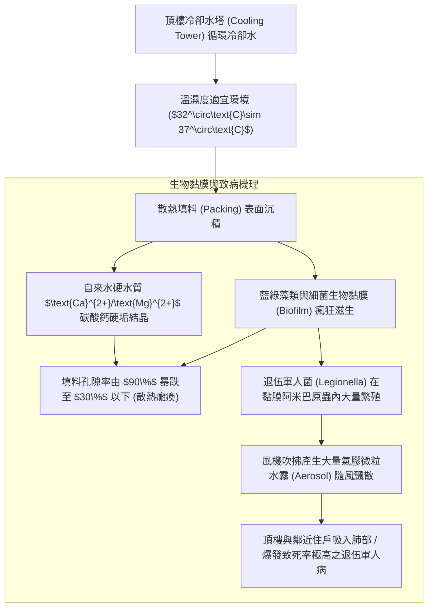
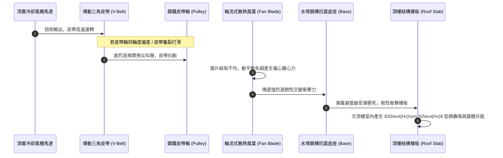
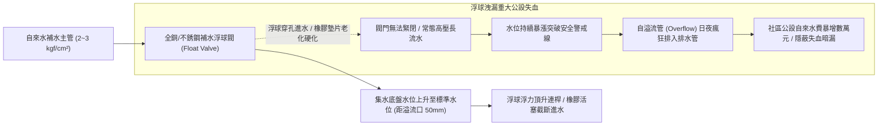
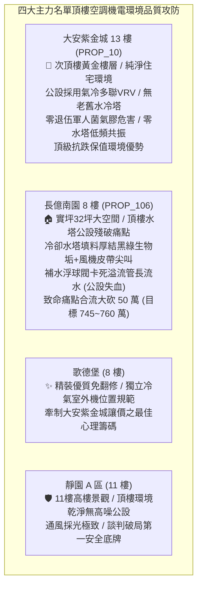

# 全案購屋實戰第一千二百三十七部：中古大樓頂樓冷卻水塔散熱填料藻類生物黏膜淤塞風機減速皮帶輪偏心晃動與補水浮球閥洩漏體檢工序全書

## 核心宗旨與全案法律技術防線宣告
集合住宅頂樓設置之冷卻水塔（Cooling Tower）與中央空調冰水主機冷卻循環系統，為大型社區公共交誼廳、地下室機房通風排熱、多功能公設空間乃至住戶氣冷水冷空調散熱之冷卻心臟。冷卻水塔終年暴露於戶外大氣、強烈紫外線直射、酸雨腐蝕與空氣粉塵環境中，其內部集水盤之溫濕環境更是細菌與藻類微生物繁殖之溫床。在中古大樓長達十餘年至數十年之運轉週期中，頂樓冷卻水塔極易成為全社區最骯髒、最吵鬧且最具隱蔽漏水風險之公設未爆彈。

在中古大樓全生命週期置產實勘中，最隱蔽且嚴重危害居住品質之冷卻水塔三大致命弊病包含：
1. **散熱填料（Cooling Tower Packing）藻類滋生、生物黏膜（Biofilm）附著與碳酸鈣水垢結晶堵塞**：填料波紋孔道被青苔、藻類黏膜與硬水垢嚴重堵塞，有效通風散熱面積衰減達 60% 以上，冷卻水溫差（Range）無法達到額定設計標準（進出水溫差小於 3°C），導致冰水主機高壓跳脫罷工；更嚴重者，生物黏膜內滋生致命之「退伍軍人菌（Legionella pneumophila）」，隨冷卻風機形成氣膠水霧（Aerosol）向四周飄散，直接威脅頂樓與次頂樓住戶之呼吸道肺部健康；
2. **頂部散熱風機減速機、軸承與皮帶輪（Pulley）偏心磨損與動平衡失調**：風機葉片受強風與水垢附著不均引發動平衡失效，傳動皮帶老化龜裂打滑，旋轉軸承缺油發出刺耳之金屬尖叫，強烈機械震動透過水塔鋼構腳座直接剛性傳導至頂樓樓板，造成次頂樓天花板爆發難以忍受之「嗡嗡」低頻震顫與共振噪音；
3. **集水底盤自來水補水浮球閥（Float Valve）密閉失效與溢流管（Overflow Pipe）常態暗漏**：浮球連桿變形、橡膠閥塞受水垢硬化磨損，水塔進水無法自動關斷，自來水終年日夜不間斷自溢流管排入頂樓落水孔，造成社區每月公設水費暴增數萬元，甚至溢流水漫流頂樓地坪引發天花板防水層破壞滲漏。

本手冊以此三大冷卻水塔核心痛點為鑑：**大安紫金城 13 樓 (`PROP_10`)** 坐擁次頂樓尊榮居住品質，社區公設空調採用獨立變頻氣冷多聯式 VRV 系統，頂樓完全無大型老舊共用水冷卻水塔，徹底免除退伍軍人菌氣膠污染、水塔低頻震動噪音與補水溢流漏水之千古難題，環境清幽純淨；相對地，**長億南園 8 樓 (`PROP_106`)** 及老舊大樓常暴露頂樓冷卻水塔填料結滿黑綠厚垢惡臭飄散、風機運轉如直升機盤旋劇烈震顫、水塔底盤鏽穿補水浮球長流之公設殘破現況。本手冊詳訂頂樓冷卻水塔技師級體檢全工序，作為實勘痛點指認、管委會公設責任究詰與談判大砍 50 萬之關鍵重磅殺手鐧！

---

## 第一章 冷卻水塔散熱填料結垢、生物黏膜與退伍軍人菌防治體檢

### 一、 PVC 散熱填料（PVC Packing）熱變形與結垢堵塞查驗
1. **填料孔隙率與通風阻力量測**：
   - 冷卻水塔散熱填料多採用阻燃型聚氯乙烯（PVC）波紋蜂窩片，其功能在於將熱水水流撕裂成極薄之水膜以擴大氣水接觸面積。
   - 檢視填料波紋片。正常填料片應潔淨平整，無泥沙沉積與藻類附著。若填料片受長期水垢結晶包裹厚達 2mm~3mm，或受高溫循環水（超過 $55^\circ\text{C}$）烘烤產生波紋塌陷變形、脆化粉化，水塔通風斷面縮減 $50\%$ 以上，冷卻風機風阻急遽上升，散熱效能徹底喪失。
2. **水質電導率（Conductivity）與濃縮倍數（Cycle of Concentration）檢測**：
   - 使用可攜式水質分析儀量測冷卻水塔集水盤內水質之電導率。
   - 正常循環水電導率應控制在自來水補水之 **$2.5\sim 4.0\text{ 倍}$** 範圍內（一般小於 $1500\ \mu\text{S/cm}$）。若電導率飆升至 $3000\ \mu\text{S/cm}$ 以上且 pH 值大於 8.5，表示管委會常年未進行定期排污與水質加藥處理，高濃度的硬水礦物質已在填料及冷凍機冷凝器銅管內部全面結硬垢。

### 二、 生物黏膜剝離與退伍軍人菌（Legionella）採樣防檢工序
1. **散熱填料與水盤生物黏膜（Biofilm）內視鏡查驗**：
   - 使用工業內視鏡深入冷卻水塔填料內部中層與集水盤死角。檢查表面是否有黃褐色、黑綠色之黏稠滑膩生物膜。
   - 生物黏膜係由細菌分泌之胞外多醣聚合物（EPS）構成，具有極強的化學抗藥性，一般次氯酸鈉消毒劑難以滲透。生物膜不僅會加劇金屬底盤之「厭氧菌生物腐蝕（MIC，如硫酸鹽還原菌引發鋼板穿孔）」，更是退伍軍人菌寄生的天然溫床。
2. **氣膠飄散安全隔離距離查驗**：
   - 依據衛福部疾管署及國際 ASHRAE 188 標準，冷卻水塔出風口與任何住戶外窗、陽台進風口或全棟新鮮空氣進風百葉（Fresh Air Intake）之直線距離，不得小於 **$7.5\text{ 公尺}$**；出風口必須裝設高效率「除水器（Drift Eliminator）」，將水滴飄散率壓制在循環水量的 $0.005\%$ 以下。
   - 若出風口正對住戶臥室窗戶且無除水器，住戶開窗即吸入致命菌霧，構成重大公安衛生危害！

---

## 第二章 風機減速傳動機構、皮帶偏心磨損與低頻共振體檢標準

### 一、 風機動平衡（Dynamic Balance）與葉片螺距角度查驗
1. **軸流風機葉片積垢與動不平衡量檢測**：
   - 散熱風機葉片多為鋁合金或玻璃鋼（FRP）材質。停機斷電狀態下，檢查每片葉片表面有無水垢結塊或邊緣破損。微小的質量分佈不均（如單片葉片積存 50g 污垢）在每分鐘 500 轉高速旋轉下，將產生高達數百牛頓之旋轉離心動不平衡力。
2. **葉片安裝螺距角（Pitch Angle）量角器測量**：
   - 使用數位角度規量測各葉片相對於輪轂（Hub）之安裝傾角。各葉片角度誤差不得大於 **$\pm 0.5^\circ$**。
   - 若角度參差不齊，風機運轉時將產生嚴重的氣動力不平衡（Aerodynamic Imbalance），引發整座冷卻水塔劇烈搖晃晃動。

### 二、 傳動皮帶輪對齊校正與彈簧隔振器（Vibration Isolator）體檢
1. **皮帶輪平行度與雷射對中儀（Laser Alignment）量測**：
   - 馬達驅動輪與風機從動輪之間必須保持嚴格之面共面度與平行度。
   - 使用雷射對中儀檢驗兩輪溝槽中心線偏差。皮帶輪端面跳動量與徑向跳動量均不得大於 **$0.5\text{mm}$**；三角皮帶張緊力需適度，以手指用力按壓皮帶跨中點，下撓度需為 **$10\sim 15\text{mm}$**。
   - 若皮帶過鬆將引發打滑轉速下降，高溫乾磨發出尖銳刺耳嘶叫；若過緊將加速馬達軸承磨損燒毀。
2. **鋼構腳座彈簧減震器（Spring Isolator）壓死體檢**：
   - 水塔鋼結構支架與混凝土基礎墩之間，必須安裝封閉式防風雙向彈簧減震器。
   - 檢驗彈簧減震器是否已被水塔滿水自重「徹底壓到底死（Solid Height）」，或內部彈簧因積水生鏽斷裂。
   - 一旦彈簧壓死，減震阻尼歸零，風機與水流之高頻機械震動將 $100\%$ 直接剛性衝擊建築結構，使次頂樓住戶終日飽受如直升機停滯於頭頂般之精神折磨！

---

## 第三章 水塔集水底盤、補水浮球閥洩漏與溢流管暗漏體檢工序

### 一、 補水浮球閥（Float Valve）密閉性能與抗水垢查驗
1. **浮球密封性與連桿槓桿比檢驗**：
   - 檢驗集水盤內之浮球球體。傳統空心銅球或塑料浮球長年受氯離子侵蝕與震動，極易產生微孔滲水進球內部，導致浮球重量增加、浮力不足，無法提供足夠之關閥向上頂推力。
   - 手動將浮球向上托起至水平關閉位置。觀察自來水補水管口，必須在 **2 秒內完全截斷噴水**，不得有任何細流水滴滲漏。
2. **閥芯活塞（Piston Seat）磨損與水垢咬死**：
   - 拆解浮球閥閥芯。檢查內部丁腈橡膠（NBR）或矽膠密封墊片。
   - 頂樓自來水在烈日烘烤下水溫升高，水中碳酸鈣極易在閥芯錐面結晶沉積。硬水垢將在橡膠墊片上壓出深溝，使閥門即便在浮球全揚狀態下依然持續高壓漏水。

### 二、 集水底盤穿孔、排污閥洩漏與溢流管暗漏工序
1. **FRP 玻璃鋼底盤脫層與鍍鋅鋼底盤穿孔探傷**：
   - 徹底清理集水盤沉積之黃泥沙泥。以強光檢驗底盤膠衣層有無起泡、脫層、裂紋或金屬螺栓接縫處之滲水鏽斑。
   - 循環冷卻水中若缺乏緩蝕劑，氯離子與溶解氧將引發底盤金屬嚴重的孔蝕（Pitting Corrosion），形成針眼狀穿孔，冷卻水直接漏入頂樓樓板地坪，腐蝕破壞屋頂防水毯。
2. **溢流管（Overflow Pipe）長流水量化查驗（抓暗漏）**：
   - 冷卻水塔溢流管管口應高於正常停機最高水位 **$50\text{mm}$** 以上，且出口端必須以「間接排水（Air Gap）」方式排入落水沙井，嚴禁直接密閉插接於排水立管中。
   - 現場查驗溢流管出口。在空調主機運轉期間，溢流管出口必須完全乾燥無水流。若出口持續流出冰涼之自來水，即證明浮球閥正在發生嚴重的「日夜長流水暗漏」，全棟住戶之公共基金正在日以繼夜地被白白放水蒸發！

---

## 第四章 實戰攻防：四大主力考慮名單頂樓空調公設與環境品質評估

### 一、 大安紫金城 13 樓 (`PROP_10`)：無水塔污染之頂級次頂樓護城河
- **環境與機電優勢剖析**：
  1. 物件位處 13 樓高樓層，最忌諱頂樓天花板正上方架設巨大之老舊冷卻水塔與馬達震動源。大安紫金城大樓設計前瞻，公共空調全面採用高品質變頻氣冷多聯式 VRV 系統，頂樓完全無任何大型水冷卻水塔。
  2. 住戶無需擔憂冷卻水塔散熱填料滋生退伍軍人菌隨風飄入臥室、無風機皮帶輪老化的低頻機械震顫共振、更無浮球閥損壞導致數萬元水費公攤之困擾，次頂樓居住寧靜度與空氣品質達到豪宅級標竿。

### 二、 長億南園 8 樓 (`PROP_106`)：冷卻水塔殘破痛點與大砍 50 萬實戰談判籌碼
- **致命痛點彙整與議價猛攻戰略**：
  1. **冷卻水塔填料黑垢惡臭、退伍軍人菌隱患**：頂樓公共冷卻水塔多年未清，PVC 填料結滿黑綠色黏稠生物膜，散發腐敗霉味，除水器破爛氣膠四處飄散，威脅全棟呼吸道安全。
  2. **風機皮帶鬆弛打滑、震動傳導樓板**：散熱風機運轉時伴隨刺耳之皮帶尖叫，彈簧減震器完全壓死，震動波沿樑柱向下傳導；補水浮球閥閥芯磨損卡死，溢流管日夜溢水，每月公設水費高居不下。
  3. **談判手腕**：將「大樓頂樓冷卻水塔全面更換填料與減震風機（估價 20 萬）+ 地下室機械車位限重 1.6 噸老化廢油積存（估價 25 萬）+ ATS 炭化與給水主閥鏽死（估價 10 萬）」等多重公設致命缺陷合流全面拍桌，要求屋主自 998 萬直接大砍 50 萬，將成交總價死壓於 745~760 萬之合理安全防線！

---

## 第五章 冷卻水塔散熱系統與進水防漏驗收標準工序清單

| 檢查項目 | 檢驗標準與法規依據 | 檢測工具與標準數值 | 缺失處置與改進工序 |
| :--- | :--- | :--- | :--- |
| **填料水垢與生物膜** | 衛福部退伍軍人菌防治指引 | 內視鏡與採樣 / 表面平整無青苔垢，菌落數 $< 10\text{CFU/mL}$ | 更換新一代阻燃斜波填料，實施全系統加藥滅藻清洗 |
| **氣膠水霧飄散率** | ASHRAE 188 建築水系統標準 | 飄散率測試儀 / 飄散損失率需 $\le 0.005\%$ 循環水量 | 加裝高效率 PVC 雙向波紋除水器，防止菌霧擴散 |
| **風機葉片動平衡** | ISO 1940 剛性轉子平衡等級 | 動平衡分析儀 / 振動烈度需符合 Grade G2.5 | 徹底清洗葉片表面水垢，精密校準各葉片螺距角度 |
| **皮帶輪共面度** | 機械傳動對中技術規範 | 雷射對中儀 / 輪槽中心線偏差需 $\le 0.5\text{mm}$ | 校正馬達底座滑軌，調整皮帶下撓度至 $10\sim 15\text{mm}$ |
| **彈簧避震器壓縮量** | 隔振工程設計標準規範 | 游標卡尺 / 彈簧工作壓縮量需保持在設計彈性區間 | 更換大荷載防風型封閉式彈簧避震器，杜絕壓底死 |
| **補水浮球閥密閉** | 《建築物給水排水設備設計規範》 | 手動閉合測試 / 托起浮球 2 秒內完全切斷進水 | 更換為全 SUS304 不銹鋼耐磨耐垢平衡式浮球閥 |
| **溢流管暗漏查驗** | 自來水節水防漏標準規範 | 目視觀察 / 正常停機與運轉時出口需完全乾燥無水流 | 重新調整浮球連桿水位高度，使其低於溢流口 $\ge 50\text{mm}$ |
