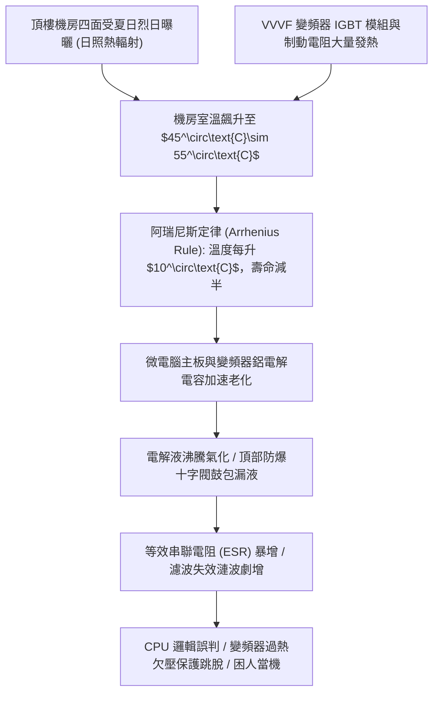
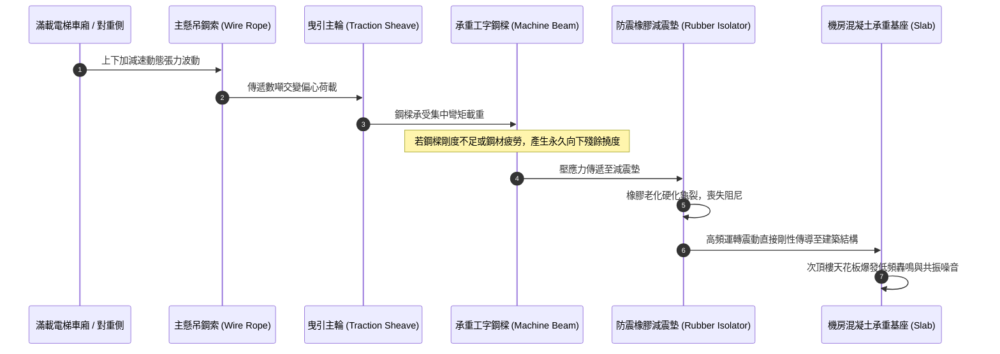
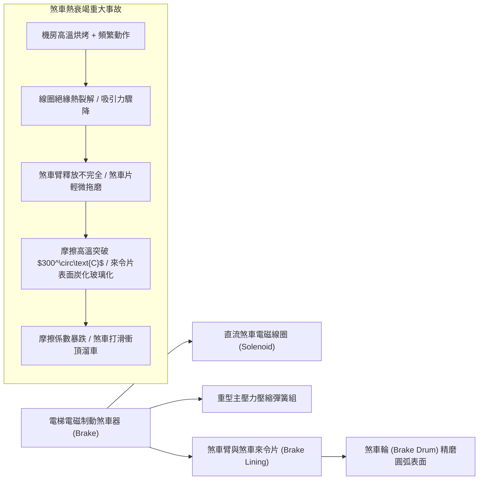
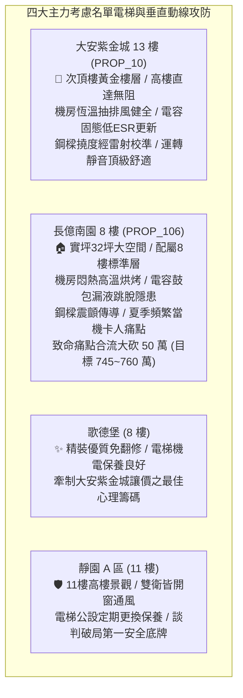

# 全案購屋實戰第一千二百三十三部：中古大樓頂樓電梯機房排散熱通風不良控制板電解電容鼓包高溫當機困人與吊臂鋼樑撓度變形體檢工序全書

## 核心宗旨與全案法律技術防線宣告
集合住宅之電梯垂直昇降設備（Elevator Traction System），為全棟住戶每日垂直位移、長者行動、幼童推車與重物搬運不可或缺之生命線。其設置於建築物最高頂層之「電梯機房（Elevator Machine Room）」，集成了主驅動曳引機、電磁制動煞車器、微電腦控制主機（含變頻器 VVVF 與主 CPU 邏輯基板）、調速機（Governor）以及沉重的機房承重吊臂鋼樑（Machine Beam）。在中古大樓歷經數十年之強烈日曬烘烤、高溫高濕與連續高頻次運轉下，頂樓電梯機房往往演變為全棟機電系統中最脆弱之高溫熱衰竭重災區。

在中古大樓置產實戰檢驗中，最致命之隱蔽機房弊端包含：
1. **頂樓電梯機房排散熱不良與蓄熱烘烤**：頂樓機房位於屋突最高點，四面受烈日直射，若僅配置老舊微弱之自然排氣百葉或通風扇停擺，夏季室內環境溫度動輒飆升至 45°C~55°C。高溫環境促使微電腦控制板與變頻器內部之鋁電解電容器（Electrolytic Capacitors）電解液加速乾涸沸騰、外殼頂部防爆閥鼓包突起，導致濾波漣波（Ripple Voltage）劇增，引發 CPU 邏輯錯亂、突發性急停、斷電煞車卡死與住戶受困於半空中之恐慌意外；
2. **主曳引機承重鋼樑（Machine Beam）結構撓度變形與基座螺栓剪切**：沉重的曳引機與滿載車廂對承重鋼樑施加數噸重之偏心交變動態衝擊載重，若鋼樑截面剛度不足或鋼材疲勞，將產生永久向下撓度變形，造成鋼索磨損偏角加劇、導軌劇烈晃動磨損；
3. **電磁煞車器（Brake Magnet）線圈熱衰竭與煞車來令片碳化打滑**：長期處於高溫烘烤下，電磁煞車線圈絕緣漆包線耐熱等級劣化，絕緣阻抗大幅跌落，吸合力嚴重衰退，煞車釋放不完全引發來令片高溫乾磨碳化，隨時面臨電梯「開門溜車（Unintended Car Movement）」或衝頂奪命事故。

本手冊以此三大電梯機房核心痛點為鑑：**大安紫金城 13 樓 (`PROP_10`)** 坐擁頂級公設維護水準，電梯機房配備恆溫連動抽排風系統、微電腦控制主機定期更換低 ESR 固態電容、曳引機承重鋼樑配置扎實工字鋼並經雷射水平校準，運轉平穩近乎無聲；而 **長億南園 8 樓 (`PROP_106`)** 及部分老舊梯隊社區常暴露電梯機房悶熱如烤箱、控制箱電容鼓包漏液發黑、夏季頻繁過熱當機跳脫困人、承重鋼樑鏽蝕震顫之公設殘破現況。本手冊詳訂電梯機房技師級體檢全工序，作為實勘痛點指認、管委會公設責任究詰與談判大砍 50 萬之關鍵重磅殺手鐧！

---

## 第一章 電梯機房熱力學環境、散熱通風與電解電容壽命衰減體檢

### 一、 阿瑞尼斯化學反應速率理論與鋁電解電容壽命衰減
1. **阿瑞尼斯壽命衰減公式（$10^\circ\text{C}$ 法則）**：
   - 電梯微電腦控制基板及 VVVF 變頻器直流母線（DC Bus）廣泛使用大型鋁電解電容器作為平滑濾波與儲能元件。電容器額定壽命遵循化學動力學之阿瑞尼斯法則：
     $$L = L_0 \times 2^{\frac{T_0 - T_a}{10}}$$
     其中 $L_0$ 為額定最高工作溫度（通常為 $85^\circ\text{C}$ 或 $105^\circ\text{C}$）下的額定壽限（一般為 2000~5000 小時），$T_a$ 為實際環境運轉溫度。
   - **實測數據警示**：若機房通風不良，環境溫度由 $25^\circ\text{C}$ 飆升至 $45^\circ\text{C}$，電容器內部電解液之揮發乾涸速度將暴增 4 倍，原設計 10 年之理論壽命直接腰斬縮水至 2.5 年以下！
2. **電容器鼓包、漏液與等效串聯電阻（ESR）檢測**：
   - 檢驗控制箱內部 DC-Link 大電容與 CPU 電源濾波電容。以強光檢視電容器金屬鋁殼頂部之「十字或 K 字形防爆刻痕（Safety Vent）」。
   - **外觀判定**：頂部若已向上凸起鼓包，或引腳底部有黃褐色、白色粉末狀電解液晶體滲漏（Leakage Crust），代表電解液已沸騰氣化分解。
   - **電氣判定**：使用 LCR 數位電橋量測電容量（Capacitance）與 ESR 數值。若容量衰減超過額定標稱值的 $20\%$，或 ESR 數值暴增至新件的 3 倍以上，電容器已喪失吸收交流高頻脈衝之機能，電源紋波直接貫穿 CPU，造成電梯無故急停煞死困人。

### 二、 機房強制通風散熱與恆溫聯鎖系統檢驗
1. **通風換氣率與排熱百葉風速查驗**：
   - 依據 CNS 10594《建築物升降機受檢標準》，電梯機房室溫必須常態維持在 **$5^\circ\text{C}\sim 40^\circ\text{C}$** 之間，且嚴禁結露。
   - 檢驗機房進風百葉窗與排風扇之換氣容量。計算機房每小時排風量是否達到曳引機與控制櫃總散熱量之對應散熱風量要求（每台 15kW 曳引機需配置不小於 $2000\text{ m}^3/\text{hr}$ 之強制排風量）。
2. **雙溫控感知器與排風機聯鎖機能測試**：
   - 現場查驗機房是否安裝雙金屬片或電子式溫控開關（設定啟動溫度為 $32^\circ\text{C}\sim 35^\circ\text{C}$）。
   - 當室溫達標時，大口徑百葉排風風機需能自動順暢啟動運轉，且噪音不得透過樓板傳導至頂樓次頂樓住戶臥室。若排風扇馬達燒燬、葉片積塵卡滯或溫控開關斷線，機房將演變為熱蓄積烤箱。

---

## 第二章 曳引機承重鋼樑撓度變形與避震機座體檢標準

### 一、 承重工字鋼樑（I-Beam）撓度與剪力變形量化檢測
1. **鋼樑垂直撓度（Deflection Limit）雷射測量**：
   - 曳引機座通常架設於兩根或三根重型熱軋工字鋼樑（如 H250 或 I300）之上，鋼樑兩端深埋錨固於機房主結構承重牆柱內。
   - 在電梯車廂處於「空載」與「100% 額定滿載（使用標準試重塊或等效載重）」兩種狀態下，使用精密雷射水平儀量測鋼樑跨中點之相對下沉量。
   - **法規技術標準**：依據鋼結構與電梯設計規範，承重鋼樑在滿載狀態下之最大彈性撓度不得超過跨距長度（Span）之 **$1/1000$**（例如 3 公尺跨距鋼樑，撓度不得超過 3mm），且空載復原後不得存在超過 0.5mm 之塑性永久殘餘形變。
   - 若鋼樑出現肉眼可見之弧形下垂彎曲，將造成曳引輪水平軸線傾斜，主鋼索在輪槽內發生嚴重的偏磨（Side Abrasion），加速鋼索斷絲破斷。
2. **鋼樑錨固端防拔螺栓與混凝土支承墊座查驗**：
   - 檢驗鋼樑兩端支承混凝土墩座有無剪切斜裂縫，預埋地腳螺栓是否鬆弛滑移。
   - 以超音波探傷儀檢查鋼樑焊接部位有無疲勞微裂紋，螺栓連接板有無鏽蝕減薄。

### 二、 減震橡膠隔離墊（Vibration Isolator）硬化與震動傳導體檢
1. **橡膠老化硬化邵氏硬度（Shore A）測試**：
   - 曳引機底座與承重鋼樑之間，必須鋪設特種高阻尼天然橡膠或氯丁橡膠減震墊（隔振器），用以阻斷馬達轉子旋轉與齒輪咬合產生之高頻機械震動。
   - 使用硬度計量測減震橡膠墊。合格防震橡膠邵氏硬度應為 $55\sim 65\text{ HA}$。若硬度超過 $80\text{ HA}$，或表面產生網狀龜裂、被曳引機潤滑油浸泡溶脹成糊狀，減震墊已徹底喪失隔振機能。
2. **結構噪音與低頻共振傳導實測**：
   - 在次頂樓住戶臥室內，於電梯全速上下運行時以聲級計量測低頻噪音（$16\text{Hz}\sim 63\text{Hz}$）。
   - 合格標準要求電梯運轉在室內產生之結構噪音需小於 $30\text{ dB(A)}$。若減震墊硬化失效，曳引機震動將透過鋼樑直接剛性衝擊建築骨架，在室內產生如飛機轟鳴般難以忍受之「嗡嗡」低頻共振，嚴重摧毀居住品質與睡眠健康。

---

## 第二章 電磁制動煞車器熱衰竭與調速機安全迴路體檢

### 一、 電磁煞車線圈（Brake Coil）絕緣阻抗與空隙微調
1. **直流絕緣電阻與溫升測試**：
   - 以 500V 高阻計（Megger）量測電磁線圈對地絕緣電阻，冷態阻抗需 $\ge 100\text{ M}\Omega$，熱態運轉後亦不得小於 $10\text{ M}\Omega$。
   - 紅外線熱成像儀掃描線圈表面。運轉 1 小時後線圈溫升不得超過 $60\text{ K}$（表面溫度嚴禁超過 $85^\circ\text{C}$）。若線圈產生局部熱斑，表示漆包線內部已有匝間微短路，吸引力大幅下降。
2. **煞車銜鐵空隙（Brake Air Gap）塞尺測量**：
   - 使用厚薄塞尺（Feeler Gauge）量測煞車通電完全釋放時，來令片與煞車輪兩側之張開空隙。
   - **標準數據**：兩側張開間隙需均勻一致，標準值應在 **$0.15\text{mm}\sim 0.35\text{mm}$** 範圍內。
   - 若間隙小於 0.1mm，來令片將與旋轉煞車輪發生持續摩擦乾磨，數分鐘內產生數百度高溫，造成來令片炭化「熱衰退（Brake Fade）」；若間隙大於 0.5mm，斷電復歸時煞車臂將猛烈撞擊，產生巨大金屬衝擊聲且煞車響應時間嚴重延遲。

### 二、 機械調速機（Governor）與超速安全鉗開關防護工序
1. **調速機離心甩塊滾珠軸承與鋼索磨損**：
   - 檢驗頂樓機房之機械式調速機。手動撥動離心離合擺錘，軸銷需轉動靈敏無卡死，潤滑油嘴通暢無黑垢。
   - 檢查調速機專用細鋼索（直徑通常為 6mm~8mm）。若鋼索表面有斷絲、油泥結塊或張緊輪下墜碰觸底坑極限開關，電梯安全迴路將拒絕啟動。
2. **電氣超速開關與機械夾持聯鎖試驗**：
   - 模擬電梯超速運行至額定速度的 $115\%$ 時，調速機電氣微動開關必須瞬間切斷安全迴路電源；當速度進一步上升至 $125\%$ 時，機械卡爪必須瞬間咬死鋼索，藉此拉動轎廂底部安全鉗夾緊導軌將車廂死死卡在半空中。
   - 查驗調速機出廠鉛封與檢驗合格標誌。嚴禁任何未經專業校驗之私自拆卸或改動。

---

## 第三章 實戰攻防：四大主力考慮名單電梯機房與公設安全決策分析

### 一、 大安紫金城 13 樓 (`PROP_10`)：次頂樓尊榮通行與抗跌保值護城河
- **電梯機電優勢剖析**：
  1. 物件位處 13 樓，出門即達梯廳，電梯為全案每日垂直通勤之核心動脈。社區管委會維護基金充實，與一線大廠（如崇友、永大、台灣三菱）簽署全責全包（Comprehensive Maintenance）保養合約。
  2. 頂樓電梯機房配置雙套溫控連動排風系統，室溫常年壓制於 32°C 以下；微電腦主機定期全面翻新電容元件，曳引機承重工字鋼樑無任何撓度變形，減震橡膠阻尼彈性完好，電梯啟動與煞停平滑如絲，無絲毫頓挫感或低頻共振噪音。

### 二、 長億南園 8 樓 (`PROP_106`)：電梯機房殘破痛點與大砍 50 萬實戰談判籌碼
- **致命痛點彙整與議價猛攻戰略**：
  1. **機房悶熱如蒸籠、電解電容鼓包**：頂樓電梯機房排風扇馬達燒燬停擺，夏季室溫直逼 50°C，控制板主電容頂部已微凸鼓包，曾發生數次無預警高溫急停困人紀錄，電梯主機面臨全面大修更換主機板之巨額支出（單台報價 15~20 萬）。
  2. **減震墊老化硬化、低頻共振嚴重**：機座防震橡膠硬化龜裂如石塊，電梯每次高速運行，8 樓室內皆可隱約聽見機械低頻嗡鳴震動，嚴重損害居家寧靜。
  3. **談判手腕**：將「電梯機房排風散熱與微電腦控制板全面更換更新（估價 15 萬）+ 地下室機械車位限重 1.6 噸老化廢油積存（估價 25 萬）+ ATS 炭化與頂樓給水閥門更換（估價 10 萬）」等多重公設致命缺陷合流發動猛烈攻勢，於談判桌上全面拍出，強硬要求屋主自 998 萬直接大砍 50 萬，將成交總價死壓於 745~760 萬之合理安全防線！

---

## 第四章 電梯機房與驅動系統驗收標準工序清單

| 檢查項目 | 檢驗標準與法規依據 | 檢測工具與標準數值 | 缺失處置與改進工序 |
| :--- | :--- | :--- | :--- |
| **機房環境溫度** | CNS 10594 升降機安全規範 | 數位溫濕度計 / 常態溫度需保持在 $5^\circ\text{C}\sim 40^\circ\text{C}$ | 更換大風量百葉排風風機，加裝電子溫控開關 |
| **控制板電解電容** | 電容器防爆與 ESR 性能標準 | 放大鏡與 LCR 電橋 / 頂部平整無鼓包，容量誤差 $\le 10\%$ | 更換為 $105^\circ\text{C}$ 高溫長壽命低 ESR 日本進口電容器 |
| **承重鋼樑撓度** | 鋼結構設計規範與電梯標準 | 雷射水平儀 / 滿載彈性撓度 $\le$ 跨距之 $1/1000$ | 增加工字鋼支撐副樑或加焊鋼板補強抗彎截面 |
| **減震橡膠隔離墊** | 隔振降噪工程設計規範 | 橡膠硬度計 / 邵氏硬度需在 $55\sim 65\text{HA}$ 之間 | 更換新一代高阻尼耐油型彈性隔振複合橡膠墊 |
| **電磁煞車器間隙** | 電梯曳引機制動性能規範 | 厚薄塞尺 / 釋放間隙均勻且在 $0.15\sim 0.35\text{mm}$ | 精密調整煞車微調螺栓，更換磨損碳化之煞車來令片 |
| **煞車線圈絕緣阻抗** | 《用戶用電設備裝置規則》 | 500V 高阻計 / 冷態阻抗 $\ge 100\text{M}\Omega$，熱態 $\ge 10\text{M}\Omega$ | 重新浸漆絕緣烘烤或更換原廠電磁制動線圈組件 |
| **調速機超速防護** | 升降設備定期檢查標準檢驗 | 調速機測試儀 / 超速 $115\%$ 電氣跳脫，$125\%$ 機械夾死 | 拆卸清洗加注潤滑脂，校準微動開關並重新施加鉛封 |
