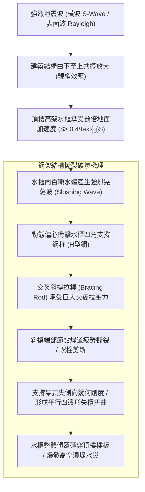
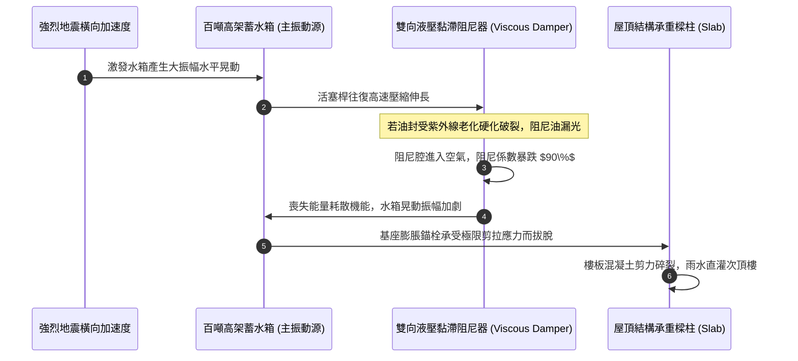
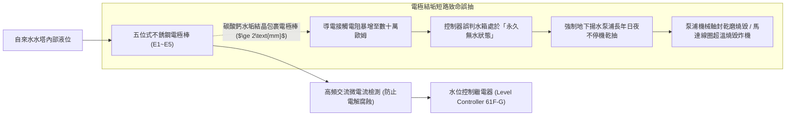
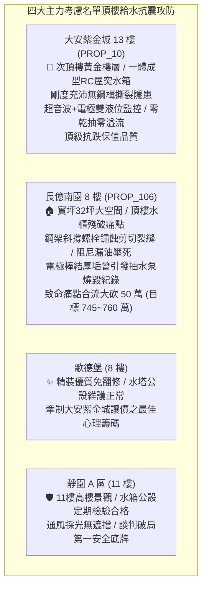

# 全案購屋實戰第一千二百三十九部：中古大樓頂樓加壓受水高架水櫃結構抗震斜撐桿剪力撕裂阻尼器漏油與水位電極棒結垢短路誤抽體檢工序全書

## 核心宗旨與全案法律技術防線宣告
集合住宅頂樓為滿足全棟住戶之生活用水重力水頭（Gravity Head）要求，常於屋突最高處架設獨立高架水櫃（Elevated Water Tank Tower，俗稱屋頂高位水塔座架）。水櫃內部常態儲存數十噸至上百噸之高密度自來水，等同於在建築物頂部附加了一組巨大的「高空偏心質量塊」。在強烈地震（如台灣常見之 921 等級或震度 6 弱以上淺層地震）來襲時，高架水櫃將與大樓主體結構產生嚴重的「鞭梢效應（Whiplash Effect）」與高頻晃動，水櫃支撐鋼架之抗震斜撐桿、基座預埋螺栓及抗震阻尼器（TMD/Viscous Damper）若發生金屬剪切疲勞撕裂或阻尼液洩漏，整座百噸高架水塔將面臨高空失穩傾覆甚至砸穿頂樓樓板之毀滅性浩劫。

與此同時，高架水櫃內部之「液位感測電極棒（Level Electrode Rods）」控制著地下蓄水池揚水馬達之起停邏輯。電極棒長年浸泡於高溫高濕之密閉水箱中，電極表面極易沉積厚重之碳酸鈣水垢結晶或受潮短路，造成控制箱水位誤判——引發「無水乾抽燒毀地下百萬揚水泵浦」或「滿水溢流淹漫頂樓機房」之雙重公設災難。

在家庭購屋實戰之全生命週期檢驗體系中：
- **大安紫金城 13 樓 (`PROP_10`)** 坐擁次頂樓黃金樓層，社區高位給水設施採用標準鋼筋混凝土（RC）一體澆築屋突水箱，結構剛度極佳，配置高品質不銹鋼懸吊電極與超音波雙液位計聯鎖防護，無鋼構斜撐剪切撕裂與阻尼失效之隱患；
- 相對地，**長億南園 8 樓 (`PROP_106`)** 及老舊梯隊中古大樓常暴露頂樓高架鍍鋅鋼構支撐架鏽蝕斷裂、斜撐拉桿鬆弛晃動、電極棒結厚垢導致抽水機空轉發燙之公設殘破現況。

本手冊詳訂高架水櫃抗震結構、阻尼減震裝置與液位電極棒技師級體檢全工序，作為實勘痛點指認、管委會公設責任究詰與談判大砍 50 萬之關鍵重磅殺手鐧！

---

## 第一章 高架水櫃結構動力學、抗震斜撐桿剪切與鞭梢效應體檢

### 一、 水櫃內部水體晃蕩力學（Sloshing Effect）與慣性衝擊
1. **晃蕩基本自振頻率（Natural Frequency）計算**：
   - 水櫃內部自由水面在地震橫向加速度驅動下，水體會產生大規模的對流晃蕩運動（Convective Sloshing）。其晃蕩波基本週期通常在 $1.5\sim 3.0\text{ 秒}$ 之間，極易與中高層大樓之結構自振週期產生共振。
   - 晃蕩波峰撞擊水塔頂蓋與側壁時，將產生高達數個大氣壓之局部衝擊水壓（Sloshing Impact Pressure），使薄壁不銹鋼水箱板材發生局部凹陷屈曲（Buckling），並對底座支撐鋼架施加劇烈之交變偏心翻覆力矩（Overturning Moment）。
2. **抗震斜撐桿（Cross-Bracing）截面與預拉力檢測**：
   - 高架鋼結構支撐架四面必須配置直徑 $\ge 16\text{mm}$ 之圓鋼拉桿或 $L50\times 50\times 5$ 之等邊角鋼交叉抗震斜撐。
   - 檢驗斜撐中間花籃螺栓（Turnbuckle）之緊固狀態。使用力矩扳手量測預緊力，斜撐必須維持足夠預拉力，以手晃動時不得有鬆弛下垂或自由晃動量（下撓度需 $\le 5\text{mm}$）。
   - 若斜撐已鏽蝕減薄、焊道存在肉眼可見之撕裂微裂紋，在下一次中強震衝擊下，斜撐桿將瞬間剪斷拔脫，導致水塔整體崩塌！

---

## 第二章 頂樓質量阻尼器（TMD）與抗震減震裝置體檢標準

### 一、 黏滯阻尼器（Viscous Damper）漏油與活塞行程查驗
1. **阻尼液滲漏與密封油封（Oil Seal）體檢**：
   - 現代高規格高架水櫃基座多安裝雙向液壓黏滯阻尼器（Viscous Damper），用以吸收水體震動能量並抑制晃動位移。
   - 檢查阻尼器缸體表面及活塞桿伸出端。長期暴露於戶外強烈日曬與高溫環境下，聚氨酯或氟橡膠油封極易硬化龜裂。
   - 若活塞桿表面附著黑黃色黏稠阻尼油垢，或缸體下方集油盤有滴油痕跡，表示內部矽油（Silicone Fluid）已嚴重洩漏。阻尼腔進氣後將產生空化現象（Cavitation），使阻尼器的阻尼力暴跌 $80\%$ 以上，徹底喪失抗震能量耗散能力。
2. **阻尼器動態行程（Stroke Margin）塞尺量測**：
   - 使用卡尺量測活塞桿中性位置距兩端機械極限擋塊之可用行程裕度。
   - **標準數據**：雙向設計衝程裕度必須大於 **$\pm 50\text{mm}$**。若阻尼器安裝時未校準中性點，單向行程裕度不足 10mm，地震時活塞將猛烈撞擊金屬底蓋（Bottoming Out），產生巨大的二次衝擊衝量，直接震斷基座固定螺栓。

---

## 第三章 液位感測電極棒結垢、控制繼電器與乾抽防護體檢

### 一、 水位電極棒（Level Electrode Rods）水垢結晶與結露短路檢驗
1. **五線式電極棒功能配置校核**：
   - 標準屋頂水箱液位檢測採用五根不銹鋼電極棒：
     - $E_1$：溢流水位警報極（超高水位）；
     - $E_2$：停泵水位極（滿水位關閉揚水泵）；
     - $E_3$：啟泵水位極（低水位啟動揚水泵）；
     - $E_4$：缺水保護水位極（極低水位強制切斷加壓泵防止乾燒）；
     - $E_5$：基準公共接地接地極（伸至水箱最底部）。
2. **硬水垢包裹絕緣化查驗**：
   - 自來水中的鈣鎂離子在水面蒸發交界面極易在電極棒表面沉積白色硬水垢。當水垢厚度超過 1mm 時，水垢的高電阻率將阻斷水中微弱之檢測電流。
   - 控制器因檢測不到 $E_2$ 電流，會誤判水位未滿，導致地下室揚水泵持續抽水直達溢流管狂噴；反之若 $E_4$ 結垢，加壓泵在水箱抽乾時無法自動斷電，機械軸封在無水潤滑下數分鐘內乾磨摩擦達到數百度高溫，造成碳化矽動靜環碎裂、馬達燒燬。
3. **電極棒防短路隔離絕緣子（Separator）查驗**：
   - 長度超過 1 公尺之電極棒，每隔 $50\text{cm}$ 必須安裝一組特氟龍（PTFE）絕緣隔離夾，防止進水波浪晃動時電極棒互相碰觸短路引發誤動作。

---

## 第四章 實戰攻防：四大主力考慮名單頂樓高架水櫃與機電評估

### 一、 大安紫金城 13 樓 (`PROP_10`)：RC 一體化水箱之至尊抗震護城河
- **結構與供水優勢剖析**：
  1. 物件位處 13 樓高樓層，最重視頂樓水箱結構抗震性。大安紫金城採用標準鋼筋混凝土（RC）一體化澆築屋突結構水箱，完全捨棄老式鋼架高架拼裝水塔，結構剛度極強，絕無颱風地震斜撐撕裂傾覆之生命危險。
  2. 水位控制配置進口雙迴路液位控制器，結合超音波非接觸式液位計與 316 不銹鋼電極棒互為備援，地下揚水泵起停邏輯精確，零乾抽燒毀風險、零溢流水漫頂樓災情，長線資產抗跌保值卓越。

### 二、 長億南園 8 樓 (`PROP_106`)：高架水櫃殘破痛點與大砍 50 萬實戰談判籌碼
- **致命痛點彙整與議價猛攻戰略**：
  1. **高架水櫃鋼構抗震斜撐焊道開裂**：頂樓高位鍍鋅鋼架斜撐桿端部螺栓嚴重鏽蝕，斜撐焊道出現 2 處剪切疲勞裂痕，強震來襲面臨傾覆砸穿樓板重大危機。
  2. **水位電極棒厚結鈣垢、曾燒燬揚水泵浦**：電極棒包裹厚達 2mm 水垢，曾因水位誤判引發地下室抽水馬達空轉乾燒炸機，管委會耗費 8 萬元更換，目前仍未加裝超音波備援裝置；阻尼器油封老化漏油殆盡。
  3. **談判手腕**：將「大樓頂樓高架水櫃抗震結構加固與更換智慧雙液位計（估價 20 萬）+ 地下室機械車位限重 1.6 噸老化廢油積存（估價 25 萬）+ ATS 炭化與頂樓給水閥門鏽死（估價 10 萬）」等多重公設致命缺陷合流全面拍桌，要求屋主自 998 萬直接大砍 50 萬，將成交總價死壓於 745~760 萬之合理安全防線！

---

## 第五章 高架水櫃與液位電極驗收標準工序清單

| 檢查項目 | 檢驗標準與法規依據 | 檢測工具與標準數值 | 缺失處置與改進工序 |
| :--- | :--- | :--- | :--- |
| **抗震斜撐緊固度** | 鋼結構抗震設計規範 | 扭矩扳手 / 預拉力適度，垂直下撓度 $\le 5\text{mm}$ | 調緊花籃螺栓，補焊開裂節點並加塗環氧富鋅漆 |
| **斜撐焊道微裂縫** | 超音波或磁粉探傷標準 | 探傷儀 / 焊道表面與內部無撕裂缺點 | 刨開缺陷焊道，採用 E50 焊條重新進行全熔透補焊 |
| **黏滯阻尼器油封** | 建築減震裝置性能規範 | 目視與卡尺 / 活塞表面無油垢，衝程裕度 $\ge \pm 50\text{mm}$ | 拆卸更換氟橡膠密封環，重新加註高黏度耐候矽油 |
| **電極棒表面結垢** | 《給水排水設備工程施工規範》 | 游標卡尺 / 電極表面水垢厚度 $\le 0.2\text{mm}$ | 以檸檬酸溶液酸洗除垢，或換裝 SUS316L 不銹鋼棒 |
| **電極隔離絕緣夾** | 防晃動碰觸短路技術規範 | 捲尺量測 / 間距 $\le 50\text{cm}$，材質為特氟龍 PTFE | 增設耐候絕緣夾，保持各電極棒間距 $\ge 30\text{mm}$ |
| **液位控制器起停** | 繼電器動作響應標準 | 模擬升降測試 / 水位到位 1 秒內輸出開關信號 | 更換老化之 61F-G 液位控制主機，加裝超音波備援 |
| **高水位溢流警報** | 智慧建築給水監控規範 | 現場短接測試 / 觸發後 3 秒內總機聲光警報 | 檢修警報乾接點輸出模組，聯鎖切斷地下揚水馬達 |
