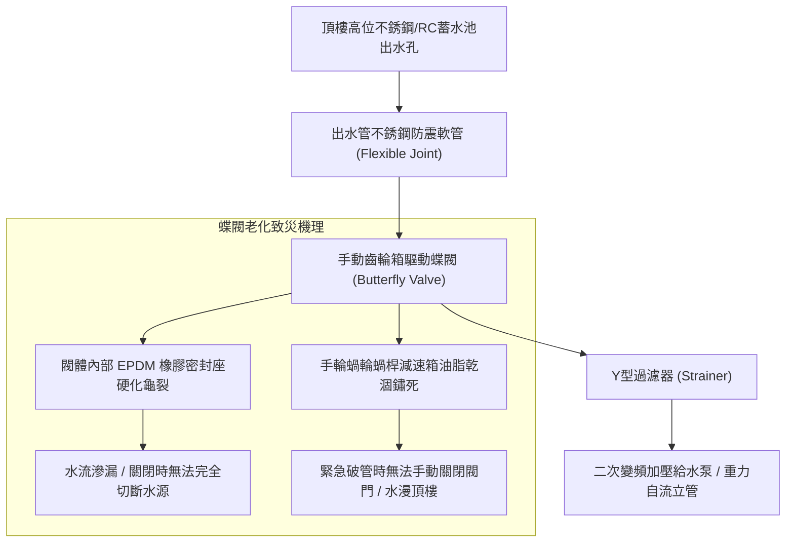
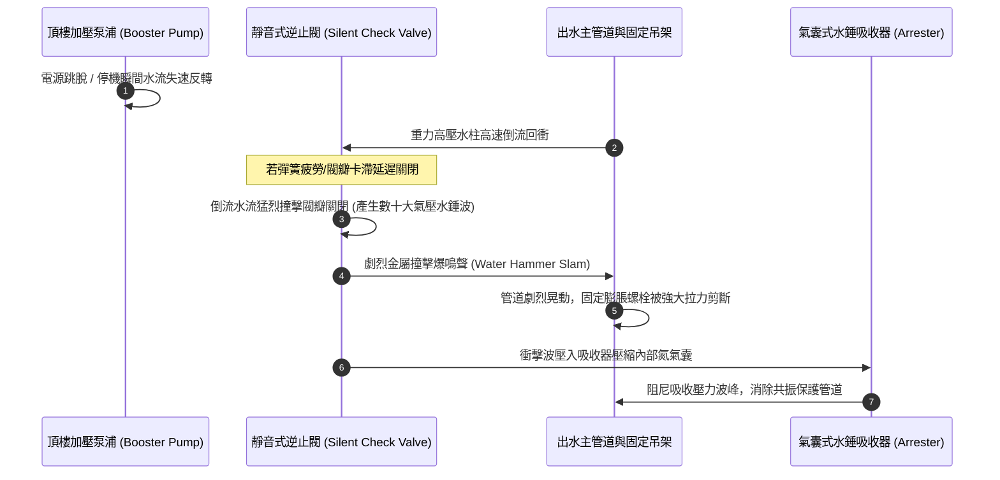
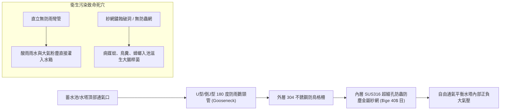
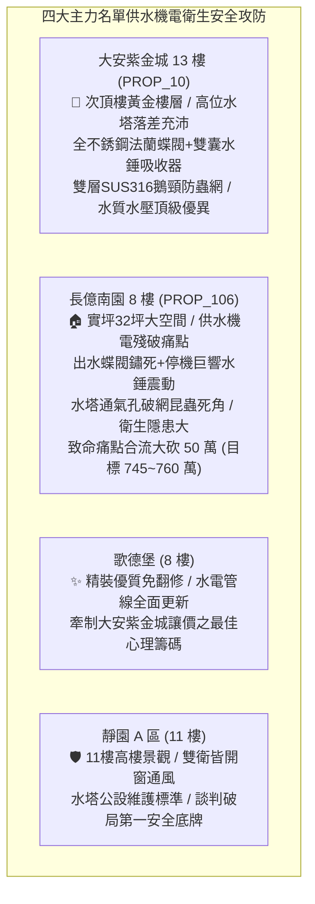

# 全案購屋實戰第一千二百三十二部：中古大樓頂樓水塔給水系統主出水管蝶閥橡膠閥座老化卡死逆止閥水錘撞擊震裂與通氣管防蟲防雨防塵網破損失效體檢工序全書

## 核心宗旨與全案法律技術防線宣告
集合住宅頂樓重力自流給水水箱（水塔）與增壓供水泵系統，為全棟住戶每日飲用、烹飪、盥洗、衛生沖洗及消防備用水源的心臟樞紐。大樓給水管網在歷經數十年之水壓衝擊、水質氯離子浸潤、氧化還原反應以及戶外極端溫差熱脹冷縮後，頂樓水塔出水主管閥門與管道附件往往成為隱蔽而致命之工程地雷區。

在中古大樓全生命週期置產實勘中，最常見且破壞力極強的給水致命缺陷包含：
1. **主出水管鑄鐵蝶閥（Butterfly Valve）內部三元乙丙橡膠（EPDM）閥座老化硬化、炭化剝落與閥軸卡死**：當低樓層或主立管突發水管破裂噴水時，管理員或住戶竟無法將總出水蝶閥旋轉緊閉，導致自來水以每分鐘數百公升之高壓流量狂噴數小時，水淹頂樓機房並沿管道間貫穿各樓層；
2. **靜音式逆止閥（Check Valve）內部彈簧疲勞與閥瓣傾斜**：在二次加壓揚水泵停止瞬間，高達數十公尺水柱重力回落引發巨幅「流體水錘衝擊波（Water Hammer）」，逆止閥瞬間承受數倍於額定工作壓力之動態衝擊，造成管件焊道拉裂、固定吊架螺栓剪斷脫落；
3. **水塔頂部通氣管（Air Vent Pipe）防蟲防鳥防塵不銹鋼紗網受酸雨腐蝕破裂洞穿**：外界粉塵、病媒蚊蠅、鳥糞、蟑螂甚至鼠類經由通氣管直墜蓄水池內部，造成全棟自來水水質大腸桿菌群與總菌落數嚴重超標，危害家人健康。

本手冊以此三大水力與衛生核心痛點為鑑：**大安紫金城 13 樓 (`PROP_10`)** 坐擁頂級機電維護水平，頂樓給水主閥採用全 304 不銹鋼法蘭式球閥、配備專用雙囊式水錘吸收器，通氣管加裝雙層 316 不銹鋼細孔防蟲罩與鵝頸防雨彎頭，水質清澈水壓穩定；而 **長億南園 8 樓 (`PROP_106`)** 及老舊大樓常暴露蝶閥鏽死無法關閉、加壓泵停機時伴隨劇烈水錘轟鳴震動、水塔通氣孔破洞紗網懸空之公設殘破現況。本手冊詳訂水塔出水主管與通氣管技師級體檢全工序，作為實勘痛點指認、管委會公設責任究詰與談判大砍 50 萬之關鍵重磅殺手鐧！

---

## 第一章 水塔出水主管蝶閥橡膠閥座密封性能與防卡死體檢標準

### 一、 蝶閥橡膠密封座（Valve Seat）化學老化與內漏查驗
1. **EPDM 橡膠炭化與硬化度檢驗**：
   - 自來水中殘留之有效餘氯（$0.2\sim 1.0\text{ ppm}$）在長年與橡膠閥座接觸下，氯離子會破壞三元乙丙橡膠（EPDM）或丁腈橡膠（NBR）之分子交聯鍵，導致橡膠彈性喪失、表面產生微孔龜裂與炭化剝落。
   - 使用橡膠硬度計量測閥座硬度。正常軟密封閥座邵氏硬度（Shore A）應介於 $65\sim 75$ 之間；若硬度超過 $85\text{ HA}$，表示橡膠已徹底脆化，關閉閥門時閥板（Disc）金屬邊緣無法與閥座形成有效彈性過盈擠壓，將產生持續性「高壓內漏（Internal Leakage）」。
2. **蝶閥完全關斷壓力密閉性測試**：
   - 現場將蝶閥手輪順時針全行程旋轉至「全關（$0^\circ$）」位置，開啟下游排污閥或洩水閥。
   - **判定標準**：下游管段在排空殘餘存水後，5 分鐘內落水孔不得有滴水或連續水流冒出。若下游持續湧水，證明閥座嚴重受損或閥瓣被管內水垢雜質卡塞，緊急時喪失完全截斷水流之防災機能。

### 二、 齒輪箱手輪驅動機構（Gearbox Operator）機械卡滯體檢
1. **蝸輪蝸桿咬死與減速比扭矩查驗**：
   - 頂樓水塔出水管徑通常在 3 英吋至 6 英吋（DN80~DN150）以上，依規範必須採用渦輪蝸桿減速箱帶動手輪操作，嚴禁使用單純手柄扳手（防止水錘及操作力不足）。
   - 檢查減速箱鑄鐵外殼有無裂紋，防水密封圈是否脫落進水。老舊社區減速箱內部潤滑黃油多已乾涸成結塊瀝青狀，蝸桿與銅質蝸輪齒面嚴重鏽蝕咬死。
2. **空轉齒隙與開度指針校準**：
   - 轉動手輪，手感需均勻無卡阻，操作力矩不得超過 $15\text{ N}\cdot\text{m}$（單人單手即可輕鬆轉動）。
   - 檢驗開度指示牌（Position Indicator）之角度是否與內部閥板實際開度精確一致。現場常見指針已指在「全開」位置，內部齒輪卻已斷齒滑牙，閥板實際懸空半掩，造成全棟水壓嚴重受阻衰減。

---

## 第二章 靜音式逆止閥水錘消除性能與管路衝擊防禦體檢

### 一、 逆止閥關閉響應速度與閥瓣疲勞檢測
1. **彈簧輔助快速關閉機制（Quick Closure）查驗**：
   - 出水管加壓泵出口端必須裝設具備不銹鋼彈簧輔助關閉之「靜音式逆止閥」或「緩閉式止回閥」，嚴禁使用傳統無彈簧之旋啟式（Swing Check Valve）老式逆止閥。
   - 檢驗內部彈簧剛度與防腐塗層。若彈簧受氯離子腐蝕斷裂或金屬疲勞，閥瓣將延遲 $0.5\sim 1.0$ 秒方受倒流水柱撞擊關閉。此延遲將導致回衝水流流速達到數米每秒，撞擊瞬間產生高達 $1.5\sim 2.5\text{ MPa}$ 之瞬態破壞性水錘高壓。
2. **水錘音壓與管道位移量化測量**：
   - 在加壓泵運轉至最高揚程時，手動切斷泵浦電源，模擬緊急停機狀態。
   - 使用聲級計於管旁 1 公尺處量測停機瞬間之「水錘撞擊音壓」。合格靜音閥撞擊音壓需小於 $65\text{ dB}$，管體無肉眼可見晃動。
   - 若停機瞬間發出如重鎚砸擊金屬之巨大「匡噹」爆鳴聲（音壓超過 $85\text{ dB}$），且管道產生超過 10mm 之劇烈橫向跳動，證明逆止閥已徹底失效，管路面臨隨時震爆爆管風險。

### 二、 水錘吸收器（Water Hammer Arrester）氣囊預充壓力校驗
1. **預充氮氣壓力（Pre-charged Pressure）檢驗**：
   - 水錘吸收器內部由耐候丁基橡膠隔膜將水腔與氣室隔離，氣室內預先充填高純度乾燥氮氣。
   - 關閉吸收器前端隔離閥，釋放水腔壓力，以胎壓計量測氣門嘴充氣壓力。預充氣壓需設定在管路靜水壓力的 $80\%\sim 90\%$（一般為 $2.0\sim 3.5\text{ kgf/cm}^2$）。
2. **隔膜破裂與氣室進水檢驗**：
   - 按下氣門嘴氣芯。若噴出者為水霧或連續水柱，證明內部橡膠氣囊早已破裂穿孔，氣室全數充滿死水，喪失一切氣體可壓縮彈性阻尼機能，該水錘吸收器已徹底報廢淪為擺設。

---

## 第三章 水塔通氣管防蟲防雨防塵衛生安全體檢工序

### 一、 通氣管幾何構造與倒 J 型（Gooseneck）防雨設計查驗
1. **管口朝向下傾角檢驗**：
   - 蓄水池通氣管功能在於加壓抽水或進水時，自由平衡水箱內部與外部之大氣壓差，防止水箱遭大氣壓抽扁抽癟或憋壓脹破。
   - 檢驗通氣管出風口是否具備向下的 $180^\circ$ 倒 U 型或倒 J 型「鵝頸彎頭（Gooseneck）」。嚴禁管口朝天垂直開放或僅做 $90^\circ$ 水平直角出風。管口最低處距水塔頂板完成面垂直淨高不得小於 $30\text{cm}$，防止暴雨地面积水飛濺吸入。
2. **管體防腐與防凝結水回流工序**：
   - 通氣管材質應為厚壁不銹鋼（SUS304/SUS316）或經熱浸鍍鋅防腐處理之無縫鋼管。
   - 查驗彎管下緣是否預留微小排凝結水孔，防止濕熱水蒸氣凝結在管口滯留發霉生銹，滴回蓄水池污染水質。

### 二、 防蟲防塵雙層金屬濾網（Insect-Proof Screen）規格檢測
1. **網目密度（Mesh Size）與耐腐材質查驗**：
   - 依據最新建築給水排水衛生安全技術規範，通氣孔必須安裝耐候防腐之 316 不銹鋼細孔金屬網，其紗網密度不得低於 **40 目（孔徑小於 0.42mm）**。
   - 40 目之密網方能徹底阻絕體型微小之搖蚊、孑孓幼蟲、小黑蚊與螞蟻鑽入；外層需加設 10 目之粗不銹鋼護網以抵禦強風及外力衝擊。
2. **紗網鏽蝕洞穿與脫落查驗**：
   - 現場以強光手電筒與高倍放大鏡檢視管口濾網。老舊大樓常用廉價鐵絲網或尼龍紗網，經長年戶外強烈紫外線照射早以風化碎裂、破洞懸空。
   - 實勘時若發現通氣管無網或破裂，蓄水池內部極高機率早已沉積厚厚一層灰渣、昆蟲屍體與生物黏膜，全棟住戶每日皆在飲用受微生物污染之生水！

---

## 第四章 實戰攻防：四大主力考慮名單水塔給水與衛生安全決策評估

### 一、 大安紫金城 13 樓 (`PROP_10`)：百萬級機電給水系統之安全尊榮
- **水力與衛生優勢剖析**：
  1. 物件位處 13 樓（總樓高 14 樓），雖距頂樓水塔垂直落差僅約 3~4 公尺，但社區早於頂樓配置專用變頻恆壓泵浦，出水端採用全 304 不銹鋼球閥與雙囊氣囊式水錘吸收器，室內冷熱水出水壓力穩定保持在 $2.2\sim 2.5\text{ kgf/cm}^2$，無任何水壓不足或高頻震顫現象。
  2. 頂樓蓄水池通氣管全數採用倒 J 型不銹鋼鵝頸管，裝設雙層 SUS316 40 目防蟲網，管委會每半年固定委託專業廠商實施清洗水塔與水質大腸桿菌檢測，用水品質極具保障。

### 二、 長億南園 8 樓 (`PROP_106`)：給水殘破痛點與大砍 50 萬實戰談判籌碼
- **致命痛點彙整與議價猛攻戰略**：
  1. **出水蝶閥全數鏽死**：頂樓水塔出水鑄鐵蝶閥齒輪箱被雨水浸蝕鏽死，現場實測手輪卡阻完全無法旋動，一旦 8 樓室內給水主閥或管道間破管，根本無法緊急關斷頂樓總閥，水淹全戶風險極高。
  2. **加壓泵停機水錘震裂管架**：逆止閥彈簧疲勞，每次加壓泵運轉停機皆引發巨大「匡噹」水錘金屬撞擊爆鳴，水塔旁出水管道固定吊架膨脹螺栓已有 2 處遭剪斷鬆脫，管件焊口出現滲水白華。
  3. **通氣管尼龍網破裂蟲害滋生**：通氣口紗網早已風化洞穿，水池內部衛生條件令人堪憂。
  4. **談判手腕**：將「頂樓給水主閥與逆止閥全面更新更換工程（估價 15 萬）+ 水塔通氣衛生改善（估價 5 萬）+ 地下室機械車位限重 1.6 噸老化廢油積存（估價 25 萬）+ ATS 炭化（估價 5 萬）」四大公設致命傷合流全面拍桌，要求屋主自 998 萬直接大砍 50 萬，將成交總價死壓於 745~760 萬之合理安全防線！

---

## 第五章 水塔出水系統與通氣管驗收標準工序清單

| 檢查項目 | 檢驗標準與法規依據 | 檢測工具與標準數值 | 缺失處置與改進工序 |
| :--- | :--- | :--- | :--- |
| **主出水蝶閥密閉性** | 《建築物給水排水設備設計規範》 | 關閉洩水觀察 / 5 分鐘內完全無水滴滲漏 | 更換 EPDM 軟密封不銹鋼法蘭蝶閥 |
| **手輪驅動機構** | 手輪旋轉操作力矩規範 | 扭力扳手 / 操作力矩 $\le 15\text{N}\cdot\text{m}$，指針開度精確 | 拆卸齒輪箱除鏽，注入耐低溫極壓潤滑脂 |
| **逆止閥水錘抑制** | 靜音彈簧輔助快速關斷標準 | 聲級計 / 停機撞擊音壓 $\le 65\text{dB}$，管體無晃動 | 更換為全 304 不銹鋼靜音式彈簧逆止閥 |
| **水錘吸收器氣囊** | 預充氮氣壓力標準校核 | 數位氣壓計 / 氣壓為靜水壓之 $80\%\sim 90\%$ | 氣室若噴出水柱表示氣囊破裂，立即整組更換 |
| **通氣管防雨構型** | 倒 U / 倒 J 型 $180^\circ$ 彎頭設計 | 捲尺量測 / 出風口距完成面淨高 $\ge 30\text{cm}$ | 改裝倒 J 型不銹鋼鵝頸彎管，切除直立管口 |
| **通氣管防蟲紗網** | 《自來水用戶用水設備標準》 | 放大鏡檢視 / 網目 $\ge 40$ 目，全 SUS316 材質 | 更換雙層 316 不銹鋼防蟲網，外加粗目護罩 |
| **管道抗震防震接頭** | 雙球型不銹鋼防震軟管標準 | 目視與探傷 / 無橡膠老化龜裂，法蘭螺栓鎖固 | 增設不銹鋼編織金屬軟管，消除水泵運轉高頻震動 |
