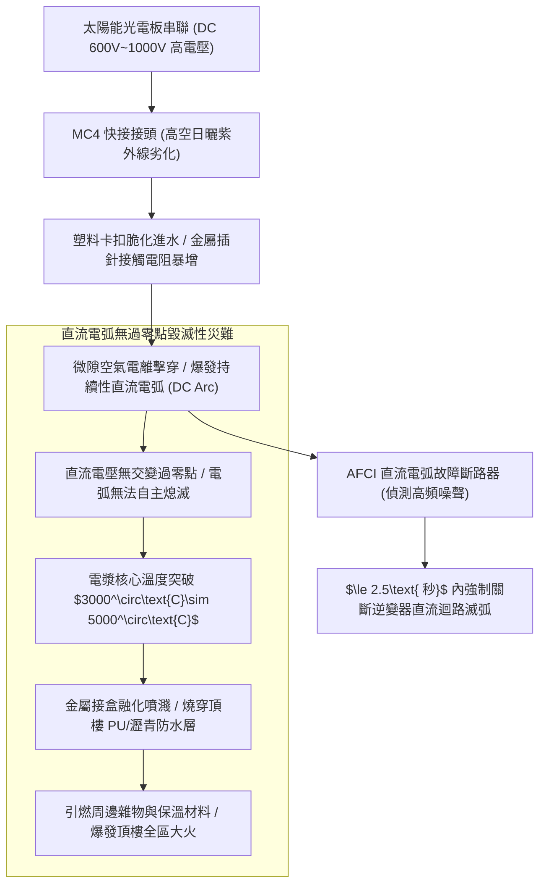
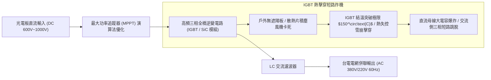
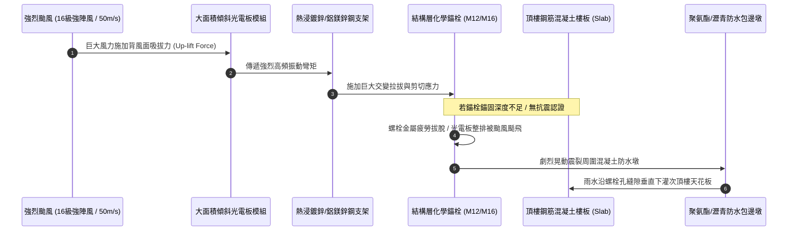
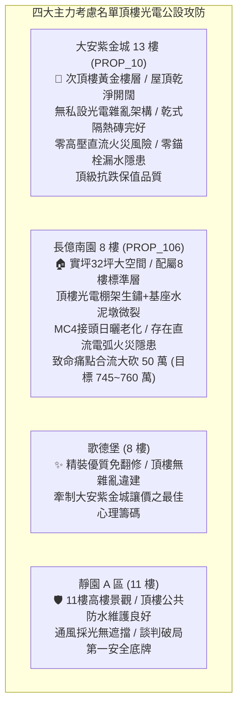

# 全案購屋實戰第一千二百三十八部：中古大樓頂樓太陽能光電發電系統逆變器IGBT熱擊穿直流電弧穿孔引燃防水層與結構支架抗風剪力螺栓疲勞體檢工序全書

## 核心宗旨與全案法律技術防線宣告
近年來配合政府綠能政策與管委會活化公共空間收益，眾多中古大樓於頂樓露台全面加蓋太陽能光電（Solar Photovoltaic, PV）遮陽發電系統。太陽能光電設施兼具頂樓隔熱、防雨保護以及將綠電躉售台電為社區賺取公共基金之多元優勢。然而，若太陽能系統於規劃、施工與長年運轉中缺乏嚴密之機電與結構維護，這座高懸於住戶頭頂之「高空高壓直流電廠」將迅速演變為致命之火災與高空墜物未爆彈。

在中古大樓全生命週期置產實勘中，最隱蔽且具毀滅性之太陽能光電三大致命弊病包含：
1. **直流側（DC Side）電弧（DC Arc Fault）穿孔引燃屋頂防水層**：光電板模組串聯後直流電壓高達 600V~1000V。戶外 MC4 接頭若受紫外線老化龜裂、受潮氧化或施工冷壓不良，將爆發持續性之「千度直流電弧火花」。因直流電無交流電之「過零點（Zero-Crossing Point）」，電弧一旦引燃便不會自行熄滅，數千度高溫電漿能瞬間燒穿鋁合金外框與屋頂防水瀝青毯，引發頂樓大面積火災；
2. **光電變流器（Inverter）IGBT 模組散熱不良熱擊穿短路**：逆變器長年置於頂樓戶外受烈日曝曬，散熱風扇卡死灰塵堵塞，絕緣柵雙極型電晶體（IGBT）結溫超過 150°C 發生雪崩擊穿，交流側短路炸機，全棟太陽能發電停擺並產生巨額維修費用；
3. **光電支架基座化學錨栓抗風剪力疲勞與防水包覆層破裂**：強颱來襲時，高架光電板承受極大之「迎風正壓與背風負壓吸力（Up-lift Wind Load）」。若膨脹螺栓或化學錨栓入結構層深度不足，反覆風振疲勞將剪斷螺栓引發光電板整排吹飛墜落砸死路人；而基座四周之混凝土防水包邊若因震動開裂，雨水將沿螺栓孔垂直貫穿樓板，造成次頂樓天花板嚴重漏水。

本手冊以此三大太陽能核心痛點為鑑：**大安紫金城 13 樓 (`PROP_10`)** 坐擁次頂樓黃金樓層，社區頂樓無盲目加蓋雜亂光電板，保有開闊乾淨之乾式隔熱磚露台與完整結構防水，完全避開高壓直流火災與螺栓滲水風險；相對地，**長億南園 8 樓 (`PROP_106`)** 及老舊大樓常暴露頂樓私設或廉價承包之光電棚架鋼構生鏽、MC4 接頭裸露受潮、基座螺栓周圍混凝土龜裂滲水之公設殘破現況。本手冊詳訂頂樓太陽能光電系統技師級體檢全工序，作為實勘痛點指認、管委會公設責任究詰與談判大砍 50 萬之關鍵重磅殺手鐧！

---

## 第一章 高壓直流電弧物理特性、MC4 接頭老化與 AFCI 滅弧體檢

### 一、 直流電弧（DC Arc）與傳統交流電弧破壞力差異
1. **直流電無過零點（Zero-Crossing）特性**：
   - 一般市電 60Hz 交流電每秒有 120 次電壓降至零伏特之瞬間，微小電弧易於自然熄滅。然而，太陽能光伏串列輸出之高壓直流電（600V~1000V DC），其電壓與電流方向恆定，一旦因接觸不良引發電弧，周圍空氣迅速電離形成高導電率電漿通道。
   - 電弧核心溫度高達 **$3000^\circ\text{C}\sim 5000^\circ\text{C}$**，足以熔化銅、鋁合金及混凝土，能在數秒內將頂樓聚氨酯（PU）防水膜或改性瀝青防水毯燒穿碳化，造成不可收拾之烈焰火災。
2. **MC4 專用接頭接觸電阻與紅外線熱斑查驗**：
   - 太陽能組件串聯使用之 MC4 防水插頭必須使用原廠專用冷壓鉗進行壓接，嚴禁使用普通鋼絲鉗夾扁。
   - 在晴天正午發電尖峰期（光照度 $\ge 800\text{ W/m}^2$），使用紅外線熱成像儀全面掃描所有光電板背面的 MC4 接頭。
   - **判定標準**：正常接頭溫度不得超過周圍電纜溫度 $5^\circ\text{C}$（絕對溫度 $\le 55^\circ\text{C}$）。若單一接頭呈現紅發白熱斑且溫度超過 $80^\circ\text{C}$，證明內部鍍錫銅針已氧化接觸不良，處於即將引爆直流電弧之極度危險邊緣！

### 二、 AFCI 直流電弧故障中斷技術（Arc-Fault Circuit Interrupter）檢驗
1. **UL 1699B 國際防電弧標準校驗**：
   - 依據最新建築電氣安全法規，屋頂光電逆變器必須內建或外加符合 UL 1699B 認證之「AFCI 直流電弧故障保護晶片」。
   - AFCI 透過霍爾電流傳感器連續高速採樣直流迴路電流波形，利用數位信號處理器（DSP）辨識電弧特有之高頻粉紅噪聲（Pink Noise，典型頻率在 10kHz~100kHz 區間）。
2. **電弧斷路器響應時間實測工序**：
   - 查驗逆變器銘牌是否標註「AFCI Built-in」。使用光伏電弧模擬測試儀注入電弧干擾信號。
   - **合格標準**：當迴路產生大於 300W 之電弧能量時，AFCI 必須在 **2.5 秒內（或釋放能量 $\le 750\text{J}$ 內）** 自動切斷逆變器主迴路並發出警報，徹底熄滅高溫電弧。若無 AFCI 保護，該光電系統即為違規危險設施。

---

## 第二章 光伏逆變器 IGBT 熱擊穿、散熱風機與 MPPT 效率體檢標準

### 一、 逆變器 IGBT 模組散熱架構與戶外日照遮蔽查驗
1. **逆變器安裝方位與防曬遮陽棚檢驗**：
   - 光電逆變器內部之功率開關元件（IGBT 模組）在進行 DC/AC 高頻斬波轉換時，會產生佔額定功率 $2\%\sim 3\%$ 之巨大熱損耗（以一台 50kW 逆變器為例，發熱量高達 1000W~1500W）。
   - 逆變器嚴禁直接朝向正南方無遮蔽安裝。現場查驗逆變器是否安裝於屋突背陰面（北面或東面），或頂部是否加設專用鍍鋅通風遮陽防雨棚。若在烈日曝曬下機殼表面溫度超過 $70^\circ\text{C}$，逆變器將自動降額（Derating）發電，發電量暴跌 $30\%\sim 50\%$。
2. **強制散熱風扇與散熱齒片風道清理檢測**：
   - 檢驗逆變器底部或背部之散熱風扇。風扇軸承需運轉平順無卡阻異音。
   - 使用風速計量測排熱風口風速。若鋁合金散熱鰭片被沙塵、柳絮、鳥巢填塞，風速衰減至 $1\text{ m/s}$ 以下，IGBT 晶片結溫（Junction Temperature）將突破 $150^\circ\text{C}$ 物理極限，造成矽晶圓瞬間燒穿熔解（熱擊穿炸機）。

### 二、 最大功率點追蹤（MPPT）與絕緣阻抗（$R_{\text{iso}}$）檢測
1. **直流對地絕緣阻抗（Isolation Resistance）檢測**：
   - 逆變器在每次並網前，必須自動檢測直流側正負極對地之絕緣阻抗。
   - 依據 IEC 62109-2 標準，直流電壓大於 600V 時，對地絕緣電阻必須大於：
     $$R_{\text{iso}} \ge \frac{V_{\text{max}}}{30\text{ mA}} \approx 33\text{ k}\Omega$$
     （工程實測標準通常需 $\ge 1\text{ M}\Omega$）。
   - 雨天或清晨高濕環境下，若電纜皮破皮接觸金屬支架，絕緣電阻跌落至低於警戒值，逆變器將觸發「$R_{\text{iso}}$ 低於標準」並死機報警，拒絕送電。

---

## 第三章 光電支架化學錨栓抗風剪力、基座防水包邊與電位聯結體檢

### 一、 光電支架抗風荷載與化學錨栓（Chemical Anchor）抗拔檢驗
1. **風荷載吸拔力（Wind Up-lift Load）校核**：
   - 台灣處於太平洋颱風帶，台中市區建築物頂樓設計基本風速需達 $37.5\text{ m/s}$（13級風），陣風可達 $50\text{ m/s}$（16級風）。
   - 依據《建築物耐風設計規範》，頂樓光電板若具備 $10^\circ\sim 15^\circ$ 傾角，在迎風與背風交界處將產生高達 **$250\sim 350\text{ kgf/m}^2$** 之巨大瞬間負壓吸拔力。
2. **化學錨栓規格與拉拔試驗（Pull-out Test）工序**：
   - 支架固定嚴禁使用普通敲擊式膨脹螺絲（俗稱壁虎），必須使用經 ETA Option 1 開裂混凝土抗震認證之「不銹鋼化學錨栓（M12 或 M16）」。
   - 化學錨栓有效錨固深度不得小於 **$100\text{mm}$**，且必須植入結構層實體混凝土中，嚴禁僅打在表面隔熱磚或輕質泡沫混凝土層上。
   - 使用拉拔測試儀抽檢錨栓抗拔力。單支 M12 化學錨栓之抗拔拉力需 $\ge 15\text{ kN}$（約 1.5噸），無滑移位移方為合格。

### 二、 基座防水包邊墩（Flashing Curb）防漏工序
1. **混凝土防水饅頭墩（Curb）高度與坡度**：
   - 錨栓穿透屋頂處必須澆築高出完成地坪 **$\ge 150\text{mm}$** 之 C25 鋼筋混凝土加厚墩（基座防水饅頭）。
   - 防水墩頂部必須抹出朝外四向排水坡度（$\ge 5\%$），嚴禁頂部凹陷積水。
2. **三布五塗泛水密封工序**：
   - 防水層沿防水墩垂直立面上翻並全包覆至支架底板下方，收口處必須以耐候矽酮結構膠完全密封。
   - 檢視防水墩四周有無環狀收縮裂縫。若發現基座四周開裂且下雨時次頂樓對應位置天花板產生水漬，證明光電板風振已撕裂防水層，必須全面敲除重作。

### 三、 光電組件全金屬接地與等電位聯結（Equipotential Bonding）
1. **組件邊框刺破型接地墊片（Grounding Clip）查驗**：
   - 光電板陽極氧化鋁外框具有絕緣氧化膜，各板之間必須安裝特種「不銹鋼帶齒刺破墊片」，在螺栓擰緊時刺破氧化鋁層實現可靠之金屬導通。
2. **接地電阻量測**：
   - 支架金屬架必須以 $25\text{ mm}^2$ 綠色接地線可靠引接至大樓避雷接地網。量測光電架任一金屬點對主接地網之電阻，數值必須 **$\le 4\ \Omega$**。

---

## 第四章 實戰攻防：四大主力考慮名單太陽能光電與公設安全決策分析

### 一、 大安紫金城 13 樓 (`PROP_10`)：無光電隱患之頂級次頂樓護城河
- **安全與結構優勢剖析**：
  1. 物件位處 13 樓高樓層（總樓高 14 樓），上方頂樓視野開闊，社區無隨意將屋頂產權出租給第三方加蓋雜亂之高壓光電棚架，完全免除數千度直流電弧火災高空引燃之生命危險。
  2. 頂樓地坪維持標準乾式隔熱磚鋪貼，無任何因光電化學錨栓鑽孔破壞結構層而引發之次頂樓天花板滲漏水災難，公設產權清晰乾淨，長期保值抗跌極致優越。

### 二、 長億南園 8 樓 (`PROP_106`)：光電公設殘破痛點與大砍 50 萬實戰談判籌碼
- **致命痛點彙整與議價猛攻戰略**：
  1. **光電支架錨栓周邊防水層開裂**：頂樓加蓋之光電遮陽棚基座混凝土饅頭墩已產生多條環狀龜裂，雨水沿螺栓孔滲漏，頂樓住戶已多次抗議修補無效。
  2. **MC4 接頭裸露受潮、逆變器無 AFCI 防電弧保護**：現場查驗光電板背面高壓直流電纜凌亂下垂浸泡地面積水，MC4 接頭外殼老化粉化，逆變器老舊未配備 AFCI 電弧故障斷路器，一旦爆發直流電弧將引爆高空大火。
  3. **談判手腕**：將「大樓頂樓光電基座全面重作防水包邊與線路整改（估價 20 萬）+ 地下室機械車位限重 1.6 噸老化廢油積存（估價 25 萬）+ ATS 炭化與頂樓給水閥門鏽死（估價 10 萬）」等多重公設致命缺陷合流發動猛烈攻勢，強硬要求屋主自 998 萬直接大砍 50 萬，將成交總價死壓於 745~760 萬之合理安全防線！

---

## 第五章 太陽能光電發電系統驗收標準工序清單

| 檢查項目 | 檢驗標準與法規依據 | 檢測工具與標準數值 | 缺失處置與改進工序 |
| :--- | :--- | :--- | :--- |
| **MC4 接頭熱斑** | IEC 62446 光伏系統檢測標準 | 紅外線熱成像儀 / 溫升 $\le 5^\circ\text{C}$，絕對溫度 $\le 55^\circ\text{C}$ | 更換為原廠正品 MC4 接頭，使用專用棘輪鉗壓接 |
| **AFCI 電弧防護** | UL 1699B 防電弧故障規範 | 電弧模擬測試儀 / 能量 $\ge 300\text{W}$ 於 2.5 秒內跳脫 | 加裝外置式光伏直流電弧故障斷路保護模組 |
| **直流絕緣阻抗** | IEC 62109-2 逆變器安全標準 | 1000V 絕緣高阻計 / 對地絕緣電阻需 $\ge 1\text{M}\Omega$ | 逐串排查電纜破皮受潮點，更換損壞之直流光伏電纜 |
| **化學錨栓抗拔力** | 《建築物耐風設計規範》 | 數位拉拔測試儀 / 單支 M12 錨栓抗拔力 $\ge 15\text{kN}$ | 鑽孔補植 ETA 認證之不銹鋼抗震化學錨栓 |
| **防水包邊饅頭墩** | 建築屋面防水工程技術規範 | 捲尺量測 / 高出地坪 $\ge 150\text{mm}$，四向坡度 $\ge 5\%$ | 敲除開裂鬆散基座，重新施作三布五塗抗紫外線防水 |
| **光電組件金屬接地** | 《用戶用電設備裝置規則》 | 微歐姆計 / 組件邊框對支架接觸電阻 $\le 0.1\ \Omega$ | 加裝不銹鋼帶齒刺破接地墊片，鎖緊防鬆螺母 |
| **支架綜合接地電阻** | CNS 避雷接地標準規範 | 數位接地電阻計 / 光伏金屬支架接地電阻 $\le 4\ \Omega$ | 以 $25\text{mm}^2$ 銅線引接至大樓主接地網並加固卡箍 |
