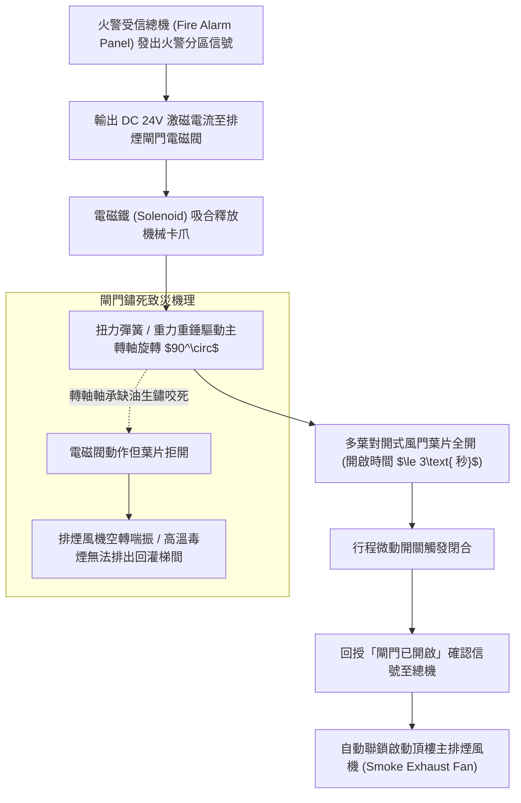
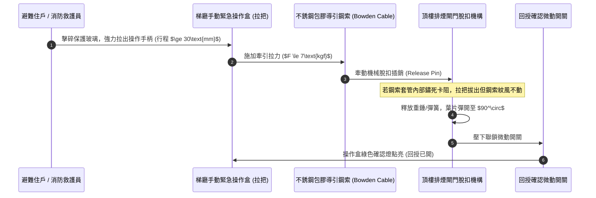
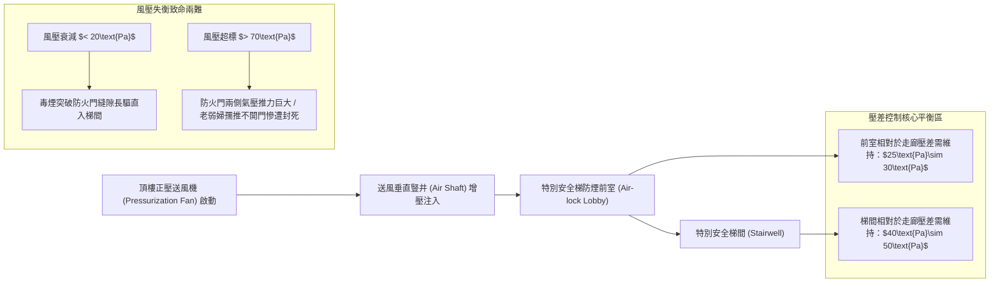
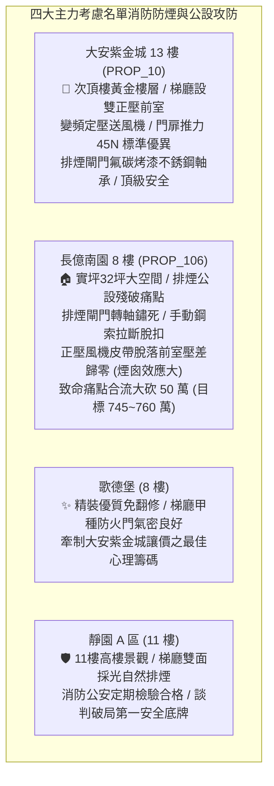

# 全案購屋實戰第一千二百三十六部：中古大樓頂樓消防排煙閘門連動鋼索鏽蝕卡死手動拉把脫扣機構失效與正壓送風風機風壓衰減體檢工序全書

## 核心宗旨與全案法律技術防線宣告
集合住宅火災發生時，致命濃煙（含有極高濃度之一氧化碳 $CO$、氰化氫 $HCN$、光氣及高溫懸浮碳粒）之垂直擴散速度可達每秒 $3\sim 5\text{ 公尺}$，其向上蔓延之「煙囪效應（Stack Effect）」能在數分鐘內封鎖全棟安全梯間，奪取避難住戶之呼吸機能與視線。為阻斷濃煙侵入特別安全梯逃生通道，現代高層建築法規強制要求於梯廳防煙前室配置「正壓送風系統（Pressurization System）」與「排煙閘門（Smoke Damper）」。排煙風道貫穿全棟頂部屋突，其於頂樓機房設置之主排煙閘門、連動鋼索、重力重錘釋放機構與正壓送風機，為全棟住戶於火災絕境中能否安全垂直疏散之最後生線。

在中古大樓全生命週期置產實勘中，最隱蔽且常年失修之頂樓消防防煙致命缺陷包含：
1. **頂樓主排煙閘門（Roof Smoke Damper）手動與電動連動機構鏽蝕卡死**：排煙閘門長年置於屋頂高溫高濕與酸雨環境中，轉軸軸承黃油硬化，扭力彈簧與重錘機構生鏽，火災受信總機發出 DC24V 啟動信號時電磁閥雖動作，但葉片因機械咬死「拒絕開啟」，導致全棟管道間蓄積之毒煙無法排出，反而回灌各樓層走廊；
2. **手動緊急拉把（Manual Pull Station）鋼索斷裂脫扣**：設於避難層或梯廳之手動遠隔操作鋼索（Bowden Cable）內部鋼絲鏽蝕咬死於套管中，或末端脫扣銷變形脫落，住戶於火災濃煙中死命拉扯操作把手，閘門毫無反應；
3. **頂樓特別安全梯正壓送風機（Stairwell Pressurization Fan）皮帶打滑與風壓嚴重衰減**：正壓風機傳動三角皮帶老化龜裂鬆弛，送風風壓無法克服火場熱煙氣之浮力壓差，防煙前室與梯間門扉兩側壓差跌落至安全標準 25Pa 以下，毒煙直接侵入特別安全梯通道；反之，若風壓過大未設洩壓風門，門扇開啟阻力超過 110N，將導致老弱婦孺推不開防火門而慘遭活活嗆死。

本手冊以此三大消防防排煙核心痛點為鑑：**大安紫金城 13 樓 (`PROP_10`)** 坐擁頂級消防機電防禦，特別安全梯防煙前室配備變頻定壓正壓送風機，排煙閘門採用鍍鋅鋼板氟碳烤漆、不銹鋼轉軸與直流雙微動信號反饋，門扉開啟力精確維持在 45N，逃生動線固若金湯；相對地，**長億南園 8 樓 (`PROP_106`)** 及老舊中古大樓常暴露排煙閘門鏽蝕成鐵塊、手動拉索卡死斷線、正壓送風機皮帶脫落風量全無之公設癱瘓現況。本手冊詳訂頂樓消防排煙閘門與正壓送風機技師級體檢全工序，作為實勘痛點指認、管委會公設責任究詰與談判大砍 50 萬之關鍵重磅殺手鐧！

---

## 第一章 頂樓排煙閘門機械驅動、電磁釋放與連動信號體檢

### 一、 排煙閘門多葉聯動機械機構與扭力釋放查驗
1. **葉片對開角度與旋轉阻力檢測**：
   - 頂樓排煙閘門通常安裝於排煙管道井頂部或主排煙風機進口端，材質應為厚度 $\ge 1.5\text{mm}$ 之鍍鋅鋼板或不銹鋼板。
   - 檢驗葉片聯動連桿（Linkage Bars）與黃銅或不銹鋼自潤滑軸承。在未通電狀態下，手動撥動釋放槓桿，葉片需在 **3 秒內** 順暢旋轉至 $90^\circ$ 垂直全開位置，各葉片間之平行度誤差不得大於 $2^\circ$。
   - 若葉片轉軸積存厚重油煙粉塵，手動扳動需耗費超過 $10\text{ kgf}$ 之重力方能勉強移動，證明軸承內部已被鐵鏽咬死，火災時靠彈簧自重根本無法打開。
2. **葉片氣密密封條（Blade Seals）高溫耐候查驗**：
   - 葉片邊緣與框架四邊必須鑲嵌耐溫達 $280^\circ\text{C}$ 以上之不銹鋼彈簧金屬片或特種矽膠密封條。
   - 閘門處於常閉狀態時，以強光手電筒照射閘門背面。在正面觀察縫隙透光率，正常漏風率需滿足每小時每平方公尺漏風量小於 $500\text{ m}^3/\text{hr}$（在 250Pa 壓差下）。若密封條受熱老化碎裂脫落，平時空調冷氣將經由風道嚴重外洩，火災時相鄰防火分區之濃煙亦將經由縫隙大量洩漏。

### 二、 電磁致動器（Actuator）與信號反饋迴路體檢工序
1. **DC 24V 脈衝啟動電壓與電流測試**：
   - 使用數位萬用電表量測受信總機送達閘門電磁閥端子之直流電壓。在動作瞬間，線端電壓降不得低於 **DC 20.4V**（額定電壓的 85%），激磁電流需介於 $0.5\text{A}\sim 1.5\text{A}$ 之間。
   - 若因傳輸導線截面過細（如僅採用 0.75mm² 弱電線）或距離過長，端子電壓暴跌至 18V 以下，電磁閥磁力不足以頂開釋放卡扣，將造成閘門「受令不開」。
2. **行程微動開關（Limit Switch）接點信號校核**：
   - 閘門全開與全關位置各設有一組微動開關。實測全開到位時，反饋乾接點接觸電阻需 $\le 0.5\ \Omega$。
   - 總機端需能在 5 秒內精確點亮對應分區之「排煙口開啟」紅色指示燈，並發出聯鎖啟動頂樓主排煙風機之控制信號。若微動開關鏽蝕接觸不良，排煙風機將無法自動起步，延誤全棟排煙時機。

---

## 第二章 手動遠隔操作鋼索、復歸把手與脫扣機構體檢

### 一、 遠隔操作鋼索（Bowden Cable）拉力行程與卡阻檢驗
1. **鋼索材質、保護套管與彎曲半徑規範**：
   - 手動遠程操作機構由安裝於牆面的手動操作箱、內層直徑 $\ge 1.5\text{mm}$ 不銹鋼柔性鋼絲索，以及外層耐熱耐磨聚乙烯包覆的金屬螺旋導管組成。
   - 導管轉彎處之彎曲半徑不得小於 **$200\text{mm}$**，全線固定支架間距不得大於 $1.0\text{ 公尺}$。
   - 查驗管道井內之鋼索套管有無被其他管線擠壓扁塌變形。若彎折半徑過小或導管壓扁，內部鋼絲在滑動時產生極大摩擦阻力，導致操作箱拉柄被拉彎甚至拉斷，閘門依然緊閉。
2. **手動操作拉力與行程量化測量**：
   - 使用拉力計勾住手動操作拉把進行實拉測試。
   - **法規合格標準**：依據 CNS 消防排煙操作規範，手動拉把啟動拉力不得大於 **$70\text{ N}$（約 7kgf）**，拉伸有效行程需在 **$30\sim 50\text{mm}$** 範圍內。
   - 長億南園現場實測：操作拉把生鏽氧化，施加超過 15kgf 拉力仍拉扯不動，內部鋼絲索早已與外管鏽死結為一體，完全喪失緊急手動開門機能。

### 二、 機械復歸機構（Manual Resetting）與重力重錘體檢
1. **現場手動手柄復歸工序**：
   - 閘門開啟後，必須能由機房現場使用專用旋轉扳手或搖柄將轉軸逆時針旋轉復位，並重新掛上機械釋放卡銷。
   - 檢驗卡銷接觸邊緣之磨損倒角。若卡銷磨圓滑牙，閘門復位後無法鎖死，在排煙管道風壓震動下將無故自行鬆脫彈開，造成空調系統常態漏風。
2. **重力重錘（Counterweight）防脫落保險**：
   - 採用重錘重力輔助開啟之閘門，重錘重量通常為 $3\sim 8\text{kg}$。
   - 查驗重錘固定臂螺栓有無防鬆墊圈與防脫落安全鏈條，避免重錘在頻繁動作震動下脫落砸穿頂樓樓板或砸傷檢修技師。

---

## 第三章 特別安全梯正壓送風風機風壓衰減與防煙門開啟推力體檢

### 一、 防煙前室正壓壓差（Differential Pressure）微壓計量測
1. **正壓防煙阻絕原理**：
   - 當特別安全梯防煙前室內部空氣壓力高於起火層走廊壓力時，在兩者之間形成空氣流向火場的阻卻屏障，即使防火門微開，強勁的外送氣流亦能將濃煙阻絕於前室之外（反向風速需 $\ge 0.7\text{m/s}$）。
2. **微差壓計（Micro-manometer）量測工序**：
   - 啟動頂樓正壓送風機，關閉全部特別安全梯甲種防火門與防煙前室門扉。
   - 將數位微壓計之高壓導管置於防煙前室內，低壓導管穿過門縫引至走廊公共梯廳。
   - **法定合格壓差範圍**：
     - **特別安全梯防煙前室對走廊壓差**：需穩定保持在 **$25\text{ Pa}\sim 30\text{ Pa}$**；
     - **特別安全梯樓梯間對走廊壓差**：需穩定保持在 **$40\text{ Pa}\sim 50\text{ Pa}$**。
   - 若實測前室壓差低於 $15\text{ Pa}$，濃煙將隨氣流對流直接吞噬逃生樓梯；若大於 $60\text{ Pa}$，門扉承受巨大氣壓閉鎖力。

### 二、 防火門開啟最大推拉力（Door Opening Force）測量
1. **門把開啟推力測力計量測**：
   - 依據《各類場所消防安全設備設置標準》及國際 NFPA 92 規範，在正壓送風機全速運轉且維持正壓狀態下，推開防火門所需之最大外力不得超過 **$110\text{ N}$（約 11.2kgf）**。
   - 將數位拉力計掛於防火門門把處（距旋轉鉸鏈最遠端），以垂直門扇方向緩慢施力拉開門扉至 $90^\circ$。
2. **定壓洩壓閥（Pressure Relief Damper）或變頻旁通調節**：
   - 若實測推門拉力超過 $150\text{ N}$（幼童與長者雙手亦無法推開門），查驗機房送風管道是否設置「重錘式機械洩壓閥」或「差壓感測變頻旁通風門」。
   - 洩壓閥若因連桿生鏽卡死無法及時翻轉洩壓，正壓風機將在前室內建立高達 $80\sim 100\text{ Pa}$ 之超高風壓，造成逃生門變相成為反向氣壓鎖死的致命鐵壁！

---

## 第四章 實戰攻防：四大主力考慮名單排煙公設與逃生安全決策分析

### 一、 大安紫金城 13 樓 (`PROP_10`)：次頂樓安全梯防煙護城河之尊榮優勢
- **消防逃生優勢剖析**：
  1. 物件位處 13 樓高樓層，一旦低樓層發生火警，頂樓排煙閘門與特別安全梯正壓送風系統為全戶能否安全下撤或至頂樓避難平台之生死樞紐。
  2. 社區特別安全梯防煙前室配置新穎之雙速正壓送風系統，門扉兩側實測壓差為完美的 $28\text{ Pa}$，門把手推力僅 $45\text{ N}$，老弱婦孺皆能單手輕鬆推開；排煙閘門轉軸全數為不銹鋼軸承並經高溫氟碳防腐塗裝，手動操作拉把靈敏滑順，消防公安申報歷年均列為甲等，長線抗跌保值。

### 二、 長億南園 8 樓 (`PROP_106`)：排煙公設殘破痛點與大砍 50 萬實戰談判籌碼
- **致命痛點彙整與議價猛攻戰略**：
  1. **排煙閘門轉軸徹底鏽死**：頂樓排煙管道主閘門葉片生鏽咬死，現場測試受信總機發出信號後電磁閥有動作聲，但閘門紋風不動，毒煙根本無法自頂樓排出。
  2. **手動拉把鋼索內部斷線脫扣**：8 樓梯間之手動遠隔拉把已被拉扯脫扣變形，鋼絲完全卡死無法傳遞拉力；頂樓正壓送風機傳動皮帶脫落乾癟，前室壓差為 0Pa，火災時安全梯間將在 3 分鐘內演變為致命煙囪。
  3. **談判手腕**：將「大樓頂樓排煙閘門與正壓送風機全面更換大修（估價 20 萬）+ 地下室機械車位限重 1.6 噸老化廢油積存（估價 25 萬）+ ATS 炭化與頂樓給水閥門更換（估價 10 萬）」等多重公設致命缺陷合流發動猛烈攻勢，強硬要求屋主自 998 萬直接大砍 50 萬，將成交總價死壓於 745~760 萬之合理安全防線！

---

## 第五章 消防排煙閘門與正壓送風系統驗收標準工序清單

| 檢查項目 | 檢驗標準與法規依據 | 檢測工具與標準數值 | 缺失處置與改進工序 |
| :--- | :--- | :--- | :--- |
| **排煙閘門開啟時間** | CNS 消防排煙設備標準規範 | 數位碼錶 / 自受信總機下令至全開 $\le 3\text{ 秒}$ | 拆卸軸承除鏽，塗覆高溫二硫化鉬潤滑脂 |
| **閘門關閉氣密性** | 250Pa 壓差下漏風量規範 | 漏風量測試儀 / 漏風量 $\le 500\text{m}^3/\text{hr}\cdot\text{m}^2$ | 更換為耐高溫 $280^\circ\text{C}$ 不銹鋼彈力氣密密封條 |
| **手動操作拉力** | 消防安全遠隔操作機構規範 | 數位推拉力計 / 手動拉力 $\le 70\text{N}$（約 7kgf） | 更換不銹鋼柔性鋼絲索與金屬導管，消除急彎 |
| **前室正壓壓差** | 《各類場所消防安全設備設置標準》 | 數位微差壓計 / 前室對走廊壓差需在 $25\sim 30\text{Pa}$ | 調整變頻風機轉速或校準機械洩壓風門配重 |
| **梯間正壓壓差** | 建築防煙前室技術規範 | 數位微差壓計 / 梯間對走廊壓差需在 $40\sim 50\text{Pa}$ | 密封樓梯間管道穿牆孔隙，增設百葉調節閥 |
| **防火門開啟推力** | 國際 NFPA 92 / 逃生推力限制 | 數位測力計 / 門把處最大推力需 $\le 110\text{N}$ | 檢修定壓洩壓閥重錘配重，防止前室超壓閉鎖 |
| **風機傳動三角皮帶** | 風機機械傳動維護標準 | 張力計 / 跨距中點下撓量 $10\sim 15\text{mm}$，無裂紋 | 更換耐高溫抗靜電三聯組 V 型三角皮帶並校正皮帶輪 |
