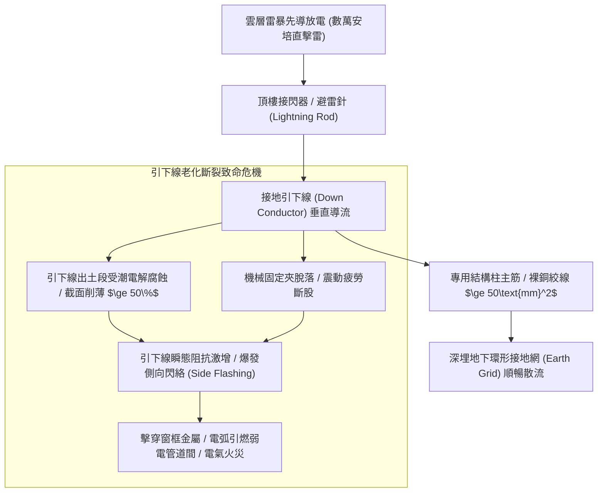
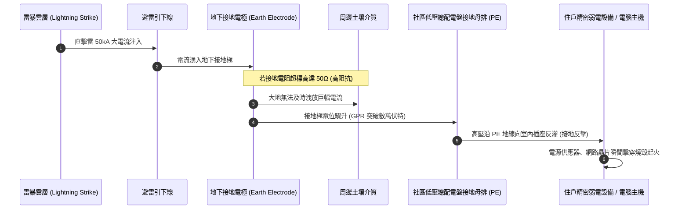
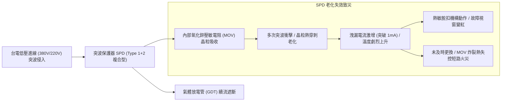
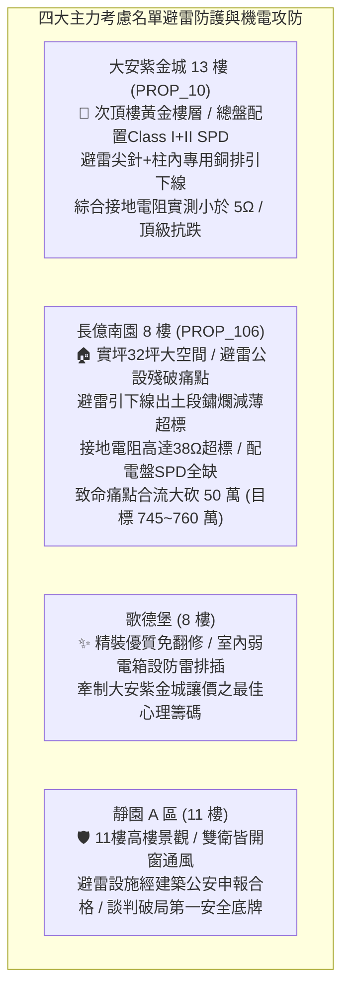

# 全案購屋實戰第一千二百三十四部：中古大樓頂樓避雷針接地系統突波雷擊接地電阻阻抗超標引下線受潮電解腐蝕與突波保護器SPD穿刺擊穿體檢工序全書

## 核心宗旨與全案法律技術防線宣告
集合住宅之頂樓建築最高突出物（如水箱屋頂、電梯機房頂、景觀天際線避雷尖針），為全棟大樓抵禦大氣雲層雷暴放電、數十萬伏特雷擊突波與瞬態高頻電磁脈衝（EMP）之第一道安全防線。建築物避雷系統由「接閃器（Air Terminal/Lightning Rod）」、「接地引下線（Down Conductor）」及「地下接地極系統（Earth Electrode System）」三大核心部位構成，並透過設置於各配電箱內之「突波保護器（Surge Protective Device, SPD）」達成等電位聯結與弱電設備之突波分流抑制。

在中古大樓置產實戰檢驗中，因長年受日曬雨淋、酸雨浸蝕、紫外線照射以及地表電解反應，避雷接地系統往往成為最容易被管委會忽視卻最具毀滅性之隱蔽公設病灶：
1. **接地引下線（Down Conductor）機械錨固斷裂與電解腐蝕減薄**：引下線沿女兒牆或管道間下引至地面時，若外露金屬固定夾脫落，強風晃動將使銅絞線產生金屬疲勞脆斷；而在穿出地面之交界處，極易因土壤中酸鹼鹽電解質受潮氧化，鋼質或銅質引下線截面積腐蝕削薄達 50% 以上，雷擊時數萬安培瞬間電流無法順暢導入大地，反而在引下線斷點處爆發劇烈側向閃絡（Side Flashing），瞬間引燃相鄰外牆保溫層、天線饋線或窗框，造成高空火災；
2. **接地電阻（Earth Resistance）阻抗超標劣化**：地下接地銅排或接地棒因長年土壤乾涸、接地降阻劑流失或金屬接地體鏽爛，系統綜合接地電阻由法定標準之 10Ω 以下暴增至 50Ω~100Ω 以上。雷擊時接地極電位急遽上升（Ground Potential Rise, GPR），數萬伏特高壓由地網反灌（反擊）進入全棟共用接地迴路，擊毀全棟弱電監控、門禁主機、電梯微電腦基板與住戶昂貴家電；
3. **低壓配電盤突波保護器（SPD）內部金屬氧化物壓敏電阻（MOV）老化擊穿漏電**：SPD 歷經多次感應雷突波衝擊後，MOV 晶粒邊界熱擊穿劣化，漏電流劇增引發熱失控起火，甚至直接短路爆裂炸毀配電箱。

本手冊以此三大避雷與突波核心痛點為鑑：**大安紫金城 13 樓 (`PROP_10`)** 坐擁頂級機電維護水平，頂樓採用專用避雷尖針與鍍鋅銅接地網，引下線深埋於結構柱鋼筋專用預埋套管，綜合接地電阻實測小於 $5\Omega$，總盤及各樓層分配電箱全數配置具備故障脫扣告警之 Class I+II 模組化 SPD，安全無虞；而 **長億南園 8 樓 (`PROP_106`)** 及老舊大樓常暴露避雷針鏽蝕傾斜、引下線裸露斷股發黑、接地電阻嚴重超標、配電箱 SPD 燒黑或根本未裝設之公設殘破現況。本手冊詳訂避雷接地與 SPD 突波保護器技師級體檢全工序，作為實勘痛點指認、管委會公設責任究詰與談判大砍 50 萬之關鍵重磅殺手鐧！

---

## 第一章 避雷引下線截面積、腐蝕減薄與側向閃絡防禦體檢

### 一、 避雷引下線截面積、機械固定與電化學腐蝕查驗
1. **導體材質與最小截面積規範**：
   - 依據《建築技術規則建築設備編》第 19 條及 CNS 12872 避雷設備標準，接地引下線若採用裸銅絞線，其截面積不得小於 **$50\text{ mm}^2$**（相當於 19 股直徑 1.8mm 銅線）；若採用熱浸鍍鋅扁鋼，其截面積不得小於 **$100\text{ mm}^2$** 且厚度不小於 4mm。
   - 現場使用游標卡尺量測引下線直徑。若老舊大樓便宜行事僅採用 $22\text{ mm}^2$ 或細銅線，雷擊大電流通過時將產生巨大的焦耳熱（$I^2Rt$），引下線將在毫秒內瞬間融化蒸發、爆裂噴濺。
2. **出土段防機械損傷與電解腐蝕檢測**：
   - 引下線自外牆下引至地面及地底 $0.3\text{m}$ 至地上 $2.5\text{m}$ 範圍內，依規定必須穿設耐衝擊 PVC 厚管或鍍鋅鋼管進行機械防護。
   - 檢驗穿管銜接處與出土分界面。此處因地表雨水、泥土酸性鹽分聚集，極易爆發電化學電偶腐蝕。量測引下線銅芯有效截面，若鏽蝕減薄超過原截面積之 $30\%$，必須立即切除並以放熱焊接（Exothermic Welding）重新跨接補強。

### 二、 側向閃絡（Side Flashing）安全防護距離測量
1. **電氣安全絕緣間隙（Separation Distance）計算**：
   - 當雷電流沿引下線洩流入地時，導線電感產生的瞬態高壓可能對相鄰金屬物（如頂樓冷卻水塔金屬外殼、窗框、瓦斯管、冷氣室外機架）產生空氣擊穿放電（側閃）。
   - 依據 IEC 62305 規範，安全防護隔離距離 $s$ 應滿足：
     $$s = k_i \times \frac{k_c}{k_m} \times l$$
     其中 $k_i$ 為防雷等級係數，$k_c$ 為分流係數，$k_m$ 為絕緣介質係數（空氣為 1），$l$ 為至最近等電位點之垂直長度。
   - **實測查驗**：引下線與任何室內弱電管線、瓦斯金屬管之空間淨距不得小於 **$1.0\text{ 公尺}$**；若距離小於此限度，該金屬管件必須以 $16\text{ mm}^2$ 以上多股綠色接地銅線實施可靠之「等電位聯結（Equipotential Bonding）」，杜絕電弧跨接引燃瓦斯或打穿電纜絕緣。

---

## 第二章 地下接地極系統接地電阻超標與電位反擊體檢

### 一、 三極法（Fall-of-Potential Method）接地電阻精密測量工序
1. **三極法測試儀佈極規範**：
   - 使用數位接地電阻測試儀（如 Fluke 1625 或共立接地電阻計）。斷開接地引下線與建築物之斷接卡（Test Joint），使接地極處於獨立受測狀態。
   - 將電流輔助接地極（C 極）打入土壤深處，距被測接地極（E 極）距離為 $d$（一般取 $20\sim 30\text{ 公尺}$）；將電位輔助接地極（P 極）置於 E 極與 C 極之間，距 E 極距離約為 $0.618d$（黃金分割點）。
2. **接地電阻合格標準與量化判讀**：
   - **法規技術標準**：
     - 單獨避雷針接地電阻：需 **$\le 10\ \Omega$**；
     - 弱電監控、電腦網路、消防與避雷共用之「綜合接地網」：需 **$\le 1\ \Omega$**。
   - **長億南園現場致命痛點**：因地下土壤乾枯、老舊接地棒早已腐爛，實測綜合接地電阻飆升至 $38\ \Omega$ 以上，嚴重違反建築法規，一旦遭遇直擊雷，全棟共用接地迴路將全面爆發「高電位反擊（Ground Potential Rise）」，摧毀全社區弱電機房！

### 二、 斷接卡（Test Clamp）氧化與跨接端子體檢
1. **接地測試端子箱（Test Joint Box）查驗**：
   - 建築外牆距地面 $0.5\sim 1.5\text{m}$ 處必須設置專用接地測試斷接箱。內部引下線與接地極母排以鍍錫銅螺栓連接。
   - 檢查斷接卡螺栓有無受潮鏽蝕結塊。氧化鏽皮將形成數歐姆之接觸電阻，在強大雷電流通過時產生局部高溫熔斷。
2. **等電位匯流排箱（MEB）跨接導通性**：
   - 檢驗總配電室之「主等電位匯流排箱（Main Equipotential Busbar, MEB）」。大樓基礎鋼筋網、金屬給水幹管、金屬瓦斯管、電梯導軌、變壓器中性點（N）與保護接地線（PE）必須以鍍錫銅排緊密壓接。
   - 使用微歐姆表量測跨接導通電阻，任兩點間之直流接觸電阻不得大於 **$0.1\ \Omega$**。

---

## 第三章 配電盤突波保護器（SPD）衰減劣化與穿刺擊穿體檢工序

### 一、 突波保護器（SPD）分類等級與技術參數校驗
1. **分級防護架構查驗**：
   - **第 I 級（Class I / Type 1）**：裝設於大樓總低壓配電盤進線端，用於洩放直擊雷電流。衝擊電流標稱參數需滿足 $I_{\text{imp}} \ge 12.5\text{ kA}$（10/350µs 波形），電壓保護水平 $U_p \le 2.5\text{ kV}$。
   - **第 II 級（Class II / Type 2）**：裝設於各樓層分電盤及電梯、消防機房專用盤，用於抑制感應雷與操作過電壓。標稱放電電流需滿足 $I_n \ge 20\text{ kA}$（8/20µs 波形），最大放電電流 $I_{\text{max}} \ge 40\text{ kA}$。
2. **持續運轉電壓（$U_c$）匹配校核**：
   - 對於三相四線制 380V/220V 系統，SPD 之最大持續運轉電壓 $U_c$ 不得小於 **$275\text{ V}$**（相對於中性線）或 **$440\text{ V}$**（線對線）。若選用耐壓過低之 SPD（如 230V），台電電網輕微突波波動即引發 MOV 長期微導通發熱燒毀。

### 二、 SPD 視窗故障指示與洩漏電流現場量測
1. **機械式故障指示視窗（Status Indicator）狀態**：
   - 現場檢視配電箱內各相 SPD 模組表面視窗。正常狀態為「綠色（Normal）」；若已變為「紅色（Defective）」或彈出，表示內部熱敏脫扣裝置（Thermal Disconnector）已因過熱跳脫，該模組已永久失效失去避雷防護能力，必須整組抽換。
2. **直流洩漏電流與壓敏電壓（$U_{1\text{mA}}$）測試工序**：
   - 使用 SPD 專用測試儀量測壓敏電阻模組之壓敏電壓 $U_{1\text{mA}}$（通過 1mA 直流電流時之端電壓）與洩漏電流 $I_{L}$。
   - **判定標準**：壓敏電壓實測值與初始標稱值偏差不得超過 $\pm 10\%$；在正常工作電壓下之洩漏電流必須小於 **$20\ \mu\text{A}$**。若洩漏電流超過 $100\ \mu\text{A}$，代表 MOV 晶界已嚴重熱擊穿，隨時可能在下一次雷暴中爆裂短路。
3. **專用後備保護斷路器（Backup Fuse/MCB）配置**：
   - SPD 前端必須串聯專用之熔斷器（Fuse）或微型斷路器（MCB）。查驗後備保護之額定分斷能力（需 $\ge 10\text{ kA}$），嚴禁將 SPD 直接裸接於大容量（如 400A）主母排上，否則 SPD 擊穿短路時將引發母線弧光爆炸！

---

## 第四章 實戰攻防：四大主力考慮名單避雷突波與公設防護決策分析

### 一、 大安紫金城 13 樓 (`PROP_10`)：百萬級機電防雷護城河之尊榮優勢
- **避雷與突波優勢剖析**：
  1. 物件位處 13 樓高樓層，鄰近頂樓，大樓避雷系統之健全度直接決定室內精密家電與智慧裝修之生存機率。
  2. 社區避雷系統全數採用標準接閃針與建築主結構柱筋雙重引下線架構，地下環形接地網綜合接地電阻僅 $3.2\ \Omega$；社區地下室總配電盤、電梯機房與弱電智慧機房全數配置國際大廠（如 OBO、Schneider）具備狀態反饋乾接點之 Class I+II 模組化 SPD，公設水準極具豪宅級抗跌保值性。

### 二、 長億南園 8 樓 (`PROP_106`)：避雷接地殘破痛點與大砍 50 萬實戰談判籌碼
- **致命痛點彙整與議價猛攻戰略**：
  1. **避雷接地電阻高達 $38\ \Omega$ 嚴重超標**：遠超國家標準 $10\ \Omega$ 警戒線，一旦雷暴降臨，地網反擊高電位將直接摧毀全社區弱電與電梯控制板（更換成本高達 30 萬以上）。
  2. **引下線出土段鏽爛見底、配電盤無 SPD 保護**：引下線外皮破爛銅綠斑駁，截面腐蝕超過 $40\%$，隨時可能於雷擊時爆發側向閃絡火災；全社區公共動力盤與各層配電箱無任何 SPD 突波保護裝置。
  3. **談判手腕**：將「大樓避雷接地網全面降阻大修與全棟加裝 SPD 系統（估價 25 萬）+ 地下室機械車位限重 1.6 噸老化廢油積存（估價 25 萬）」兩大重磅公設致命傷合流全面拍桌，要求屋主自 998 萬直接大砍 50 萬，將成交總價死壓於 745~760 萬之合理安全防線！

---

## 第五章 避雷接地與 SPD 突波保護器驗收標準工序清單

| 檢查項目 | 檢驗標準與法規依據 | 檢測工具與標準數值 | 缺失處置與改進工序 |
| :--- | :--- | :--- | :--- |
| **避雷引下線截面** | 《建築技術規則建築設備編》第 19 條 | 游標卡尺 / 裸銅絞線截面積 $\ge 50\text{mm}^2$ | 切除腐蝕細線，以放熱焊接更換標準截面導線 |
| **引下線機械保護** | CNS 12872 避雷設備標準 | 目視與捲尺 / 地面上下各 $2.5\text{m}/0.3\text{m}$ 需穿管 | 加裝厚壁鍍鋅鋼管機械護套，牢固錨固於外牆 |
| **綜合接地電阻** | 《用戶用電設備裝置規則》 | 數位接地電阻計（三極法）/ 數值需 $\le 10\ \Omega$ | 鑽孔補打深井接地棒，注入長效物理性降阻劑 |
| **等電位聯結電阻** | IEC 62305 建築防雷技術規範 | 微歐姆計 / 金屬導體跨接接觸電阻 $\le 0.1\ \Omega$ | 清除接觸面鏽皮，重新加裝鍍錫銅跨接導線 |
| **SPD 故障指示視窗** | IEC 61643-11 低壓 SPD 標準 | 目視檢查 / 指示視窗需為「綠色（正常）」 | 視窗轉紅立即更換損壞之插拔式壓敏電阻模組 |
| **SPD 洩漏電流測試** | 壓敏電阻老化特性檢驗標準 | SPD 測試儀 / 正常工作電壓下 $I_L \le 20\ \mu\text{A}$ | 洩漏電流超標者整組報廢更換，防止熱失控起火 |
| **後備保護斷路器** | 配電盤短路保護協調配合標準 | 規格核對 / 額定斷流容量需 $\ge 10\text{kA}$ | 補設 SPD 專用後備保護斷路器，嚴禁直接接母排 |
